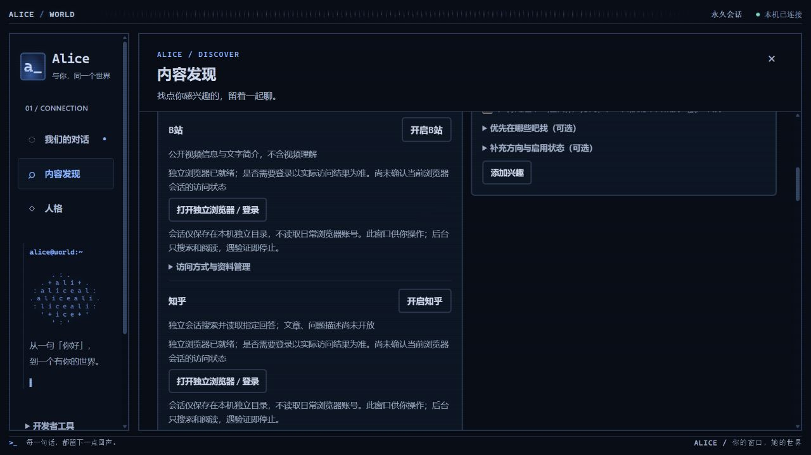

# B站与知乎：独立浏览器接入与人工验收

2026-10-31。用户要求继续攻坚两平台，并明确接受 `addons/` 独立本机浏览器组件，需要登录时自己操作，不复用现有浏览器账号。本轮基于 `trial/windows-v0.2-20261028 / 7a23227`，起始工作树干净。

## 当前结果

**B站“搜索 → 视频简介”、知乎“搜索 → 指定回答正文”均已取得真实内容。** 独立组件已安装，本机 Alice 已在 `127.0.0.1:8800` 启动新版；通过实际 GUI 保存并刷新确认，两平台访问方式均为“独立本机浏览器”。平台开关仍维持关闭，由用户决定何时纳入日常寻找；贴吧仍开启，原兴趣、回帖及优先吧设置保留。

本轮读取验证经真实联网 CLI 完成，模型调用均为 0。**尚未执行正常兴趣的“现在找一轮 → 整理存卡 → 聊聊这条”完整人工验收**，不会将分段诊断写成整卡流程已通过。界面的最近访问状态只来自当前服务的寻找任务，因此尚未运行时仍显示未确认；CLI 诊断不会伪造服务内活动账本。

## 真实结果与关键修正

| 真实操作 | 结果 | 结论与限制 |
| --- | --- | --- |
| 原 B站匿名链路，固定“科技” | device HTTP 成功/code 0；nav code -101；search code 0 但非空验证信号；3 GET、模型 0 | 原匿名搜索仍未通过，停止，不将 code 0 当作空结果或成功 |
| 初版浏览器搜索 B站 | 21 个获准资源后报告 browser_scope | 发现把被阻止的子框架错误归为主文档失败；已改成仅主框架改变影响主页面结果 |
| 修正后的 B站浏览器搜索 | 最终复核 21 个获准资源、1547079 字节、未知传输 0，返回 5 个真实 BV 链接和正确标题 | 初版标题误取缩略图覆盖文字，已改为卡片的 h3，并完成真实复核 |
| 浏览器直接加载首个 B站视频页面 | 53 个获准资源、5248222 字节后到时退出 | 不作为已打通；自动流程已改用既有固定公开简介接口，避免加载播放器 |
| 对搜索所得 BV1YVnH6iERd 调用现有 view 读取 | 1 GET、2379 响应字节、模型 0，取得真实标题及 235 字符资料，范围 video_description_only | 搜索所得候选至实际简介这一分段已确认；不能宣称看过视频或读过字幕 |
| 独立知乎新会话搜索“科技” | 1 个资源、1073 字节，verification_required | 匿名浏览器请求仍未通过；不猜测是账号、IP 或其他因素中的哪一项 |
| 知乎独立会话登录与关闭 | 用户亲自登录；首次仍占用目录，关闭整个独立窗口后释放 | 会话保存在专用目录，不读取日常账号、不导出 Cookie |
| 登录后直接打开知乎页面 | 搜索在无窗口及普通窗口模式均首请求拒绝（985 字节）；文章与回答页面同样拒绝 | 不是窗口尚未关闭；不反复要求登录，不据此推断账号或 IP 被封禁 |
| 知乎同源搜索，初次 API 数量设为 5 | 正常响应，但没有可读候选 | 小片段可能只含不支持的模块；改成至少请求一页，再按用户数量截取候选，并提供筛选计数 |
| 最终知乎搜索“科技”，候选上限 5 | 4 个获准资源、81177 字节、未知传输 0；收到 20 项，11 个回答符合范围，返回 5 项，9 项类型暂不支持 | 首页会话内调用 search_v3；19 位问题/回答编号用 Python 解析，避免 JS 精度丢失 |
| 对上述首个知乎回答读取正文 | 问题 2094691156475093762 / 回答 2098823635112817899；4 个获准资源、45411 字节、未知传输 0，342 字符资料 | 同源 answers/<id>；同时核对问题和回答编号，只采纳对应 content 字段的文字；范围 zhihu_answer_excerpt |
| 知乎文章接口读取 | 4 个获准资源后仍收到拒绝，未知传输 1 | 最终通道仅选回答；文章与问题描述不进入候选，避免中断已验证的回答流程 |

知乎最终采用 OpenCLI 所示的“首页会话 → 同源站内读取”方式，参考源文件见[组件参考](../addons/browser_reader/README.md#参考)。未安装或运行社区项目，未使用指纹伪造、隐身补丁、验证码求解或身份轮换。每次拒绝均结束该次诊断；改实现后另行人工核查，没有后台自动重试。登录由用户亲自完成；桌面工具此前因无法可靠识别网址而停止过知乎窗口的界面操作，后续未操作登录表单，最终本机 Alice 的 GUI 操作已正常完成。

## 使用逻辑

1. 本机已安装组件并启动新版 Alice，进入 **内容发现 → 偏好设置 → 去哪里找**。
2. B站和知乎的 **独立本机浏览器** 访问方式已保存。按意愿点 **开启B站** 或 **开启知乎**；原第三方搜索/匿名接口选项保留，换方式不会自动修改平台许可。
3. 知乎独立会话已经由用户登录。将来提示登录失效时，点 **打开独立浏览器 / 登录**，亲自处理后关闭整个独立窗口，再手动寻找。账号只保存在 `user/browser_sessions/<平台>/`，Cookie 不交给模型。
4. 界面区分组件安装就绪、当前访问取得内容、需要登录、验证、配置目录被占用、超时和没有可确认正文。安装完成本身不代表平台已验证可用。

当前 B站范围为搜索和真实视频简介；知乎为指定回答正文节选。均不读取评论、字幕、音视频、私信或付费内容，搜索暂不翻页。知乎文章与问题描述留待单独验证。原贴吧配置和实现保留。

请求和重定向逐次受宿主检查与额度预留；读取取消或超时回收整个浏览器任务进程树，人工登录窗口独立。自动页面禁止弹窗、表单、工作线程、框架、媒体和 WebSocket。新增可调的单资源预留量 browser_resource_bytes（初值 8 MiB），没有新增固定的业务请求数或时间上限；字节计量不是操作系统级限流，未知传输保留预留量。详见[组件说明](../addons/browser_reader/README.md)。核心仍标准库，只有 addon 的独立环境安装 Playwright，未引入前端依赖。

## 还需要的人工验收

| 项目 | 通过标准 | 本轮状态 |
| --- | --- | --- |
| B站搜索标题 | 实际卡片标题与候选一致，不混入播放量/稍后再看文案 | 真实读取已通过 |
| B站寻找整卡 | 浏览器搜索→公开简介→整理保存；范围明确，无播放器依赖 | 分段已验证，整卡待验 |
| 知乎登录后搜索 | 独立窗口亲自登录并关闭后，固定“科技”搜索得到规范链接 | 真实读取已通过 |
| 知乎回答正文 | 同时核对问题与回答编号，取得对应正文，不混入其他回答或登录页 | 真实读取已通过 |
| GUI 保存通道与刷新 | 访问方式持久保存，范围提示正确，不自动开启平台 | 已通过 |
| 知乎寻找整卡与聊天取用 | 正常兴趣搜索、整理存卡、用户发起讨论 | 待人工验收 |
| 日额度与取消 | 资源逐次计账，零额度不访问，前台抢占/取消回收完整进程树 | 静态复核，真实矩阵待验 |
| 关闭平台/修改设置 | 在途任务取消、旧结果不提交；不读取日常账号或改变贴吧偏好 | 静态复核，真实矩阵待验 |
| 登录过期/平台验证 | 明确报错并停止，用户处理后才手动再次寻找 | 拒绝与窗口占用已确认；过期后重新登录待验 |
| 知乎文章与问题描述 | 对应正文可稳定读取 | 暂未开放 |

参考项目与浏览器接口见[组件参考](../addons/browser_reader/README.md#参考)。仓库做 Python 静态编译、JS 语法和差异检查，不新增或执行机器自测。本轮修改了本机 user/browser_sessions；启动服务及保存通道更新了 user/data，未修改 user/config.toml。没有发送聊天或 QQ 消息，代码未提交、未推送。

实际 GUI 保存结果（截图只证明界面配置，读取证据见上表）：

