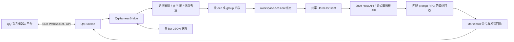

# QQ 接入：dsh-im 参考项目调研

> 查阅日期：2026-10-29（Asia/Shanghai）。本文件是只读源码调研附录，配套 [QQ接入-方案与审核.md](QQ接入-方案与审核.md)。仅方案，未开始开发；不代表已获准安装依赖、绑定账号或发送消息。

## 1. 证据范围与版本

- 仓库：[xmanrui/dsh-im](https://github.com/xmanrui/dsh-im)，默认分支 `main`。
- 固定审阅提交：[e278ac7da82384e6e21d907c606db6545fdc1d1e](https://github.com/xmanrui/dsh-im/commit/e278ac7da82384e6e21d907c606db6545fdc1d1e)，提交信息 `chore(release): v5.7.0`，提交时间 `2026-10-27T18:01:07Z`（北京时间 2026-10-28 02:01:07）；包版本 `5.7.0`。
- 用 GitHub 连接器读取了仓库元数据、完整递归目录树和下列源码。没有克隆进 Alice、安装依赖或执行参考项目任何脚本；没有登录 QQ、调用模型或发送探测消息。
- “源码事实”指该提交可直接看见的逻辑；“项目声称”指 README/项目说明中的描述，不能当本轮实测；“推断/待验证”明确另列。腾讯平台资格、发送窗口等当前政策以主方案的官方资料核验为准，不能由 dsh-im 常量反推保证。
- 腾讯 SDK 上游链接 `https://github.com/tencent-connect/qqbot` 本次通过 GitHub 连接器读取失败，随后网页读取返回 404；未据此断言 SDK 不可用。通过 npm 官方 registry 只读取得了 `qqbot-nodejs@1.0.4` 的发布元数据，见第 7 节。SDK 内部实现、平台账号实际可用性没有在本附录独立实测。

### 关键源码定位

以下链接均固定到本轮提交，行号为本轮读取所得；同一文件后文用文件短名和行号引用。

| 定位 | 所核实内容 |
|---|---|
| [README.md:96](https://github.com/xmanrui/dsh-im/blob/e278ac7da82384e6e21d907c606db6545fdc1d1e/README.md#L96)；115、131、139–149、196–206、282–316 | 产品能力表、默认访问范围、群记录、延迟交付、宿主连接与 QQ 命令 |
| [package.json:105](https://github.com/xmanrui/dsh-im/blob/e278ac7da82384e6e21d907c606db6545fdc1d1e/package.json#L105) | Node 引擎、直接运行依赖与构建依赖 |
| [LICENSE:1](https://github.com/xmanrui/dsh-im/blob/e278ac7da82384e6e21d907c606db6545fdc1d1e/LICENSE#L1)；[THIRD_PARTY_NOTICES.md:11](https://github.com/xmanrui/dsh-im/blob/e278ac7da82384e6e21d907c606db6545fdc1d1e/THIRD_PARTY_NOTICES.md#L11) | MIT 主许可证、QQ SDK 与扫码 connector 的不同许可声明 |
| [src/channels/qq/qr-auth.mjs:1](https://github.com/xmanrui/dsh-im/blob/e278ac7da82384e6e21d907c606db6545fdc1d1e/src/channels/qq/qr-auth.mjs#L1) | `startQrConnect` 委托 |
| [src/channels/qq/config-store.mjs:23](https://github.com/xmanrui/dsh-im/blob/e278ac7da82384e6e21d907c606db6545fdc1d1e/src/channels/qq/config-store.mjs#L23) | AppID 派生 botId/secretRef、配置校验、原子替换 |
| [src/channels/qq/qq-controller.mjs:90](https://github.com/xmanrui/dsh-im/blob/e278ac7da82384e6e21d907c606db6545fdc1d1e/src/channels/qq/qq-controller.mjs#L90)；193–230、391–454 | 启动、扫码、手工凭据绑定、凭据存储、关闭 |
| [src/channels/qq/qq-runtime.mjs:160](https://github.com/xmanrui/dsh-im/blob/e278ac7da82384e6e21d907c606db6545fdc1d1e/src/channels/qq/qq-runtime.mjs#L160)；204–332 | `QQBot` 官方 SDK 实例、WebSocket、事件、输入提示与停止 |
| [src/channels/qq/qq-bridge.mjs:146](https://github.com/xmanrui/dsh-im/blob/e278ac7da82384e6e21d907c606db6545fdc1d1e/src/channels/qq/qq-bridge.mjs#L146)；547–608、766–938、1190–1475 | 会话路由、访问判断、排队去重、恢复、最终回答投递 |
| [src/channels/qq/qq-mention.mjs:10](https://github.com/xmanrui/dsh-im/blob/e278ac7da82384e6e21d907c606db6545fdc1d1e/src/channels/qq/qq-mention.mjs#L10) | 平台 @ 标记与正文 @ 规范化 |
| [src/channels/qq/state-store.mjs:7](https://github.com/xmanrui/dsh-im/blob/e278ac7da82384e6e21d907c606db6545fdc1d1e/src/channels/qq/state-store.mjs#L7) | JSON 状态、1000 条去重、200 条待处理、损坏恢复 |
| [src/channels/qq/markdown-reply.mjs:10](https://github.com/xmanrui/dsh-im/blob/e278ac7da82384e6e21d907c606db6545fdc1d1e/src/channels/qq/markdown-reply.mjs#L10)；[src/channels/shared/markdown-chunks.mjs:1](https://github.com/xmanrui/dsh-im/blob/e278ac7da82384e6e21d907c606db6545fdc1d1e/src/channels/shared/markdown-chunks.mjs#L1) | 分片、被动回复预算、明确拒绝才降级、默认 4500 字符 |
| [plugin-src/host/channels/qq/production.mjs:38](https://github.com/xmanrui/dsh-im/blob/e278ac7da82384e6e21d907c606db6545fdc1d1e/plugin-src/host/channels/qq/production.mjs#L38)；[connection-supervisor.mjs:1](https://github.com/xmanrui/dsh-im/blob/e278ac7da82384e6e21d907c606db6545fdc1d1e/plugin-src/host/channels/qq/connection-supervisor.mjs#L1) | 宿主注入、数据目录、状态恢复、启动重试与关闭 |
| [plugin-src/host/channels/qq/rpc.mjs:38](https://github.com/xmanrui/dsh-im/blob/e278ac7da82384e6e21d907c606db6545fdc1d1e/plugin-src/host/channels/qq/rpc.mjs#L38)；259–264 | 管理响应脱敏、严格 payload 字段、管理 RPC authority |
| [plugin-src/host/channels/shared/access-policy-production.mjs:10](https://github.com/xmanrui/dsh-im/blob/e278ac7da82384e6e21d907c606db6545fdc1d1e/plugin-src/host/channels/shared/access-policy-production.mjs#L10)；61–66、105–145；[src/channels/shared/inbound-access.mjs:14](https://github.com/xmanrui/dsh-im/blob/e278ac7da82384e6e21d907c606db6545fdc1d1e/src/channels/shared/inbound-access.mjs#L14) | 新 bot 默认开放、兼容策略、主人特权与 fail closed |
| [src/channels/qq/harness-client.mjs:1](https://github.com/xmanrui/dsh-im/blob/e278ac7da82384e6e21d907c606db6545fdc1d1e/src/channels/qq/harness-client.mjs#L1)；[src/channels/shared/harness-client.mjs:978](https://github.com/xmanrui/dsh-im/blob/e278ac7da82384e6e21d907c606db6545fdc1d1e/src/channels/shared/harness-client.mjs#L978)；1807–1856、2030–2169 | 宿主 API/旧 HTTP、prompt RPC 身份、队列提交与最终回答匹配 |
| [src/channels/shared/workspace-session.mjs:93](https://github.com/xmanrui/dsh-im/blob/e278ac7da82384e6e21d907c606db6545fdc1d1e/src/channels/shared/workspace-session.mjs#L93)；[deferred-delivery-coordinator.mjs:22](https://github.com/xmanrui/dsh-im/blob/e278ac7da82384e6e21d907c606db6545fdc1d1e/src/channels/shared/deferred-delivery-coordinator.mjs#L22)；119–226 | 绑定锁、超时登记、恢复原回合、发送结果未知时停重试 |
| [docs/deferred-delivery.md](https://github.com/xmanrui/dsh-im/blob/e278ac7da82384e6e21d907c606db6545fdc1d1e/docs/deferred-delivery.md)；[docs/group-history.md](https://github.com/xmanrui/dsh-im/blob/e278ac7da82384e6e21d907c606db6545fdc1d1e/docs/group-history.md)；[ADR 0001](https://github.com/xmanrui/dsh-im/blob/e278ac7da82384e6e21d907c606db6545fdc1d1e/docs/adr/0001-semantic-core-native-channel-adapters.md) | 项目对恢复限制、群记录及语义层/原生渠道层分工的说明 |

## 2. 实际接入路线：官方机器人，不是个人 QQ 协议

**源码事实：**`qq-runtime.mjs` 直接从 `@tencent-connect/qqbot-nodejs` 引入 `QQBot`、`contentSanitizer` 和 `typingIndicator`，以 `appId/appSecret/accountId` 创建客户端，指定 `transport: 'websocket'`、`tokenPrefetch: 'sync'`。`qr-auth.mjs` 委托 `@tencent-connect/qqbot-connector` 的 `startQrConnect`。QQ 渠道代码没有 NapCat/OneBot 客户端，也没有个人 QQ 密码登录实现。手机 QQ 扫码在此是机器人授权/开通流程，不能解释为把用户个人 QQ 号当作聊天自动化账号登录。

| 事项 | 真实实现 | 对 Alice 的含义 |
|---|---|---|
| 手工接入 | `bindCredentials({appId, appSecret})` 保存凭据并尝试运行；新配置 `ownerUserOpenid` 默认为 `'*'` | 可复用“手工凭据”路线，不能复用开放身份默认值 |
| 扫码接入 | SDK 回调二维码 URL；本地记录 5 分钟有效期/刷新状态；成功取 `credentials[0].appId/appSecret/userOpenid` | 是独立可选 onboarding，不是收发消息必需依赖；资格是否满足须查腾讯后台 |
| 配置 | 每 bot 保存 AppID、派生 botId、secretRef、ownerUserOpenid、创建/连接时间 | 配置与密钥分离值得借鉴；OpenID 不能由昵称或普通 QQ 号推断 |
| 秘密 | `ctx.credentials.set/resolve/unset`；config JSON 仅保存引用 | Alice 没有 DSH credentials provider，不能直接照搬路径或假定自动具备 OS 密钥保护 |
| 网络 | 宿主向 QQ 建立 WebSocket，消息交给 SDK 归一化；发送走 SDK | 本机出站长连接路线，不要求照搬公网 webhook；实际网络可达性仍待账号联调 |
| 联系人 | 路由来自 SDK `senderId/groupOpenid/replyTarget`；已读 QQ 层未见好友列表/联系人搜索/加好友实现 | 不承诺个人号好友生态；首期白名单应用 OpenID 与人工绑定 |
| 群 | 仅处理 `c2c/group`，忽略机器人发言；群触发使用平台 `GROUP_AT_MESSAGE_CREATE`、`mentions.is_you` 或已知 bot ID 的 @ | 不以正文“我是主人”认身份；不承诺可收到所有群消息 |

**项目声称：**README:115 写 QQ 私聊显示输入状态、最终 Markdown，群被 @ 后仅发送最终答案。README:131 明确新 QQ 机器人默认允许所有用户在私聊、群聊聊天及执行命令。后者有 `newBotAccessPolicyFor` 的实际代码支持；它适合此项目的开放机器人选择，却与 Alice 私人长期记忆的默认语义冲突。

## 3. 组件、目录与完整消息路径

目录分工为 `src/channels/qq/`（渠道协议与桥）、`src/channels/shared/`（会话、权限、媒体、恢复等共用逻辑）、`plugin-src/host/channels/qq/`（DSH 宿主装配/管理 RPC）、`plugin-src/client/channels/qq/`（React 设置界面）、`lib/`（构建产物），另有测试、CLI 与发布脚本。并非一个可直接粘到 Alice 的 Python addon。

1. `production.mjs` 需要宿主的 connection、credentials、Typert Gateway；默认数据目录为 `DSH_HOME/integrations/dsh-qq`，不是 Alice 的 `user/`。配置在 `config.json`，每 bot 状态在 `bots/<botId>/state.json`，工作区映射另存 `workspaces.json`。
2. `QqRuntime` 注册 SDK `ready/resumed/error/message`，先规范化 @、解析 QQ 表情标签，再应用输入状态中间件，把 message 交给 Bridge。
3. 会话键是 `c2c:<senderId>` 或 `group:<groupOpenid>`；群键不包含发言者，所以同一群的成员共享一条 DSH 会话。每个 bot 有独立 state，支持各自工作区/模型/Session 绑定。这与 Alice 单一永久会话不是同一种模型。
4. Bridge 检查 `messageId`、`senderId`、kind、senderIsBot、已处理集合与正在处理集合；生产环境注入访问策略，普通消息和命令可分别授权。策略读取损坏/缺失时默认拒绝，另有显式主人 ID 特权。没有注入策略时保留兼容分支：群直接允许，私聊匹配 owner 或 `'*'`。
5. QQ 层每个会话键有 Promise 队列；同一会话排队，多会话可并行。共享 HarnessClient 又向宿主提交 `session.prompt`，`mode:'queue'`；这不是对 Alice 的并发保证。
6. `askInWorkspaceSession` 使用绑定锁；不存在会话则创建并记录。损坏会话仅在确认尚未提交时允许换建；工作区变化有 generation fence。Alice 不能跟随这个逻辑自动新建永久会话或覆盖记忆。
7. 默认宿主路径使用内部 API，只有显式 `harnessBaseUrl` 才走旧 HTTP/WebSocket。旧 RPC 为 `POST /api/<method>`、JSON `{type:'client-request',rpcId,method,payload}`，本段未设置 QQ 到 Alice 所需的机器令牌。它完全不是 Alice `/api/chat` SSE 协议，不能把 URL 换成 Alice 就用。
8. HarnessClient 用 prompt RPC ID、历史序号与 turn 身份定位自己的结果；接收进度/交互，同时按历史轮询（所读路径每 300 ms）追踪回合。最终 QQ 不逐 token 发送；`finalAnswerOnly:true` 避免把中间工具文字混入答案。

## 4. 收发能力与权限的真实边界

| 能力 | 源码事实或项目声称 | Alice 首期建议 |
|---|---|---|
| 文字 | 用户正文进入 Harness；最终答案通过 `sendMarkdownReply` | 支持纯文本，复用汇总结果而非推理/内部维护事件 |
| Markdown | `msg_type=2`，结构分片默认 4500 JS 字符；特定业务码 `40034090` 且 4xx 时才纯文本回退 | 首期可从纯文本开始；限长须按获批平台能力重新确认，4500 不是腾讯保证 |
| 流式 | QQ Bridge 将 `stream` 初始化为空而未建立流；源码注释称某些 C2C 客户端确认 stream final frame 却不显示 | 不把 SDK 支持流式等同于项目实际稳定使用流式 |
| 输入提示 | 使用 SDK `typingIndicator({keepAlive:true,predicate})`，过滤非授权/非定向消息 | 可选且不得额外模型调用；是否占平台消息额度须核验 |
| 群 @ | 识别平台事件/@元数据并移除 bot @；回复给原 replyTarget | 若以后开群，须另外加入群白名单和发言者白名单；不能只判断 @ |
| 引用 | 将平台实际交付的引用内容/附件类型/不可用原因正规化；不是任意历史查询 | 首期不展开引用或仅保留可信 ID，不根据正文拉历史 |
| 图片/文件 | 从 attachment 元数据构造延迟下载引用；图片限制域名后缀；文件准备交给共享文件入口；最终支持原生图片/文件发送与错误分类 | Alice 本期延期；不引入自动 URL 下载、文件工具或模型自选路径发送 |
| 语音/表情 | 表情由 SDK `contentSanitizer(parseFaceTags:true)` 解析；引用音频中可取平台 `asr_refer_text`；QQ 层未形成独立语音对话链路 | 不能声称首期语音可用；非文本明确拒绝/提示，普通 Unicode emoji 可作为文本 |
| 主动消息 | `sendProactiveText` 接受结构化 user/group route；超时结果可在窗口外改主动发送 | Alice 默认关闭；模型不能生成任意收件人，超时不得自动扩为主动广播 |
| 远程管理 | `/new /clear /workspace /session /models /model /permission /stop /steer` 等，含审批交互 | 不照搬；QQ 不获得人格重置、模型配置、付费核查与全局历史访问权限 |
| 群记录 | Bridge `accept` 在正式访问判断前先 `captureGroupHistory`；README 声称默认采集、14 天滚动保存 | 不照搬。未获准群消息不落 Alice 对话/长期记忆，也不为未来功能预采集 |

SDK 的 ready/resumed 与发送 API 成功只证明各自阶段。不能据此声称人已看到或读到消息；昵称与群头衔不应成为授权字段。项目的 UI/错误脱敏值得借鉴：RPC 严格限制 payload 字段，递归移除 appSecret、secretRef、ownerUserOpenid、verificationUrl 等；页面只拿脱敏状态及二维码图。但 Alice 不应继承其宽范围管理 RPC。

## 5. 去重、落盘、回复恢复：可借鉴但没有跨平台事务

**去重与提交：**Bridge 有内存 `acceptedMessageIds` 及 JSON `seenMessageIds`，后者最多保存 1000 个 ID。待处理文本在加入队列前写 `pendingMessages`，最多 200 条；字段包括 id、key、messageId、kind、text、submitted、senderId、createdAt、target。正式交给 Harness 前先持久化 markSeen，再置 `submitted:true`，避免错误通知发送失败后平台重投导致再次执行。

**恢复：**`submitted:false` 可恢复为原用户文字再排队；`submitted:true` 不自动重放，尝试提示用户检查后重发。JSON 语法损坏时先保存原始字节到 `.corrupt-时间-UUID`，再重建空状态并记录丢失绑定/去重/延迟交付的告警。状态更新写临时文件并 rename；程序申请目录 0700、文件 0600，但这不能当作已在 Windows 上验证的 ACL 保护。

**超时结果：**`workspace-session` 仅在 `harness-reply-timeout` 时登记延迟交付，保存会话路由、Session、Turn、原 prompt RPC ID、历史游标及目标。共享协调器启动/重连/turn end/定时触发原回合历史检查，重建最终文字，不再次提交问题。明确失败最多三次；结果未知则持久化 failed/unknown 并停止自动重试。绑定改变后不向新绑定投递旧结果。项目文档还注明每路由最多四条待交付、最多读取 20 页/30 秒，旧记录可能无法安全停止。

**必须保留的限制：**

- `markSeen → submitted → 远端 inbox` 不是一个事务；中途崩溃可能需要人工确认，也可能产生“未提交但已标记已消费”的空隙。不能把它描述成 exactly-once。
- `#recordPendingMessage` 写失败只 warn 后继续；超过 200 条删除最老记录。原附件、引用上下文并未完整保存在文本恢复条目，空文本媒体消息也不走该条目。它不是任意消息无损持久队列。
- JSON 重建会清空去重；1000 条上限之后旧投递可能再次入站。不能用该上限替代 Alice 的 request_id 持久去重契约。
- 恢复的未提交条目直接进入 `#enqueueMessage`，没有重新经过 `#accept` 的访问策略。Alice 恢复时应重新校验当前主人绑定、白名单与会话代际，避免授权撤销后仍执行旧队列。
- 延迟交付没有持久化 pre-send claim；平台接收成功、本地删除之前崩溃，重启可能重复补发。项目 `docs/deferred-delivery.md` 明确承认这一窗口。
- 正常最终发送错误并不都进入延迟恢复；登记入口针对前台等待超时。不能把 README 的延迟交付说成所有发送失败的通用 outbox。
- `sendMarkdownReply` 部分片成功后可能返回已发送部分与提示；不能把“返回了一组响应”当全部文本送达。被动回复预算在代码中为 c2c 4/group 5；超出后尝试主动目标，有被平台拒绝的可能。
- `deferredDeliveryTarget` 的 c2c 60 分钟/group 5 分钟与 30 秒余量是参考项目常量，须用当期官方规则和获批账号验收确认，不能无条件继承。

Alice 应采用明确的入站 request 状态与出站分片状态，区分 received/accepted/persisted/generated/send_started/platform_accepted/unknown；请求与最终轮次的关联须由核心公共接口提供。即使只接一个主人，也不能用“取最新一条历史回复”恢复结果，GUI 并发会串话。

## 6. 连接、关闭与异常

`QqRuntime.start` 先检查 Harness 可用，再建立 bot；等待 ready 默认 20 秒。SDK `ready` 和 `resumed` 都置 connected，错误记录诊断，`bot.start` 整体失败置 failed。心跳、token 刷新与 WebSocket session resume 的底层细节委托 SDK，本轮未审阅到其实现，不能承诺任意断线消息都补齐。

宿主 supervisor 按 `250ms / 1s / 3s / 5s / 10s / 30s` 阶梯重试未连接 bot；健康巡检默认 15 秒。启动默认 `autostart:false`，不会因该默认自动拉起 DSH；旧显式远程兼容 HarnessClient 另有可选 spawn 路径，不能移入 Alice 桥来绕过 GUI 主生命周期。

停止时 runtime abort、调用 bot.stop、最多等 runTask 2 秒，再 waitForIdle。宿主 close 先关闭 supervisor，再 controller，最后 stopManagedProcess。该实现可借鉴“停止重试—停止收件—等待任务”的分工，但 abort 在前，不能据此宣称满足 Alice 现有“在途聊天、维护、评估排空”的全部语义。

常见消息错误带安全提示与引用号；文件发送区分额度、权限、过大、空文件、限流和不确定结果。无法给 QQ 发错误提示时只能本地记录，不能把“用户一定收到失败说明”作为验收前提。

## 7. 依赖、许可及最小桥判断

| 证据 | 结论 |
|---|---|
| dsh-im `package.json` | Node `>=22.19`；QQ 直接固定依赖 `@tencent-connect/qqbot-nodejs:1.0.4`、`@tencent-connect/qqbot-connector:1.2.0`；整包还带其他渠道、邮件、Matrix 等运行依赖 |
| 构建/宿主 | Cordis、DSH Host、Typert Gateway；客户端 React/esbuild 等属于整套插件，不是小桥所必需 |
| README | Node 22.21 的提示针对 Telegram 环境代理，不是 QQ 特有门槛；没有本轮能确认的 Windows QQ 实机兼容报告 |
| [npm registry：qqbot-nodejs 1.0.4](https://registry.npmjs.org/@tencent-connect/qqbot-nodejs/1.0.4)（本轮只读获取） | 发布元数据 `engines.node: >=18`，直接依赖仅 `ws:^8.21.0`，`license:MIT`；SDK 完整运行语义仍需获批后核对锁定版本并人工联调 |
| dsh-im LICENSE | MIT，复用实质代码须保留版权/许可声明；“可参考思路”与“直接复制代码”需在施工时区分 |
| THIRD_PARTY_NOTICES:15 | 扫码 connector 1.2.0 的 npm 元数据声明 `UNLICENSED`，项目仅作为外部依赖，未复制源码；不能因为 dsh-im MIT 就推定 connector 同为 MIT |

**可行性推断：**可以单独写一个 Node 桥，仅引用 QQ SDK，使用 Node 内置 `fs/http/crypto` 与 Alice 的受限机器 API 通信；它不需要 React、Cordis、Typert 或其他渠道。SDK 的 `ws` 第三方依赖必须留在 addon 私有依赖树，不进入 `alice/`。手工 AppID/AppSecret 模式不 import `qr-auth.mjs`，因此可以不带扫码 connector；不要直接安装整个 dsh-im 来“顺带得到 QQ”。推荐工具链锁定一个满足 SDK 要求且与参考实现相近的 Node 22 版本，具体小版本获批时再固定。

这只是基于依赖与模块边界的设计判断，不是已验证原型。SDK 的 MIT 声明与 connector 的许可差异需在正式选择版本时重新确认；扫码 onboarding 延期不妨碍先审官方机器人手工凭据路线。

## 8. 取舍清单与待验证事项

**值得直接借鉴的设计：**协议层与业务桥分开；平台消息 ID 与发言者 ID独立于正文；明确的 replyTarget；消息消费去重与内存并发去重并存；先持久化再模型提交；只提取本轮最终答案；明确拒绝才格式降级；发送结果未知不自动重投；状态与凭据分离；连接失败可诊断；重连恢复原回合而不重新提问。

**不能照搬：**多 Session/多 workspace 默认语义；新机器人开放消息和命令；主人 ID 特权绕过普通策略；群共享会话；访问判断前群历史采集；模型切换/权限切换/清空等远程命令；文件任意来源回传；主动发送溢出；DSH 专属 API、credentials 与 `~/.dsh` 布局；源码中的平台额度常量；弱持久队列和有限 seen 集合所暗含的恢复保证。

获批后由人工确认的事实包括：目标账号能否创建并使用官方机器人、私聊/群事件权限、OpenID 绑定方式与跨场景差异、SDK WebSocket 在部署网络的实际连接/重连、平台发送窗口/条数/文本长度、未知发送的表现、Windows 休眠恢复、客户端显示 Markdown/typing 的差异。源码阅读无法替代这些真实环境验收，本轮未执行，不能写“通过”。

对 Alice 的推荐输入是“官方 QQ SDK 独立桥 + 单个明确绑定的主人私聊 + 手工凭据 + 核心显式机器接口”，群、多人、全媒体、远程管理与扫码自动开通均单独审核。主方案负责给出接口、迁移、人工验收与开工边界。

## 9. 官方资料独立核验（2026-10-29）

本节与前面的固定提交源码审阅分开记录。查阅日期为 **2026-10-29（Asia/Shanghai）**，来源限 QQ 平台官方文档、腾讯官方仓库和 NapCat 项目自身文档。网页描述是平台/项目公开承诺，不等于本机、目标账号或锁定 SDK 已验收。没有登录开放平台、注册应用、扫码、调用 QQ API、发送消息或运行参考代码；**目标账号当前的资格、C2C/群权限及服务范围仍未知**。

### 9.1 当前接入政策与网络方向

| 来源与页面日期 | 查得事实 | 对本方案的约束 |
|---|---|---|
| [QQ Bot 接入指南](https://bot.q.qq.com/wiki/)；更新 2026-10-21 | 页面明确提供 WebSocket/Webhook 切换；WS 无需公网服务器，适合个人单机；Webhook 接收 HTTPS 推送。个人认证可建 5 个 bot、暂不能公开服务、进群上限 500；内部体验支持 20 个号码。 | 官方 WS 独立桥是有当前依据的首选。仍须获批后人工确认目标账号的具体开放能力，不能把“可以注册”写成“已具备全部接口”。 |
| 同一接入指南的 IP 白名单说明 | 不设置白名单时允许所有来源调用；配置后只允许所列 IPv4，最多 50 个。 | 固定公网出口不是本文可确认的普遍硬门槛。启用白名单后，家用出口变化需人工更新；不要为便利直接开放 Alice 入站端口。 |
| [官方 botgo README](https://github.com/tencent-connect/botgo) | 仍能读到 2024 年 WebSocket 逐步下线/新 webhook 灰度的旧通知。 | **以更新至 2026-10 的平台官网指引作为当前设计依据**；旧 SDK README 不再适合据以断言 WS 不可新接入。这是证据新旧取舍，并非本轮证明所有账号均可连接。 |
| [启动接入](https://bot.q.qq.com/wiki/develop/api-v2/)；更新 2026-07-21 | 机器人身份可覆盖单聊、群、频道；票据为 AppID/AppSecret，旧 Token 已弃用。 | 官方 bot 不等于普通个人 QQ 号；不能承诺访问个人账号完整好友列表或所有聊天。 |
| [API 变更记录](https://bot.q.qq.com/wiki/develop/api-v2/changelog.html)；更新 2026-10-28 | 2026-08-10 起接口调用域名统一为 `api.bot.qq.com`。 | 新桥以当前官方域名/SDK配置为准；不把旧 `api.sgroup.qq.com` 硬编码为新默认。 |

### 9.2 鉴权、重连和 webhook 替代方案

[获取访问凭证](https://bot.q.qq.com/wiki/develop/api-v2/dev-prepare/access-token.html)（更新 2026-09-16）规定以 AppID/clientSecret 获取 access_token，HTTP 头为 `Authorization: QQBot <access_token>`。按返回的 `expires_in` 管理有效期，当前最长 7200 秒；临近失效可刷新。取 token 即使失败也可能 HTTP 200，必须检查业务 `code`。AppSecret 与 access_token 只留桥侧，禁止进入模型上下文或普通日志。

[WebSocket 方式](https://bot.q.qq.com/wiki/develop/api-v2/dev-prepare/event-emit/websocket.html)（更新 2026-07-30）描述获取 gateway、Hello、Identify、Ready、服务端指定周期心跳与 Resume；恢复使用 session_id 和事件序号 s，短时断线可能补发事件。**这不是任意长离线可补全的保证**；恢复游标应在业务持久接收后推进，SDK具体保存/推进方式仍须对锁定版本核对。权限错误、被封禁或无效 intent 应停止或进入需人工处理状态，不能无限紧密重连。

[通用事件结构](https://bot.q.qq.com/wiki/develop/api-v2/dev-prepare/event-emit/payload.html)（更新 2026-07-21）将 C2C 与群相关事件归于 `GROUP_AND_C2C_EVENT (1<<25)`。订阅同一 intent 不意味着准入所有事件：首期桥仅接受已绑定所有者的 `C2C_MESSAGE_CREATE`。外层 `id` 是事件 ID，`s` 是网关序号，不能把 s 当跨连接永久消息主键。

若选择 webhook 替代，[Webhook 方式](https://bot.q.qq.com/wiki/develop/api-v2/dev-prepare/event-emit/webhook.html)（更新 2026-09-11）要求公网 HTTPS，允许端口为 80/443/8080/8443，并处理 op13 地址验证。[安全和授权](https://bot.q.qq.com/wiki/develop/api-v2/dev-prepare/interface-framework/sign.html)要求逐请求使用 Ed25519 校验 `X-Signature-Timestamp + 原始 HTTP body` 与 `X-Signature-Ed25519`；不能只信 `X-Bot-Appid`。防重放、请求限长与时间窗属于桥的设计要求。公网 TLS/反代/签名实现需另行批准，Alice 核心仍只监听回环。

### 9.3 发送额度、ID 与确认的实际含义

| 核验问题 | 官方资料及冲突 | 建议处理 |
|---|---|---|
| 被动回复窗口 | [消息收发概述](https://bot.q.qq.com/wiki/develop/api-v2/server-inter/message/overview.html)写 C2C 60 分钟/4 次、群 5 分钟/5 次。[发送单聊消息](https://bot.q.qq.com/wiki/develop/api-v2/autogen/api/v2_users_user_openid_messages.post.html)更新于 2026-10-28，顶部也写 60 分钟，但同页 `msg_id` 字段仍写 5 分钟。 | **官方文档内部存在 5/60 分钟冲突**。首期按 5 分钟保守截止，获批后真实账号人工验证，再修改有版本的配置；不能仅按 dsh-im 60 分钟常量承诺能力。 |
| 主动消息 | 当前消息概述列出 C2C、群主动消息及频控，且用户可关闭接收。 | 旧“2025 年全部下线主动消息”的说法不能当现状依据；首期禁主动消息是 Alice 产品选择。超时不得自动改为主动发送。 |
| 消息长度 | 发送接口列超长错误，但本轮没有取得适用于所有文本场景的统一长度保证。 | dsh-im 的 4500 字符只是其实现参数。首期采用保守可配置分片值并做人工验收，明确处理条数耗尽；不能无限分片。 |
| 出站去重 | 同一被动回复 `msg_id + msg_seq` 重复发送会失败；成功返回 id/timestamp，部分接口还返回引用索引。 | 为每个分片持久化固定 seq；重试同一分片不可随意递增 seq。响应丢失标记结果未知，去重错误不直接等同“完整成功且用户已看到”。 |
| 可见引用 | `message_reference.message_id` 使用 REFIDX；来源为入站 `message_scene.ext.msg_idx` 或机器人发送响应 `ext_info.ref_idx`。 | 不要把用于被动回复鉴权的 `d.id` 直接当引用索引。无可靠索引时不展示平台引用，仅发正文。 |

[API 调用指南](https://bot.q.qq.com/wiki/develop/api-v2/dev-prepare/api-call-guide.html)（更新 2026-09-17）说明 OpenID 按 AppID 区分，并区分 `user_openid`、`member_openid`、`group_openid`。同一个人的 C2C 与群身份不能靠昵称或群头衔自动合并；QQ 号、昵称、正文自述也不是 owner 授权。接口返回的 trace_id 可作脱敏诊断索引，HTTP 成功码仍须结合业务错误判断。

[单聊消息事件](https://bot.q.qq.com/wiki/develop/api-v2/autogen/event/c2c_message_create.html)存在另一处歧义：介绍先说结合 msg_seq 去重，紧接着又说结合 `message_scene.ext.msg_idx`；正文 schema 未列入站 msg_seq。建议规范化时保留外层 event_id、`d.id`、msg_idx、AppID、场景和真实发言者。以 `AppID + 场景 + 发言者 + d.id` 为基本幂等标识，msg_idx 用作辅助一致性校验，并把真实事件差异列入人工验收。原始 ext 可能含 `auth_token`，不应全量写日志或进入长期记忆。

[流式发送单聊消息](https://bot.q.qq.com/wiki/develop/api-v2/autogen/api/v2_users_user_openid_stream_messages.post.html)提供 stream_msg_id、递增 index、append/replace 和结束状态。因此准确表述是“QQ 不直接消费 Alice SSE，首期聚合后发送完成文本”；**不能称 QQ 平台没有流式能力**。C2C 原生流式及输入中提示可列延期，需另验首片未知、部分片已发、额度和客户端表现；本轮没有验证 typing 是否占被动回复次数。

### 9.4 SDK 与扫码资料的访问范围差异

前文第 1、6、7 节记录的限制仍成立：参考源码审阅者访问的是 `https://github.com/tencent-connect/qqbot`，该路径返回 404，取得的是 `qqbot-nodejs@1.0.4` npm 发布元数据，未审 SDK 内部运行实现。

本次独立网页核验成功打开了**不同的有效路径**：[tencent-connect/qqbot-nodejs](https://github.com/tencent-connect/qqbot-nodejs)、[README.zh-CN.md](https://github.com/tencent-connect/qqbot-nodejs/blob/main/README.zh-CN.md)、[USAGE.md](https://github.com/tencent-connect/qqbot-nodejs/blob/main/USAGE.md)与[package.json](https://github.com/tencent-connect/qqbot-nodejs/blob/main/package.json)。因此不能把前述 404 泛化成“腾讯 SDK 源码仓库整体不可访问”。这些 main 页面是本轮查阅的滚动资料，**不替代 dsh-im 锁定版本证据，也不意味着 SDK 全量源码已经审完**。

| 版本证据 | Node / 依赖 / 许可证 | 使用边界 |
|---|---|---|
| dsh-im 固定使用的 `qqbot-nodejs@1.0.4`，前文取得的 npm 元数据 | Node >=18；`ws:^8.21.0`；MIT | 是参考项目的真实版本；不能混用 1.0.5 的声明推定其全部行为。 |
| 本轮读取腾讯 `qqbot-nodejs` main 的 package.json | **1.0.5；Node >=20；`ws:^8.21.0`；MIT** | README 承诺双传输、token 管理、心跳/Resume、C2C流式。获批施工时选择并固定一个审核版本，核对恢复/重试/日志实现；不要自动跟随 latest。 |
| 扫码 `qqbot-connector@1.2.0` | 前文 notices 及腾讯官方 [openclaw-qqbot 锁文件](https://github.com/tencent-connect/openclaw-qqbot/blob/main/package-lock.json)记录 `UNLICENSED` | 本轮 npm 页面读取 403、同名 GitHub仓库路径404，未取得其完整源码或独立授权条款。不能从 SDK/dsh-im 的 MIT 推导 connector 可复制。 |

腾讯官方 [dsh-qqbot README](https://github.com/tencent-connect/dsh-qqbot)明确介绍手机 QQ 扫码绑定、凭据自动保存后后续无需扫码。这支持“官方 bot 授权绑定”的解释，不是普通个人 QQ 客户端登录。该便利流程没有必要进入 Alice 首期；推荐先用开放平台取得的 AppID/AppSecret，由本地人工完成所有者绑定。若以后引入 connector，另审许可、凭据落盘、ownerUserOpenid 来源与扫码授权范围。

### 9.5 第三方路线仅作备选证据

[NapCat 项目说明](https://napneko.github.io/guide/napcat)介绍通过 QQ 客户端 Node 模块提供能力，再暴露 OneBot HTTP/WS，这与官方 Bot OpenAPI 是两种接入路线。[配置指南](https://napneko.github.io/config/basic)支持正反 WS、HTTP、token 和扫码登录，示例与 WebUI 默认含 `0.0.0.0`，不能照搬进 Alice。若用户另批此路线，应显式回环绑定、配置鉴权、关闭不必要面板，并维护 QQ 客户端与桥进程。

[NapCat 安全说明](https://napneko.github.io/other/security)自身讨论掉线、社交风控及常用账号可能受影响，足以作为维护和账号风险的依据；不据此估计封号概率，也不保证个人号好友/群能力持续可用。此路线还需裁决 Alice 现行蓝图的官方 bot 原则，**不作为官方资格未满足时的自动降级**。

本节结论是公开证据足以支持官方 WS 独立桥方案设计。未知项仍包括实际权限、所有者绑定、网络与休眠恢复、固定 SDK 的游标持久化、平台长度/窗口、重复发送对账及用户端显示；均须获批后人工验收。本轮仍为**仅方案，未开始开发，等待用户审核及另行开工授权**。

## 10. 开工后补充：扫码组件的使用说明（2026-10-29）

用户随后明确批准开工，并选择“像参考项目一样扫码，先核清组件使用条件”。前文是调研时的记录，本节补充新取得的证据。

本次直接读取[官方 npm 发布资料](https://registry.npmjs.org/@tencent-connect%2Fqqbot-connector)成功，取得完整 README 和 1.2.0 元数据。README明确说明第三方可通过npm安装并调用 `startQrConnect`，扫码后返回机器人AppID/AppSecret；默认展示接入方为“第三方机器人”，自定义平台名称或商务合作需联系腾讯。腾讯自己的 [openclaw-qqbot package.json](https://github.com/tencent-connect/openclaw-qqbot/blob/main/package.json)也将1.2.0声明为直接依赖。这比此前只取得UNLICENSED标记增加了明确的官方使用指引。

元数据仍为 `UNLICENSED`，没有因此变成MIT开源组件。本项目采取的接入方式是：仅按官方公开说明引用固定版本外部依赖；不复制其源码，不打包内联，不随Alice分发node_modules，不推定获得修改/再许可/转售授权；保留手工绑定办法。以上是工程采用依据，不作完整知识产权保证。若将来发布安装包或商业分发，需重新核对组件条件，而不能沿用SDK或Alice自身许可覆盖它。

源码实施与真实接入分开：本轮可实现并静态检查扫码入口，只有用户运行扫码命令后才访问官方授权服务、显示二维码并保存本机凭据；开发过程中不代扫、不登录、不创建账号或机器人、不向QQ发送消息。凭据不输出到日志，扫码完成不自动启动聊天或修改模型配置。README的示例会打印AppSecret，本项目不采用该打印方式。

新增依赖为 `qqbot-connector@1.2.0`（Node>=18，依赖qrcode-terminal）；与收发SDK分开，只用于首次接入。其QR结果中即便有用户标识，也仍需本机确认所有者；没有可靠标识时另走限时配对，不采用“首个发消息的人就是主人”。真实扫码资格、页面提示与返回字段仍待本人操作验收。
