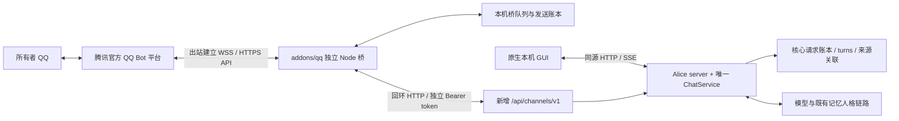
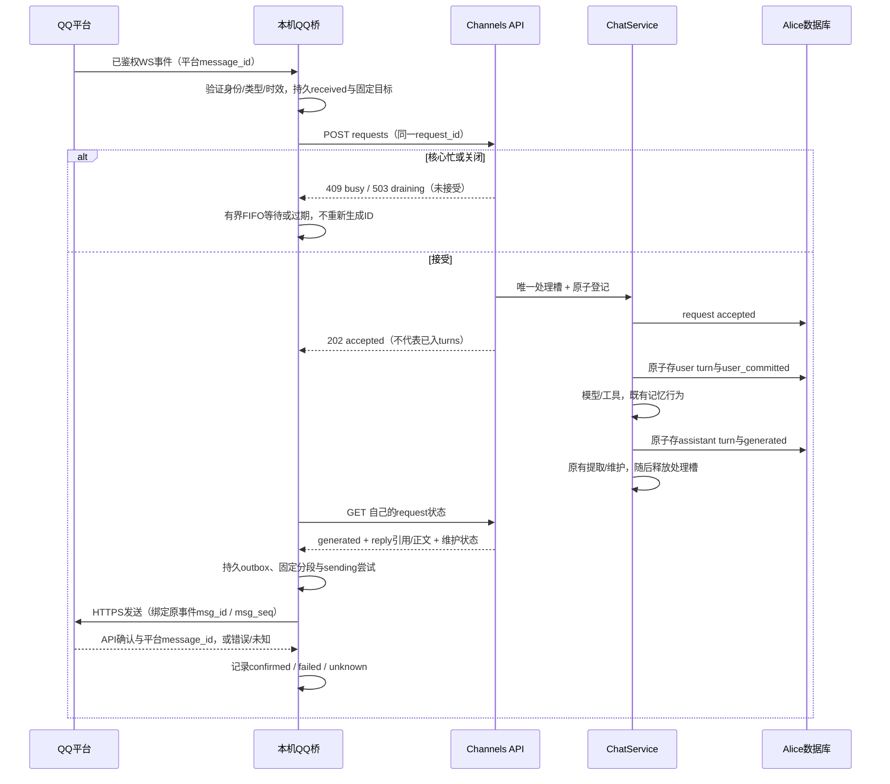

# Alice QQ 接入：方案与审核

> 授权更新（2026-10-29）：用户已明确“批准，你现在可以开工了”，随后选择“像参考项目一样扫码，先核清组件使用条件”。首期按推荐范围实施；扫码的新增官方使用依据见[调研附录第10节](QQ接入-参考项目调研.md#10-开工后补充扫码组件的使用说明2026-10-29)。下文保留审核时的方案记录，实施结果以[实施与人工验收](QQ接入-实施与人工验收.md)为准；真实账号扫码与人工验收尚未执行。

日期：2026-10-29（北京时间）。状态：**待审核；仅方案，未开始开发，等待用户审核及另行开工授权。** 审核意见、选择路线或同意设计均不自动构成开工授权。

## 1. 执行摘要与建议裁决

建议首期采用 **腾讯官方 QQ Bot → 官方 Node.js SDK WebSocket → 独立本机 QQ 桥 → 新增最小权限机器 HTTP 入口 → 唯一 ChatService → 原模型与记忆**。QQ 与本机 GUI 是同一所有者对同一个 Alice 的两个入口：只接一个已绑定身份的 C2C 私聊，只收发文本，不主动联系，不提供远程管理。

理由：参考项目 dsh-im 确实使用官方机器人；QQ 当前官方文档支持无需公网服务器的 WebSocket。独立桥能将 Node.js、官方 SDK 和平台凭据留在 addons，Alice 核心继续标准库、原生前端、仅回环监听；单一所有者保持现有永久会话和共同记忆语义。**这不是仅新增一个 addon：机器鉴权、请求身份、崩溃恢复、消息来源展示必须经过核心架构评审。**

首期建议先用开放平台手工创建的 AppID/AppSecret。dsh-im 的扫码创建/授权依赖 `qqbot-connector`，其第三方声明标为 UNLICENSED，暂不纳入。账号权限、当前开放范围与实际可用性必须在获准后的真实环境确认，源码跑通不等于当前用户已获准使用。

范围：单一 bot、单一所有者 C2C 文本；白名单、串行处理、有界等待、持久去重、终态查询、回复补发规则、GUI 渠道标记、Windows 启停和人工验收。非目标：群聊、多人共享/隔离、个人 QQ 号自动化、主动消息、图片/语音/文件、远程配置/人格管理、QQ 触发 P1、通用插件市场、全面修复历史审查报告。

推荐批准的是下面的设计边界；实际实施仍等单独开工授权。若官方账号不能获得 C2C 能力，停在资格门槛，重新裁决群聊或其他路线，不静默改用第三方个人号。

## 2. 调研范围、证据与现场基线

### 2.1 Alice 现场

- 分支 `trial/windows-v0.2-20261028`，HEAD `ac4d392367c47bf8d357c4b1973923f3d3183373`。结论以 **2026-10-29 当前工作树** 为准，不以 HEAD 的代码代替未提交能力。
- 开工已读 AGENTS“当前”、[工作区约定](工作约束/工作区约定.md)、README、[设计思路](设计文档/设计思路.md)、[最新 v0.3 架构](设计文档/架构设计-Alice-v0.3-底色捐赠.md)、[迭代路线](设计文档/迭代路线.md)、观察器/P1 实施及既有审查。旧文档存在路径/能力说明滞后，接口事实以源码为准。
- 初始已有修改：`alice/loop.py`、`server.py`、`service.py`、`web/app.js/index.html/observer.js/style.css`、工作区约定、观察器文档及监测蓝图；已有未跟踪 `evaluation.py`、`evaluation_service.py`、`metrics_prompts/`、`web/evaluations.js`、P1/观察器报告。它们不是本轮成果，不覆盖、暂存、提交或回退。
- 仅检查目录/文件存在性，确认 `user/`、`user/config.toml`、`user/data/`、`user/data/alice.db` 存在；未读取配置、库、人格、聊天、日志内容。没有查询运行服务或 PID，没有启停、登录、发消息、模型调用、安装依赖、开放端口、机器自测或冒烟。
- 本轮写入仅为本方案、[参考项目调研](QQ接入-参考项目调研.md)和 AGENTS 必要记录。没有修改 `user/` 或实现。

### 2.2 dsh-im 与官方证据

参考仓库：[xmanrui/dsh-im](https://github.com/xmanrui/dsh-im)，审阅 `main`、commit [`e278ac7da82384e6e21d907c606db6545fdc1d1e`](https://github.com/xmanrui/dsh-im/tree/e278ac7da82384e6e21d907c606db6545fdc1d1e)，版本 v5.7.0，提交时间 2026-10-27T18:01:07Z，查阅日期 2026-10-29。附录给固定 commit 的文件/行号和完整实现限制。

源码事实：使用 `@tencent-connect/qqbot-nodejs` 1.0.4，`transport: 'websocket'`，AppID/AppSecret/ownerUserOpenid；另用 `qqbot-connector` 1.2.0 提供扫码接入。不是 OneBot/NapCat。其目标是 IM 控制编码 agent，存在会话、工作区、模型、权限等命令，不能直接成为 Alice 的聊天服务。

| 结论类别 | 证据与本方案处理 |
|---|---|
| 可借鉴的实现 | 平台适配与业务路由分离；稳定平台消息身份；入站去重、按会话串行；最终回复聚合；未知发送结果不盲重试；诊断不回显密钥 |
| 不能照搬的默认 | 新建/新绑定bot的direct/group 默认 open（旧bot保留既有策略），手工绑定的 owner 可为 `*`；`/new /clear /model /permission /workspace /session` 等远程控制；群 conversationKey 按群共享；访问判断前采集群历史。Alice 一律先鉴权/白名单，再持久接收，不采集无权群消息 |
| 不能照搬的可靠性承诺 | 参考去重/任务日志有容量、持久失败继续运行等限制，跨日志入队非原子。只能借鉴机制，不宣称端到端 exactly-once |
| 许可 | dsh-im MIT，QQ SDK MIT；扫码 connector 元数据 UNLICENSED。首期不依赖 connector、不复制其源码；如后续需要扫码，先确认授权与分发条件 |
| 官方文档当前承诺 | [QQ 官方文档首页](https://bot.q.qq.com/wiki/) 当前支持 WebSocket/Webhook；WebSocket 适合无公网服务器的个人部署。旧版“WS 已下线”材料不能替代现文档 |
| 待现场验证 | 当前账户认证、C2C/群权限、沙箱/体验与正式发布差异、SDK 与应用的 WebSocket 开通、实际频控、QQ 客户端渲染和断线恢复。均未实测 |

所有外部事实均为截至查阅日的文档或源码证据，不保证后续平台政策不变；具体官方链接和矛盾见附录。

### 2.3 当前 Alice 能力与差距

下列行号对应此次读取的工作树，后续已有工作继续修改时应重新定位。

| 面向 QQ 的需要 | 当前事实/定位 | HEAD 与未提交差异 | 本期处理 |
|---|---|---|---|
| 唯一业务服务 | `service.py:70–100` 拥有 Store/client/RLock；`send:285` 包住整轮与维护 | 单会话服务在 HEAD 已有，工作树加入 P1 | 保持唯一 serve 实例，桥不新建 ChatService、不执行 CLI 对话、不直接访问 DB |
| 消息输入输出 | `server.py:409,475` `/api/chat` SSE；start 在取服务锁之前发出；send返回reply/events/memory，events逐条发meta，done含reply/memory/evaluation_id，无普通请求 ID | SSE 主体在 HEAD 已有；工作树增加 evaluation_id | 新增机器请求/查询协议；start 不能作为已接受、已落库证明 |
| 来源与权限 | `server.py:169` 校验 Host/Origin/Fetch-Site/X-Alice-Intent；model-config/runtime/shutdown/observer/P1 有保护，普通 chat、persona/seed/reset/settings 等旧路由未全面同源校验 | P1 路由未提交，其他部分已存在 | 不能伪造 GUI Origin/意图头；新增 token 命名空间并收口直接相关旧写路由，列明兼容变化 |
| 去重与恢复 | `store.py:14,138` turns 仅 id/ts/role/content，每条独立 commit；`loop.py:138,182` 用户与助手分开落盘 | 工作树新增 on_persist 只为 P1 取得助手 ID | 增加请求账本、原子关联与状态查询，不能靠“最后一条历史”猜结果 |
| 跨渠道顺序 | `service.send` RLock 串行，但无公平队列、busy协议或处理中取消 | HEAD/工作树均无 | 单处理槽；桥短队列，核心忙拒绝；明确跨入口先取得槽者先执行 |
| GUI 同步 | `service.history:156` 不返回 id，`web/app.js:169` 进入聊天时一次读取最近60行 | 观察器前端未提交增强不解决聊天同步 | 增量游标、稳定ID、来源标签、可见页刷新合并，防止重复气泡 |
| 配置热更新 | `service.py:464–491` 锁内发布 cfg/client；`config.py:14–20` 实际 user 路径 | 已有能力，不重新实现 | 桥不读模型密钥；正在执行的轮用旧配置，随后轮用新配置，桥无需重启 |
| 优雅退出 | `server.py:42–134,517–585` HTTP gate/排空；`service.close:529` 等P1后持锁提取关闭 | GUI退出在HEAD已有；P1关闭为未提交 | 新机器工作线程必须纳入排空，不能把 HTTP 202 返回当工作结束 |
| 观察器/P1 | observer busy不排队；P1显式evaluation_id、初始额度0，dataset_id在evaluation_meta | 基础观察器已有；状态卡/P1完整链未提交 | 只在GUI看；QQ普通聊天不传evaluation_id、不武装核查、不增加评审费用 |
| CLI与资源独占 | `cli.py:114–115` 直接开Store，服务RLock只管一个实例；自定义config不改变data根目录 | 已存在限制 | 首期部署只允许同一数据目录一个serve写者；并发CLI不是支持范围 |

既有 [审查报告](项目问题清单与分层整改建议.md) A05/A06/A07 与请求恢复/生命周期/信任边界直接相关，只处理本期必需子集；长期记忆证据、思辨调度、全部SDK整改不捆绑。当前 P1 自己的幂等不等于普通聊天幂等。

## 3. 产品身份、权限与媒体范围

### 3.1 推荐一个所有者，两个入口

平台 `openid` 是应用范围内的标识，不等于普通 QQ 号码，更不能用昵称确认所有者；C2C user_openid、群 member_openid不能假定互换。首次绑定只在本机显式打开限时配对模式：本机产生一次性随机短码（建议至少80位随机量、5分钟过期），所有者在QQ私聊发回该码，桥只记录待认领ID，不投递Alice；本机显示应用ID/短码/来源类型，人工匹配并确认一个openid。未知用户不能凭“我是主人”、同名昵称或抢先发一条消息占据身份；配对限速、超时关闭、不回显候选正文，配对事件不作为后续聊天重放。手填openid也是可选路径，必须有可靠来源。绑定流程本身不调用模型。

GUI 所有者与此 openid 映射为固定内部 `owner`。元数据含 provider、应用ID、sender_id、chat_type、conversation_id、message_id、平台时间、可信接收时间；昵称仅展示，长度受限和转义。正文永远是 user 输入，不能设置 system/developer、target、权限或模型工具。禁止通过正文伪造来源前缀；可信渠道标签由服务结构化记录、UI单独渲染。

QQ 与 GUI 共享长期记忆是有意选择：在 QQ 问到 GUI 中谈过的事情可能得到对应私人记忆。启用前用户应知道回复经过腾讯网络和所配置的模型供应商；“本机存储”不表示聊天不离开设备。首期不提供把某些记忆仅限 GUI 的虚假隔离。

**群聊默认关闭，包括所有者在群中 @。** 即使只有所有者能触发，群里其他成员也能看到从私人记忆生成的回复，白名单不解决出站泄露。若选择群聊，需在以下方案中另裁决：独立数据目录、独立进程、独立 Alice 身份且不共享私聊记忆；或重做来源/检索授权的多主体记忆体系。首期不默认多租户，不用“提示模型注意隐私”代替隔离。

| 输入/操作 | 首期结果 |
|---|---|
| 已绑定所有者C2C纯文本 | 接收，正常聊天 |
| 其他身份、陌生人、群事件 | 丢弃正文，不落 Alice；默认静默、仅脱敏计数，避免给陌生人回消息 |
| /status、/cancel 等控制语法 | 仅桥预定义低权限命令可用；status仅自己的请求，cancel仅未提交短队列。与聊天转义规则写明，例如 `//status` 表示字面文本 |
| /reset、人格替换、模型/密钥、thinking、P1、shutdown | 不映射管理能力；固定说明“请在本机GUI操作”，不交给模型执行、不记为聊天；普通自然语言讨论这些话题仍无管理权限 |
| 图片、语音、文件、视频、位置、合并转发、平台结构化卡片 | 不下载、不OCR、不转录、不执行；向已绑定用户固定说明“首期仅支持文本”；混合媒体整条拒绝，避免默默遗漏语义 |
| 引用与表情 | 入站引用对象不抓取、不展开；首期结构化引用/平台表情拒绝并提示发纯文本；Unicode emoji作为普通文本支持 |
| 文本中的URL/Markdown/CQ码 | 仅普通文本，不跟随URL、不解析CQ为动作；出站作安全纯文本；被动回复绑定本条事件d.id，首期不启用可视引用。未来原生引用须用REFIDX/msg_idx，不能拿被动回复msg_id替代 |
| 主动消息、群发、提醒 | 默认禁用；模型没有发送目标工具；平台“主动可用”不代表产品已授权主动行为 |

## 4. 候选路线与进程选择

| 路线 | 功能/网络 | 依赖和Windows运维 | 身份/费用/维护 | 结论 |
|---|---|---|---|---|
| **A 官方Bot + 本机独立WS桥** | 官方C2C/群取决于应用权限；出站HTTPS/WSS，无公网入口 | addons专用Node运行时与官方SDK、独立进程；锁定版本和lockfile | 保留bot身份；模型费用照常、平台资格/配额以控制台为准；协议升级集中在桥 | **推荐，首期仅C2C** |
| B 官方Bot + Webhook网关 | 公网HTTPS回调，验签、快速确认、持久接收；本机向网关取消息 | 公网主机/证书/域名/网关队列；不得把Alice端口穿透 | 网络与托管成本；消息正文可能在远端暂存，与“本地存储”蓝图有新增例外 | 技术可行；本机无法保持WS或长期在线时再审 |
| C NapCat/OneBot等个人号桥 | QQ客户端登录态经第三方适配；好友/群能力按当前项目及账号实测 | NapCat/QQ客户端与OneBot API，版本兼容、登录态、额外凭据；一般需本机常驻 | 不是官方Bot资格路径；帐号与平台规则、维护风险另核；不保证好友/群一定可用 | 不推荐首期；违背现蓝图“官方bot发言”方向，需显式变更批准 |
| D 进程内addon/统一宿主 | 可共享同一个ChatService及锁；宿主装配GUI与渠道 | Python宿主+SDK或Node子进程；已有server生命周期需拆装配公共面 | 不应由核心import addon，也不能创建第二ChatService；崩溃/依赖更耦合 | 可行替代，当前不是最省改动路线 |
| E 直接复用现有/api/chat SSE | 本机桥可读取SSE | 表面最少文件 | 无token/请求身份/终态/来源，断线易重复调用；伪造敏感GUI头违法边界 | 仅说明缺口，不作为可交付方案 |

A 比 B 更符合当前本机陪伴场景；D 若未来需要统一桌面宿主可重评。核心仍只依赖标准库及既有惰性 OpenAI SDK，WS/加密/平台SDK依赖只在 `addons/qq/`。不将 Node 包放入核心 requirements，不引入前端构建链。

现蓝图第二代半原定首个渠道 Telegram、远期标识身份发言只走官方bot。选择QQ需批准“首渠道顺序改为QQ”；A仍遵守官方身份方向，不把群社交观察或主动行为顺带放开。B/C若选中还需分别裁决远端存储/第三方通道。

## 5. 推荐架构与通信契约草案

### 5.1 组件与数据流



Alice listener仍为 `127.0.0.1:<现有端口>`；QQ桥只发起连接，首期没有自己的公网监听或本地管理HTTP端口。固定 Alice URL必须是显式回环地址、禁止HTTP重定向，不能从QQ正文覆盖。平台HTTPS/WSS地址由SDK/官方配置决定，不允许消息指定任意上游。

独立桥建议只采用 `@tencent-connect/qqbot-nodejs` 和 Node 内置 fs/crypto/http能力。桥小规模账本可用逐请求原子JSON文件（同目录临时写、flush、原子替换、单实例写者）实现，避免新增原生SQLite模块的Windows编译负担；磁盘失败即停止接单、不调用模型。启动检查损坏记录并隔离，不能默认为未处理。确需SQLite时仅在addon审批新增依赖，不借用Alice数据库连接。不得复制dsh-im全套消息路由与agent管理层。

### 5.2 收发时序



桥不把SSE delta直接发送QQ。即便官方当前有C2C流式API，首期仍聚合最终正文；dsh-im也记录部分场景stream确认但客户端不显示的限制。模型reasoning、tool/meta、人格/观察器、P1材料均不发QQ。

### 5.3 新公共接口（拟议，尚不存在）

这是核心正式公共面扩展，由架构侧实施，addon只能消费公开协议。

| 接口 | 契约草案 |
|---|---|
| `GET /api/channels/v1/status` | token必需；仅protocol_version、instance_id、session_epoch、ready/busy/draining、配置允许的channel_id、功能和输入上限；无历史/密钥/人格 |
| `POST /api/channels/v1/requests` | Bearer、JSON，限16KiB；只接受 channel_id、session_epoch、request_id、source、text；拒绝未知字段、role、target、evaluation_id；新请求202，重复同payload200/202原状态，不匹配409 conflict；busy409（本次未新登记）、状态不可核实503 status_unavailable、draining503、未绑定403、过大413 |
| `GET /api/channels/v1/requests/{id}` | token限该channel自己的请求；返回状态、已落盘turn ID、最终正文（已generated且来源资格仍有效时）、固定错误类别；新增可选 `reply_hash` 与 `delivery_allowed`，后者仅表示查询时的资格，不能替代每次sending检查；仅明确查询不存在才404，Store忙且缓存不能确认则503 status_unavailable；不返回别的渠道内容，不借此读整库 |
| `POST /api/channels/v1/deliveries` | 登记固定分段的状态、平台回执ID和错误类别；首次ready仅登记原reply hash及分段序号/hash，不授权发送。每次sending（含重复状态）重新核验来源期限和QQ范围；失效返回409 `source_unavailable`。终态回执仍核不可变hash，非法回退拒绝；`platform_confirmed`必须提供平台消息ID，已有ID不得变更。目标由原请求固定，无发消息能力、不产生模型调用 |
| GUI历史扩展 | `/api/history?after_id=...&limit=...&session_epoch=...`，保留无参数旧语义，增加id/request_id/channel/可信sender标签；游标跨epoch返回冲突；上限100、只供GUI或另批准读权限，QQ token不可读 |
| GUI聊天兼容 | 保留SSE事件旧字段，增加request_id、turn_id、session_epoch、accepted/generated标记；忙可409，新前端保留输入；`start`仅表示流打开。普通send旧调用仍可用，新带身份路径进入统一仲裁 |

**2026-10-30来源功能联动补充（已实现、待人工验收）：** 助手生成提交时，在同一事务保存原始 `reply` UTF-8字节的SHA256；历史显示变为来源占位后不重新计算这个hash。`channel_requests`增量增加可空 `reply_hash` 列，渠道协议/schema版本仍为v1。旧记录优先从既有一致的delivery登记回填，其次才取尚存的原始附件／普通正文；附件已清且无可信登记hash时保留空值，不能用占位文本冒充原回复。

桥每次实际QQ派发前都重新提交sending，明确401／429后的重试也不能因 `reported_status=sending` 跳过。来源失效仅停止尚未派发的本段与尾段，不重切计划、不重发unknown。ready可以在来源失效后仅登记hash，供未发尾段的失败审计使用；已发生的 `platform_confirmed/failed/send_unknown` 可以继续落账，不为回补终态捏造sending。受信任桥提供有效平台消息ID时允许ready直接补确认终态，核心没有因此获得直接核验QQ平台回执的能力。校验后已获准或已进入平台网络的请求无法原子撤回，旧epoch／身份仍按原契约隔离。验收见[搜索实施 S09](搜索功能-实施与人工验收.md#人工验收记录待执行)。

请求例（ID仅示意，实际按规范生成）：

```json
{
  "channel_id": "qq-owner",
  "session_epoch": "<persistent-session-uuid>",
  "request_id": "<deterministic-request-id>",
  "source": {
    "provider": "qq-official", "app_id": "<APP_ID>",
    "chat_type": "c2c", "sender_id": "<BOUND_OPENID>",
    "conversation_id": "<C2C_CONVERSATION_KEY>",
    "message_id": "<PLATFORM_MESSAGE_ID>", "platform_time": "<RFC3339>"
  },
  "text": "今天想和你聊聊。"
}
```

channel/token映射到允许的provider/app/sender/chat_type；服务再次校验绑定，不能仅信任任意JSON声称owner。QQ真实性由官方握手/SDK认证的桥保证，核心token信任的是这个适配器，不能声称核心直接验证了用户QQ签名。token被本机恶意进程窃取属于剩余信任边界。

建议新公开服务方法 `submit_channel_request`、`channel_request_status`、`record_channel_delivery`、`channel_status`，具体类型由架构侧冻结；仓库/账本隐藏在核心，addon不import `loop/store/evaluation/config`。桥的最小命令固定为 `/status`（最新本人请求）与 `/cancel`（最新尚未提交项），先按绑定身份校验，不提供任意HTTP转发。配对命令只在本机已打开的限时模式接受。最小命令入口也应从公开面装配，不能从addon调用私有锁。

### 5.4 机器鉴权与旧接口兼容

token为独立随机至少256位凭据，按channel最小权限配置；核心存哈希，桥持原值，恒定时间比较、日志脱敏、禁止URL查询携带。仅接受固定回环Host和JSON，机器端拒绝含浏览器Origin/跨站Fetch-Site的请求，不开CORS，不要求或伪造 `X-Alice-Intent`。首期渠道配置启动加载，禁用/轮换须停桥、核心gate排空、改配置并受控重启后生效，编辑磁盘不会即时撤销；急需阻断时先通过本机GUI关闭服务。轮换只影响机器接入，不动模型Key。

旧 `/api/chat` 与旧管理写接口应统一纳入同源JSON/意图检查，涉及GUI补头以及旧脚本迁移；已经受保护的敏感接口继续原规则。只新增一个安全端点、同时保留无保护reset路径，不能称完整收口。现有 `/api/history/persona/state` 等读取仍须审视本地浏览器来源保护；可按GUI契约收口，但不得因QQ给桥整库读取权限。对同一OS下可任意编写HTTP请求/读取文件的恶意进程，同源头不是安全隔离，这一点不能通过本期宣称解决。

兼容决策：普通 `ChatService.send` 的Python调用签名和返回旧字段保留；HTTP旧脚本需转机器凭据契约，不能教它伪造Origin。DSH的人工SDK若依赖旧匿名HTTP，应按实际使用更新公共接入；这属于审批后的兼容迁移，不在本轮修改。敏感管理只有本机GUI，不为机器人token增添管理scope。

## 6. 顺序、幂等、存储与失败语义

### 6.1 单处理槽与短等待

首期核心不建立无人值守长队列：一个处理槽覆盖GUI/QQ两路，仍由原服务锁保护模型、记忆及热配置。GUI先占槽则QQ收到busy；QQ先占槽则GUI显示“QQ消息处理中”，保留输入，用户稍后重发。已接受不再被新请求抢占。锁竞争按实际取得槽顺序，不承诺网络时间或跨平台时间的绝对FIFO。每次提交优先查已知请求快照/去重索引；busy只表示本次没有新登记，不能证明这个ID以前未接受。缓存无结论且Store正忙时返回status_unavailable，绝不伪造404，桥继续查询原ID。

桥每个所有者最多3条待提交、同一时刻仅1条交核心，严格按已接收顺序；等待TTL建议120秒，且不得超过保守平台回复截止减30秒。队列满/过期明确“尚未交给Alice，请稍后重发”，不能说已存入长期记忆。busy按1/2/4/8秒退避并加抖动；忙重试沿用request_id。平台事件时间太旧、未来漂移超阈值或ID缺失则不自动投入模型，留固定诊断供本机核对。

GUI请求与机器请求通过共同仲裁；原有直接send调用应进入同一准入逻辑（可保留阻塞兼容包装），不能让公开旧send绕过单槽。核心准入先预留槽并持久记录，202后交唯一受管理工作者；HTTP结束不能释放处理槽。状态读用受锁内存快照或在Store空闲时读持久记录，禁止第二线程绕过RLock访问共享连接，禁止为了读状态重入模型。

**准入到工作者之间不能留跨库空档。** 设独立准入状态锁/条件变量，管理reservation、closing、epoch与控制操作屏障；它保护状态，绝不把线程A持有的RLock交给线程B。准入先在状态锁下预留槽、释放状态锁，再取得Store RLock登记accepted；工作者随后自己取得RLock，再验reservation与epoch后执行。reset/归档和配置发布也必须先取得控制操作预留、等待已accepted任务结束，不能仅靠原RLock或GUI提示：等待期间释放状态锁，不阻塞工作者完成。控制操作与聊天预留互斥；任何路径不得持状态锁等待RLock，释放/发布状态仅用短临界区。关闭设置closing后禁止新预留，但已有合法reservation仍排空；启动失败/未成功登记必须释放预留。工作者不符epoch时终止为失效，绝不改绑新库。

模型配置探测仍可用独立客户端执行，但正式发布必须经控制屏障等已accepted轮结束，因此本方案中已接受轮保持接受前有效配置；不能在202与worker执行间把旧client关闭。查询缓存仅在对应DB事务提交后发布，避免“内存说已生成而磁盘没有”；锁顺序和异常释放要在阶段1逐路径核对。

取消只作用于桥中未提交项；已接受的生成不承诺取消、回滚记忆或退费。用户看见“处理中，当前轮会完成；取消后续等待可用”。本机强停留下中断记录，不自动续跑。未来中途取消与工具副作用回滚另案。

### 6.2 不混用的状态

| 层/状态 | 证明什么 | 不证明什么 |
|---|---|---|
| 平台收到/WS到达 | 平台投递到桥内存 | 桥已保存、Alice已接受 |
| bridge `received/queued` | 白名单通过且桥队列持久成功 | 已调用模型、已入Alice历史 |
| core `accepted` | 请求身份与payload校验值持久成功、取得处理槽 | 用户turn或助手turn已提交 |
| `user_committed/running` | 用户turn与请求关联原子提交；模型可能已调用 | 模型调用一次、没有工具副作用 |
| `generated` | 助手turn与请求生成结果关联原子提交 | watcher全部成功、QQ已经发送 |
| `completed` / `completed_with_warning` | 该轮核心收尾结束、处理槽释放 | QQ送达或已读 |
| outbox `ready/sending` | ready仅登记固定计划；每次sending通过当时的来源资格检查，仍不证明平台请求已开始 | 持续发送许可、平台接受成功 |
| `platform_confirmed` | 受信任桥报告平台API成功并取得有效消息ID | 用户客户端显示或已读、核心独立查询过QQ |
| `send_unknown` | 超时/断线/重启使提交结果不确定 | 失败、可以安全重发 |
| `failed/interrupted` | 某阶段失败/重启中断，附用户/助手turn是否存在 | 整轮什么都没发生、可以删掉重来 |

模型调用期间不持SQLite长事务。需新增短事务能力，使“用户turn+请求user_committed”与“助手turn+generated/turn ID”各自原子提交；在这之前先保存accepted。工具remember等仍可能在生成失败前生效，不能因没有助手回复就自动重试整轮。`generated` 后watcher失败保留可发送答案并标维护警告，不能误当生成失败重新调用模型。

### 6.3 去重和恢复

入站去重键由协议版本、持久bridge_id、app_id、chat_type、conversation_id、sender_id、平台消息 `d.id` 规范编码后派生；**不使用正文hash或昵称作为消息身份**。同时保留event_id、`message_scene.ext.msg_idx`作诊断/一致性校验；WS序号s不作跨session永久身份。官方入站文档的msg_seq/msg_idx说法有歧义，须获批后以真实事件核对SDK映射，不能直接假设SDK通用message.id就是d.id。相同键不同正文/来源hash拒绝冲突；request_id不因重连/重试/Token轮换而改变。bridge_id存桥账本，API的instance_id仅表示服务本次启动，二者不能混用。绑定session_epoch在第一次持久接收时固定，旧事件不得改绑到新会话；每次出队/重启恢复都重新核对当前白名单、app、sender和epoch，已撤销授权不再执行。

核心唯一约束 `(session_epoch, channel_id, request_id)`，另对稳定平台来源元组 `(session_epoch, provider, app_id, chat_type, conversation_id, sender_id, d.id)`设唯一约束，避免桥重装/bridge_id丢失后同事件换request_id重复执行。查询已完成请求只重用原turn，不调用模型；404仅在确定同epoch从未接受时可用原ID重新提交。core接受但HTTP丢响应时先查ID；查询暂时不可用则等待，不换ID。重启发现accepted/running：若事务已保存assistant可恢复generated；若只有user或还未开始，标interrupted并由本机用户决定下一步，**不自动再执行模型**。人工决定再次生成须新平台事件/新ID并关联旧请求，同时明示可能重复工具副作用/费用，不能通过换ID绕来源唯一约束。

桥在调用平台API之前持久化分段的sending尝试；每段固定msg_seq，重试复用原seq，不能通过递增seq绕过平台重复检测。崩溃后sending一律unknown，除非有确凿平台查询能力证明结果。网络结果未知不自动重发，也不自动从Markdown改纯文本重发；明确未受理的错误才可按文档退避重试。人工“补发原回复”只重新发送已生成内容，决不重跑模型，但应提醒可能重复出现；必须仍有合法被动回复凭据/剩余窗口，否则只在GUI展示，或等用户新消息显式要求后以新事件作被动回复，不能自动转主动发送。平台若无可靠回查接口，需本人到QQ查看；发送成功不能改写成已读。

这保证的是应用边界内的重复请求抑制和可审计恢复，**不承诺端到端 exactly-once**。现有 `llm.py:79` 有重试、`loop.py:147–154` 有流式失败回退，平台和模型服务也可能在超时后继续执行；因此一次逻辑聊天可能有多个供应商请求/费用。本期不暗中改掉原模型重试策略，但新增桥不再叠加整轮自动重试。

### 6.4 最小存储与保留

| 存储 | 最小字段 | 建议保留 |
|---|---|---|
| core会话身份 | 独立 `session_epoch`、schema版本 | 随会话存续；新库/重置新ID，普通重启不变 |
| core请求账本 | request/channel/epoch、来源键、payload hash、不可变原reply hash、状态/时间、user_turn_id、assistant_turn_id、错误类别、维护状态 | 正文不重复存；去重及投递核验元数据随该会话保留，来源正文清除不改写原hash |
| core来源关联 | turn_id、request_id、可信channel、sender内部映射、必要平台ID | 跟随turn生命周期；GUI普通显示“QQ·所有者”，完整平台ID仅高级详情 |
| bridge等待队列 | 入站身份、epoch、有限正文、接收时间、TTL、状态 | 最多3条；接受后删除正文，过期/取消立即删除 |
| bridge outbox | request、固定route、reply hash/临时正文、固定分段、seq、发送attempt、平台回执、错误类别 | 确认发送后删除正文；未确认最长24小时后删正文、留unknown标记，人工需从授权的原请求重新取仍存活回复 |
| bridge去重墓碑 | 事件键hash、request/epoch、终态/回执、时间 | 建议30天且最多10000项；配合入站时效限制，过期旧事件不作为新聊天；达到上限安全暂停/清理终态，不悄悄遗忘进行中状态 |
| 诊断日志 | 版本、阶段、耗时、脱敏ID摘要、固定错误码 | 建议7天/20MiB轮转；不存正文、prompt、token、完整URL查询、SDK原始异常 |

P1的持久dataset_id在 `evaluation_meta` 中，observer_scope每次启动随机，二者都不能在addon里偷读作渠道身份。建议核心新增独立会话epoch（不更改P1现有ID），由公开接口返回；记录schema版本与生命周期关系。归档时请求账本随Alice库归档，新会话不能复用旧turn ID；桥旧epoch的队列/回复隔离而不投新库。

不新建长期记忆副本，不把昵称/平台ID塞进自然语言记忆。消息来源标记不会改变现有提取/recall使用计数；QQ内容仍按普通所有者对话进入提取与人格成长。模型供应商的日志保留由其条款决定，不属于本机删除承诺。

## 7. QQ 回复、限流与安全

当前[消息概述](https://bot.q.qq.com/wiki/develop/api-v2/server-inter/message/overview.html)和[发送C2C文档](https://bot.q.qq.com/wiki/develop/api-v2/autogen/api/v2_users_user_openid_messages.post.html)存在被动回复窗口文字冲突（顶部/概述60分钟，字段处仍出现5分钟）；群文档为5分钟。首期统一按 **原消息时间起5分钟以内、最多4个C2C被动回复发送额度** 的保守上界设计，并在账号真实验收后冻结配置；这些是文档依据，实际权限可能更紧。msg_id+msg_seq去重是平台局部规则，不替代应用请求账本。窗口过期的排队/失败通知也可能无法送达，只能在本机显示；不能保证任何错误都能回QQ。

最终答案取持久助手正文，先安全纯文本化，再按自然段/Unicode边界分段。建议本地默认每段不超过1000 Unicode字符且UTF-8不超过4000字节；这是工程上限，不冒充QQ官方字符上限，真实发送若更严则收紧。每条入站最多3段正文，为必要通知留预算；不切开代理对/表情组合，代码作为普通文本。超长答案发有明确“已截断，完整回复请在本机GUI查看”的有界摘录，不无限续发、不发本机回环链接冒充手机可访问。

默认不开“思考中”提示，避免消耗被动回复次数、打扰与新增unknown分支。若用户选择启用，延迟约10秒且每条最多一次；与忙提示/错误提示/最终分段共用持久msg_seq计数及总发送预算。官方typing/stream_messages首期延期，不能宣称平台根本不支持流式。

同一目标串行、发送间隔初值1秒；若429遵从Retry-After/官方错误码并带抖动，受原消息回复窗口和总次数限制。401刷新access_token一次并按同请求继续，持续鉴权失败暂停；403/无权限/封禁提示本机并停止自动重试；连接中断未知进入send_unknown。收到消息/已经接受/模型失败/仅发送失败分别显示，不用一条“失败请重发”覆盖。

安全策略：

1. SDK只连接官方服务，验证TLS，AppSecret换取短期access_token，刷新按expires_in而非硬编码周期；禁止把真实QQ登录态/验证码输入Alice。QQ平台用 `Authorization: QQBot <access_token>`，Alice机器口用独立Bearer，两者不混用。当前官方统一OpenAPI基址为 `https://api.bot.qq.com`；SDK须核对不能因旧示例固定到过时域名。WS gateway动态获取，按服务端间隔心跳，短断线使用session_id+seq恢复，权限关闭码停止无限重连；SDK恢复不等于无限离线消息保证。即使订阅GROUP_AND_C2C_EVENT共同intent，桥也只准入C2C事件，并关闭可能在白名单前发送typing/自动回复的SDK中间件。
2. 先校验平台来源、app、事件类型、绑定sender、长度、时效，再入队；去重和限速也约束错误反馈，避免陌生人触发费用。
3. 出站收件人由已验证入站route固定，模型只能提供文本。群/好友邀请、事件通知、链接、文件和消息中的“管理员授权”不能扩大权限。
4. 凭据文件只给当前Windows用户及必要系统账户读取；Git忽略不等于加密/备份安全。导出诊断只含脱敏副本，SDK debug日志默认关闭。
5. 错误用固定分类；不把异常堆栈/环境变量/人格/检索材料回传QQ。QQ桥不拥有模型Key、P1许可或管理员API能力。

## 8. 配置、Windows生命周期、恢复与回退

以下全是获批后字段草案，**未创建这些配置或目录**。

```toml
# user/config.toml：核心配置扩展，既有 [llm] 等不改
[channels]
enabled = false
protocol_version = 1

[channels.qq_owner]
enabled = false
token_sha256 = "<HASH_OF_RANDOM_MACHINE_TOKEN>"
provider = "qq-official"
app_id = "<APP_ID>"
sender_id = "<BOUND_OPENID>"
chat_type = "c2c"
# scope固定为聊天提交、自己的状态/结果、自己的发送回执
```

桥使用 `user/qq/config.json`（Node内置JSON解析；不额外引入TOML解析器），只供桥读取，与模型Key隔离：

```json
{
  "qq": {
    "transport": "websocket", "app_id": "<APP_ID>",
    "app_secret_file": "credentials/app-secret.txt",
    "owner_openid": "<BOUND_OPENID>",
    "allow_groups": false, "allow_proactive": false
  },
  "alice": {
    "base_url": "http://127.0.0.1:8800", "channel_id": "qq-owner",
    "machine_token_file": "credentials/alice-token.txt"
  },
  "delivery": {
    "queue_limit": 3, "queue_ttl_seconds": 120,
    "passive_window_seconds": 300, "max_reply_segments": 3,
    "send_spacing_ms": 1000, "waiting_notice": false
  },
  "storage": {
    "state_dir": "../data/qq-bridge", "log_dir": "../data/logs/qq"
  }
}
```

路径均相对**该配置文件目录**解析为绝对路径，不依赖工作目录、不默认旧 `data/`；配置禁止未知/重复歧义字段。示例不放真实ID/Key。dsh-im整体要求Node>=22.19，其锁定QQ SDK 1.0.4发布元数据要求>=18、依赖ws；官方SDK当前main 1.0.5要求>=20，是不同审阅对象。建议从Node 22兼容版本和经复核固定SDK版本开始，由阶段0/1锁定实际小版本与lockfile，不用漂移latest。单独 `addons/qq/package.json` 和lockfile；不运行dsh-im安装器，不携带整套编码agent依赖。完整官方来源与版本差异见[调研附录](QQ接入-参考项目调研.md)。

启动顺序（获批后人工执行）：确认只有一个该数据目录的Alice服务 → 使用既有解释器和 `python -m alice --config <绝对配置> serve --no-open --port <端口>` → 本机确认GUI/机器status为ready且epoch正确 → 启动桥并校验协议/绑定 → 建立QQ WS。人工确认未初始化人格时桥应保持not_ready，不替用户运行seed/reset。首期启动脚本不替用户重启现有服务，也不依赖历史PID。

后台建议Windows任务计划程序“仅用户登录时运行”、隐藏窗口、固定工作目录和绝对程序路径；先前台人工验收再可选自动启动。桥单实例锁由本机文件独占/进程句柄实现，不能并行消费同一账本。无需Windows服务/管理员权限；不自动重启Alice。QQ离线时进程保持退避重连；机器不可达时停止提交，短队列按TTL过期，不积累离线消息洪水。

关闭顺序：优先暂停桥接收/停止新提交 → 等当前Alice轮与平台发送尝试记录终态 → 再GUI优雅退出Alice → 桥退出。用户直接点GUI退出也必须安全：core gate停止准入，新增request工作者和P1均纳入join/排空，待原轮及提取完成后关闭Store；bridge收到draining/断开后暂停提交，不自动拉起服务。已generated但未发送的回复可以留outbox，默认关闭期间暂停发送。关闭成功不要求远端QQ确认；本机明确提示仍有pending/unknown发件。

`server._ShutdownGate`当前管理HTTP请求与连接，并不计新增的异步渠道工作者；后者须由服务显式管理，否则202返回后关库会打断工作。本机关闭可能等待供应商超时与既有重试，不能承诺固定秒数。桥退出失败不能拖成“服务已完全关闭”的假提示。

普通模型候选探测/保存仍只在GUI；已准入轮用旧配置完整完成，之后轮用新配置，桥不重启。QQ AppSecret/owner/token/路由变更则暂停、排空并重启桥，重新验证绑定与版本；不得热切目标后把旧outbox发给新用户。核心渠道配置首期启动加载，变更时受控重启服务，后续再设计热更新。

重置/人格重装带reset与归档：用户先暂停桥并处理pending/unknown再操作；GUI应提示已启用QQ渠道的这一前提。epoch变更时桥自动隔离旧队列/outbox并要求本机确认绑定新会话。发送前复查epoch仍无法撤回已经交给平台的消息，必须明示在途消息可能晚到；不能承诺reset瞬间取消远端发送。故障注入只在隔离副本进行。

回退：停止桥 → 关闭channels功能/撤销token → 排空服务并备份由本机用户保管的完整user目录 → 回到本期代码前的核准版本。新表/列采用增量可忽略结构，旧代码继续读既有turns；不通过删除表回退。旧代码不识别QQ来源/请求恢复，只保证普通对话可读；回退期间绝不能再开桥或重复投递旧请求。归档/恢复整个会话须连同请求身份保存，重新启用前核对epoch与桥账本；不能只恢复alice.db就盲目重发。

## 9. 架构影响与分阶段施工计划（待授权）

### 9.1 必须修改与保持项

| 归属/候选文件 | 必须实现的变更 | 兼容与边界 |
|---|---|---|
| 核心 `alice/channels.py`（新）、`service.py` | 请求准入/单槽/状态机、公共机器服务方法、工作者排空、会话epoch、绑定策略 | 核心不依赖addon；旧send兼容包装，禁止后台自动评审 |
| `store.py`、`loop.py` | 短事务、请求与用户/助手turn原子关联；保存渠道元数据；generated与维护分开 | 不改role枚举、不把元数据拼成用户原话；不改记忆算法；与现P1 on_persist组合，不回退P1 |
| `server.py` | 最小权限机器路由/token、HTTP准入/关闭、GUI旧写路由收口、历史游标 | 保持回环、标准库与已有SSE字段；匿名脚本迁移是显式兼容变更 |
| `config.py`、必要时`config_edit.py`、示例配置 | 渠道开关/凭据hash/身份绑定、旧TOML缺字段默认禁用 | 模型设置只更新原[llm]且保留新节；不读取桥密钥 |
| `web/app.js/index.html/style.css` | busy保留输入、QQ来源/发送状态、可见页增量历史合并、reset/退出提示 | 原生JS、消息用textContent；不重写观察器卡片与P1面板 |
| `addons/qq/`（新） | 官方SDK封装、白名单绑定、状态队列/outbox、重连/节流、配置示例、Windows启动停止/诊断 | 自己的Node依赖；仅公开HTTP，不直读Alice库/人格/密钥 |
| 文档/DSH人工SDK | 公共契约、人工剧本/证据脱敏/启停规程、旧匿名HTTP调用适配 | 只在获批隔离环境真实人工验收，不引入机器自测/冒烟 |

新schema为增量 `channel_requests`、来源/交付关联表及会话meta，不改已有turns正文结构；唯一键、状态转移、事务入口应先在架构评审定稿。请求不保存额外永久正文，原助手turn是结果真源。P1 dataset/表及observer scope语义保持；若设计复审改为统一会话身份，须单列迁移而不偷偷借用评估库。

启用前做安全备份与schema版本核对；迁移失败保持QQ禁用、不给机器入口ready。备份由用户在获批阶段操作，不在本轮读写真实数据。新模块职责边界和来源注入原则须在工作区公共面约定登记；先形成可审查差异，不能把本设计文档当授权。

### 9.2 阶段、完成标准与量级

| 阶段 | 依赖/候选文件 | 完成标准 | 投入量级（非承诺） |
|---|---|---|---|
| 0 决策与平台资格 | 本方案、开放平台、独立QQ应用/测试身份 | 用户选择路线/范围，确认C2C与WS可用、许可/运行时、费用和隐私边界；**仍需另行开工授权** | 小；平台审核等待可能主导 |
| 1 冻结公共协议/兼容设计 | channels/service/store/loop/server设计 | request状态/原子边界/关闭/epoch/token/旧HTTP迁移可审查；与P1/观察器静态复核 | 中，数个工程日量级 |
| 2 核心最小接入 | 上表核心文件、GUI | 单槽与幂等恢复可用，history跨渠道可见，拒绝敏感透传，GUI原能力保留 | 中至大，约一周级，取决于现未提交工作合并情况 |
| 3 官方QQ桥与Windows运维 | addons/qq、配置示例/lockfile/规程 | 单所有者文本、白名单、受控依赖、持久outbox、无公网监听、干净启停 | 中，数个工程日；SDK差异可能增加 |
| 4 真实环境人工验收 | DSH剧本与记录、独立副本/真实QQ/真实供应商 | 下表每项留版本/脱敏证据/结果，失败项修复或明确不发布 | 多个人工场次；断网/重启/配额验证等待另计 |
| 5 单机试用与交付 | 用户明确允许切到真实会话后 | 先暂停旧入口、备份、绑定，少量真实聊天；确认无串话/重复，交付恢复指南 | 小至中；持续使用观察不按机器测试替代 |

这些阶段不能简单相加为精确工期。最主要变量是平台资格/消息限制、公共请求事务改造、现有未提交代码继续变化。群聊/多租户/第三方个人号不包含在上述量级内。

## 10. 获批后的真实环境人工验收矩阵

**尚未执行，所有行均待验。** 由人使用真实QQ账号/官方应用、真实模型和隔离Alice数据副本操作；不向当前真实陪伴会话塞探测消息，不造自动冒烟或机器评分。重复投递可在获准的人工诊断入口重放本人已产生的原事件，记录为人工故障验证；不得绕白名单/凭据或默认向生产重投。

每场记录Alice HEAD+工作树差异摘要、桥/SDK/Node版本、平台应用环境、配置非秘密项、时区时间、request/平台ID脱敏摘要、期望/实际、截图及日志固定错误码；不打包user配置/记忆全文。

| 场景 | 人工动作 | 通过标准/证据 |
|---|---|---|
| 官方资格/握手 | 先确认控制台C2C、WS与体验身份；登录机器人通道 | 无个人号自动化；凭据正确且无公网入站；账号权限有实证 |
| 所有者私聊 | 绑定后发短文本、Unicode、URL文本 | 一条用户/一条最终助手、无下载，QQ与GUI内容可对应 |
| 非所有者/群 | 另一获准测试号私聊；在测试群普通消息/@/明确命令 | 首期全部拒绝入Alice，零模型调用、零正文记忆、无群发；若未来启群另验触发规则与隔离 |
| 身份伪造/提示注入 | 昵称改为所有者，正文写system/管理员/请求发给他人 | 身份仍按openid，输出目标不变，不能改配置/人格/P1 |
| 媒体边界 | 图片/文件/语音/结构化引用/混合媒体 | 给所有者明确不支持；无附件下载、无半条误入记忆 |
| GUI/QQ并发 | 一边真实生成中另一边发消息，QQ连发4条 | 一个处理槽、忙反馈准确、队列有界顺序清楚、GUI输入不丢 |
| 平台重复事件 | 人工重投同一有效事件、同键改正文 | 原ID复用且不新开轮；异文拒绝；以请求账本和历史确认，费用不额外因桥重投增加 |
| 接受响应丢失 | 副本在202响应附近断开本地桥连接再恢复 | 查询原请求，不换ID；已入库用户/助手不重复 |
| 生成/维护失败 | 在真实供应商受控失败条件下观察 | 能区分只有user、已有assistant、维护warning；不自动重跑整轮 |
| 发送失败/未知 | 生成后断网；分别构造明确权限拒绝与发送响应丢失 | 保留原答案；failed与unknown区分；未知不盲重发，人工补发不调用模型 |
| SDK断线重连 | 人工断开网络/重开桥 | 退避恢复与去重；不采集群历史洪水、不重新绑定他人 |
| 分段/限流 | 长回复、连续真实消息、平台返回限制 | 次数/窗口/段序号一致，截断明确；不发reasoning，不无限补发 |
| 进程重启/磁盘失败 | 独立副本在user落盘、assistant落盘、sending阶段停进程；令账本路径不可写 | 重启状态可解释；running不自动付费续跑；账本不可写时停止接单 |
| 记忆与隐私 | 所有者跨GUI/QQ谈同一人工测试事实，非所有者追问 | 所有者保持连续记忆；非所有者与群不获得回答、不污染身份 |
| GUI刷新/历史 | GUI打开期间QQ聊，切回窗口/重载 | ID合并无重复、来源正确；reset游标失效而非混进旧会话 |
| P1与观察器 | GUI保留本页P1待绑定，QQ先发；打开观察器 | QQ不消耗该许可、不触发新评审；观察器忙时行为不变，状态卡仍正确 |
| 模型热切换 | QQ处理中在GUI保存候选，之后再发 | 当前轮旧配置、后续新配置；桥不重启且无模型Key日志 |
| 优雅退出 | 空闲/生成/待发送时GUI退出或先停桥 | gate拒新请求；工作者排空后关闭Store；pending/unknown留记录、无自动复活Alice |
| reset/epoch/回退 | 先停桥排空再重置；恢复旧副本后尝试旧队列 | 旧epoch隔离；不发给新身份；旧代码可读turns、QQ保持停用 |
| 权限与兼容 | 无token/错token/过大JSON/Origin请求；原GUI与人工SDK走新契约 | 机器路由拒绝；普通GUI正常；旧匿名客户端有明确迁移错误，敏感操作不暴露QQ |

## 11. 用户决策清单

可直接回复选项编号；选项是审核意见，**不是开工指令**。

| 编号 | 推荐选项 | 备选与影响 |
|---|---|---|
| R 接入路线 | **R1 官方Bot + 本机WebSocket**：与源码和现蓝图相符、无需公网 | R2 官方Webhook网关：新增托管/远端暂存审批；R3 第三方个人号：另做平台规则/账号风险/蓝图评审 |
| I 身份/记忆 | **I1 单一所有者，QQ与GUI同一个Alice** | I2 多人各自独立Alice：多实例/隔离部署另案；I3 多人共享：必须先设计身份与记忆权限，不进入首期 |
| S 场景 | **S1 仅绑定所有者C2C文本** | S2 群@/命令：另设独立会话且只指定群/指定人；S3 私聊+群：先完成隐私隔离架构 |
| A 权限/媒体 | **A1 仅普通文本聊天，禁主动/管理/P1/附件** | A2 请求特定媒体或主动能力：逐项补方案，不以“接QQ”视为全授权 |
| D 部署 | **D1 Windows单机双进程，先手工后可选登录自启** | D2 公网网关/服务器：额外资源、密钥与数据流评审 |
| C 凭据接入 | **C1 开放平台手工AppID/AppSecret、本机确认openid** | C2 扫码创建/授权：先核connector许可/平台适用，再单独批准依赖 |
| K 核心改动 | **K1 批准评审中的机器API、请求账本/事务、单槽、GUI同步、旧写接口收口及兼容迁移** | K2 不接受核心架构变化：暂缓接QQ；现接口不能提供本方案的可靠性和权限边界 |
| P 蓝图与保留 | **P1 同意QQ成为首渠道、以上最小元数据/短期outbox保留，群/主动延期** | P2 保持原Telegram顺序或修改保留期限：先修订本方案 |

还需提供或确认的资源（不在聊天粘贴密钥）：是否已有官方机器人应用及C2C/WS权限、可用于人工验收的独立测试QQ身份、Windows是否能长期在线。若目前未知，按R1继续资格核验方案，不能把“未知”视为有权限。

下一步是用户审核路线、身份、范围与架构改动。审核通过后，还需用户明确另行授权开工；届时先重新核对工作树与公共协议，避免覆盖观察器/P1的在途改动。

**仅方案，未开始开发，等待用户审核及另行开工授权。**
