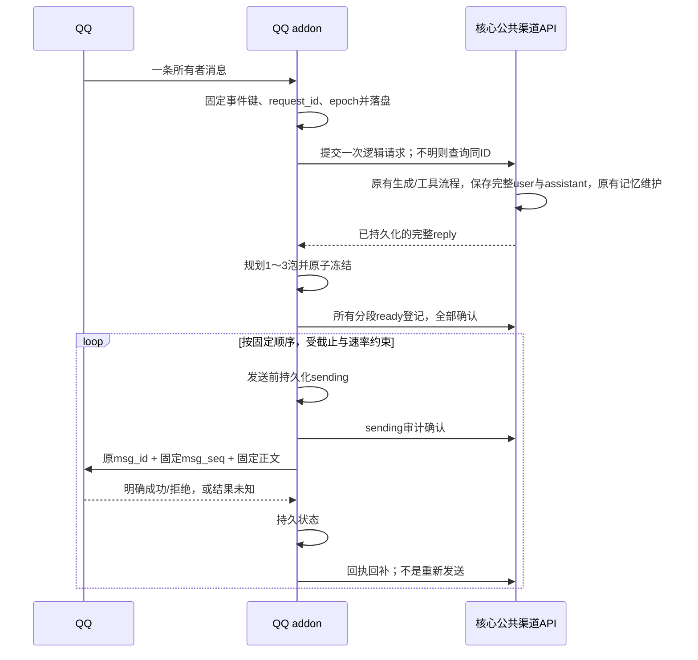

# QQ 自然分条回复：技术参考

本文保留完整调研与施工审查细节。审核主方向请先看[精简方案](QQ自然分条回复-方案与审核.md)；本文不代表额外实施授权。

日期：2026-10-30。本文保留施工前的完整设计依据；用户随后已批准精简范围并授权开工，实际变更与待验项见[实施记录](QQ自然分条回复-实施与人工验收.md)。本文中的可选架构项仍未纳入实施范围。

同日搜索功能实施增加了来源资格联动：第7.3节说明原回复hash、逐次发送许可与历史回执。它独立于自然分条算法，不改变已冻结的正文／seq／计划；本文原先“核心接口/schema不变”的判断仅指自然分条本身。

推荐 **A：QQ addon 内的确定性段落／句群切分**，配合固定投递计划、现有逐段发送账本及保守的网页状态文案。先让普通多段回复成为 2～3 条实际 QQ 消息；短回复仍是一条。无需增加模型调用，不改人格、全渠道提示词、核心回复契约或记忆语义。若真实人工体验证明无结构长段仍不自然，再单独评审 C，而不是本轮预先引入结构化模型输出。

本文是施工前设计，不代表已实现或已验收。用户批准方案后，仍须明确授权开工。本轮仅阅读代码、官方公开资料与本地问题截图，新增本文并按协作约定更新 AGENTS.md「当前」；未读取真实 `user/` 配置、密钥、人格、历史，未安装依赖、调用模型、发送 QQ 消息、运行测试、启停服务或提交代码。

## 1. 问题、目标与范围

截图显示多个自然段被装进同一气泡；“说短一点”或在正文中换行不能使 QQ 客户端收到多条独立消息。截图只作本地体验证据，不复制进仓库，不引用私人对话；不能用历史样式推断当前 main 的实现。本文例子均为合成。

目标是按可辨认的表达单元组织实际发送：一小段承接、一段解释、一个追问，可以是不同气泡；同一意思的两个短句可以留在一起。切分器只能利用文本结构和有限规则，不能声称理解所有语义。宁可少拆，也不把一句话的解释、转折、数字或链接拆坏。

范围限定本人 C2C 纯文字的 QQ 输出组织、发送和状态说明。网页继续展示完整逻辑回复；不扩展群聊、主动发送、实时 token 推送、输入中动画、人格改造、重复话题治理、全渠道语气改写或 QQ 远程管理。

## 2. 现场基线与完整链路

只读核实：本地分支 `trial/windows-v0.2-20261028`，HEAD `620219d`，开始时工作树干净。没有拉取、切分支、rebase，也没有核验远端 PR #4 当前状态；以下行号均针对本地该提交，不代表最新 main。实施前须重新核实多人改动与授权分支，默认遵守 AGENTS 的 `ytq` 流程，不能沿用旧任务的分支例外。

| 环节 | 文件／函数定位 | 当前事实及设计含义 |
|---|---|---|
| QQ 准入和请求身份 | `addons/qq/src/bridge.mjs:49` `Bridge.receive` | 只接受绑定所有者 C2C；事件键散列 provider/app/chat/sender/原始消息 ID，request_id 再结合持久 bridge_id；先落账本再提交。原时间生成被动截止时间，不因重试续期 |
| 公共 HTTP | `addons/qq/src/alice-client.mjs:3` `call`；`alice/server.py:271` `_channel_route` | addon 只调用 `/api/channels/v1/`，10 秒 HTTP 超时，响应读取上限 256KiB。专用鉴权，不能借 GUI 权限读历史或管理 P1 |
| 请求准入、去重 | `alice/channels.py:180` `normalize`、`:248` `lookup`、`:274` `accept_locked`、`:320` `submit` | 固定身份／epoch／来源唯一键；重复请求返回原状态；GUI/QQ 共用处理槽。查询503不是请求不存在，不能换 ID 重生成 |
| 一轮生成 | `alice/service.py:386` `_send_locked`；`alice/loop.py:133` `chat_turn` | 一次逻辑 chat_turn 中可有多次原有工具／模型往返；用户正文写一次，最终 assistant 正文写一次。拆气泡不应增加任何这些调用 |
| 持久化与记忆 | `alice/store.py:138` `add_turn`；`alice/loop.py:186`、`:192` | 正文与 request/turn 关联同事务；同角色重复关联被拒绝。完整 assistant 入库后才进入原有 extract_pending（未到阈值可跳过），不是每气泡提取一次 |
| 结果与进程恢复 | `alice/channels.py:225` `_view_locked`、`:285` `finish_locked`、`:87` `bind_store` | 返回已落库完整 reply；启动时无助手正文的未完成请求标 interrupted，有正文的标 completed_with_warning，不自动重做工具或生成 |
| 获取最终正文 | `bridge.mjs:122` `stepRequest`、`:149` `consume` | 提交响应不明则查原请求；取得 generated/completed/completed_with_warning 的 reply 后建立 outbox。generated 已有完整正文，不是流式片段；维护仍可能未结束 |
| 当前切分 | `bridge.mjs:8` `textSegments` | 只按长度累积字素簇；上限是每段1000 Unicode码点、4000 UTF-8字节，最多由配置指定的3段。自然段和句号均不会主动触发拆条；超限加截断说明 |
| 发送与预算 | `bridge.mjs:179` `sendSegment`、`:221` `tick`、`:251` `run` | **现已先将全体分段 ready 登记成功才发送首段**；每次选择最早 outbox 的首个待发段，固定 index+1 为 msg_seq，用原消息 ID 被动发送。循环约1秒，不是严格每秒到达 |
| 发送回执 | `bridge.mjs:163` `report`；`alice/channels.py:376` `delivery` | 接口只记回执，不发消息、不调模型；index 只接受0～2，hash不可变；核心无计划总段数、截断标志和 plan_id。无需为3段扩大接口 |
| 本地账本 | `addons/qq/src/storage.mjs:53` `Ledger`、`:15` `atomicJSON`、`:81` `prune` | v1 JSON、临时文件fsync后替换、单实例锁；重启将 sending 转 unknown。成功删除该段正文，未确认正文最长24小时，墓碑30天／10000条上限；不可写即停，损坏不清空 |
| 网页历史 | `alice/service.py:168` `history_page`；`web/app.js:175` `markTurn`、`:204` `mergeTurn`、`:295` 回执刷新 | 一条完整 assistant 按 turn/request ID 合并。状态按 unknown→failed→sending→ready 优先，否则已有回执都确认即 confirmed；不能给出精确 n/N、全文是否完整发出 |
| 观察器／P1 | `alice/service.py:221` `_observer_read`、`:253` `evaluations`、`:391` 许可捕获；`alice/channels.py:182` 字段白名单 | 观察器只读，忙即返回；P1通过GUI显式evaluation_id绑定一轮。QQ请求没有该字段，不读取或消费网页中待用许可；分段发送无权进入这些能力 |

当前配置证据：`addons/qq/src/config.mjs:27`、`:43` 与 `addons/qq/config.example.json:15`。默认3条等待、等待120秒、被动窗口300秒、最多3段、发送间隔1000ms、waiting_notice=false。实际本机私有配置本轮没有读取，不能说运行中的桥必然使用这些默认值。

现有设计可复用，但要正视三个缺口：`consume` 无显式“已有计划不重切”防线；失败／unknown 终止整条时，其余 ready 尾段可能悬挂；`history_page` 无法区分完整发送与截断摘录。现有“全ready后首发”门禁必须保留，不把它误写成新增能力。`report` 目前为终态回补可能补登 sending，不能据此推断该段实际调用过 QQ；真实尝试以桥的 dispatch 记录为准。

## 3. QQ 外部约束与证据等级

查阅日期2026-10-30。浏览工具起初无法读取新站，随后只读HTTP GET成功取得当前官网的[消息概述](https://bot.q.qq.com/wiki/develop/api-v2/server-inter/message/overview.html)、[C2C接口（页面更新2026-10-28）](https://bot.q.qq.com/wiki/develop/api-v2/autogen/api/v2_users_user_openid_messages.post.html)、[API调用指南](https://bot.q.qq.com/wiki/develop/api-v2/dev-prepare/api-call-guide.html)及[访问凭证说明](https://bot.q.qq.com/wiki/develop/api-v2/dev-prepare/access-token.html)。仅在内存提取公开文档，没有请求真实平台业务接口。下表区别官方当前文字、工程选择和账号待验项。

| 项目 | 本轮证据 | 设计决定 |
|---|---|---|
| C2C条数／时限 | 当前概述与发送页写60分钟、每条入站最多4次；同发送页msg_id字段仍写5分钟内有效，冲突现场可见 | 不扩额度。继续最多3条正文、原时间300秒内发送；这是保守工程值，账号若更紧须再收紧 |
| msg_seq | 当前C2C页说明与msg_id联合去重，同组合重复会失败，默认1 | 计划内固定1/2/3；重试保持原seq，不通过递增绕过拒绝，也不把此规则当exactly-once保证 |
| 文字长度／字节 | 当前C2C页有40054007长度超限等错误，但content字段未明确统一的数字上限 | 1000码点／4000字节是Alice工程上限，不是官方承诺；账号人工验证后只收紧，不自动放宽 |
| 频率 | C2C基础信息给所有类型合计100QPS；另一张10QPS等表属于主动频控 | 不能把主动或文字子频道规则套到C2C被动。至少1000ms是本地节奏／限速，非官方强制间隔；账号实际可能更严 |
| 成功、过期、去重 | C2C页返回id和timestamp；40034128为被动时间或次数超限，40054005为去重 | 有有效ID才记平台确认；超限停止，去重拒绝也不证明某段已读，不换seq探测 |
| HTTP／业务错误 | API指南区分HTTP与err_code，401认证、429限流；201/202也可能含需处理的业务错误 | 检查状态和响应体，不能仅凭2xx判成功；SDK实际错误映射待人工核实，网络／5xx保守unknown |
| Token／URL | 凭证页以expires_in描述寿命；API指南列出URL未报备错误304003 | 不逐泡刷新；只在明确401后刷新一次。保持URL完整不等于必能发送，拒绝后不改写规避 |

上述数字与错误说明分别来自对应的[C2C页](https://bot.q.qq.com/wiki/develop/api-v2/autogen/api/v2_users_user_openid_messages.post.html)和[API指南](https://bot.q.qq.com/wiki/develop/api-v2/dev-prepare/api-call-guide.html)。腾讯[旧文档仓库发送页](https://github.com/tencent-connect/bot-docs/blob/main/docs/develop/api-v2/server-inter/message/send-receive/send.md)仍写60分钟／5次，并提醒短超时可能出现实发成功但未收到响应；本方案采用新站4次作为文档预算依据，旧页只作差异与未知结果风险佐证。实际账号权限、Unicode长度和错误映射仍须真实环境人工验证。

发送次数预算与HTTP尝试预算分开：同原消息最多3个计划slot，每slot最多3次有证据可重试的尝试，全轮最多9次；这不意味着平台只按slot计费／计频。每次尝试都计入本地速率，通知、失败提示不额外占用“假定剩余第4条”。不开typing，不自动转主动消息。鉴权与限流组合不得重置尝试总数。

## 4. 三类方案比较与推荐

| 维度 | A：本地确定性段落／句群 | B：模型显式边界／消息数组 | C：结构优先＋本地兜底 |
|---|---|---|---|
| 自然度 | 对自然段可靠，长段靠保守规则，无法可靠推断隐含语义 | 可按表达意图组织；仍会过拆、漏字段或输出标记 | 理论上较好，但必须同时验证结构与兜底体验 |
| 可靠性 | 不受模型结构遵从度影响，可稳定复现 | 标记碰撞、JSON损坏、工具调用兼容、部分输出均需处理 | 比B稳，但有两条解析路径和更大状态面 |
| 延迟／费用 | 不增加模型调用；只增加必要发送间隔 | 同次生成可无新增调用，但改变输出token与提示契约；二次改写则新增费用和等待 | 同次结构无额外请求，不能默认用第二个模型修复 |
| 兼容 | 直接消费现有reply:string；QQ独有 | 必须给生成端可信渠道上下文，定义如何保存原文、去标记、展示和提取记忆 | A兼容已有纯文本，结构部分仍要求B的接口设计 |
| 核心影响 | 无核心接口／会话变更；桥账本升级、网页文案小改 | 需要核心架构审核；不能把隐藏指令拼进用户正文绕过 | 结构能力需要独立架构审核，不是“纯addon改动” |
| 复杂度 | 中低；主要难点是特殊文本和恢复边界 | 中高；模型/工具/持久化三方契约 | 最高；长期可能合适，首期收益不足以抵消复杂度 |

**推荐A作为本次完整交付。** 不默认加框架、运行依赖或模型二次改写。提示词单独改成“短一点”不会增加平台发送次数；即使要求“每条空一行”，当前桥仍把短的多段文字发成一条。只按句号切会将承接短语、引号内话语、URL、小数、代码拆坏，并迅速耗尽3条预算。A可以不改提示词就改善已存在的自然段；没有明确边界时保守少拆是其公开限制。

若以后选择B/C，推荐同一次生成返回受约束结构、验证失败回退原完整文本；不接受“另调一次模型切分”作为默认。不能让模型数组的每项变成独立 assistant 回合。此项见第10节独立裁决。

## 5. 推荐的文本规划规则

新增纯函数模块建议为 `addons/qq/src/reply-plan.mjs`，输入原始reply及一份有效配置快照，输出不可变运输计划；不访问模型、核心数据库或网络。

### 5.1 优先级与软阈值

1. 保存核心原文及其reply_hash语义；桥仅创建运输副本。可沿用过滤不可显示控制字符，统一运输副本换行；不做Unicode归一化、不改措辞、不删情绪表达。裁切只移除边界多余空白，原文仍完整保留在核心。
2. 识别保护区域：围栏代码、行内代码、URL／邮箱、成组引号／括号、列表连续项及标题、引用段。空行通常是强候选；普通单换行只是弱候选，不能把列表一行拆一泡。
3. 以自然段／完整结构块为初始表达单元。非结构文本中，<=12码点的承接短段优先并入相邻段，合并后<=80码点；先并后段，末尾短段并前段。若段落是完整独立问句、明显转题或结构标题，保留边界。仅“嗯／好／对呀”之类短承接不独立成泡。规则以标点、结构及固定小范围转题词判断，不能假装通用语义理解。
4. 普通单段<=160码点时不因句号主动拆开。较长段才寻找闭合的句末边界，目标约120码点，优先选60～180码点附近的候选；并确保普通头尾至少24码点。找不到安全边界就保留到硬上限。上述数值是首轮人工体验调优起点，不是平台限制或每泡必须达到的长度。
5. 初稿超过3泡时，先合并相邻单元：弱句边界先于强段边界，保留原顺序和内部换行；同优先级选合并后较短者，再以靠前者打破平局。可为覆盖全文重新分配长段切点，不能在第3个自然段就停止。必要时放弃120的软目标，允许较长气泡。先满足结构保护与运输硬限，在此约束内尽量覆盖全文，再优化节奏。
6. 最终每泡<=1000码点且<=4000 UTF-8字节、最多3泡。普通无标点超长文本在最后手段下沿字素簇硬切；明确记录hard_split。不得切开emoji ZWJ序列、肤色修饰、组合音标、代理对。计数单位明确区分码点、字素簇和字节。

规则顺序是可复现契约；算法版本、阈值和切点策略发生变化即换planner版本。实现可用有界扫描与相邻合并，避免对所有字符做无界组合搜索。输出长度受现有响应读取上限约束。

### 5.2 特殊文本与过长降级

| 边界 | 处理 |
|---|---|
| `。！？!?`、`？！` | 连续末尾标点视为整体，闭合引号跟随前句；只提供候选，不逐句必拆 |
| `……`、`...`、破折号、逗号／分号／冒号 | 省略号整体保留；不默认作独立消息边界。冒号后的解释、标题后的内容优先同行／同泡 |
| 引号／括号 | 未闭合时禁止内部自然切分；完整短引用及归属语优先同泡。超硬限的结构走摘录降级，不发送看似完整的半个引文 |
| URL、邮箱、版本、小数 | URL和代码中的点不算句末，`3.14`、`v1.2.3`不拆；不下载、不改URL，不用隐藏字符规避平台校验 |
| 列表／引用 | 连续短列表作为一单元，标题与首项绑定；超长列表只在完整项之间分条，保留编号，不自行补造编号或内容 |
| 代码块／行内代码 | 默认整个代码块同泡并保留原文字围栏，不按代码句号拆；超硬限的块不截成可被误复制的半段代码，停止此前缀并提示GUI查看 |
| emoji／无标点长文 | 字素簇安全；超限单个异常字素不得像旧实现那样静默跳过，走明确摘录提示或只发查看提示 |

若在3泡硬预算内放不下全文或完整保护块，保留**连续原文前缀**到最近安全边界，在最后一泡追加“（后文未发送，完整回复请在本机网页查看。）”，预先计入字数／字节。不得略掉中间重要条件后又继续发送后文；不调用模型摘要。若安全前缀为空，只发查看提示。运输计划标记truncated和原因；核心reply_hash仍对应完整原回复。通知不发回环URL给手机，不默认发第4条。

空白回复沿用“（沉默）”运输占位；该占位不回写核心。不允许分割后出现空泡。输入输出映射应能解释为原文的有序片段加明确的系统截断提示，而不是新生成内容。

## 6. 一个逻辑回合与冻结投递计划

**冻结点：** 首次取得可用完整reply后、任何ready登记和平台发送之前，一次性保存全体segments及plan元数据。已有segments或plan时禁止再次调用规划器；结果重新查询只核对身份和reply_hash，冲突则停止，不覆盖。`generated`只有正文已落库后出现，可使用；不得从SSE delta或工具过程规划。

建议桥账本升级v2，仅本地addon schema变化：

| 字段 | 用途／不变量 |
|---|---|
| `plan.version`、`kind`、`planner_version`、`origin` | 计划结构版本、chat/notice类型；natural-v1／length-v1／legacy-frozen；不得由当前代码版本隐式推导旧计划 |
| `plan.plan_id` | SHA256规范数组编码 `[kind, epoch, request_id, content_hash, planner_version, policy_snapshot, ordered_segment_hashes, truncated, reason, hard_split]`；嵌套快照键固定排序，缺失旧值显式null，无密钥。chat的content_hash即完整reply_hash；notice使用自身通知正文hash。hash是完整性标识，不是加密 |
| `plan.policy_snapshot` | 有效mode、软阈值、硬上限、max_reply_segments，以及冻结时send_spacing_ms；文本配置冻结，发送限制允许变严，但不能因此重切已冻结文本。实际间隔取冻结值与当前值的较大者 |
| `plan.segment_count`、`truncated`、`reason` | 1～3与输出一致；新计划truncated为布尔，旧计划不可证实则为null并标legacy_unknown；reason固定枚举如capacity/protected_block，不记录私人内容 |
| `plan.hard_split` | 是否用过普通文本字素簇硬切；新计划为布尔、无法恢复的旧计划为null，纳入plan_id，不靠成功后已删除正文重算 |
| `segments[]` | 保留现有index、seq、text、hash、status、attempts和回执字段；未发text必须与hash相符；已确认text可删除，hash及plan_id保留 |
| 段级 `auth_refresh_used`、`rate_retry_count`、`dispatch_attempts` | 明确区分鉴权刷新与限流重试；最多一次刷新、总平台派发尝试<=3。核心回执重试不消耗派发次数；保留旧attempts作旧版审计，不把它直接解释为真实派发数 |
| 账本级 `last_dispatch_at`、`not_before` | 所有消息／通知共用发送时钟，实际平台调用前原子保存；429冷却也作用于全桥，避免切到通知或重启绕过限制。重试时刻不参与不可变plan_id |

index固定0..N-1，seq固定index+1；请求身份、epoch、目标、原msg_id均不变。计划校验失败保留账本并停止，不能清空后从完整reply重新拆发。不同算法对同一段可能产生相同hash，不影响计划以request+index标识；不能按正文hash去重不同回合。

notice明确走单泡运输计划，不调用自然句群切分，不提交核心生成或delivery接口；它没有核心reply_hash，不能套chat校验。已有legacy notice可直接以有序分段hash作为content_hash的派生依据（单泡即该hash），已删除正文也能稳定认领；legacy chat继续绑定原reply_hash。旧快照／truncated无法恢复时用null＋legacy_unknown参与同一规范编码，不假造历史阈值或判定完整性。notice只属于它自己的原入站事件，不能与同事件chat分别建两套seq从1开始。

核心仍只有一个user_turn_id和一个assistant_turn_id，原始reply留作历史／提取／P1证据来源。泡数不是轮数。投递回执不触发ChatService.send、extract_pending、watchers或工具；已有记忆副作用不因发送失败回滚。原有维护之后可能重试失败的提取，这不等于拆泡导致重复执行。

## 7. 顺序、节奏、失败与恢复

### 7.1 排队与节奏

- 按当前单发送器串行处理；同一回复N泡不穿插下一条回复或控制通知。新用户消息仍可接收和落盘，最多3条等待，但等当前outbox终态后才提交下一轮；不合并追问、不改原消息ID。GUI仍可按核心处理槽规则参与对话，不新增跨渠道大锁。
- 默认固定1000ms最小发送尝试间隔，包含重试与notice；不随机模拟打字、不按字数故意拖慢。3泡仅因节奏引入约2秒的间隔，另有现有约1秒轮询及网络／核心审计延迟；不能承诺2秒内送齐。429退避的现有随机抖动属于网络退避，不是聊天人格。
- 保留每次尝试至少15秒截止余量；首次发送前若剩余时间不足 `15秒 + (未发泡数-1)×有效间隔`，整份计划直接记为窗口不足并停止，不赶在过期前连发。这个估算不是网络完成保证。窗口随原入站时间固定；限流后每次重算，不能换成主动消息。**refresh及核心sending回执可能耗时，真正调用QQ API之前必须再次校验deadline、停止标志和有效绑定**；若此时已不足，标为未发，不再调用QQ。仍无法消除跨进程撤权与在途网络的竞态。
- 不新增节奏等待项；发送间隔沿用合法配置，不能借新算法降低安全下限。重启时按持久last_dispatch_at和not_before保守等待；429冷却适用于全桥，过期冷却不累积。时钟明显回拨停止待人工核对，不能把负间隔当零。
- `/cancel`本期仍只取消尚未提交的排队输入；**不新增取消未发尾泡的用户命令**，避免悄悄改变现有语义。新消息不会隐式取消上一轮。发生失败、unknown、过期或授权变化时系统会停止剩余发送；已交平台的在途消息不能撤回。若以后允许“别继续发”，需另设计请求身份、未发段取消记录和提示，不重跑生成。
- 暂停桥不是撤回，也不是永久取消计划：未尝试段可在用户再启动且原窗口有效时恢复；在途sending重启后unknown，不继续发送该轮尾部。

### 7.2 异常与恢复矩阵

| 事件 | 本地／平台语义 | 后续动作 |
|---|---|---|
| 核心提交超时／503 | 是否已接受未知 | 查同request_id；只在确定不存在且原状态允许时提交同ID，不生成新ID、不额外调用模型 |
| 核心生成中断 | 无完整reply或维护中断 | 无reply则interrupted并停止；有已保存reply可冻结计划。不能自动再生成或重放工具 |
| 计划写盘失败 | 未获得可恢复计划 | 不登记、不发送，停止接单；保留原件 |
| 部分ready回执登记后崩溃 | 计划已冻结，尚未发送 | 原计划补齐全部ready后再发；不得根据已登记数量缩减计划 |
| sending落盘后进程退出 | 即使可能尚未调用QQ，也无法可靠排除已发 | 该段send_unknown，整轮停止；尾部未尝试段标failed并注明blocked_by_previous_unknown。宁可少发，不自动补发 |
| 平台成功且有有效消息ID | 平台已确认受理，不代表手机已读 | 保存ID与confirmed，再删该段text；仅继续后续ready段；核心回执失败只重试回执 |
| 明确401拒绝 | 本次未授权 | 清token缓存刷新一次，固定正文/seq重试；第二次401或403停止桥。不能把所有业务错误都当token过期 |
| 明确HTTP429 | 已知限流拒绝，仍需验证SDK映射 | 固定seq、至少5秒量级有限退避，受总尝试<=3及窗口约束；有可靠Retry-After则不早于它。超预算终止整轮 |
| 22009等平台额度业务拒绝 | 未证明只是短时限流 | 标failed/qq_business_rejection并停止本轮，不默认重试；不增加seq以占新名额 |
| 400/404/413/422等明确拒绝 | 失败，不是成功 | failed，不自动改写、缩短或降格式再发；尾段failed/blocked_by_previous_failure，完整原文仍在网页 |
| 网络断开、5xx、缺成功ID或响应解析不明 | 可能已发，结果未知 | send_unknown，不重发当前段，也不自动发送剩余尾段；保留原seq和审计证据 |
| 第1泡成功，第2泡失败或unknown | 已有部分输出 | 第1泡保持confirmed；第2泡保留真实状态；第3泡failed+未尝试原因。不能把整轮回滚成“没有发出” |
| 被动窗口不足／过期 | 后续不能合法被动发送 | 未发段failed/passive_window_expired并回补核心；不额外发“过期”通知、不转主动 |
| app/owner/epoch改变 | 原投递目标／会话不再授权 | 整条隔离，绝不将旧回复改绑到新身份；旧epoch的核心回执可能无法补写，以桥账本为准，不伪造回执 |
| 24小时正文清理 | 恢复正文不可再依赖本地text | 先把未尝试段终结并保留hash／未同步回执，之后清正文；不得以缺text为由重切原reply。30天墓碑政策沿用 |
| 账本损坏／丢失／版本不支持 | 已发送范围不可证明 | 停止并保留文件；不能初始化空账本继续发。此前未知结果不能靠恢复旧备份消除 |

终态回补要覆盖failed／unknown尾段及过期清理路径，而不只正常sendSegment。未实际调用平台的ready尾段允许用现有 `ready→failed` 转移；不要为它捏造sending尝试。已有sending审计但尚未调用平台即过期的，仍以failed和明确未派发原因收口。无法可靠排除派发才保留unknown，不能把确定“不打算发”冒充unknown。回执暂不可写时保留dirty状态，下次只补回执；若epoch已变则隔离，不阻塞新会话却也不向旧目标继续发。派发次数检查及递增放在核心审计成功之后、平台调用之前，同一次原子保存dispatch_attempts与发送时钟；落盘后崩溃仍保守unknown，计数表示派发意图而非证明平台受理。

本期无自动补发和远程恢复命令。人工先核对QQ已收到哪些泡和本机状态；原回复可从本机网页查看。人工看到相似文本不能可靠证明某个seq已确认，因此不把肉眼确认自动升格为平台回执。将来若加补发，需要单独授权、原合法窗口／新明确事件与重复风险提示；绝不能通过重新发问或换request_id冒充无费用恢复。端到端不承诺exactly-once。

### 7.3 来源资格与原回复hash（搜索功能联动，2026-10-30）

使用搜索资料的回复，其正文可能因来源到期、清除或撤回QQ范围而变为固定占位。投递核验使用**生成时保存的原始reply SHA256**，不能对当时的历史展示文字重新计算。核心新增可空 `channel_requests.reply_hash`，生成事务立即固化；旧记录优先采用已有一致delivery登记的hash，再从尚存的原始附件／普通正文补齐。已清附件没有可信旧hash时不从占位推断，不放行新发送。

请求结果增量提供 `reply_hash` 与 `delivery_allowed`，不改变 `reply` 原有类型、端点、协议v1或index0..2上限。`delivery_allowed`只是查询时快照。ready仅登记固定分段的元数据；**每次实际调用QQ前，包括明确401／429后重试，都重新提交sending**。桥不能因 `reported_status` 已是sending而省略这次请求。核心逐次检查来源附件的渠道、期限及全部必要来源包，不能通过正文是否等于占位来判断权限。

失效返回409 `source_unavailable`：仅把当前尚未派发段和未发尾段终结为failed并清掉这些段的临时正文；已有confirmed／unknown保持原事实，冻结计划不重切。真实终态仍按原reply／segment hash补报，不伪造一次sending来换取落账。ready可直接补真实确认终态，但必须由受信任桥提供有效 `platform_message_id`，已登记ID不可改；这不等于核心直接查询QQ证明送达或已读。单纯ready登记即使在来源失效后也可用于失败审计，它不授予发送许可。

本机资格检查不能与QQ远端请求原子绑定；校验后已获准或已进入网络的发送无法撤回。旧epoch／身份变化仍按原隔离规则处理，来源恢复不会复活已停止的分段或unknown。人工覆盖冷却／重试中的撤销与历史终态回补，见[搜索实施 S09](搜索功能-实施与人工验收.md#人工验收记录待执行)；目前仍待执行。

## 8. 网页、观察器和状态准确性

网页保留一个完整assistant气泡，不跟着QQ拆3条，也不把截断运输正文覆盖完整reply。来源、turn_id、request_id及P1证据引用不变。观察器刷新仍只读；发送失败不改变记忆主张是否成立，也不能触发额外核查。

本期采用**现有接口＋保守文案**，避免为展示n/N先改核心架构：

| 现有状态 | 建议网页文案 |
|---|---|
| pending | QQ投递状态尚未登记；请查看桥状态 |
| ready | QQ已有分条待处理（桥暂停或终止时可能延后更新） |
| sending | QQ分条提交中，尚未确认结果 |
| platform_confirmed | QQ发送片段已获平台确认；可能为长回复摘录，不代表已读 |
| failed | QQ有片段未发出或发送失败，可能已部分发送；完整回复保留在此 |
| send_unknown | QQ至少一条结果未知，可能已部分发送；请先到QQ核对 |

这样不误称“整轮失败”“全文已送达”或“尚未登记必会继续发”。桥`/status`可直接用本地计划说明“已确认1/3，1条未知，1条停止未发”，但这是用户主动发出的新控制事件，自己占其被动预算；无自动状态消息。桥仍不把私人正文写日志。

限制明确：核心目前没有manifest、总数或truncated字段，网页无法精确显示3/3及截断原因，离线期间状态也可能滞后。若要求精确详情，采用第10节独立架构变更，而不是让web直接读取桥私有state.json或为QQ开放历史／P1权限。

## 9. 配置、迁移与回滚

新增 `delivery.reply_split_mode`，枚举 `natural` / `length`；在用户批准并部署后，新配置及旧配置缺省均取 `natural`，以使升级真正生效。`length`为新生成计划的边界策略回退，仍使用新账本和恢复修正，也不恢复旧版静默跳过超限字素的行为；两种模式都保留3泡／1000码点／4000字节硬上限及明确截断。无需同时增加含义重叠的enabled开关。短句／句群软阈值初期作为planner版本常量，先用人工例子调优，不暴露一屏参数。

继续沿用 `max_reply_segments=3`（允许1～3）、`send_spacing_ms=1000`（保留原合法范围）、`passive_window_seconds=300`、queue_limit=3、queue_ttl_seconds=120、waiting_notice=false。不自动改写真实配置；实施时更新严格字段白名单及模板，旧配置按默认读取。修改配置对后续新计划生效，已冻结计划继续原文本／seq。若新安全限制使旧计划不可发送，停发并标原因，不能重切；放宽限制也不能复活终态计划。

升级方案：用户受控暂停桥并确认退出→本机保留权限受控备份→v2程序验证v1→一次性原子迁移。备份含聊天，须留本机并按原保留政策清理，不进入git。v1已有segments整体认领为legacy-frozen，原text/hash/index/seq逐字保留；旧算法和配置不可重建时标unknown，不根据当前配置补造历史快照。缺已确认text正常，缺未发text则停止该项并记录原因。原sending先转unknown；原failed/unknown有ready尾段时终结尾部并补审计，绝不自动续发。旧attempts不能区分审计尝试／真实派发，迁移时以其作保守已用上界，不清零；旧账本无发送时钟则启动至少一间隔冷却并保留既有retry_at。尚未生成计划的queued/submitting/accepted保持身份，首次取得reply再按新模式规划。迁移失败不部分覆盖原件。

v2增加必要校验：状态、index连续、seq固定、N<=3、reply与plan绑定、未发正文hash／长度、未知版本拒绝。迁移时不通过重新运行旧切分器推测已发正文；不要根据新配置压缩旧segments。

推荐回滚是设置mode=length并受控重启桥，旧计划仍按冻结内容。若回退到旧代码，v1读取器会拒绝v2，旧配置解析器也拒绝新mode键，这是预期的安全停止。不得直接将version改回1或恢复发送前的旧账本副本：那会遗失已发状态。确需代码降级，先排空或隔离未完成／未知项，再由另行审核的迁移工具保留所有去重与终态证据并处理旧配置兼容；无工具则关闭QQ，网页仍可使用。不迁移核心对话／记忆库。

## 10. 架构影响与需用户裁决的架构变更

| 边界 | 推荐A本期影响 |
|---|---|
| 核心公共接口／reply契约 | 自然分条不改reply；来源联动增量返回reply_hash／delivery_allowed，sending逐次核资格，仍用现有请求和delivery接口及index0..2 |
| 核心存储schema | 自然分条不新增核心plan表；来源联动仅给channel_requests增量添加原reply_hash，见第7.3节，不复制QQ分段正文进turns |
| addon持久schema | **需要v1→v2**，用于明确冻结、恢复、配置快照及安全拒绝旧代码；属于本期必要设计，不隐瞒为“只改几行切分” |
| 会话／记忆／工具／P1 | 不变，一逻辑请求；拆泡不新增提取、工具或付费核查 |
| 渠道通用能力 | 不新增。只在QQ addon规划；网页只改QQ状态文字，其他渠道保持原输出 |
| 依赖与安全面 | 不加依赖；Node内置Intl／crypto／fs足够。alice仍标准库，web原生JS，仅回环；addon不导入alice内部模块 |

**以下独立项目默认不纳入本次实施授权：**

1. **精确计划／投递摘要接口。** 若用户要求网页明确“1/3、已截断、尾段已取消”，需核心公共面接收不可变manifest（plan_id、reply_hash、总段数、有序hash、truncated），原子登记后再接逐段回执；history增加摘要及兼容旧记录的unknown-total。收益是精确展示与核心证明计划完整；代价是新schema、协议协商／能力字段、旧桥迁移、状态机审核。最小替代是第8节保守文案及桥本地状态，已能避免误报。不可只加segment_count而没有不可变计划校验。
2. **B/C模型结构化输出。** 要可信渠道上下文、明确canonical reply和有序bubble数组关系，并定义不一致／无效结构回退。标记不能污染历史、记忆或P1引用；不能把普通用户输入伪装成系统边界。收益是更强表达意图，风险是全生成链兼容和格式失败；最小替代为A，先积累合成、脱敏人工反例。
3. **超过3泡或发送中用户取消。** 前者同时触及config、Ledger、核心index限制及平台额度；后者需新的控制语义与审计。都不是本次自然分条的前提，不擅自实现。

## 11. 合成前后示例

以下仅表示QQ独立气泡边界，不是新的措辞生成；实际回复文本仍来自原有生成流程。

| 场景 | 原逻辑回复（↵↵表示空行） | 建议QQ结果 |
|---|---|---|
| 短答 | 在呀。刚把手头的事放下。 | ① 在呀。刚把手头的事放下。 |
| 三段日常 | 这两天安排得挺满，今晚可以把节奏放慢一点。↵↵那件小事明天再处理也来得及。↵↵你现在想聊会儿，还是先安静待着？ | ① 第一段；② 第二段；③ 完整追问，各为实际消息 |
| 极短承接 | 好。↵↵我把那两处要改的地方记下了。 | ① 好。↵↵我把那两处要改的地方记下了。 |
| 句子有关联 | 可以慢慢来。今天已经做了不少，剩下的留到明天也行。 | ① 完整保留，不每句一泡 |
| 数字和网址 | 记得用3.14，版本是v1.2.3。说明在 https://example.com/a.b?q=1.2 。 | ① 完整保留；能否实际带URL发送须人工验证 |
| 列表 | 出门前带上：↵1. 钥匙↵2. 水杯↵3. 耳机 | ① 标题及整个短列表，不发四条 |
| 超过预算 | 四个较长段，原文仍能放入三条硬上限 | 相邻合并／重分配后最多3条，尽量完整，不直接丢第四段 |
| 超长保护块 | 简短说明＋一个单泡放不下的代码块＋结语 | 发送安全前缀及“后文未发送…”；不跳过代码继续发结语，不把半段代码当完整方案 |

自然度人工判断：气泡读起来各有完整作用；不强制每轮三泡、不强制每个段落一泡、不把独立追问吞进大段的优先规则，应与防碎片规则一同核对。

## 12. 获批后的实施步骤与文件

1. 重新读AGENTS／状态，明确获批范围与分支；保留并发工作。本阶段到此为止，以下均待开工授权。
2. `addons/qq/src/reply-plan.mjs`（新增）：纯规划、保护区域、硬限与降级、版本与稳定hash；不建新的模型适配层。
3. `addons/qq/src/config.mjs`、`addons/qq/config.example.json`：模式白名单与缺省兼容；核对 `main.mjs` 的init、`web-control.mjs` 的模板读取可继承，不另设不一致默认值。
4. `addons/qq/src/storage.mjs`：v2验证／迁移、冻结计划、发送时间与次数、终态清理和损坏处理。原锁、权限、保留政策沿用。
5. `addons/qq/src/bridge.mjs`：consume只规划一次；保留全ready门禁；按固定计划发送；明确尾段停止和回执回补；`/status`显示本地计数；通知仍单泡。`alice-client.mjs`公共调用保持，不访问数据库或新管理端点。
6. `web/app.js`：仅QQ投递标签／说明的保守准确性；不修改网页气泡生成与观察器／P1流程。推荐A单独实施无需改alice/channels.py、service.py、loop.py、store.py；同日另获授权的搜索来源联动涉及channels/store，按第7.3节记录，不作为切分算法扩张。
7. 更新 `addons/qq/README.md`、相应实施记录，写清配置、迁移、partial/unknown、真实验收结果；方案本文保留作为审核依据，后续实施差异另记，不将未验证设计冒充完成。
8. 获批后由人工在独立完整检出与真实QQ／真实模型环境按第13节执行；不写／运行机器自测或冒烟测试。合并阶段按当时授权和AGENTS共存检查执行，不能借此在本设计阶段启动服务。

## 13. 真实环境人工验收清单（全部待执行）

只设计剧本，本轮未执行。使用专用真实QQ机器人、本人测试身份和隔离Alice副本；更换模型config不等于数据隔离。记录版本、算法、脱敏请求引用、计划hash、分段状态、时间、人工观察；不得导出密钥、人格、完整私人历史或本次截图。真实模型输出有波动，若该次未产生目标文本形态，应标“场景未覆盖”，不冒充通过。

| 编号／场景 | 人工操作 | 验收要点 |
|---|---|---|
| M01短回复 | 自然问候／确认，观察多次短回复 | 一泡且读起来完整；不会为凑数量拆出“嗯”“好” |
| M02多段回复 | 真实聊一个有解释和追问的话题，取得2～3个自然段 | QQ实际出现独立消息；顺序正确；网页仍一条完整assistant |
| M03长单段／多句 | 真实请求一段稍长解释 | 句群有上下文，短答不逐句拆；无合适边界时允许少拆，记录自然度反例 |
| M04长文本／特殊文本 | 请求包含中英文标点、引号、省略号、小数、URL、列表、代码、组合emoji的真实输出 | 文本不乱码、不破坏URL/数字/emoji；结构块完整；超长明确截断，GUI保留全文；URL拒绝也要记录为平台限制 |
| M05预算超限 | 请求多段长解释、超长列表或代码 | 不超过3条；先合并保全文；放不下用连续前缀与提示，不静默漏段 |
| M06连续追问 | 第一轮发泡途中再发两条普通消息及一次/status | 后续落盘排队，同轮不交错；原msg_id对应固定seq；通知不夺当前轮预算；队列上限、过期行为清楚 |
| M07部分成功 | 在受控真实会话首泡确认后制造明确后段拒绝条件 | 已成功不重发；失败段真实状态，尾段停止；网页说明可能部分已发；不再生成答案 |
| M08限流与鉴权 | 通过获批的真实账号／平台条件观察401、429／业务额度错误；不靠大量轰炸触发 | 一次鉴权刷新、有限退避、seq不变、截止有效；拿不到真实错误则待验，不以假接口替代 |
| M09结果未知 | 在获批隔离环境人工干预网络或中断桥进程，覆盖发送后回执未落盘窗口 | 到QQ核对可能已发；重启后unknown且不自动重发，尾段停发；不承诺肉眼可完全判定时序 |
| M10重启恢复 | 在冻结前、全ready前、首泡确认后、sending阶段分别人工中断／恢复 | 同请求不重生成；固定计划／hash／seq；ready可按窗口恢复，sending→unknown；receipt回补不重发 |
| M11升级与配置变化 | 用真实未完成旧计划执行受控升级，再改mode／阈值版本 | legacy计划不重切；新计划用新规则；旧代码拒绝v2；不能恢复过期备份继续发 |
| M12窗口／暂停／取消 | 人工等待过期，暂停再启；执行/cancel | 超时不转主动；/cancel只影响未提交输入；已发不可撤回；网页没有“必将继续发”的误导 |
| M13逻辑历史与记忆 | 对分3泡的请求在GUI按request/turn核对，观察原维护记录与记忆证据 | 一条user、一条assistant，完整正文一致；记忆维护按原轮／阈值，不随泡数增至3次；工具轨迹不因发送重放 |
| M14P1与观察器 | GUI保留一份未消费许可，同时QQ聊天／分条；打开观察器 | QQ不消费许可、不创建额外P1任务／费用；观察器无写副作用，busy行为不变 |
| M15身份与账本故障 | 在隔离副本受控验证epoch变更、损坏账本／写盘不可用 | 原件保留、停止接单与发送，不改绑、不初始化空账本、不恢复未知为ready |
| M16来源资格与旧回执 | 按[搜索实施 S09](搜索功能-实施与人工验收.md#人工验收记录待执行)，在已获准的真实冷却／重试或回执待补期间清除资料或关闭QQ资料范围 | 每次实际尝试重新核资格；未发尾段停止且不重切；已确认／unknown真实终态仍按原hash落账，不对占位重新hash，不重发unknown；未覆盖则待验 |

M07～M10的操作只有在用户另行允许干预测试环境后执行；不能为了覆盖故障破坏日常会话。每项登记待验／通过／未通过及证据；“读代码看起来正确”不等于人工通过。尚未覆盖关键unknown／重启场景时，不宣布恢复可靠性验收完成。

## 14. 风险与待用户决定

主要风险是启发式对隐含语义判断有限、3泡预算使长回答仍可能较长、更多平台调用增加部分失败概率，以及现有SDK网络正文等待可能拖长退出。缓解依赖保守少拆、冻结计划、有限重试、unknown不重发和人工体验验收；本方案不承诺网络整体截止或平台端恰好一次。

请审核两项范围决定：

1. 是否接受推荐A及默认节奏：**最多3泡、固定最小1秒间隔、短回复合并、旧配置缺省启用natural**；保留length回退。更强调模型主动组织的B/C应单独启动架构评审。
2. 网页是否先接受**完整逻辑回复＋保守投递文字**（推荐）；若必须精确n/N及截断详情，请一并裁决第10节manifest接口变更，施工范围将扩大。

上述选择确认后，仍需用户明确“批准方案并授权开工”。方案写完、静态阅读发现改动很小或无需核心架构变化，都不是实现授权。
