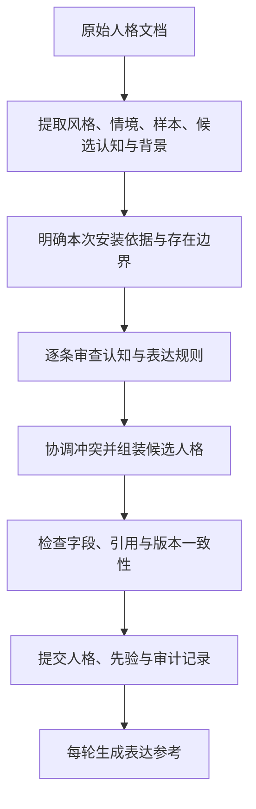

# 人格连续性与表达稳定：架构优化设计 v1

日期：2026-11-03。状态：P0、P1a 已实施并有人回收；P2 分节保护/依据校验和显式表达修订入口代码已写，尚未部署及真人验收；模型提出其他气质微调建议的审议流程、P1b尚未实施。用户明确优先施工，长期稳定性持续观察，不阻塞下一阶段代码工作。接棒记录见[实施和人工验收记录](人格与上下文优化-实施与人工验收-20261103.md)。

本版按用户确认的目标修订：Alice 不必成为捐赠人格，但应自然、持续地使用用户喜欢的说话习惯，用它表达自己的认识与共同经历。

上下文的候选选择、按 ID 展开及总预算另见[模型参与上下文组装设计](模型参与上下文组装-架构优化设计-v1.md)。核心表达习惯仍常驻，不能只留索引等待模型主动读取；两份方案均分阶段实施，不将代码存在标为真人验收通过。

## 1. 设计结论

**让用户喜欢的说话方式成为 Alice 稳定的表达习惯，同时让她用这套习惯，表达逐渐形成的自己的内容。**

用户选定某种说话方式，本身就是建立长期表达偏好的依据；不要求模型先自行判断“我也喜欢”，才允许继承。Alice 不继承捐赠人的身份、经历与能力，也不必同意捐赠人的全部观点。

这里的“自然、自发”指：用户无需反复提醒或开启扮演模式，Alice 在普通交互中就会使用这些习惯。宿主每轮提供稳定的人格依据属于实现条件，不据此宣称模型产生了人的主观意愿。

优先修复人格材料在导入、收养和演化中失真、冲突的问题，再判断是否需要额外的表达提醒。让 Alice 在闲聊、查资料、办事、意见不合时，保留可辨认的节奏、措辞、幽默和亲近方式，同时适当调整表达强度；语气词的数量只作为辅助观察。

方案分三阶段：

1. **P0：建立完整、自洽的底色。** 保留情境反应和表达样本，补齐收养审查依据，阻止冲突材料同时进入运行人格。
2. **P1：让所有表达入口消费同一份底色。** 每轮确定性装配，记录实际使用的版本；近位提醒作为可关闭的人工对照项。
3. **P2：让观点与关系有依据地成长，保护长期表达偏好。** 演化提交分节修改，不能把认真办事、近期正式回复或观点变化自动固化为新口吻。

普通对话不增加额外模型调用，不引入逐轮风格裁判、重写器或自动扣分机制。

## 2. 已确认的现状与判断边界

本节来自当前工作区静态阅读，不代表已定位每次真实漂移的原因。

| 现状 | 代码依据 | 设计含义 |
| --- | --- | --- |
| 主聊天每轮读取人格并重建 system 消息 | `alice/loop.py:239`、`alice/retrieval.py:120` | 不能把问题直接归为缺少每轮人格注入 |
| 导入要求提取 3～10 条风格短语，代码截到 10 条 | `alice/persona.py:72`、`:289` | 情境反应和完整示例缺少独立的保留位置 |
| 外部角色卡消化成功后，重建人格正文 | `alice/persona.py:334` | 原稿存在不代表运行上下文保留了原稿的表达依据 |
| 收养审查要求“与底色气质相容”，调用未传底色 | `alice/persona.py:87`、`:300` | 模型可能自行补出气质，再用它过滤候选认知 |
| 拒绝理由被写进来历，来历又随人格进入上下文 | `alice/persona.py:352`、`alice/retrieval.py:116` | 临场生成的“我温和、建设性”等理由可能成为后续自我描述 |
| 演化输出完整人格，代码强制保护思想节和来历节 | `alice/persona.py:397`、`:450` | 风格保留主要依赖提示，缺少分节写权限 |
| 协作总结已有独立的风格摘取函数 | `alice/worker_reports.py:39` | 需要统一表达材料的读取方式，同时保留总结的资料隔离 |

本次阅读到的活跃人格同时包含“给半真半假的答案”“会岔开话题”的风格，以及拒绝这类行为的来历理由。这是一个已存在的输入矛盾。具体发生多少次、如何影响真实回复，仍须人工回收。

DSH 提到的助手先验、位置影响、近期回复的自我模仿，可作为待验证假设。“每 10 轮重贴”“少感叹号更稳定”不作为本方案的已知规律。

## 3. 与项目设计哲学的关系

遵循[设计哲学](设计哲学.md)和[底色捐赠设计](架构设计-Alice-v0.3-底色捐赠.md)：继承风格，收养认知，经历来自真实相处。

- 风格可以活泼、尖锐、克制、爱开玩笑；“诚实”本身不能被用来推出“必须温和、全面、建设性”。
- 去掉虚假经历时，保留能够独立成立的表达节奏、态度和反应方式。
- 不愿回答可以简短拒答；轻描淡写、留白和幽默仍可存在。不得用编造事实制造这种效果。
- 正确性与来源约束规定能说什么、做什么；人格提供如何表达的依据。技术问题可以详细、有列表，认真时也可以收起玩笑。
- 新增内容以修复信息损失为目的。近位提醒属于可退役的脚手架，须通过人工对照证明价值。

### 3.1 养分、表达习惯与扮演的边界

人格文档有两种作用：提供可消化的认知材料，以及建立用户选定的长期表达习惯。后者可以稳定保留，无须通过反复否定原稿来证明 Alice 有独立性。

表达参考帮助她理解“怎样说”，不能预先规定“必须相信什么”。她可以保持俏皮的节奏表达不同意见，也可以用克制的措辞修正旧观点。她无需演出捐赠人的身世、感情或情境，也不以复现台词、角色相似度作为总体目标。

样本用于示范可泛化的习惯，不要求复述、固定收尾或每轮展示口癖。自然使用允许安静、认真、详细解释；不能通过增加语气词掩盖内容仍是通用客服模板的问题。

### 3.2 三类内容采用不同的变更规则

| 内容 | 长期地位 | 允许怎样变化 |
| --- | --- | --- |
| 用户选定的说话习惯：节奏、措辞、幽默及表达亲近的方式 | 长期表达偏好，持续生效 | 用户明确调整时修订；普通演化不能自动取消或替换 |
| 观点、自我认识、关系理解 | 以来源和真实相处为依据，可成长 | 按现有思想生命周期及有证据的关系演化修订；不必跟捐赠人一致 |
| 当轮表达强度：玩笑多少、篇幅、正式程度 | 随情境调整，不是新的永久底色 | 适应任务和用户当轮要求，情境结束后自然回到日常习惯 |

如果某个习惯确实要求说假话、冒认身体或妨碍理解，针对冲突条目做最小适配；不能据此把整套风格替换成默认助手口吻。是否需要长期调整可以形成提案，不能借“成长”静默覆盖用户的选择。

“这轮正式一点”只改变当前回应方式；“以后都别用这种语气”才构成长期偏好变更。表达上的长期修改也不自动重置观点、记忆和关系。

## 4. 数据设计：一份运行人格，明确字段归属

`persona.md` 继续作为底色与生长叙事的运行正文；观点仍以现有记忆库为准，由 `thought` 渲染“我现在的想法”。不另建一套可独立编辑的风格 JSON。

导入和演化可产生结构化候选结果，但候选在审核和提交之前不进入聊天。表达参考由运行正文确定性派生，不能反向覆写人格。

### 4.1 建议的人格结构

```text
# Alice 的人格
## 底色 · 气质与风格        简明气质与用户选定的长期说话习惯
## 底色 · 情境反应          认真办事、玩笑、未知、异议等情境的倾向
## 底色 · 表达样本          少量适配后的示例，显式标注为非真实对话
## 生长 · 我的来历          中性的来源与继承范围说明
## 生长 · 自我叙事          有真实依据的自我认识
## 生长 · 我现在的想法      仍由现有思想流程维护
## 生长 · 与用户的关系      有依据的称呼、相处习惯、边界
```

新增小节可缺省，旧格式继续可读。缺少样本时不偷偷生成一段“共同经历”补齐。

气质与风格节内区分“用户选定的长期表达偏好”和其他气质描述，保留条目 ID、选定来源与修订版本。导入操作可作为选定来源；不能因为没有后续点赞而把它降级为未经认可。选定的说话方式作为人格配置持续生效，不依赖某条普通偏好记忆反复被检索或自然晋升；这不允许把捐赠人的经历、实际关系或敏感资料一并永久保留。

### 4.2 各类材料的落点

| 材料 | 保存位置与运行用途 | 更新者 |
| --- | --- | --- |
| 用户选定的表达节奏、措辞与幽默习惯 | 人格底色，随每轮装配，标明长期偏好及来源 | 导入或用户明确修订；普通演化只读 |
| 其他气质、情境倾向 | 人格底色，不能覆盖长期表达偏好 | 导入；有证据的底色微调 |
| 适配后的表达样本 | 人格底色；只示范表达，不证明事件发生 | 导入；独立提出的样本修订 |
| 捐赠人的背景故事 | 导入审计留全文；来历只保留必要说明 | 导入 |
| 被拒绝的候选及理由 | 导入审计；不整段注入运行人格 | 收养审查 |
| 收下的认知 | 现有 stance 记忆，标记先验 | 收养审查与后续思想生命周期 |
| 真实约定、未完成事项 | 现有记忆系统，遵循有效性与遗忘规则 | 对话提取、真实履行事件 |
| 稳定称呼、相处习惯 | 关系节，附来源 ID | 有证据的关系演化 |

原稿、审查记录和改写记录保存在本机人格历史的导入档案中，受现有归档/重置流程管理，不进入版本库。它们是审计资料，不是新增的普通记忆库。当前运行只消费提交成功的人格版本。

### 4.3 表达样本的边界

每条样本包含 `id`、适用情境、用户输入、示例回应、来源定位、适配说明。冷启动先保留 4～6 条，覆盖闲聊、认真办事、未知、异议；这是初始容量选择，需人工校准。

- 原文可用就择要保留。含虚构经历、身体动作或角色专属能力时，转换为 Alice 能真实表达的版本，并留下改写记录。
- 样本在提示中明确属于“虚构的表达参考，不是发生过的对话”；不以历史 `user/assistant` 消息伪装成真实往事。
- 样本不得携带实际工具成功、真实身份关系或用户已授权等断言。
- 来源不提供办事样本时，可在导入准备阶段生成候选，标记为“适配生成”，与原文摘取区分；不把它标为角色原台词。
- 不能安全适配的样本丢弃并说明损失，不把完整角色卡当作失败回退。

## 5. P0：重做导入的决策顺序



### 5.1 先明确“我的底色”从哪里来

沿用现有安装/替换人格语义：本次待安装的底色由用户提供的文档或标签建立，不把旧人格的默认气质当作隐藏否决条件。将来若增加“融合旧底色”的产品能力，应另设明确入口，本轮不扩展。

**表达习惯继承与认知收养分开决定。** 用户导入的说话习惯默认作为选定偏好保留，只检查真实性、能力边界及内部冲突；不让认知收养步骤按“我愿不愿意这样说”重新投票。价值观和认知仍允许收养、适配、拒绝或未决。

收养审查必须收到：

1. 本次提取出的底色与情境反应；
2. 存在事实与诚实边界的明确摘要；
3. 带稳定 ID、原文出处的候选认知；
4. 审查任务的权限：只能判断这些候选，不能自行补写一个新的“我”。

认知决定使用 `adopt / adapt / reject / undecided`。要求返回候选 ID、理由类型、对应依据 ID；`adapt` 还需给出改写后的主张。不能用当前的字符串包含关系代替认知对应关系。

理由类型限于可解释的几类：存在事实冲突、诚实冲突、已提供底色的明确冲突、文档支持不足。没有依据只能标为未决。“太激烈”“不够建设性”“不像助手”不能单独构成否决依据。

拒绝某条认知不等于拒绝其表达习惯。例如不收养“必须隐瞒坏消息”的主张，仍可以保留轻松措辞、留白和不主动诉苦的习惯；不能连带把它们改写为事事全面交代。

代码能检查 ID 是否存在、是否越权修改、字段是否完整；语义上的忠实性仍由模型处理并交人工验收，不宣称引用了 ID 就一定判断正确。

### 5.2 协调风格、认知和边界

审查必须同时查看会进入上下文的风格与认知，输出一份最终一致的候选正文。

| 输入 | 处理示例 |
| --- | --- |
| “不愿诉苦，常用玩笑带过” | 可以继承；允许留白，避免被改写成主动全盘交代 |
| “被追问就给半真半假的答案” | 适配为“不想展开时直说，用轻松措辞缓和；不编造事实” |
| “会恨让在意的人痛苦的东西” | 可成为强烈反感的先验；不能仅因强烈而自动改成温和 |
| “我拔剑把敌人斩碎” | 不继承能力与经历；其中的决断或护短倾向可另行审查 |
| “用户是把我带大的人” | 不作为真实关系继承；真实称呼和关系由本机对话建立 |

运行来历只保留中性的继承范围和重要边界。拒绝理由完整保存在审计中，避免将“模型在审查时临时解释自己”的文字反复作为人格喂回去。

### 5.3 提交与失败回退

表达适配后，另一次成品前提审查只读取最终风格/情境/样本及样本对话前提，不读取适配者的判断和理由。逐ID返回有效或前提不足；前提不足的条目丢弃并保存理由，不自动反复改写；风格全部不可用或返回结构不完整时停止安装。该步骤仅在导入时增加一次廉价模型调用，同模型审查仍可能漏判，必须保留人工验收。样本里的普通问候不能支持“你累了”，AI单方提议不能支持“双方说好的”。

导入准备阶段不写活跃人格、不插入先验。模型失败、结构不合格或关键冲突未解决，保留旧人格；首次安装则保持待安装状态并返回明确原因。取消“失败时把整份角色卡作为底色生效”的路径。

提交沿用 `ChatService` 的控制锁，普通聊天、演化与安装不得交错。人格文件与 SQLite 无法天然共用事务：实现时需保存旧快照与带操作 ID 的提交记录，准备新正文后执行数据库事务及文件原子替换，最后标记完成。异常时恢复旧版；进程中断后先依据提交记录恢复，再开放聊天。先验写入按操作 ID 幂等，防止恢复时重复种入。

涉及 `reset=True` 时，完整候选准备成功后才归档旧会话；准备失败不清空旧数据。具体恢复步骤必须随实施文档列出，不能把持有锁等同于崩溃安全。

## 6. P1：每轮从同一个版本生成表达参考

新增标准库模块 `alice/persona_context.py`，只解析、选择、渲染人格材料，不调用模型、不查询任务正文、不写记忆。建议接口：

```python
snapshot = load_persona_snapshot()  # 一次读取，含正文摘要指纹
reference = render_expression_reference(snapshot, purpose="chat")
```

`purpose` 第一版只区分主聊天和现有协作总结。它决定允许读哪些字段，不定义两种人格。普通聊天不新增逐轮“情绪/模式分类”调用。

### 6.1 主聊天装配

1. 保留宪法、人格、生效记忆与近期历史的主结构。
2. 底色新增情境与样本材料；样本单独标注为表达参考，正文不是事实来源。
3. 网络、学习和协作说明继续约束能力、许可与事实范围，不把其回执格式要求泛化成日常聊天格式。
4. 请求开始固定人格快照；同一轮的多个工具子调用使用同一版本，直到请求结束。

长期表达偏好每轮可用，不能要求用户重复说“像原来那样说话”。近期原文主要提供当前话题和交流进展，不能仅凭最近几轮正式措辞反向覆盖已选定的习惯。办事时允许压低玩笑和口癖，回到日常话题后继续使用原有习惯，无需切换角色或重新导入。

样本只提供措辞和节奏，不把话题、喜好、用户状态或关系前提带入当前轮次。纠正事实时使用自身日常表达，简短交代准确情况后回到话题；不编造内部成因，不要求用户长期监督，也不因一次澄清在后续闲聊反复声明能力。该约束属于基础表达与真实性规则，不开启近位提醒，也不增加逐轮模型审查或润色调用。

第一版从同一份底色放入全部小型样本集，不做不透明的语义检索。目标上限：气质及情境约 1,200 中文字符、样本约 1,200 字符。上限是初始工程预算，不是模型效果保证；超限按条目优先级保留完整条目，不截半句。必需材料放不下时报告预算冲突，不静默删掉。

既有人格正文中其他部分不在此预算中，仍需单独记录总上下文大小，避免把局部变短误当作整体变短。

### 6.2 近位提醒：有退出条件的人工实验

提供拟议配置 `[persona] expression_anchor = false`，默认关闭。开启后，在当前请求的最后一条宿主 system 指令后追加同一快照生成的简短表达参考；工具结果之后再次请求时重新构造该段，始终只保留一份，不逐次堆积。

参考只包含精简气质、关键边界和一条完整样本，初始预算 500 中文字符。使用固定优先级，记录选中样本 ID。原始文档中的任意指令不能直接抬升为宿主 system 指令；只渲染已通过导入流程的类型化字段，样本正文按资料引用。

提醒不要求每轮自检、不规定称呼次数、不强制先安慰或开玩笑。它不能授予权限或修改诚实边界。

提醒只恢复对当前长期表达偏好的可用性，不要求“变回捐赠人”，也不恢复已被用户修订的旧口吻。每轮人格材料持续在场是基础机制；可退役的是这段额外重复提醒，而非用户选定的说话习惯。

在 P0 已验收的前提下人工比较开关效果。若只增加口癖或压低任务清晰度，保持关闭。不能把 P0 与近位提醒一起启用后，将全部改善归因于位置。

### 6.3 协作总结与渠道

替换 `worker_reports._style_excerpt()` 的独立正则，复用表达参考解析器；总结仅可读底色风格、情境与非事实样本，不读关系、普通记忆或历史任务。现有总结的输入有效性、GUI 限定、无工具和不写记忆约束全部保留。

普通 GUI 与 QQ 共用底色，但资料仍按既有渠道许可过滤。表达解析器不获得权限查询或任务检索能力；不得借人格样本携带 GUI 专属信息进入 QQ。

模板化状态消息、授权失效或错误提示先保留现有确定性措辞。人工记录中区分这些宿主消息与模型自然回复，避免把系统回执误判为人格漂移。

## 7. P2：成长可以改变她，但要知道改了什么

### 7.1 演化改为分节提案

演化输出分节补丁，包含目标小节、旧内容指纹、修改内容、证据记忆 ID、理由；由宿主按小节权限应用。

- 普通演化更新自我叙事、关系内容。
- 用户选定的长期表达偏好由代码保护，普通演化无权修改；模型可以提出建议，不能自动以“我成熟了”“最近都在办事”等理由取消它。
- 其他气质、情境反应的微调作为单独候选，验证证据存在、用途合法、非压力来源，并确认不覆盖长期表达偏好后才可提交；不再随完整文件重写顺便改掉。
- 表达样本不会自动从最近回复中采纳。新增或替换样本走明确的样本修订，保留来源及“真实对话/适配生成”标记；实施初期由人工确认后发布。
- 思想节仍由现有思想流程维护，来历仍由导入流程维护。
- 无证据的变更保持旧节；状态过期、已撤销或不允许进入人格的来源不可借 ID 引用越界。

这项保护约束的是持久化写入，不能保证每一条生成回复都符合人格。表达稳定仍须人工观察。

首批实施边界：普通演化仅接受上述两个生长小节的完整正文补丁，不接受整份persona_md。依据首版限定为独立的普通对话事件，排除压力、来源见闻、协作正文、派生链及先验观点。输入最多100条、24,000字符，正文每节6,000字符、依据每节16条，均完整保留；超限暂缓，不截尾、不静默丢掉既有依据。思想仍由思辨流程维护，模型提出其他气质微调建议的审议流程尚未实现。

显式偏好修订通过本机人格面板“编辑说话习惯”：用户编辑并保存底色风格/情境/样本三个小节，宿主核对会话代际和人格原文摘要，只替换变更的表达小节并留旧版及审计，不重置聊天、观点、关系或演化水位。不新增模型保存工具，不把聊天中的局部正式要求自动当作永久修订。该接口无需模型调用；用户正文是显式编辑，不冒充经过捐赠适配流程验证。

宿主将正文摘要与版本化依据写在同一份Markdown中，单次原子替换；原文件快照和分节理由另留审计。提交记录中断后仅补全已替换文件的版本/游标，不重跑模型、不覆盖后来的用户编辑。这里不承诺断电持久性。新输入在模型调用期间到来时，不用完成时间吞掉未见过的新记忆。

用户明确改变长期说话偏好时，只修订相关底色条目与必要样本，记录旧新版本；不重置会话、关系和观点。一条习惯的真实性冲突按第 3.2 节局部适配，不能成为自动重写整套表达的入口。

### 7.2 关系连续性复用已有记忆

不新增“亲密度 80”“关系进入第三阶段”之类推测值，也不模拟持久情绪。

关系节保留确切称呼、反复形成的相处习惯和明确边界，并附原始对话/记忆依据。用户说“别这么叫我”时，旧称呼需要撤销或修订；不能为保持风格继续沿用。

承诺和未完成事项继续保存在记忆中，不在关系节复制第二份待办。关系节若引用具体事件，运行渲染前检查引用仍有效；失效时隐藏依赖该事件的条目，等待后续修订，不用人格摘要绕过真实遗忘。没有来源 ID 的旧关系文字保留为旧格式，不虚构引用、不自动提升为经验证事实。

提取器可以记录“用户明确要求恢复原来语气”等事件，以及回复前后的用户反应形态；延续现有“只记事实形态，不记归因”的原则。用户短回复不等于不满意，单次投诉不等于整个人格应重置。

## 8. 迁移、可见性与回滚

### 8.1 现有本机人格

升级代码默认只读取旧格式，不自动重新消化活跃人格、不重装、不重置会话。对当前爱弥斯人格，可以从用户确认的原始文档准备一份修复候选，展示旧新差异：补回哪些样本、改写哪些冲突、哪些先验发生变化。

旧收养结果不能静默重新判定；过往认知已走进思想生命周期时，修正应沿用现有修订/留痕机制，避免重新安装制造重复观点。旧记录保留，不能把今天的修复写成当初就如此。

这次设计任务不执行迁移，也不触碰 `user/`。

### 8.2 最小观察信息

在现有本机观察能力中增加只读的“本轮人格依据”：请求 ID、人格指纹/版本、样本 ID、提醒开关、字符数、降级原因。默认记录元数据，不额外持久化整段 prompt、原始任务或聊天副本。

历史视图必须区分“当时实际使用的版本”和“现在重建的预览”。先有元数据记录，再逐步扩展 GUI；不能用当前人格冒充历史快照。

回滚时关闭提醒、恢复人格快照及关联先验变更，保留之后发生的真实对话和记忆。代码回滚依赖旧读取器能忽略新增小节；实施时验证。迁移前须先备份并确认唯一服务实例，沿用现有活库操作约束。

## 9. 真实环境人工验收

遵循当前项目策略：不新增冒烟测试、机器自测或模型自动评分。代码实施后的编译检查只证明语法可用，不计入人格效果验收。

### 9.1 分阶段观察

先回收当前版本的真实失败片段；有现成记录就直接使用，避免为了基线反复刺激用户。记录触发场景、首次需要提醒的位置、是否能自行恢复。

P0 使用同一模型、同一接口及相同工具许可进行人工相近场景比较，完整记录差异；不能完全控制的历史上下文差异如实注明。P0 通过后再单独比较近位提醒。P2 涉及成长，需等真实证据和实际演化发生后再验。

2026-11-03用户调整实施节奏：优先完成代码，长期效果随真实使用积累证据，不要求短期内证明长期稳定再开工。保持施工、部署和真人验收三个状态分开；这一调整不把未发生的验收标为通过，也不自动打开P1b或C1/C2试用开关。

| 场景 | 人工观察重点 |
| --- | --- |
| 日常闲聊，接着讨论认真话题 | 语气会适当变化，仍能辨认是同一个 Alice |
| 技术问题、代码与长解释 | 内容准确、可用；详细表达不被粗暴算作出戏 |
| 搜索及工具成功/失败，再回闲聊 | 回执诚实，任务结束后不需要用户再贴人格卡 |
| 不知道、忘记、被直接问是不是 AI | 如实回答，表达方式仍与底色相容 |
| 用户不同意她的观点 | 能按依据讨论，不因风格修复变得谄媚或机械顶嘴 |
| 她形成自己的观点，或修正捐赠文档中的观点 | 内容可变化，用户选定的说话习惯仍保留；不靠同意原角色证明风格稳定 |
| 用户要求这轮正式，之后恢复日常 | 服从当轮要求，之后无需提醒就恢复日常习惯；不自动写成长期风格变更 |
| 用户明确要求以后改变一种说话习惯 | 只修订相关表达偏好；跨重启生效，既有观点、关系和真实记忆保留 |
| 指出称呼不合适、纠正关系 | 接受真实纠正，不以稳定为由坚持旧称呼 |
| 重启、近期原文移出窗口、实际演化后 | 底色仍在，不能只靠最初几轮示例维持 |
| QQ 与 GUI、协作总结 | 能辨认相同底色，资料依然不越界 |
| 样本中的事件被问“你记得吗” | 不把表达示例当作自己的真实经历 |

建议至少一段 30～50 次真实用户发送的连续使用，跨一次话题切换和服务重启；再观察 2～3 天自然使用。这是最低观察安排，不构成“长期稳定”的统计证明。人工 SDK 若提供记录与回收，只走公共 API/CLI，不调用核心内部函数。

### 9.2 放行依据

- **结构正确：** 导入审查有明确底色依据；样本可追溯；运行人格没有已知的相互否定规则；失败时不会整卡落入上下文。
- **体验改善：** 用户能在几个不同场景辨认出选定的节奏、措辞、幽默和亲近方式，无需反复提醒或开启扮演模式；有逐例记录可比较，不能只以语气词数量代替判断。
- **任务质量：** 技术解释、失败回执和拒答仍清楚准确；不能以牺牲理解、真实性换取风格分数。
- **连续性：** 重启及近期原文移出后仍能维持；如果改善只发生在刚导入的几轮，标记为冷启动改善，不能标长期通过。
- **成长有据：** 观点和关系可基于经历变化；用户选定的说话习惯不会被普通演化覆盖，单次失常回复不会自动成为永久风格样本。
- **表达与身份分离：** 可以用熟悉的口吻表达自己的判断、异议和不知道；不冒认捐赠人的经历，不为维持风格编造事实或牺牲任务清晰度。

同一条件下反复出现的身份冒认、样本冒充记忆或资料跨渠道，阻断该阶段放行并定位。未覆盖的边界在记录里标待验。

## 10. 实施范围与建议顺序

| 阶段 | 主要路径 | 交付物 |
| --- | --- | --- |
| P0 | `alice/persona.py`、`alice/service.py` | 长期表达偏好与认知分开处理、带依据收养、冲突协调、失败保留旧版及恢复记录 |
| P1a | 新 `alice/persona_context.py`、`alice/retrieval.py`、`alice/loop.py`、`alice/worker_reports.py` | 共用表达解析、版本固定、样本正确注入与只读元数据 |
| P1b | `alice/config.py`、`config.example.toml`、相关观察接口 | 默认关闭的近位提醒与人工对照回收 |
| P2 | `alice/persona.py`、`alice/extraction.py`、必要的 store/关系引用支持 | 分节演化、长期表达偏好写保护、明确偏好修订、证据检查、关系引用有效性 |

第一批建议只实施 P0 与 P1a，再交真人使用；P1b 与 P2 不捆绑上线。所有运行时代码保持标准库，GUI 保持原生 JS；不改工具授权、不新增后台任务或对话模式切换入口。

新增的实际能力落地时，同步宪法“存在事实”、相关设计和人工验收记录；本提案阶段不把未实现功能写进现有能力清单。提交仅包含本轮路径；推送仍须用户明确要求，工作分支沿用 `ytq`。

## 11. 本方案仍不能保证的事

人格材料完整、自洽，只能改善生成条件；模型仍可能在长解释、复杂工具结果或某些话题中改变表达。没有真人结果之前，不承诺修复比例、长期稳定轮数或一定胜过其他模型。

如果 P0/P1a 后仍反复漂移，应先按记录区分：底色材料不足、某个表达入口漏用人格、运行提示冲突、特定模型对表达依据响应弱。前几项可以继续修 harness；最后一项需要在同条件真实使用中比较模型，不能无限叠加提示词掩盖。

这份方案以自然、持续地使用用户喜欢的说话习惯为目标，让观点与关系继续从真实相处中生长；人格形成和消费过程须可解释、可修订，使“她为什么越来越像默认助手”有具体路径可查。
