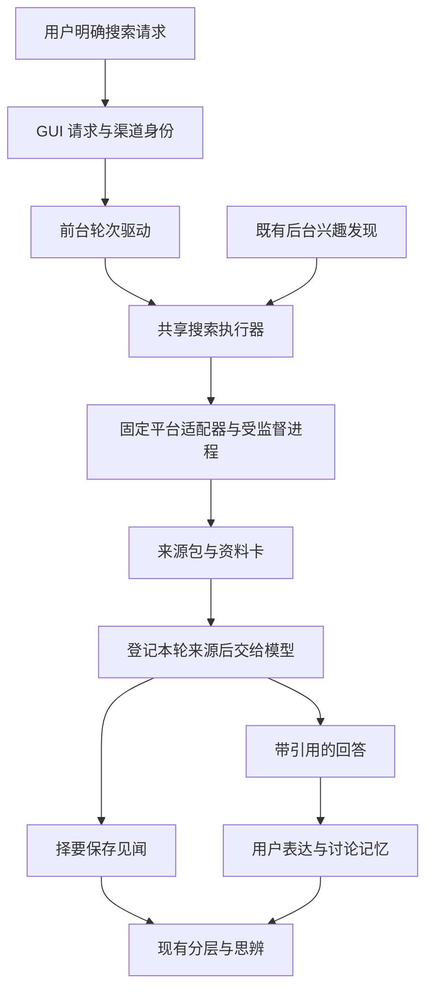

# 对话内检索与记忆衔接方案

2026-10-31｜待审核。依据当前 `trial/windows-v0.2-20261028` 的 `31598be` 及工作区内尚未提交的 B站、知乎浏览器增量。本文是[对话内检索 v1](./对话内检索-设计.md)的后续方案，保留原稿；通过审核后再进入开发。

让用户在聊天里说“帮我找找”，Alice 就能在用户开放的平台内搜索、读取并带来源回答；值得留下的内容成为可追溯的见闻，用户自己的表达和双方讨论的经历也能进入记忆。继续使用现有资料池、三层记忆、渠道和预算体系。

## 一 审核要点

| 项目 | 建议采用的方案 |
| --- | --- |
| 与现有搜索的关系 | 兴趣驱动的后台发现继续存在；新增对话内临时查询，共用平台、读取器、来源和账本，不要求临时问题先变成长期兴趣 |
| 首版入口 | 本机 GUI，用户明确发起搜索；常用自然语言命令直接识别，也可用输入框旁的“联网找资料”，已开放范围内不重复确认 |
| 执行方式 | 保留单一前台会话；增加归属于本轮的搜索任务，网络在受监督子进程执行，等待期间不持 Store 锁，支持停止 |
| 工具范围 | 搜索与实际读取合为一次工具操作；首版不同时引入任意 URL 的 `web_open` |
| 平台范围 | 先完成贴吧全链路；B站简介、知乎回答沿用已有增量，完成相同人工验收后接入。由用户开关决定实际使用，不自动开放 |
| 数量与费用 | 返回 3 份材料作为可改初值；不新增写死的“一轮只能搜一次”。次数、容量、等待预算由用户配置，共享账本不重复计算 |
| 正式记忆 | Alice 可通过明确的保存动作择要记住见闻，不逐条询问用户；宿主核对真实来源、资格和额度，默认普通重要度 |
| 讨论记忆 | 明确的用户记忆指令直接保存其原意；含引用或指代不清的混合讨论先形成候选，不把网页观点自动记成用户观点 |
| 思辨 | 正式见闻可成为有出处、可修订的观点依据；依赖与可见范围贯穿观点及渲染，不因写成摘要就扩大权限 |
| 本次交付边界 | 本文只确定方案；不变更功能代码、本机设置或数据，不启停服务 |

本方案承接[搜索计划](../搜索功能-计划与审核.md)、[冲浪计划](../冲浪功能-计划与审核.md)、[社交观察计划](../社交观察功能-计划与审核.md)和[思想层 v0.4](./架构设计-Alice-v0.4-思想层认识论结构化.md)。产品顺序按用户后续决定执行：搜索、冲浪、社交观察优先，完整查证产品不作为前置；额度采用搜索计划后续修订的可配置契约。早期[联网设计](./联网能力-设计.md)中的固定次数、查证优先和不使用独立浏览器，不作为本方案的约束。

## 二 当前工程基础与缺口

| 现状 | 对本方案的影响 |
| --- | --- |
| `discovery_sources`、受监督 worker、逐步预留预算、资料卡与来源附件已存在 | 复用读取与核准机制；不再建一套直接 `urllib` 抓取的聊天旁路 |
| 聊天取得渠道槽会取消后台发现；搜索执行前检查到前台占用即停止 | 需要区分“后台任务”与“当前聊天自己的任务”，不能直接调用现有后台入口 |
| `ChatService.send` 在整轮内持服务锁，后台存储步骤也需此锁 | 必须调整等待与提交的边界；不能启动一个等待同一把锁的线程，再让聊天等它 |
| 后台卡片发布依赖有效的兴趣 ID 与版本，且会跳过已经见过的内容 | 临时查询需要独立的任务归属；重复查询应能返回有效旧材料，不因后台去重而变空 |
| `remember(source_url)` 已写入普通记忆，可参与思辨；目前只核对 URL 非空，并传入 `salience=1` | 需要补真实来源关联、共享写入额度及普通遗忘语义，不能把该入口直接视为已完成的来源校验 |
| 自动发现的 `memory_eligible` 仍只对 Wikipedia 开放；旧 `external/external_derived` 路径继承来源期限 | 自动短期外部记忆与正式见闻是两种准入，不能只把所有平台的旧资格位改为 true |
| `ordinary_turns` 整体排除带来源轮 | 保留原隔离，同时增加用户表达与讨论事件的专用提取路径 |
| 同一模型响应可能带多个工具调用；现有循环中的 4 是模型交互轮数 | 业务调用次数应独立计数；不能把循环轮数当作搜索额度证明 |
| B站搜索及视频简介、知乎搜索及指定回答已有真实读取记录 | 这些是分段接入证据，完整存卡、聊天和撤销仍待人工验收，见[浏览器接入报告](../B站与知乎-浏览器接入与人工验收.md) |

当前依据主要位于 `alice/discovery.py`、`discovery_memory.py`、`channels.py`、`service.py`、`loop.py`、`retrieval.py`、`store.py`、`extraction.py`、`consolidation.py` 和 `thought.py`。运行中的服务是否已加载这些文件，不由工作树状态推定。

## 三 用户体验与触发

例如：“帮我在贴吧搜一下独立游戏的环境叙事，看看有哪些不同看法。”输入框显示本次将查找的主题和平台；发送就是发起请求，无需再去内容发现页建兴趣、启动一轮、选卡后回到聊天。Alice 展示查找进度，读到材料后回答，来源可展开。

完成后仍可“聊聊这条”“记住这条见闻”“记住我的看法”或“以后也找这类”。最后一项沿用兴趣候选及外发许可，不把一次查询自动变成永久兴趣。既有“聊聊这条”继续只填草稿，由用户发送。

资料卡显示实际状态：“仅作资料”“已记为见闻”“有关联讨论”或“来源已失效”；状态来自落库结果，不采用模型自报。点“已记为见闻”可直达对应记忆，记忆侧也能返回来源和讨论轮次。用户不用理解数据库表，就能看出哪些只是读过、哪些留下了记忆。

### 搜索意图与外发内容

首版采用可明确识别的命令和用户动作：以“搜一下”“帮我找找”“在贴吧搜索”等明确命令开头的输入，或用户点击“联网找资料”。GUI 展示可编辑的搜索主题；宿主再次解析或核对所提交的搜索范围。引用里的命令、否定请求、指代不明的“查查那个”不静默发起，保留草稿并提示补充主题。对任意自然语言意图的完整识别不作为首版承诺。

宿主将当前请求登记为短时 `search_request`，绑定当前用户消息、渠道、会话版本、批准的主题和平台。来源正文及助手回复不能创建该请求。工具只接受这个请求的标识，不能把整份聊天或记忆重新拼成外发 query。首版搜索词使用用户提交的明确主题及适配器的确定性规范化；已有后台隔离选题器仍可围绕获准兴趣自主组词。后续若扩展对话内同义词规划，其输入只含本次可外发主题，不读私人记忆，并按实际模型调用计账。

没有临时兴趣记录，也不默认继承所有兴趣的优先吧。用户明确选中已有兴趣时才复用其已检测优先吧，并沿用“优先这些吧，其他吧后备”的规则；回帖权限与数量继续使用用户设置。

### 控制与状态

保留当前总启停语义，新增独立的“对话内检索”和“自动备料”控制。总开关关闭时两者均停止；暂停自动备料只影响后台，不影响已经启用的对话内请求。迁移保留原开关和平台状态，新对话能力初始关闭，由用户启用一次。界面明确区分停止后台与停止全部联网。

进度使用“正在搜索 → 正在读取 → 已获得材料 → 正在回答”，不承诺固定十几秒。搜索阶段提供“停止查找”；停止后可以依据已经提交的有效材料继续回答，但必须说明仅完成部分。平台要求登录或验证时结束当前任务，展示既有独立浏览器入口；用户处理后自行发起新请求，不后台重试。

失败文案区分：没有匹配结果、结果类型暂不支持、找到了但未读到正文、来源已失效、额度不足、平台验证、取消及中断。已保存的有效材料被复用时明确显示“使用已有资料”，不写成“没有新材料”。

## 四 前台执行结构



### 执行器复用范围

从当前发现监督器中提取共享的“核准、预留、执行、结算、回收”步骤。两个调用方提供不同的任务归属：后台持发现任务身份，前台持当前渠道槽对应的所有权令牌。后台仍在聊天开始时撤销；前台执行器只允许与当前渠道槽、请求和会话版本完全匹配的任务通过，不能全局取消 `foreground_busy` 检查。

前台共享平台许可、通道配置、资源预算、正文校验及来源存储，但不受后台活动时段、库存目标或选题间隔限制。不调用后台整套 `_run`，也不重复执行后台的模型规划和解读。当前主会话已经负责理解请求与回答；资料卡可先由实际标题、节选和覆盖信息确定性生成，作者观点及 Alice 解读没有生成时留空，不伪造。

前台首次出站前确认被抢占的后台联网任务已经回收；若尚未回收，显示正在停止后台，不并行启动第二个网络工作者。普通聊天的模型处理不必等后台网络返回，但数据库提交与联网任务归属仍各自串行。

### 锁与单一写者

渠道槽覆盖整轮，仍阻止 GUI 与 QQ 同时生成回复。将前台轮次拆成准备、模型等待、工具执行、提交几个步骤：数据库操作由宿主在短锁内完成；网络、模型和进程回收等待在锁外。`loop` 交出待执行步骤，由 `service` 执行后恢复轮次，避免手工释放多层 `RLock` 或使用它的私有方法。

Store 仍由宿主串行访问，worker/addon 不持数据库连接。只读状态可在步骤之间读取；重置、人格重装等控制操作继续取得独立控制槽，不能在一个聊天的中间替换 Store。停止搜索只设置绑定当前请求的撤销信号，不等待 Store 锁；预算结算和终态随后在短事务中提交。

每次出站、读取下一项、提交材料以及送入下一次模型调用前核对请求、会话、平台策略版本与取消状态。关闭平台先撤销执行许可，再保存配置；迟到结果不得入库。回收确认完成前不释放该联网任务的执行资格，不把超时返回当作子进程已退出。

这是首期的主要架构工作。`ChatService.send` 的现有阻塞公共用法、QQ 请求及回执协议保持兼容，需要通过真实 GUI/QQ 共存验收后才能开放新入口。

### 任务归属与恢复

复用 `discovery_runs`、`discovery_attempts` 和 `activity_budget`，补充 `trigger_kind`、`parent_request_id`、`tool_call_id` 与规范化请求摘要。临时任务的 `interest_id` 可为空；取消不能删除已发生的费用。

同一聊天请求的重复提交、同一个工具调用的重放只返回已有状态或结果。同轮完全相同的搜索优先复用结果，不重复出站。明确的“重新搜索”是新任务，正常扣额度。进程重启后在途任务标记中断，不自动重跑；SSE 断开沿用现有请求已被接受的语义，服务继续至原预算边界，重连查询原请求，不因断线新增一次生成。用户可用绑定原请求的停止入口取消剩余搜索。

首版不将超时请求静默降级为后台任务，也不承诺“明天告诉你”。未来异步模式须增加 `pending/task_id`、结果查看与独立通知规则。

## 五 工具与公共接口

建议工具契约如下，名称沿用 v1，但模型不再提供任意查询字符串：

```text
discovery_search(search_request_id, platform="auto", limit=null)
```

`search_request_id` 由宿主创建并注入当前轮，模型不能构造有效授权。`platform` 只能在该请求已批准且用户已开启的集合内选择；`auto` 使用请求确定的顺序，不因失败跳到集合外。`limit` 指本次希望返回的“实际读到的材料份数”，候选尝试数另由既有 `read_candidates` 控制；省略时使用用户的返回数量设置。

请求标识只对创建它的会话和当前轮有效。工具参数中的 `limit=null` 表示继承设置；配置中的“不限”沿用用户额度语义。模型不能重用旧轮请求标识取得新的搜索许可。

返回结构至少包括下列字段，正文作为工具结果中的非可信数据，不增加系统消息权限：

```text
status: ok | partial | empty | blocked | cancelled | interrupted | failed
run_id, phase, reason_code
counts: received, accepted, attempted, readable, reused, returned
items: [{packet_id, card_id, title, url, platform, fetched_at,
         evidence, coverage, source_version, expires_at, reused}]
usage: {queries, network, response_bytes, extra_model_calls}
```

搜索摘要、主帖、回帖、视频简介和回答节选分别标明实际覆盖范围。达到数量目标不意味着读完所有候选；只有简介不能表述为看过视频。部分成功时保留已合法提交的材料，附未完成原因；没有合法正文时不让搜索摘要冒充证据。

`/api/chat` 增加可选的结构化搜索意图，纳入请求内容哈希；同一请求 ID 携带不同搜索意图应报冲突。新增 GUI 专用的请求状态和停止操作，沿用同源与意图校验，身份绑定 `request_id/session_epoch`。具体路由在实施时与已有 `/api/chat/activity` 整理，不另起服务。`ChatService.send` 新参数为可选；QQ 既有提交体不扩权，首版不向 QQ 暴露此工具。

现有只含工具名的 SSE 提示增加阶段、任务 ID 和安全计数；终态可通过状态接口恢复。浏览器组件只接既有固定 JSON 行协议，不接收聊天正文、记忆或模型密钥，不导入核心。

## 六 资料进入当轮与资料池

实际读取成功后，宿主先建立或复用有效来源包，再在同一事务中关联当前用户轮和本轮来源集合，之后才把材料暴露给模型。后续 `remember`、assistant 保存与消费记录使用这一集合，复用 `protect_source_turn` 的先登记后提供顺序。

来源集合包含本轮实际看见的卡片、工具结果、外部 recall，以及历史展开中仍向模型提供的外部内容。工具失败或回答中断也不能擦掉已经登记的来源边界。跨多项材料的总结绑定全部必要来源，不能仅保留最后一个 URL。

卡片增加“兴趣发现 / 本轮查找”的归属。现有 `discovery_cards.interest_id/interest_version` 非空约束需要迁移为适合临时任务的结构，同时保留原 ID、来源关系和历史绑定；不创建一个虚假的长期兴趣来绕过校验。后台卡继续检查兴趣版本，本轮卡检查原请求及其许可。

来源包、卡片和正文使用既有容量账本。`pool_capacity=0` 只禁止新增自动候选卡，若来源存储仍获准，可创建本轮附件并回答；`source_pool_bytes=0` 则禁止新增来源内容，预检时直接说明，不能先联网再无处保存来源。调低容量不删除仍有效的历史。模型上下文不足时返回已选子集及覆盖说明，不声称处理了全部材料。

复用缓存时仍检查 scope、平台策略、读取范围和到期状态，不因命中而续期。后台已消费的卡可以在用户明确回顾时再使用，但不重新取得自动分享资格。对话检索不消耗自动分享次数；实际搜索、读取与正式写记忆照常记账。

## 七 见闻与讨论记忆

### 四类内容各自保留什么

| 内容 | 保存内容与进入条件 | 生命周期 |
| --- | --- | --- |
| 原始资料与资料卡 | 实际节选、来源、覆盖、临时解读；搜索成功不等于正式记忆 | 现有来源及卡片 TTL、容量和撤销规则 |
| 正式见闻 | Alice 择要转述，绑定宿主已验证的来源版本及必要短证据；用户允许该类保存 | 普通活跃、仓库、长期分层，默认 `salience=0`，同时受来源保留限制和撤销约束 |
| 用户表达及共同讨论 | 可回查的用户原句、讨论轮次；“用户这样认为”与“网页这样声称”分开 | 独立用户表达走普通记忆；依赖网页语境的事件保留来源约束 |
| 可修订观点 | 由正式记忆经现有思辨生成，保留依据 ID、解释来源与未知项 | 沿用观点生命周期；必要依据失效时停止作为当前有效观点使用 |

不要求每次搜索都保存见闻或形成观点。保存见闻属于 Alice 的明确工具动作，不等于要求用户逐条批准；用户在设置中一次决定是否允许择要保存，并能看到、删除已记内容。后台自动落少量外部 event 与此选项分开，沿用原有 `save_memories` 语义。

### 正式见闻的来源与遗忘

扩展 `remember` 的来源引用参数，使其引用当前可用的 `packet_id` 或已保留证据 ID。`source_url` 保留作显示和兼容字段，不能单独获得“已读”或正式见闻资格。用户只给了一个尚未读取的链接时，可记录为用户提供的线索，不伪造阅读。

宿主验证：来源真实存在、当前任务可见、内容类型及保存用途获准、短证据能回指读取内容、全部必要来源有效、共享写入额度与容量允许。短引文匹配只证明出处，不证明整条转述真实；正式记录保留“作者声称 / Alice 的理解 / 未确定部分”，错误可被纠正。

混合材料上的模型转述默认继承该次输入的来源集合；模型填写较少的来源 ID 不足以解除其他依赖。仅在宿主可独立核对的逐包摘录，或明确隔离输入的处理中，才缩减为对应单源，避免多源内容被记成只有一个出处。

增加独立的 `observation_eligible` 准入，不复用旧 `memory_eligible` 扩大所有自动写入。具体平台能保留的摘要、短证据和期限由适配器策略及用户设置共同决定；未定义该用途的通道可供当轮讨论，不能静默转成长期全文保存。

为避免原始缓存到期就失去所有见闻，同时又不靠普通记忆绕过来源治理，增加最小的持久证据记录：规范来源 ID、版本、URL、标题、读取时间、覆盖、内容哈希、必要短引文、许可范围及最长保留期限。仅在保存正式见闻时创建，不复制整页。证据随依赖它的记忆存活，最后一个依赖被遗忘后清理；来源允许的硬性期限仍优先生效。

原始资料 TTL 到期只清短期包；已经获准独立保留的见闻和最小证据可继续走普通遗忘。**显式撤销、来源数据清除和许可到期不同于缓存到期**，必须使对应持久证据及必要派生失效。扩大期限不延长旧证据授权，改写摘要不重新起算年龄。

当前 `purge_source_packets` 会调用 `revoke_source_packets`；D2 必须先拆分到期清理与显式撤销的原因和传播范围，再开放这种独立保留。旧来源绑定记录仍维持原到期语义，不能因新见闻能力被普遍续期。

### 用户表达与共同讨论

保持带来源轮不进入原普通批提取器。在此基础上新增窄入口：

1. 用户明确说“记住，我更喜欢……”，或在自己的消息上点“记住我的看法”：保存原句或可独立理解的转述，绑定真实用户 turn 和文字片段。直接执行该次保存，不再弹一次确认。
2. 普通混合讨论：仅从用户自己的话中产生候选，保留逐字片段、指代和所依赖来源；没有明确归属的“我也这么想”不自动变成无来源的个人事实。候选静默放在可展开区域，不每轮弹窗。
3. “我们比较过几种游戏叙事方式”这类共同讨论事件：可择要保存为带讨论轮次和必要来源的事件；它证明讨论发生过，不证明网页中的观点为真。

独立用户偏好可在原资料清除后保留；包含文章内容、作者判断或无法脱离上下文理解的表达仍是来源派生。模型不能靠自报“这与网页无关”解除依赖。用户确认的是自己的独立表述，不是为整段网页重新授权。未确认候选不进入兴趣外发队列，记住偏好也不自动等于允许用它上网搜索。

### 数据与消费方式

保持 `memories.kind` 的 `event/stance` 两类和现有分层。保留 `origin` 的真实出处，正式见闻仍来自外部，不冒充 `conversation`；新增生命周期资格区分“随来源到期的材料”和“已准入普通遗忘的见闻”。普通对话、旧外部记录和新正式见闻分别显式迁移，不能将所有旧外部行一并放开。

拟新增两类关系：持久证据记录；记忆与证据、用户轮次及其他记忆 ID 的依赖关系。关系区分必要依据和仅作讨论背景的关联，默认外部依据为必要；模型不能单方面降级为背景。旧 `source_memory_dependencies` 继续管理短期来源，迁移期间保持兼容。

| 数据对象 | 拟增字段或关系 | 关键约束 |
| --- | --- | --- |
| `memories` | `lifecycle` 区分普通记忆与来源绑定记录，`provenance_status` 区分有效、待核实与失效 | 正式见闻保持外部 origin，采用普通 lifecycle；资格不明时不自动准入 |
| 持久证据记录 | 来源 ID、版本、抓取时间、短证据、范围、最长保留期和撤销状态 | 有允许独立保留的策略才创建；不限于缓存 TTL 不等于无限制保留 |
| 记忆依赖关系 | 记忆 ID → 证据 ID、用户 turn 片段或依据记忆 ID；关系角色 | 按 ID 和版本追踪，删除传播不靠标题匹配；独立用户表述与外部依据分开 |
| `discovery_runs/cards` | 前台请求归属与可空兴趣关联 | 既有兴趣卡保留版本核对，临时卡不占兴趣列表 |

持久短证据、正式外部见闻和来源派生文本继续计入 `source_pool_bytes`，不因移到新表获得第二份容量。观测索引只存必要标识，不复制正文作为变相缓存。

集中提供按“用途、渠道、当前时间”筛选记忆的宿主方法，统一用于 active、recall、提取、思辨、人格、技能、P1 和观察器。正式见闻可参与普通分层与获准的思辨；旧隔离记录不会因此自动取得资格。单有 `source_url` 的行不能再越过这些检查。

## 八 思辨与撤销传播

思辨输入显式标记“见闻”，依然使用 v0.4 的 encounter、facts、interp、missing、next_response 结构。标题可用于展示，但依据绑定 ID 和内容版本，不仅靠同名标题。一次页面声称不直接成为验证事实或人格特征，也不触发搜索之外的新联网动作。

衍生观点继承全部必要依据的可见范围交集。GUI 专用见闻可以支持 GUI 范围的观点，但不能写进供所有渠道使用的无范围人格正文；“我现在的想法”按当前渠道从库中重建。既有共享人格和技能只接收满足其全体消费范围及原成长规则的材料；尚未完成范围传播的消费入口继续排除来源派生。

| 操作 | 对资料、记忆和观点的影响 |
| --- | --- |
| 暂停自动备料 | 停止以后后台任务，已有合法内容按原规则存活；已启用的对话内搜索仍可使用 |
| 关闭某平台 | 立即撤销在途请求与未来读取，未用候选不再自动分享；不是清空合法历史 |
| 原始包 TTL 到期 | 清短期正文、卡片和到期的历史附件；不删除另有合法保留资格的见闻证据 |
| 普通见闻被遗忘 | 按现有分层清理，保留不含正文的必要墓碑；不能因为卡片又出现而自动复活 |
| 清除来源数据或必要证据被撤销 | 清对应资料及来源派生正文，相关见闻不可用；派生观点退出有效输入和渲染，重新计算后才能以新依据恢复 |
| 缩小可见渠道 | 下一次消费前生效，GUI 附件、历史、recall、观点渲染及 QQ 发送前检查均遵守交集 |

如果一个观点仍在使用其依据记忆，引用与依赖管理需协调，不能让观点有效而唯一证据已消失。继承来源的东西必须能沿依赖找到，不以“已经总结过”作为保留理由。一个必要依据被撤销时，其他链接仍存在不代表原结论仍成立。

删除传播包括已存的来源回答附件及派生记忆；独立的用户表达不因来源删除自动被抹去。历史界面仅留必要占位。数据库 WAL、备份及已经发送到其他平台的消息不宣称可远程抹除，后续不再主动提供已撤销内容。

## 九 预算与使用权限

沿用现有 `daily_queries`、`daily_network`、`daily_response_mib`、`daily_memory_writes` 等账本。所有正式外部写入，包括新见闻、实质更新和来源派生讨论事件，使用同一每日写入额度；同一内容重放不重复计数。普通用户记忆沿用现有规则，不伪装成网页写入，也不能借分类绕开来源额度。

`daily_models` 当前记录发现规划与解读等额外模型调用，不能声称已覆盖整个普通聊天。首版对话内搜索不追加独立规划、解读模型；主模型处理材料的 token 计入原聊天统计。若以后加入额外阅读或组词模型，则明确计入发现额度并检查已有费用许可，界面同时展示两类成本。

| 配置 | 建议语义 |
| --- | --- |
| 每日次数、容量等已有可空字段 | 沿用 `null` 为不限、0 为禁止新增、正数按值执行，不恢复旧业务封顶 |
| 每轮搜索调用次数 | 新增可调字段，建议初值不限，受共享日预算及本轮执行预算约束 |
| 默认返回材料数 | 建议初值 3，可调整；不表示候选只查 3 个，也不是写死最大值 |
| 工具交互轮数 | 将既有 4 轮移为用户可调设置，保留 4 作为初值，支持不限；与搜索调用数分开 |
| 搜索、读取、整项等待时间 | 复用已有正值可调时间配置，前台整项预算可单独设置；所有有效值可见，不藏固定业务时限 |
| 字节与上下文 | 复用来源容量、单资源预留和取材额度；超过本轮可处理范围时显示部分结果，不静默声称完整 |

不限仍记录实际消耗。浏览器一轮搜索可能产生多个资源请求，网络计账按实际获准资源进行，搜索次数与资源数分别显示。已开始的请求、未知传输和模型调用照实结算，不因取消、失败或重复提交而退回已发生费用；未执行的预留按既有协议释放。

工具可见性与调用校验由宿主决定。外部标签和可疑语句检测仅辅助说明，不能宣称靠标签或正则保证防注入。平台地址、渠道身份、外发主题、保存来源、费用许可与撤销检查必须由代码执行。独立浏览器可使用用户已批准的专用登录会话，凭据不进入模型、查询字符串或结果。

## 十 分期与工程范围

| 阶段 | 拟改位置 | 可交付结果与退出条件 |
| --- | --- | --- |
| D0 执行与数据契约 | `service.py`、`channels.py`、`loop.py`、`discovery.py` | 前台步骤与 Store 锁分开，宿主令牌区分前后台，共享执行器、取消和请求重放成立；先人工验证普通 GUI/QQ 行为未退化 |
| D1 对话内检索 | `discovery_sources.py`、`discovery_memory.py`、`server.py`、`web/app.js`、`web/discovery.js` 及必要样式 | 贴吧明确请求 → 搜索 → 实际读取 → 当轮带来源回答；临时卡不依赖长期兴趣，支持缓存、部分成功、停止和恢复状态 |
| D2 记忆衔接 | `store.py`、`retrieval.py`、`extraction.py`、`consolidation.py`、`thought.py`、`persona.py`、`skills.py`、`evaluation.py`、观察器 | 持久证据、非特权见闻、用户表达与讨论事件、依赖撤销和按渠道消费贯通；修复仅凭 URL 绕过准入的路径 |
| D3 多平台验收 | 已有 `browser_transport.py`、`addons/browser_reader/` 及上述公共流程 | B站简介、知乎回答通过相同存卡、聊天、取消与记忆范围验收后由用户开启；不扩为字幕、评论、文章或无限分页 |
| 后续活动能力 | 既有冲浪、社交观察计划 | 复用同一来源与记忆合同，另行实现自主活动、评论订阅与待续念头，不借本功能默认为其授权 |

D0 与 D1 可以先作为可体验的检索里程碑；D1 若先开放，必须先关闭其未校验的 URL 保存旁路，不能把临时结果送入旧直接入普通记忆的分支。D2 完成才称“对话检索与记忆衔接”交付。D3 可逐平台推进，不因某个平台阻塞而阻塞已验收通道。

核心和 GUI 保持标准库、原生 JS；浏览器依赖继续只在 addon 自己的环境。测试工作区与 addons 只使用公共服务、HTTP 或 CLI。新增能力同时更新 `retrieval.py` 的存在事实清单，准确区分“能搜到”“读了节选”“记住了”和“形成了观点”。

## 十一 迁移与回退

迁移前备份所在检出的本机数据；实施阶段再执行，不在方案阶段读取或调整 `user/`。保持平台、兴趣、优先吧、回帖、provider、用户额度、既有请求及卡片 ID；不随版本发布开启 B站、知乎或自动记忆。涉及卡片非空约束的重建在事务中完成，失败保持旧库可读。

已有 `source_url` 普通记忆没有完整证据链的，标为历史来源待核实：不删除用户历史、不编造抓取时间，也不自动访问链接补证。可供用户回顾其历史记录，但不得作为已核实的新见闻或继续扩大人格依据；只能从可核对的既有证据补齐关联，或经用户发起重新读取后建立新证据。用户确认自己的观点可以另记为用户表达，不能由此倒推出过去已经读取网页。已有重要度不批量偷改；新见闻默认值从新入口开始纠正。

历史观点能找到对应来源记忆时补可用性标记；不能恢复依赖的旧人格修改需人工核对，不承诺反向推导全部旧影响。新路径的来源、范围与依赖必须从创建时完整记录。

回退先停新增入口并回收任务，保留来源过滤及新数据识别。新正式见闻不能被旧代码误当无来源普通记忆；不兼容版本拒绝启动或使用兼容读取方案，不仅回退 Python 文件后直接打开新库。设计本身不执行数据迁移或删除。

## 十二 真实环境人工验收

遵守工作区现行策略，只做真实环境人工验收及记录，不恢复冒烟测试或机器自测。下面各项均为待执行剧本；DSH 的 SDK 仅通过公共面协助执行、收集和记录，不能直接修改内部账本伪造通过。

| 场景 | 需要实际看到的结果 |
| --- | --- |
| 没有长期兴趣时询问一个公开主题 | 当轮搜索并读到材料，来源可展开；兴趣列表没有被偷偷新增 |
| 关闭后台、保留对话检索 | 无后台新任务；用户明确请求仍可执行；总开关关闭则两者都不执行 |
| 普通聊天、引用中的“搜索”或指代不明 | 没有新增网络请求；需要补主题时草稿保留，不循环索要平台授权 |
| 重复查询和断线重连 | 有效材料可复用；同请求不重复扣费、建卡或模型生成；显示原任务终态 |
| 同轮多次调用及改额度 | 0、不限、高于旧上限各按实际配置执行；多个工具调用不能绕过同一账本 |
| 慢页面时停止或关闭平台 | UI 可发出停止；已完成与未完成可区分，进程树回收，迟到数据不入库 |
| 有链接但无正文、部分读取成功 | 不称为读完；分别给出不可读原因或有限覆盖，不笼统归为没有合适材料 |
| 保存见闻再开启新话题回顾 | 能回忆自己的转述并给出真实出处；只有简介时始终不宣称看过视频 |
| 用户说“记住我更喜欢环境叙事” | 保存用户表达及原句关系；作者相反观点不会写成用户偏好，也不自动外发为兴趣 |
| 原资料到期、正式见闻仍存活 | 原文不可展开时如实提示；仍能回顾获准保存的短见闻及最小证据 |
| 普通遗忘与观点引用 | 按真实时间或人工获准的测试设置跨越遗忘窗口，确认普通重要度生效；活跃观点没有悬空依据 |
| 清除来源、缩小范围、GUI 与 QQ 切换 | 派生内容和历史附件正确失效，独立用户偏好保留；QQ 与全局人格看不到 GUI 专用材料 |
| 网页指令及伪造来源 | 不能创建新搜索许可、改设置或用任意 URL 存成已读见闻；记录宿主拒绝原因，不能只凭一次模型抵抗宣称机制成立 |
| 旧库迁移与中断恢复 | 旧卡和请求身份保持，未核实旧见闻标记准确，旧在途请求不自动联网重跑 |
| B站与知乎各自的完整过程 | 分别核对实际内容、覆盖、卡片、当轮回答、取消和记忆；某平台通过不代替另一平台验收 |

每项记录日期、代码版本、平台通道、请求/任务 ID、实际资源与模型消耗、来源和记忆 ID、人工结论及缺口。不得把“代码存在”“接口返回成功”或一次来源匹配等同于资料理解准确和完整闭环通过。

## 十三 与原设计的关键调整

保留 v1 的当轮工具、资料入池和择要记忆方向，补齐前台任务所有权、锁边界、取消和幂等；将“包一层即可”改为明确的执行前置工作。统一搜索与读取职责，移除“一轮只能一次”的固定业务限制，不把异步交付当成不改契约的降级。

记忆采用真实来源绑定和最小证据独立保留，区分缓存到期与撤销，解决 URL 直接入普通记忆及统一重要度的问题。补上用户表达、共同讨论和观点的依赖传播。平台范围以最新接入报告和用户开关为准，继续复用 heartbeat 参考中的素材与正式记忆分离、后台备料与对话表达分离，不复制其固定次数或新增自主发送。

## 2026-10-31 审核通过后的施工记录

用户已审核通过并要求施工。上文保留为原审核稿，交付现状以[实施与人工验收报告](../对话内检索与记忆衔接-实施与人工验收.md)为准。

D0/D1/D2 的代码、公共接口与 GUI 已落地；迁移前自动备份本机数据库，用户关闭原服务后已在原 8800 端口启动新版，原会话及平台开关保留。新对话搜索与正式见闻开关默认关闭，额度继续可调，增加可选的新见闻最长保留期。普通用户原句和来源讨论采用不同记录关系，混合内容不直接转为用户事实。

Python 编译、相关 JS 语法、差异检查、起服和观察入口只读检查通过。没有恢复机器自测；界面自动检查因工具无法可靠识别浏览器 URL 而中止。贴吧对话检索、保存/召回/撤销、GUI/QQ 共存、真实思辨及 D3 多平台完整闭环仍按人工验收表执行，不能把本轮代码完成写成全部场景已验收。

## 2026-10-31 用户纠正：由对话 Agent 自行查找资料

用户明确：联网搜索不放在搜索栏，需要 Agent 在对话中自行查找相关资料。此节替代前文“用户明确发起搜索”“窄命令识别”“输入框旁联网找资料”及“不允许模型生成查询词”的首版入口限制；其他来源、记忆、许可、额度和渠道边界继续沿用。

- 开启聊天检索许可后，主对话模型按话题需要调用 `discovery_search(query, platform?, limit?, fresh?)`，自行提炼公开关键词；不用搜索口令、独立表单、每次确认或额外选题模型。已有记忆与材料足够时直接聊天，不强制先搜一轮。
- 移除输入框旁的搜索表单。实际检索时在回复内显示主题、进度、计数、来源和停止；未调用则不显示空任务。后台按兴趣寻找仍独立运行。
- 宿主继续核验当前用户配置、前台所有权、平台和共享额度。查询只取公开主题，提示中要求抽象私人经历、不外发完整对话，另用有限格式检查拦住常见私密标识与凭据；不承诺语义隐私检测完备。用户常见的本轮禁用表达会直接移除工具。
- 同轮允许按需调整关键词；同调用重放和有效结果缓存继续幂等。遇到平台验证、登录、拒绝或限流，记录本轮平台阻塞，不能靠改词再次访问。
- `search_intent` 只保留为旧 API 调用方的可选查询提示，不再决定普通消息能否获得工具。QQ 仍未扩展新的搜索协议。
- 仅有工具可用不创建外部来源讨论；实际材料进入本轮后再绑定来源与讨论，正式见闻仍由独立开关控制。

验收追加：没有“搜索”口令的自然话题能按需查找；信息足够时不查；本轮明确禁止联网不查；进度可停止、旧进度不覆盖新进度；验证后改词也不会重新访问。实际实施与重载状态仍见上述实施报告。
