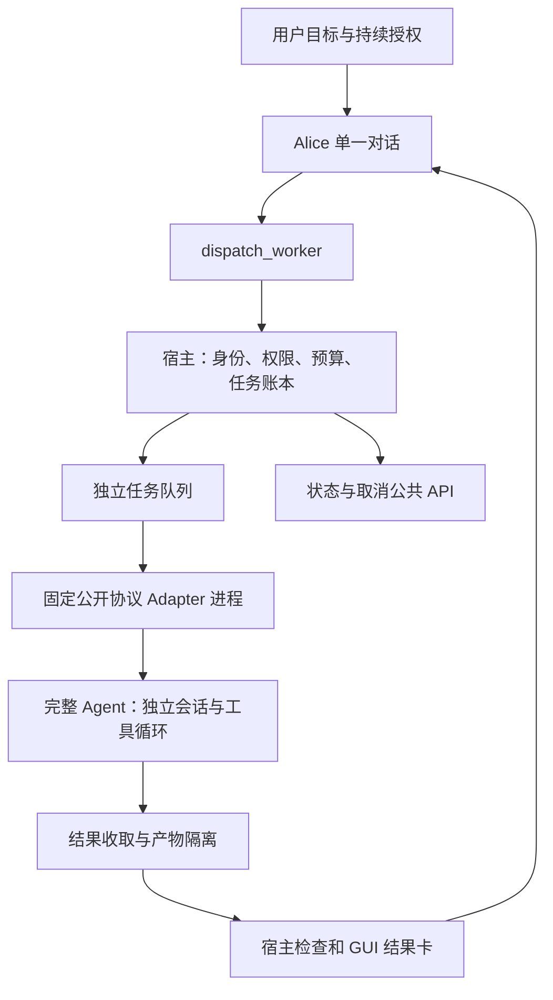

# Alice 管家式 Agent 调度：开发方案 v1

> **2026-11-02 修订入口**：[CLI 协作·宿主契约补充设计 v1](./CLI协作-宿主契约补充设计-v1.md)。本文保留原方案基线；短 Store 锁、独立执行槽、原子登记、来源依赖等约束继续沿用。原强隔离档、文件导入/收取/下载属于设计要求，不能视作现有能力；Claude 原生权限档与软预算的实际边界以补充设计为准。当前施工在 `ytq`，Claude 不合 main。
> **结果展示更新**：PR19 已交付 GUI 单次无工具总结、持久领取及依赖隔离。因此 §2、§9、§14 的“首期只显示元数据/不解释内容”是历史默认，不应据此撤回既有能力；新增工人必须接入同样的身份、政策和来源规则，不自动开放其他渠道或记忆资格。

> 2026-11-01｜待开发方案审核，尚未实施。  
> 基线：`trial/windows-v0.2-20261028` / `7463be08f5cc768650b3a623a91856f23f845618`。  
> 依据：[v2 架构评审](./协作者调度-架构评审-2026-11-01.md)及用户本轮明确提出的“管家／女仆式存在、提供信赖关系、经授权自主协调本机完整 agent”。本文件独立于外部原稿，不覆盖原稿或评审。
> 入库注（2026-11-02）：本文由 astra 出具，ZCode 录入仓库存档。**施工动态**：2026-11-01 用户裁定开工（只动架构侧）；ZCode 完成 D1/D2 机制层与契约冻结 v1，同日 trial 分支 3732ffe 出现平行实现（同名模块 + dsh_agent 真实 adapter + 全链路接线）。2026-11-02 撞车裁决已落定：采纳 trial 3732ffe 为正典，撤回另一套 D1 实现，保留 worker_artifacts.py 与 testbed worker，两者均尚未接线；契约 v1 转为 P1 人工验收标尺，后续推进 P2 来源契约（见 main 提交 f983fa7 与设计稿 v2.3）。

## 1. 产品定位与目标

Alice 是持续陪伴用户的管家：理解用户的目标和偏好，在用户授权范围内选择本机已安装的完整 agent，组织它们完成任务，跟进进度、处理失败并整合交付。她不必亲自掌握每一项执行技能，但必须能判断该找谁、交给对方什么、怎样判断事情做到了哪一步。

用户与 Alice 建立一个持续的信赖关系，不需要为了每项任务切换 agent、反复解释上下文或亲自管理所有工人。Alice 可以在已授予的持续权限范围内自主派工，不要求用户每次点名或重复批准。新增权限、扩大输入范围及改变外部副作用边界仍由用户决定。

“调度一万台计算机”的类比表达的是通过协调扩大能力，而不是承诺数量线性提升智能或吞吐。实际收益取决于任务可分解程度、专业互补、交接损耗、资源竞争和验收能力。方案支持从单 agent 扩展到少量专业 agent 协作；先证明交付质量，再增加并发。

**目标架构是完整 agent 协调系统；首期单 agent 是最小验收单元，不是产品能力上限。** 陪伴与人格仍属于 Alice；执行能力可以由外部 agent 提供。

### 1.1 Alice 的职责

| Alice 负责 | 宿主负责 | Agent 负责 |
|---|---|---|
| 理解目标、选择工人、形成任务说明、提出拆分、判断进度与失败、比较结果、向用户解释 | 权限核验、任务身份、调度与回收、预算记录、来源与产物准入、渠道范围、持久状态 | 在任务范围内使用自己的模型循环与工具，执行、产出文件或研究报告、报告可观测用量和失败 |
| 在已有授权内自主决定是否派工 | 决定请求是否能实际执行；模型不能绕过 | 无权自行扩大 Alice 授予的范围或直接改其人格、记忆 |

判断可以有模型建议，权限和任务状态必须有宿主事实。Alice 不必把 agent 报告当结论，也不应假装所有工作都是自己亲手完成。

### 1.2 体验例子

用户在 GUI 选择一份 CSV，授权指定 agent 使用该文件并在任务目录生成结果，然后说：“按月份拆分，画趋势图，指出明显异常。”

Alice 自主选择已启用且适合数据任务的 agent，提交任务后继续聊天。GUI 显示状态；产物完成后出现结果卡。Alice 可以说明“文件已生成，结构检查通过，内容尚待核对”，而不是只因 agent 自报成功就说“全部验证正确”。

后续协作阶段可以由一个 agent 整理数据、另一个独立检查结果；下游只获得获准的中间产物，不能自动取得上游全部上下文。

## 2. 范围及明确决定

| 项目 | 本方案决定 |
|---|---|
| 首期入口 | 本机 GUI，已有许可内自主派工；QQ 不暴露新派工、任务查询或产物下载能力 |
| 首个 agent | 优先核实用户希望接入的 ZCode；仅为候选，不假定存在 `zcode --headless` 或其权限能力。P0 核实后冻结具体 adapter；不能满足则记录缺口，再选择其他候选 |
| 首期任务 | 用户提供文件、在独立任务目录内处理和生成产物；不覆盖原文件、不改 Alice 项目、不发布到外部系统、不自动安装依赖 |
| 首期执行 | 一名真实 agent、一个运行任务；有界队列。目标架构保留独立任务槽，后续可配置扩展 |
| 主会话 | 保留 GUI/QQ 共用的单前台对话槽；agent 执行不占住该槽 |
| 完成通知 | GUI 状态卡主动更新；不另发模型生成的主动聊天、不发 QQ。下一次 GUI 对话可查询宿主状态；用户也可直接查看结果 |
| 结果理解 | 首期交付文件及宿主状态；不自动把原始报告、文件内容注入永久会话。受范围约束的内容分析纳入 P2 |
| 多 agent | P3 引入并行独立任务，再引入少量有依赖的子任务；不承诺无限扇出 |
| 原有联网 | 保留 `discovery_search`、后台发现及浏览器路径；不把加 manifest 当作完整研究循环 |
| 验收 | 真实环境人工验收；不新建或运行冒烟、单元、机器自测。协议与输入检查属于运行时校验，不等于业务验收 |

以上默认值是本方案建议，不是现有实现或已授予运行权限。授权开发时不自动授权付费试跑、登录或用户文件外发。

## 3. 架构与工程边界



核心继续只用标准库；网页继续原生 JS；第三方 SDK、CLI 兼容及隔离后端集成留在 addon。核心通过固定公开 CLI / JSON 行协议启动 addon，不 import addon；addon 不 import `alice`、不访问 Store。

### 3.1 建议模块落点

下列均为拟新增或拟调整路径，未创建代码。

| 落点 | 职责 |
|---|---|
| `alice/collaborators.py` | 注册项、有效能力视图、用户政策、准入与协调器；不解释 agent 私有输出 |
| `alice/worker_tasks.py` | Store 内任务、尝试、事件、预算及交付元数据；所有写入由宿主短锁执行 |
| `alice/worker_transport.py` | 固定命令启动、JSON 行边界、期限、进程归属、取消回收、协议状态；不承载模型研究循环 |
| `alice/worker_artifacts.py` | 输入导入、产物收取、路径与格式检查、受保护下载、清理 |
| `addons/agent_runner/` | 首个经核实 adapter、独立环境、CLI 私有协议转换与权限后端；公开协议说明 |
| `web/worker-tasks.js` | 文件选择、任务卡、状态恢复、停止、结果下载、人工确认 |
| `alice/service.py` / `server.py` | 公共方法与 GUI 路由，生命周期接线 |
| `alice/loop.py` / `retrieval.py` | 条件挂载工具、有效名单、准确存在事实；不让模型提供执行命令 |
| `tests/` | DSH 的人工剧本、真实记录辅助与公开接口适配；不导入核心内部模块 |

先复用 `steps.drive`、渠道身份与固定连接器的经验，不立即抽象所有现有 transport。待第二个真实 adapter 出现再确认共性，避免先造通用插件框架。

### 3.2 三种所有权

1. **对话槽**：沿用 `ChannelCoordinator`，覆盖一轮 GUI/QQ 对话及现有控制操作。
2. **任务执行槽**：独立协调器持有，覆盖 agent 启动、运行、停止及回收；用户继续聊天不取消文件任务。
3. **Store 锁**：只用于短步骤与事务；文件读写、模型等待、进程等待与回收均在锁外。

所有协调器禁止持执行队列锁再等待 Store 锁。推荐统一顺序：短 Store 步骤内读取并提交任务状态；退出锁后通知调度器。进程事件使用不可变数据入队，再由宿主短事务处理。取消 API 先记录取消意图并发信号，不等待进程退出。

现有兴趣发现继续按其原政策为聊天让路；长文件任务使用自己的任务政策。多个任务共享模型账号、配置目录或浏览器时，以资源组限额约束，不能靠注册不同别名绕过。

## 4. 注册与持续授权

### 4.1 注册信息不等于运行许可

将三类状态分开：

- 安装描述：adapter 身份、协议版本、任务类型和适用范围。
- 用户政策：启用、允许输入、外发范围、输出类型、额度、并发。
- 运行事实：版本是否匹配、依赖是否存在、认证是否可用、进程是否可回收、最近阻塞原因。

有效能力 = 已认可安装项 ∩ 当前用户政策 ∩ 当前渠道范围 ∩ 可用运行条件。模型名单、工具挂载和实际执行读取同一有效视图；每次启动仍重新核验。禁用、认证失败、依赖缺失分别显示，不一律说“没安装”。

以下 manifest 仅表示新协议草案，不是可执行 CLI 配置：

```toml
[collaborator]
name = "zcode-agent"
kind = "agent"
adapter_id = "zcode_local_v1"
protocol_version = 1
task_schema = "artifact_task_v1"
result_schema = "artifact_result_v1"
provides = "在获准任务目录处理输入文件并生成产物"
use_when = "任务需要多步骤执行或文件处理"
not_for = "未授权文件、外部发布、Alice 自我修改"

[requirements]
isolated_session = true
permission_profile = "task_files_v1"
owned_process = true
```

`adapter_id` 由核心固定映射至已审核的 addon 启动入口；manifest 不包含任意 shell 字符串、verify 命令或模型可改执行路径。安装项、CLI 版本或权限后端改变后，旧认可失效，重新进行人工注册验收。

### 4.2 权限配置 `task_files_v1`

首期要求：

- 只读宿主提供的输入副本；可写本任务的 work/output/temp。
- 不可读 Alice 配置、记忆、其他任务及个人文件；不可写输入原件、Alice 仓库或注册资料。
- 新 agent 会话，不附着用户正在使用的会话；禁止自动继承无关历史、插件和全局工具授权。
- 认证所需配置由具体 adapter 以最小方式提供；不传给 Alice 模型、不放 argv 和日志。只有必要认证例外，不能因此授予整个用户目录。
- 模型服务网络与任意互联网访问分开声明。首期允许获准的 agent 模型通信，其他浏览、MCP、发布、安装等能力关闭；若做不到，P0 必须报告，不能声称该档可用。
- 子进程和工具执行继承同一限制。单纯 cwd、环境变量清理、提示词约束均不算实现。

P0 首选核验 CLI 已有的真实权限机制；若不能满足，再评估独立账户或其他隔离后端的可行性与维护成本，不预设建设完整容器平台。**在限制无法强制且未明确改变产品授权范围前，不开放该 adapter。**

### 4.3 用户授权一次，Alice 在范围内行动

GUI 为用户展示：使用哪个 agent、哪些文件可交给它、是否会发往它的模型服务、允许的任务动作和费用控制方式。保存持续政策后，同范围后续任务不用逐次确认。

新文件通过用户选择与导入获得文件级资格；模型只能引用当前获准 `input_id`，不能传任意本地路径。无文件任务也要有明确用户目标，不能仅因网页或 agent 报告包含命令便产生新任务。计划模式的多步再派工需关联同一用户目标及许可。

## 5. 输入与输出文件

### 5.1 输入导入

首期用浏览器文件选择及同源二进制上传，服务端只接文件字节，不接任意本机源路径。上传使用独立大小限制及流式写入，不沿用小 JSON 请求上限。

宿主创建 `input_id`、内容摘要、长度、媒体类型、上传身份、许可版本和有效期；先写临时文件，再发布元数据。最终文件名由宿主生成，用户文件名仅作展示，不作路径。输入随 GUI 当前请求绑定，不自动变成长期兴趣或对话附件正文。

任务目录拟放在本检出的 `user/worker_tasks/<epoch>/<task_id>/<attempt_id>/`，分为 input、work、output、collected；这个路径由宿主生成，worker 只能获得自己任务目录。首期文件类型限定文本、CSV 和受支持的图像产物，不自动解压归档或处理快捷方式。

上传内容是任务数据，不是注册命令、权限政策或宿主系统指令。文件内容默认不送 Alice 主模型；外发给 agent 的权限单独控制。

### 5.2 产物收取

worker 返回相对路径清单；宿主拒绝绝对路径、父目录逃逸、链接／重解析点及不允许的文件类型。收取前停止该任务写入并确认进程回收，之后复制到宿主独占的 collected 目录，计算 SHA-256、长度与格式状态。隔离后端必须保证 worker 不能继续改 collected。

不接受 worker 自报哈希作为宿主确认。Windows 路径验证需处理大小写、卷路径、重解析点与检查/使用竞争，不能只做前缀比较。文件收取与数据库发布非同一事务：使用暂存、最终目录及 manifest 哈希完成两阶段发布；恢复时孤立文件不交付，可重复校验但不重新启动 agent。

下载只按 `artifact_id` 经 GUI 授权提供，禁止 URL 映射任意路径。首期作为附件下载，不内联执行 HTML/脚本，不自动运行生成的程序。下载、查看元数据和导出都重验 epoch、scope、撤销和有效期。

### 5.3 四种完成含义

| 状态字段 | 含义 |
|---|---|
| `execution_state=succeeded` | 进程按协议正常结束，不表示内容正确 |
| `validation_state=accepted` | 宿主已收取获准产物，路径/格式/大小等检查通过 |
| `review_state=unreviewed/accepted/rejected` | 人工核对任务目标后的判断 |
| `delivery_state=available/presented/withdrawn` | GUI 可取、已展示或已撤回；展示不等于用户验收 |

首期不支持任意 `verify` 命令。运行时格式检查采用宿主固定、非执行性的检查器。对于 CSV 分月示例，由人工核对行数、月份归属、图表和异常说明，不以语法检查代替。

## 6. 工具、公共 API 与协议

### 6.1 模型工具

```text
dispatch_worker(name, brief, input_ids, requested_outputs)
  → {task_id, execution_state:"queued", message}

worker_task_status(task_ids)
  → 仅当前 GUI 范围内的宿主状态、产物数量与可用句柄

cancel_worker_task(task_id)
  → {task_id, cancel_requested:true, termination_confirmed:false}
```

三个工具只在 GUI 且当前政策允许时挂载。取消已有任务不依赖新增任务许可仍开启；关闭入口后仍保留 GUI 状态/停止操作。首期用户改目标时取消旧任务并建立新任务，不原位修改执行中的 brief。

派工返回的是排队事实，不得提前说“已开始”“已完成”。`requested_outputs` 只允许约定的产物类别及目标描述，不接受程序、shell、绝对路径或环境变量。权限收窄由宿主完成，模型参数不能覆盖政策。

### 6.2 公共面

拟增加 `ChatService.collaborators`、`worker_tasks`、`worker_inputs`、`worker_artifacts` 公共方法；名称与参数在协议冻结时统一。HTTP 提议：

| 路由 | 作用 |
|---|---|
| `/api/collaborators` | 本机 GUI 名单、政策读取与版本化更新 |
| `/api/worker-inputs` | GUI 导入输入文件，返回不透明 ID |
| `/api/worker-tasks` | 列表、状态、停止、重试请求和人工验收记录 |
| `/api/worker-artifacts` | 受范围保护的元信息与附件下载 |

复用本机 GUI 来源、同源及意图检查，新增 `X-Alice-Intent: workers`；写入带 session_epoch、政策修订号及幂等请求 ID。QQ 机器凭据不接受这些路由。状态使用游标增量查询及页面可见时低频轮询，后续可复用事件设施；首期不新开回调服务。

DSH 人工 SDK 只通过上述公共面或明确支持的本地 CLI，不伪造浏览器头、不直接打开内部数据库写入。GUI HTTP 不适用的人工操作可调用公开 Python 服务方法，在受控真实测试部署中执行。

### 6.3 Adapter JSON 行协议

所有帧带 `protocol_version/task_id/attempt_id/seq`；每个尝试独立 stdin/stdout，stderr 不直接送 UI 或模型。

```text
宿主 → start {policy_digest, input_handles, output_root, brief, deadline, limits}
adapter → ready {adapter_version, cli_version, effective_capabilities}
宿主 → go                         # 预算与政策复核后才发送
adapter → progress {phase, counters}  # 有界枚举及数值，不回传终端全文
adapter → usage {sequence, cumulative, confidence}
adapter → result {status, artifacts, report_ref?, usage_final, errors}
宿主 → cancel {reason}             # 可在执行中发送
adapter → stopped {local_confirmed, remote_state}
```

`ready` 前禁止付费与业务副作用；若某 CLI 无法做到，adapter 启动阶段不能直接运行它，只在 GO 后启动。命令采用固定 argv 数组，不使用 shell 拼接。

一次尝试只接受一个终态结果；重复相同序号幂等，冲突、非法转换和越界帧拒绝。stdout 断开、超量输出、非预期退出均进入明确失败/未知状态，不将任意尾部文本当成功结果。

协议防护初值建议：单帧 256 KiB、结果清单 1 MiB、待处理事件队列 128 项；进度限频并合并，终态不丢。合法格式、身份校验与有界解析是协议约束；用户文件大小、任务次数和运行时间另设可调业务配置。过限返回明确错误，不假装读完。

## 7. 任务状态、持久化与恢复

### 7.1 分离执行、验收和交付

执行主状态：`queued → starting → running → collecting → succeeded`；失败分支为 `failed/cancelled/interrupted/unknown`。取消意图是独立字段，在确认停止前不进入“已取消”。如果资源未回收，保留 draining 标记并阻止资源组启动后续任务。

建议在现有 Store 中新增以下表，由服务短锁串行访问，不给 addon 数据库连接：

| 表 | 最小内容 |
|---|---|
| `worker_registrations` | adapter ID、版本、用户政策、revision、启用与认可记录 |
| `worker_inputs` | input ID、epoch/scope、哈希、大小、许可、有效期、内部路径 |
| `worker_tasks` | task ID、原请求与工具调用 ID、参数哈希、epoch/scope、政策快照、brief、执行/验收/交付状态 |
| `worker_attempts` | attempt ID、启动令牌、进程归属、GO 状态、截止期、终态、未知原因 |
| `worker_events` | 单调游标、任务/尝试 ID、事件类型、宿主字段、去重键；不保存完整终端日志 |
| `worker_artifacts` | artifact ID、任务、相对受控路径、哈希、大小、资格与有效期 |
| `worker_budget_entries` | 预留/观测/结算/未知、计量单位、资源组、尝试与幂等键 |

任务 brief 和文件名属于 GUI 任务资料，不进入通用聊天历史、观察器跨渠道快照或普通记忆提取。持久化由用户任务资料保留策略控制；有效期与显式清除贯穿下载和展示。

### 7.2 幂等与启动间隙

- `(epoch, originating_request_id, tool_call_id)` 唯一，绑定参数哈希；相同返回旧任务，不同返回 `request_conflict`。
- 先在事务内登记任务与预算预留，再锁外启动；发送 GO 前短事务登记准入，随后核验取消与代际。
- 数据库记录 GO 与进程收到 GO 不能原子化。启动后崩溃的任务保守标为 interrupted/unknown，不承诺 exactly-once，不自动重跑。
- queued 且确认从未创建尝试的任务，重启后也先暂停，用户显式恢复时重新核验输入、政策与额度。首期不静默恢复队列。
- 用户显式重试生成新尝试、保留原任务关联和旧消费；若目标或输入改变则新任务。未知副作用在 UI 说明，本方案首期通过禁止外部写入减少影响，但不能据此抹掉未知费用。

### 7.3 取消、版本变化、退出

取消和结果到达通过宿主终态提交顺序裁决。取消先提交则迟到结果仅隔离，不自动交付；有效产物先发布则取消不伪称“撤回已完成任务”，用户可另行撤回结果资格。

政策收窄或禁用先阻止新准入，再取消受影响任务；collector 在发布前复核政策版本。CLI/adapter 更新期间不接新任务，旧任务收尾后切换，重新认可。

退出顺序：停止接单 → 发取消并锁外回收 → 提交终态和预算 → 再执行原有 Store 关闭维护。归档/重置同样先在锁外排空任务，不能在 `_archive_locked` 内等待需要 Store 的工作线程。任务数据按旧 epoch 隔离；新会话不可自动取用旧任务结果。

Windows 可复用现有 Job Object 整树回收思路，但应抽成明确进程所有权组件；不能把按 PID 杀进程当作恢复所有权，需进程启动身份/句柄核对。远端模型是否仍执行单独记录为 unknown，不假装本地退出撤销了远端费用。

## 8. 成本、并发与用户控制

不把工具轮数当执行次数，不把费用当并发限制。以下分开配置：任务日次数、每任务/日模型用量或金额、执行数、排队数、时限、文件与输出容量、结果保留期。

建议新安装默认禁用；启用时由用户确认 adapter 的计量能力和预算设置。首期全局运行数为 1 是实施范围限制，界面明确；P3 开放配置。队列建议初值 4、任务超时 30 分钟，均可调，0 只用于有定义的“禁止新增”，期限必须为正。不得悄悄覆盖现有检索额度。

| adapter 能力 | 允许的表述与处理 |
|---|---|
| 有真实事前上限及可观测消费 | 宿主按任务上限预留，终态幂等结算；跨日仍结算原预留日，防止双扣 |
| 只能结束后报告 | 明确显示软预算/记录，不能宣称硬帽；用户只有显式接受这种计量方式后才能启用 |
| 中断后用量未知 | 保留未知项及已有预留，不把 unknown 记作 0；按政策阻止新增付费任务或要求用户处理 |
| 多个别名共用账号 | 使用同一资源组和同一预算账本；外部手动调用不在宿主控制内，应明示统计覆盖范围 |

进度 usage 采用带序号的累计数，不能重复累加。账本单位必须明确：token、调用次数、货币金额分列，币种和计价版本记录；不能拿估计 token 当实际账单。

完整 agent 首期使用独立可解释的任务预算记录，统一 UI 展示；与 discovery 已有额度不混算未知单位。以后 agent 经宿主调用轻工具时，轻工具只在原共享池扣一次，任务账本关联消费 ID；不重复计费，也不绕过原平台许可。

## 9. 结果、记忆与信任边界

### 9.1 P1：先保证安全交付

首期对 Alice 主模型仅提供宿主生成的状态、产物数量及不透明任务/产物句柄。不提供任意 stdout、worker 报告、文件名、文件内容或错误原文；错误使用宿主枚举映射。GUI 可直接查看任务范围内的元信息并下载产物。

不自动把 worker 产物或总结写成普通记忆。宿主事件事实也不因此获得全渠道自动记忆资格；首期保存在任务账本。这样交付文件无需先改完整记忆污染防护链。

Alice 能说“这项任务已生成两份文件，尚待内容核对”，不能仅凭状态说“分析结论正确”。用户若要求解释文件内容，P1 明示需人工查看，或进入后续已实现的受限分析能力；不能偷偷把全文塞进常规聊天。

### 9.2 P2：实现受范围约束的分析与整合

新增任务附件上下文，绑定 task/artifact/evidence ID、内容版本、epoch、scope、保留许可和必要依赖。原始 agent 报告以不可信数据提供；分析建议与宿主事实分开。任务来源不伪造网页 URL，也不直接塞入现有只接受网页字段的来源包。

在进入模型前登记本轮任务依赖；返回、历史展开、recall、记忆提取、思辨、人格/技能维护、观察器及 QQ 取用必须按同一依赖范围处理。派生回答绑定实际输入集合，不能由模型删减依赖。显式撤回、输入许可取消和必要证据失效应传播到派生内容；单纯候选文件清理与撤销许可区分。

正式打开该能力前，须有专门的任务内容来源方案与真实跨渠道/撤销验收；否则只保留 P1 交付。不得用一个 `summary` 字段绕开这道门槛。

研究结果若要进入现有见闻管线，必须由认可的读取路径建立真实来源，核对 quote、身份、版本、覆盖、期限和许可。worker 自报 URL 与原文不能相互自证；同源重抓不是独立佐证。允许 agent 给出综合建议，但 Alice 采纳及记忆资格由宿主事实和实际证据决定。

### 9.3 信赖关系中的诚实

名单写“能协调某 agent 完成哪些范围的任务”，不写“什么都会”。失败区分未安装、禁用、认证失效、权限不符、额度不足、排队、执行失败、结果不合格、取消未确认。一次试跑成功不代表所有任务可用；注入扫描是提示信号，不能称免疫。

协作者表现可在 P2 后作为有范围的经验记录：任务类型、版本、耗时、人工结果、样本量。不因一次失败永久定性，不让经验改权限或预算。

## 10. 多 Agent 目标架构（P3）

先开放互不依赖的任务并行，再支持小规模子任务依赖。Alice 输出计划建议，宿主登记 `goal_id/parent_task_id/dependencies`，校验无环、输入资格、预算与资源组，只有依赖产物已被收取且未撤销才启动下游。

每个子任务有独立权限、输入和消费；父目标授权不自动授予所有文件。共享中间产物通过不可变 artifact ID，不共享可写工作目录。agent 不自行招募其他 agent；需要再派工时向 Alice/宿主提交建议，由既有目标范围和政策准入。

用户可取消整个目标或单个任务；上游取消/失败使依赖任务 blocked，不能静默改用猜测结果。独立任务继续与否由用户目标政策决定。总预算先覆盖计划承诺，新增子任务重新核验剩余预算；不允许通过拆分无限逃逸限制。

Alice 在有界上下文内比较交付与需求，记录哪些结论来自哪个 agent 和证据；合并结果不自动扩大受众或永久化。多机、复杂 team、任意 CLI 插件市场留待真实需求，不属于此版交付。

## 11. 开发工作包与责任

以下为建议分工，不启动子代理或代表任何协作者领取任务。

| 工作包 | 主责建议 | 可审核交付与依赖 |
|---|---|---|
| D0：真实 adapter 能力核验 | ZCode 架构侧与该 addon 开发者；DSH 准备人工记录 | 明确具体版本、真实命令、权限后端、会话隔离、用量和取消能力；逐项证据，无凭据正文。未通过不得启用 |
| D1：协议和任务账本 | ZCode | 冻结 JSON 帧、状态迁移、公共 API、预算和恢复契约；先加表不拆旧表 |
| D2：文件与进程宿主 | ZCode 核心＋addon 开发者 | 输入导入、输出收取、固定启动、GO 准入、进程回收；真实 adapter 单任务闭环 |
| D3：GUI 与 Alice 接线 | ZCode | 注册与授权 UI、工具条件挂载、结果卡、状态/停止/恢复、准确存在事实 |
| D4：人工验收 SDK | DSH | 仅公共 API/CLI 的真实环境部署、操作剧本、计数/截图/日志记录、清理说明；不添加机器自测 |
| D5：P1 验收及修订 | 用户主持，开发者记录 | 通过下表人工门槛，形成实施报告；未验项逐项留空，不以起服代替 |
| D6：内容整合 | ZCode | P2 任务附件来源方案、所有消费路径范围传播与人工验收后启用 |
| D7：并行协作 | ZCode＋DSH | P3 资源组、依赖任务和取消传播；同一目标真实人工对照 |

P0/D0 允许只做文档、静态接口核验和用户主持的真实注册验收，不把“注册”变成每次开机偷偷调用模型。具体 CLI 尚未核实，所以本方案不虚构运行命令、工期或成功率。

## 12. 真实环境人工验收门槛

本轮未执行下列任何项。仅在开发和真实验收获授权后，由人使用明确的样例文件及自己的额度操作；不自动创建“必崩 worker”等机器测试替代真实场景。

| 编号 | 操作 | 必须看到的结果 |
|---|---|---|
| A01 | 注册具体 agent，版本/依赖不符再恢复 | 状态准确；不匹配时不派工，不触碰原会话 |
| A02 | 用户指定 CSV，Alice 自主派工，完成分月与图表 | 用户无需点名每步；输入不覆盖，产物可下载，人工核对内容并记录 |
| A03 | 执行中继续 GUI 普通聊天、再进行本人 QQ 对话 | 前台顺序正确；文件任务不因普通聊天取消；QQ 不获取任务内容或工具 |
| A04 | 人工请求访问未授权样例目录/写输入副本 | 由真实权限机制拒绝，不仅 agent 口头拒绝；样例不得含真实密钥 |
| A05 | 点击取消、关闭入口、收窄权限、退出 | 意图、停止、回收和未知远端消费分清；无迟到发布 |
| A06 | 同请求重放、断线重连、人工中断后重启 | 不重派、不重复扣账；未知不假报成功；原任务仍可查 |
| A07 | 预算设小、设 0、调整等待与容量 | 遵守用户设置；软预算如实显示，未知保留，协议约束不被绕过 |
| A08 | 产物路径越界/链接、格式错误、内容错误 | 越界不交付；结构与人工验收分开，内容错误可拒收 |
| A09 | 更新 adapter 或修改任务目标 | 旧认可/任务不混用；原消费保留，新目标另建 |
| A10 | 清除输入许可与任务结果、归档后查看旧链接 | 无跨 epoch 下载或旧报告复活，未清除的其他工作不受影响 |
| A11 | P2 报告含注入内容，GUI 分析后 QQ 查询、撤销 | 实际动作不越权，来源依赖传播，范围隔离，记忆不污染 |
| A12 | P3 两个 agent 并行、上游失败、目标取消 | 并发可控、资源组有效、依赖阻塞准确，产物不互相覆盖 |

记录：基线提交、adapter/CLI/权限后端版本、policy revision、task/attempt/input/artifact ID、宿主状态、实际用量与未知项、人工判定和未解决问题。避免收集凭据、完整个人文件或终端敏感输出。

已有 GUI 知乎 candidate/url 静态不匹配另开修复项，不混入首个 agent 架构实现；将来统一检索入口前必须修复并人工验证。

## 13. 迁移、回退与交付流程

只新增任务表和 task 目录，不迁移或改写既有来源/记忆数据；迁移前在获授权实施时备份。新功能初始禁用，不改变现有后台、聊天检索、平台、QQ 和记忆开关。

回退顺序：禁止新派工 → 取消并确认回收/隔离未知任务 → 保存用量与状态 → 禁用新入口。首选功能开关回退，不用旧代码直接打开新库证明兼容；涉及版本回退时使用配套备份，不删除其他轮次备份或浏览器会话。

权限无法证明、无法确认回收、产物越界、未知消费被计零、跨渠道泄露、重复执行任一出现即阻止上线；其他问题可保留明确降级但不得宣称功能通过。

现有 `discovery_search` 只有在统一新路径完成同等来源、额度、停止、恢复、记忆与渠道验收后才讨论退役。低使用率、成本追平、维护压力只是评审触发条件，不是自动删除规则。

提交只暂存本任务路径。2026-11-02 用户纠正：当前工作分支为 `ytq`，此前 `trial/windows-v0.2-20261028` 是本文历史基线；推送须用户明确指示，Claude 直调仅限 `ytq`、不合 main。其他获准合入的改动经 PR，不直推 main；合并时按 AGENTS 的共存检查执行，须处于获授权的实施/启服阶段，本轮文档修订不执行这些检查。

## 14. 当前默认与待决门槛

本方案已经采用两个保守但可调整的产品默认：完成时更新 GUI 卡片、不自动主动发言；首期只处理指定输入及独立目录产物。它们不限制后续管家能力，只避免在首个执行闭环中同时引入主动消息和外部写入。

实施前唯一不能凭设计自行补齐的技术门槛是：**首个具体 agent 的接口与权限能力核验**。P0 报告必须回答能否满足该档，以及费用是硬上限还是软记录；若不能，提交精确差异供用户决定更换 adapter、改变范围或接受明确的计量模式，而不是临场降级权限。

用户未来要求主动交付、直接改原项目或发布到外部系统时，在已有任务账本上增加明确的动作许可和交付规则，不重写人格或把全部任务变成无条件高权限命令。

## 附：本次开发方案与现状的接线依据

| 当前位置（基线行号） | 本方案处理 |
|---|---|
| `alice/channels.py:141` `reserve` | 保留对话槽，任务槽独立 |
| `alice/steps.py:11` `drive` | 保持短锁与锁外 I/O 模式 |
| `alice/service.py:315/368/769` | shutdown、archive、close 接任务排空；等待不能放入锁内归档 |
| `alice/service.py:462` `_send_steps` | 仅 GUI 注入派工上下文与宿主状态 |
| `alice/loop.py:165` `chat_turn_steps` | 新工具分支使用步骤接口；派工不阻塞整轮 |
| `alice/retrieval.py:24/98` | 有效能力名单与存在事实同步，不删除原检索事实 |
| `alice/discovery.py:1359/1384` | 参考预留/结算，不直接把完整 agent 未知消费当旧模型次数 |
| `alice/browser_transport.py:97` | 参考 Job Object 所有权回收，不把它当权限沙箱 |
| `alice/local_connector.py:114` | 参考固定 CLI 协议启动，不让网页提供命令 |
| `alice/retrieval.py:202` 与 `alice/observation_memory.py:124/209` | P2 必须保留来源资格和派生依赖，不用报告摘要绕过 |

*补充修订（2026-11-02）：实际双轨接线采用宿主契约补充设计 H1～H4 与 H01～H10 人工门槛。本文方案、已有实现与真实验收分别记录，不用设计清单标记实现完成，不用历史 runner 结果替代 GUI 人工闭环。*
