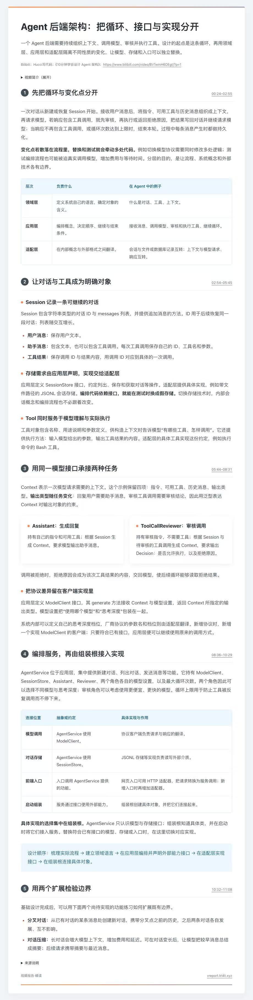

# Alice Agent 架构现状评估报告

日期：2026-11-11

评估对象：`ytq` 当前工作区源码，包含未提交的在途改动。

评估方式：依据用户提供的架构示意图，对照源码进行静态审阅。

> **参考声明：本报告仅供参考，不作为直接施工依据、执行计划或改造授权。施工改造仍需经过完整考量，包括产品目标、实际问题、依赖关系、兼容性、数据迁移、权限与预算语义、实施成本、回滚方案及真实环境人工验收。报告中的建议顺序是初步判断，须在正式设计时重新确认。**

## 一、总体判断

Alice 的架构基础成立，宿主治理比较扎实，核心职责的耦合已经偏重。

当前形态更接近“按功能组织、由 ChatService 协调的单体宿主”，尚未形成严格的领域、应用与适配层隔离。主要风险是能力持续增加后，调整某一项规则会影响主循环、模型调用、来源保护和数据提交等多个环节。

这一判断针对源码结构，不等同于运行稳定性、权限安全或长期人格效果的验收结论；未完成的真人验收仍保持未验状态。

## 二、附图的主要启示

原图见文末附录。

图中强调将稳定流程与易变实现分开：

- 稳定流程：接收消息、组装上下文、调用模型、审核与执行工具、回填结果、继续或结束。
- 易变实现：模型供应商协议、存储方式、具体工具及 HTTP/CLI 入口。
- 通过明确接口连接两者，由启动组装部分选择具体实现。
- 将会话、工具调用、工具结果和审核决定表达为可识别的数据对象，减少业务流程对 SDK 报文的直接依赖。

评价边界的关键是“修改会传播到哪里”。文件数量和目录分层本身不能证明解耦完成。

图中的模型审核可以辅助判断，但权限、预算、撤销及执行身份仍须由宿主确定性核验。图中的分叉对话是边界检查示例，不意味着 Alice 必须改变单一长期会话的产品定位。

## 三、当前职责分布与评价

| 部分 | 主要文件 | 现状与评价 |
|---|---|---|
| 入口与渠道 | `server.py`、`cli.py`、`channels.py` | HTTP/GUI/QQ 已有公共服务入口和渠道治理；部分终端命令直接使用核心流程，入口尚未完全统一。 |
| 宿主协调 | `service.py`、`steps.py` | ChatService 管理资源与协调器；步骤驱动区分持锁数据操作和阻塞 I/O。已有良好基础，但服务还承担构造、恢复、配置和多类业务协调。 |
| 主对话循环 | `loop.py` | 同时承接上下文、流式协议、工具路由、来源核验、回复审核、持久化与轮末维护，职责过重。 |
| 模型适配 | `llm.py`，以及部分业务模块中的直接 SDK 调用 | 已有公共访问封装；主流程仍理解供应商响应结构，流式与非流式处理、任务特殊参数分散。 |
| 工具定义与执行 | `capability_registry.py`、`capabilities/commands.json`、`worker_tools.py`、`dialogue_search.py` | 定义、公开 schema 和参数校验已同源；执行依然通过分支及不同会话对象路由，尚未统一为完整执行契约。 |
| 记忆与数据 | `store.py`、`retrieval.py`、`learning.py`、`memory_policy.py` 等 | Store 混入多类业务能力，部分协调器直接执行 SQL；纯策略式的 memory_policy 已展示可延续的分离方向。 |
| 外部 Agent | `worker_runtime.py`、`worker_process.py`、`worker_permissions.py` 等 | Claude 已通过独立进程协议接入，具备生命周期、账本和权限监督；不同 Agent 的差异仍有部分留在核心协调逻辑中。 |
| 上下文与人格 | `context_*.py`、`persona_context.py`、`grounding.py` 等 | 已有预算、快照、分层读取及依据审核；这些机制与主循环的数据访问、失效检查和提交过程联系紧密，仍需整理协作边界。 |

这里的“宿主”不只指 ChatService：主循环、渠道与任务协调器、维护执行器和存储管理也属于宿主实现。模型负责生成与选择，宿主负责核准、执行、记录及资源生命周期。

## 四、值得保留的基础

1. **执行事实治理。** 请求身份、幂等、会话代际、取消与 unknown 状态已有明确处理，不能在重构中退化为简单重试。
2. **来源与依赖保护。** 资料具备受众、有效期、撤销和派生依赖，执行与发布前存在重新核验。
3. **工具定义同源。** 能力注册表减少工具说明、参数 schema 与实际能力之间的漂移。
4. **外部实现隔离。** Claude CLI 已走固定进程协议，核心直接导入 addon 的旧问题已修正；原生权限监督仍不等于操作系统沙箱。
5. **符合当前规模的单体部署。** 单体、SQLite 和单一长期会话都有现实合理性，现有证据不足以支持拆成微服务或更换数据库。

## 五、主要风险及影响

| 风险 | 可能影响 |
|---|---|
| 主循环承接过多业务规则 | 人格、记忆或审核规则的局部调整，可能影响流式输出、工具交互和回复提交，增加评审与验收范围。 |
| 模型协议穿透业务层 | 更换供应商或接入另一种协议时，多处业务代码需要同步修改，重试、超时和用量语义容易分化。 |
| 工具执行契约不完整 | 新工具仍可能要求修改主循环；参数合法、当前授权、实际执行和结果附着之间的责任不够集中清晰。 |
| 存储与业务规则交织 | 表结构、事务边界或维护规则变化时，影响面较大；仅注入 client 和 db_path 尚不足以隔离全部状态，人格读取等仍使用全局路径。 |
| 执行事实分散保存 | 长期聊天记录、轮内工具消息、任务账本和上下文观测承担不同职责；排障记录不能直接视为统一、持久的会话执行账本。 |

上述风险是结构上的维护风险，不表示已经证实发生越权、数据损坏或所有模型调用行为不一致。

## 六、候选优化方向

建议在正式设计时优先比较以下三项的成本与收益：

1. **模型端口收口。** 为请求、结果、流事件、错误与用量建立统一表达，供应商差异留在适配层；明确每类调用的超时和重试政策，保留禁止重发未知操作等既有语义。
2. **工具执行契约收口。** 延续能力注册表，明确可见性、参数校验、执行核准、调用回执和结果附着各自责任；实际执行器继续检查当前权限与预算。
3. **逐步收窄循环与数据职责。** 将上下文组装、有效性核验、回复审核和提交整理为明确组件，逐步归拢 SQL，并提取独立业务策略。

是否补充持久化的工具执行事实，应先确定恢复和审计需求，再决定最小数据结构与留存范围。无需为套用图中示例而保存全部原始 SDK 报文。

## 七、施工前必须明确的事项

- 本轮要解决的具体问题、预期收益，以及明确不改动的产品行为。
- 对在途改动、GUI/QQ、CLI 和外部 Agent 接入的影响范围。
- 来源撤销、权限复核、预算预留、unknown、流式发布及幂等语义如何保持。
- 是否涉及已有会话、记忆、人格及任务账本迁移，以及备份和回滚方式。
- 分阶段交付边界与真实环境人工验收安排；遵循项目现行测试约定。

本次仅完成源码评估与文档整理，未进行架构施工、用户数据访问、服务重启、业务测试或模型调用。

## 附录：用户提供的参考图

来源：用户提供的《Agent 后端架构：把循环、接口与实现分开》截图，原样保存，供对照阅读。

