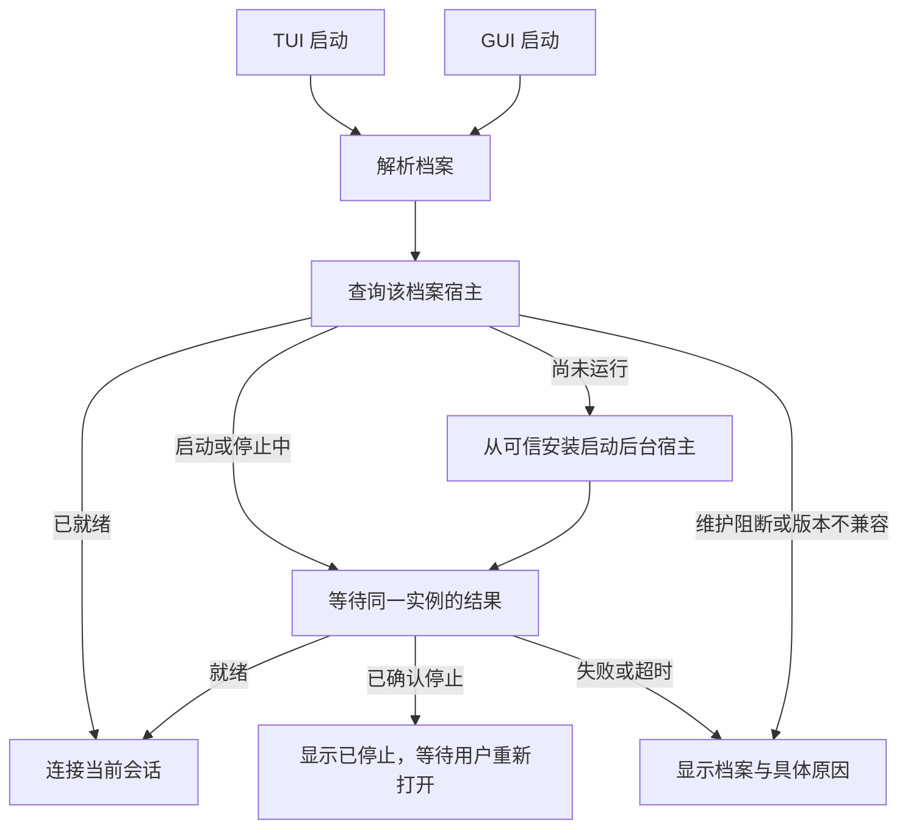

# Alice TUI 与 GUI 独立启动说明 v1

2026-11-22 · 设计说明，待施工

2026-11-22 · 第一阶段（§6.1：宿主发现、按需启动、就绪握手、`alice stop`，TUI 接入）已施工待真人验收；桌面接入同一宿主与退出入口迁移留第二阶段，并存/异常恢复验收留第三阶段

2026-11-22 · 第二阶段（§6.2）已施工并过 cargo check：桌面启动先经档案 socket 控制面（新增 `GET /api/tui/v1/gui` 就绪信息）附接共享宿主，spawn 竞态败方转附接；desktop_host 管道断开不再杀宿主（仅 Lab 实验宿主保留随管道消亡）；关窗=客户端离开、宿主留存至显式停止；菜单新增「停止 Alice」（共享模式走 socket，管道模式走既有排空链）；共享模式下维护/更新入口拦截并引导先 `alice stop`（防 alive() 误判对活库 restore）。更新/恢复流程在共享宿主下的迁移留第三阶段；§7 真人验收待做

## 1. 用户体验

输入 `alice` 就能在终端继续对话。双击 Alice App 就能打开桌面界面。最先打开的入口负责确保本机宿主已启动，随后打开的入口直接连接。两个界面可以各自开关，同一个档案始终由一个宿主管理，继续使用同一条会话、人格、记忆和后台活动记录。

这里借鉴的是 `claude` 可以从终端直接进入交互的启动体验。Alice 的宿主生命周期按自己的永久会话与后台活动设计。 [Claude Code 快速开始](https://code.claude.com/docs/en/quickstart#step-2-start-your-first-session)

| 用户操作 | 预期结果 |
| --- | --- |
| 桌面 App 没打开，输入 `alice` | 终端显示「正在启动 Alice」，按需启动选定档案的宿主。就绪后直接进聊天。 |
| 桌面已经在聊天，再输入 `alice` | 终端加入桌面正在使用的会话，能看到已有消息。 |
| 先在终端发消息，再打开桌面 | 桌面加入同一宿主，能看到终端发出的消息及已保存的回复。 |
| 关闭终端或退出桌面界面 | 当前入口离开。已经接单的工作继续收尾，后台活动仍受原有清醒状态、权限和开关管理。 |
| 明确选择「停止 Alice」 | 停止该档案接收新工作，等待现有工作安全收尾。所有连接它的界面看到同一停止状态。 |

## 2. 当前行为与变更点

当前 TUI 只尝试读取所选档案的 Unix socket，宿主缺席时退出。源码命令默认选择仓库 `user/`，桌面安装版使用自己的档案。此前桌面正在运行而直接输入 `alice` 报错，原因就是两端查找了不同档案的 socket。源码的 `serve --no-open` 可以起服而不打开浏览器，仍需用户另行运行命令。 [现有 TUI 入口](../../addons/alice_tui/__main__.py) · [现有 CLI](../../alice/cli.py)

目前桌面直接启动 `desktop-host` 子进程，并通过私有管道取得就绪地址和发送关闭指令。控制管道断开会发起后端收尾。独立启动要求桌面成为宿主的客户端，桌面窗口和管道的存活期只代表当前客户端连接。 [桌面启动器](../../addons/desktop/src-tauri/src/main.rs) · [桌面控制协议](../../alice/desktop_host.py)

## 3. 档案选择与启动流程

### 3.1 两端用同一套档案解析

- 正式安装版的 `alice` 和桌面 App 默认使用同一个本机档案。macOS 沿用已安装桌面版的 `~/Library/Application Support/Alice`，用户已有的会话与资料仍由该档案提供。
- 开发、测试和多档案场景继续支持显式指定绝对路径。源码 CLI 的 `--user-dir` 与 `ALICE_USER_DIR` 沿用原有优先关系，未给定时使用所在检出的 `user/`。`alice tui --desktop` 可继续显式选择桌面档案。安装版默认与源码默认分别说明。
- 档案以规范绝对路径确定身份，沿用档案级 socket 路径。启动失败、碰到旧版本或权限不符时，界面显示实际选中的档案和原因，等待该档案恢复或让用户主动更换档案。 [现有档案路径解析](../../alice/runtime_paths.py) · [档案级 socket](../../alice/local_socket.py)

### 3.2 先连接，按需启动

1. 客户端先解析档案，再核对运行中宿主的协议版本、档案和实例身份。只读状态成功后才进入聊天。启动程序来自已知安装包或用户明确选定的源码环境。
2. 同一档案的启动请求串行协调。TUI 与 GUI 几乎同时打开时，只有一个启动者创建宿主，其余客户端等待就绪。宿主继续使用外层档案锁和数据目录实例锁，成功取得锁后才打开 Store。
3. 就绪信号来自已能处理请求的宿主。握手将「宿主在线」和「模型与人格已就绪」作为两种状态，首次安装可先连接，再进入现有配置流程。等待有上限，启动期间显示状态，并允许用户关闭界面。
4. 权限不符、版本不兼容、维护停机和启动失败分别显示。锁被占用但暂时连不到时，先核对实例状态。陈旧端点由持有档案锁的宿主在确认原监听器已结束后清理。锁文件按现有规则保留。 [实例锁实现](../../alice/instance_lock.py)

## 4. 宿主与界面的职责

| 部分 | 职责 |
| --- | --- |
| 每档案一个 Alice 宿主 | 持有 Store 和档案锁，负责会话、消息接单、断线核对、记忆维护、人格及后台活动。TUI、GUI 同时提交时沿用现有队列与忙闲规则。 |
| TUI | 通过档案级 Unix socket 建立聊天连接，沿用对端 UID 校验。提交、历史、状态、原请求核对继续使用现有终端契约。 |
| 桌面 GUI | 发现并连接已就绪的同档案宿主。原生端通过独立的本机控制面取得 GUI 访问所需的就绪信息。现阶段 GUI 继续走回环 HTTP，沿用网页的来源校验与桌面原生命令权限。 |
| 生命周期控制 | 提供就绪、连接、断开和显式停止等控制。控制面与日常聊天权限分开，停止和维护由用户通过显式入口触发。 |

第一阶段可用同一个后台宿主同时提供终端 socket 和本机 GUI 接口。只开 TUI 时启动宿主即可，浏览器和桌面窗口按用户选择打开。宿主仍只提供本机接入，Lab 和 QQ 维持自己的授权。该改动面向客户端生命周期，模型工具能力沿用现有注册表。 [现有宿主启动链](../../alice/server.py) · [TUI 接入约定](../../addons/alice_tui/README.md)

## 5. 退出、后台活动与更新

- **关界面**只结束当前客户端连接。已接单的轮次由宿主处理并保存，其他界面可继续查看。同档案最后一个界面退出时，首版建议宿主留存至显式停止或系统正常关机。后台活动开关继续决定宿主是否主动工作。宿主按首次打开入口时启动，登录系统本身无需启动 Alice。
- **停止 Alice**是对整个档案宿主的操作。建议桌面提供「停止 Alice」，终端提供 `alice stop` 作为显式命令。宿主停止接单，排空已准入请求和后台任务，保存数据后发布停止结果，再清理自己的 socket 和释放锁。多个停止请求得到同一个结果。两端看到「正在停止」时等待完成，下一轮由用户重新打开入口启动。
- **准备更新、备份和恢复**仍走现有维护事务。显式停止与维护准备各保留自己的收尾语义。存在维护阻断时，两种客户端都显示同一原因，按已有授权流程恢复。发布新安装包时验证运行中宿主、安装入口与客户端协议兼容。 [现行退出约定](./桌面App/退出入口调整-实施与人工验收-20261115.md) · [更新与恢复约定](./桌面App/更新前备份与失败恢复-实施与人工验收-20261115.md)

## 6. 落地顺序

1. 实现公共的宿主发现、启动、就绪握手与档案选择。TUI 先接入，确保服务停止时直接运行 `alice` 也能打开终端对话。
2. 桌面接入同一套后台宿主，迁移关闭窗口、显式停止与维护入口。确认 TUI 先开、桌面后开和桌面先开、TUI 后开两条路径都能续聊，再把新的退出行为作为默认。
3. 验证已装版本与源码档案并存、异常停止恢复、旧 `SIGINT` 挂起和维护阻断。以上场景验收后再更新安装版默认入口与使用说明。

## 7. 人工验收

| 场景 | 通过标准 |
| --- | --- |
| 档案服务已停止，在 macOS 终端输入 `alice` | 可以看到明确的启动反馈，随后直接进入选定档案。桌面窗口无需打开。 |
| TUI 和桌面分别先开一次 | 后开的入口看得到先开入口的消息与回复，会话代次一致，同档案只启动一个宿主。 |
| 两个入口同时启动，两边先后发消息 | 启动复用同一实例。聊天按现有接单规则处理，忙闲提示明确，消息只写入一次。 |
| 关掉一个界面，再关掉最后一个界面 | 其他界面继续工作。按后台设置核对宿主是否继续活动，重开可以接续已保存的结果。 |
| 显式停止时有前台回复或后台任务 | 两端可见停止与收尾状态，完成后再打开可读取已保存消息，同档案只出现一个新实例。 |
| 指定源码档案，同时打开安装版 | 各自进入指定档案，前台状态、会话和后台任务清楚隔离。 |
| 用没有模型配置的档案、维护阻断档案或不兼容的老版本启动 | 分别得到明确提示与后续操作入口，原资料可按原流程恢复。 |
