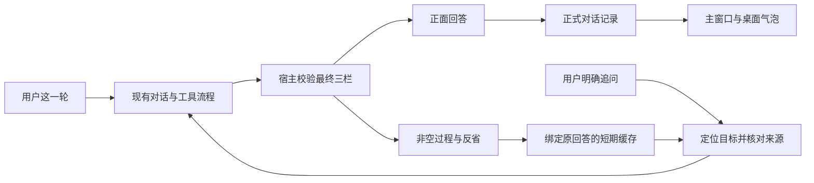

# 三栏回答与追问缓存

2026-11-18 · 实施设计

Alice 每轮按「正面回答、任务过程、反省」生成最终回复。宿主只发送正面回答。只有本轮已经形成且有必要保留的过程或反省才进入短期缓存。用户追问时，Alice 根据所问读取相应部分，当作新一轮的材料来回答。

## 1. 三栏怎么分

| 字段 | 该写什么 | 日常处理 |
| --- | --- | --- |
| 正面回答 `answer` | 用户这一轮要听到的话。问原因就直接答原因。明确要求步骤、复盘或详细分析时，这些内容本身就是答案。 | 发送给用户。 |
| 任务过程 `task_process` | Alice 对与本轮有关、当前问题没问到的步骤和结果所作的说明。实际操作以工具回执为准。 | 有注释才缓存。 |
| 反省 `reflection` | 本轮已经形成、适合对用户表达的自我修正或事后反省。 | 有内容才缓存。 |

正面回答里如果缺少某句话会改变用户对事实、结果、风险或不确定性的理解，那句话就留在正面回答。比如「只读到了第三方转述，官方原文尚未核实」可能决定结论能否成立，应随结论交付。用户指出错误时，具体更正和必要的承认也属于正面回答。人格语气、幽默和自然的接话由说话情境决定。

后两栏默认空。问候、闲聊和只有一句答案的任务通常没有缓存。提示只要求模型把已经要表达的内容分栏。每轮可以自然结束，无须为字段写解释，也无须用反问引导用户打开缓存。技术说明、方案或者用户明确要长文时，正面回答可以按任务需要写完整。篇幅由任务决定。

### 用户提出的搜索例子

用户问「为什么刚才的搜索失败了？」

```text
被网页拒绝访问了。
[[过程]] 搜索返回了候选，读取目标网页正文时返回 403。
```

若用户接着问「报了什么错」，该轮可依据搜索回执答「403，目标网页拒绝了访问。」若用户问「网页为什么拒绝」，而回执没给原因，正面回答应明确说具体原因未能确认。状态码能说明拒绝发生了，无法证明是反爬、登录要求还是其他缘故。

## 2. 模型与宿主的分工

模型写回答时留意每句话的用途，将原本想说的额外过程或反省用注释标出。宿主按行识别注释并执行已有的缓存和读取权限。正文里的语义判断由模型承担，要用真实对话验收。

语义规则放在**前台回复协议提示**中，宪法原有的语气与互动约定照常适用。能力注册表登记 `reply_detail`，宪法补入「基于实际交付理解自己说过的话、基于有效回执理解操作」这一自我事实。协议语法由实现与工具定义维护。

- 工具轮照现有流程工作。只有模型交付无工具调用的最终回答时，才解析三栏。工具轮同时生成的叙述不能提前进正文或缓存。
- 正面回答照常写，可以正常使用 Markdown。若一句是额外说明，另起一行写 `[[过程]] 注释文字` 或 `[[反省]] 注释文字`。每个标记只管同一行，可重复。下一行继续写正文或另一条注释。
- 闭合的 Markdown 代码块内可以示范字面标记。缓存里的过程注释属于 Alice 当时的说明，追问时按实际工具回执确认操作和错误码。
- 反省栏只收面向用户的简短事后自评。它与供应商的推理字段、内部草稿和系统提示隔离。首版启用协议的会话也不沿现有前台推理流显示这些内部内容。
- 沿用现有模型接口收集最终文本，结构校验由 Alice 统一执行。首版没有启用供应商特定的约束输出，兼容性以实际接入的模型和工作路径为准。

## 3. 生成、发送与保存



当前底层流式回调可以直接发 `delta`，一些路径也会在判断最终轮之前放出缓冲。启用三栏协议后，拦截点要放在 `alice/loop.py` 的模型输出与 `on_delta` 之间，覆盖流式、非流式和已有回退。首版先收齐最终一轮，完成结构、权限与来源检查，再把 `answer` 作为正式回复交给现有保存和发送链。必要时复用现有审阅流程，但只把 `answer` 交给审阅，原回复被更正或撤回时丢弃依附于旧草稿的缓存。

保存成功后，宿主用真实 `assistant_turn_id` 绑定缓存，再发送正文和完成回执。主窗口与桌面气泡继续消费同一份正文，保留逐句展示、跟随最新、回看暂停及动效。首次文字确实会晚于直接透传模型 token 的做法。等待期间可以保留简短的「正在搜索」「正在读取」状态，避免把状态提示当作正面回答或自动展开的过程。已有工具与协作操作回执按原权限保留，成功与失败的关键信息由正面回答如实交代。

正式历史、同步、断线重连、桌面预览、摘要与记忆抽取读取 `answer`。已有上下文观测的正文档要与聊天链路一同核对，确保原始三栏、未发布过程和反省正文不会被默认观测或调试日志保存。可记录协议版本、解析是否成功、候选长度和命中数量等无正文指标。

重复请求沿用已保存的正面回答。重复回执不会重复插入缓存，也不会重新执行工具。缓存写入失败只影响之后的追问。已成功保存的正面回答依然可交付。若实际发送失败，客户端从正式历史取回答案。

### 格式错误如何处理

- 单独的空标记不写入缓存。其后的行按常规规则处理。普通正文可以出现在任意注释之前、之后或之间。
- 正文为空或输出超出解析上限时，给简短的生成失败提示。已执行操作可通过原有回执核对。
- 传输回退沿用现有请求重试约束，不为三栏补齐新增一次模型调用，也不会因格式失败自动重做已产生副作用的操作。现有的请求状态、历史核对与已执行回执继续可用。
- 源材料到期、会话切换或权限撤回时，正面回答按现有来源链处理，对应缓存失效。

## 4. 缓存与追问

首版在服务进程内维持一个有界缓存。条目按原答复 ID 定位，绑定该轮请求、答复摘要、到期时间和可复验的网页资料来源。只为已保存为正式回复的答案创建条目。客户端断线后仍能按正式记录同步这条答案。

试用上限为 **16 条、正文总计 32 KiB、单条 4 KiB**，写入后 **30 分钟**内可读。前台请求、读取或写入时清除已到期条目，达到容量时淘汰最旧条目。重启、换会话或恢复备份后重新开始，人格指纹变化后旧条目也会清除。缓存不进入导出、备份、永久对话、向量索引或长期记忆。

缓存与原回答共享来源与会话边界。首版继承该轮网页资料依赖。涉及无法完整复验的协作、思想、按需人格、索引记忆或前情展开时，保守跳过旁栏缓存。读取时重新核准原答复和当前来源许可，失效即不可读。派生回复在保存前沿用现有来源保护。

### 反省和遇到的问题在哪里留档

对话历史记录双方实际说过的话。过程或反省被追问后，只有随后作为正面回答说出的部分进入对应的新轮次。缓存全文依据缓存容量和有效期清理。

| 内容 | 怎么保留 | 例子 |
| --- | --- | --- |
| 已公开的结果、限制和更正 | 随正面回答进入对话历史。只要问题影响用户理解结果，当轮就应交代。 | 「被网页拒绝访问了。」如果约定的核查因此未完成，也说明缺哪份依据。 |
| 实际发生的操作与失败 | 复用宿主已有工具回执和保留规则。留可核对的阶段、状态、错误码及必要来源引用，由任务状态或追问按需读取。 | 搜索返回候选，正文读取拒绝并报 403。即使过程缓存过期，只要回执仍有效，就能确认失败在哪一步。 |
| 需要后续处理的未解决事项 | 有继续任务或等待条件时，通过既有任务状态或思想疑问记录具体缺口、等待条件和实际下一步。普通失败留在工具回执里。 | 待取得官方原文再核实。未安排后续时，维持本次未能确认的结果。 |
| 未说出的反省 | 短期缓存到期即清理。确有以后可复用的结论时，经过现有的记忆或思辨流程，按依据校验后另存结论和适用条件。 | 某次网页拒绝不能证明整站以后都无法访问。只有有依据、值得复用的判断才单独保留。 |

缓存淘汰不会触发归档或记忆抽取。跨轮需要继续的任务依赖宿主所知的最新状态及仍有效的依据。反省由 Alice 形成，记录时按自评理解。它可以帮助解释当时的改法，不能单独证明她做过某项操作。任务回执、待办与已经说出的回答也各按原有权限和有效期处理。

### 追问怎么匹配

1. 用户有明确要展开的对象时，优先采用该回复的绑定 ID。自然续问可以指向最近一条相关回答。例如「报了什么错」请求过程，「你刚才哪里判断错了」请求反省。仅一句「为什么」时，宿主只允许指向最新的一条答复。
2. 宿主在现有模型工具循环内允许一次窄范围读取，每次只取一个目标的一栏。模型提交原答复 ID、目标栏和本轮用户请求查看该内容的原话片段。宿主校验片段来自当前真实用户消息、目标属于当前会话与渠道、条目仍有效，以及本轮读取次数。原话校验确认意图的出处，真实匹配仍依赖模型理解语义。含糊的续问先澄清。
3. 普通对话不提供缓存正文或目录。检测到追问时才传入最近 4 条同渠道回复及可用的缓存条目的 ID 和可用标志，读取成功后下一次调用直接交付最终答复。它的输入观测只保留元数据，也不再开放工具，避免缓存正文被写进其他记录。
4. 读到相关内容以后，由 Alice 用符合本轮问题的正面回答交付。追问查不到缓存时，从已保存的回答与仍获准的原始回执核对。可用依据不足时如实说明。无需为了重取缓存而重跑搜索或其他任务。

若实际模型经常串错对象或把普通转题当追问，首版可以用「针对某条回答追问」的显式绑定作为可靠入口，再逐步开放自然追问。显式绑定只定位对象，用户本轮文字仍决定要哪一栏。

## 5. 实施顺序与验收

建议先在本机开发环境用前台普通聊天和搜索验证，再扩大范围。主窗口与桌面气泡共享后端的一次实现。后台思考回执、主动邀请和 QQ 在首版沿用各自现有协议。首版可在本机配置中选择是否启用，便于前后对照和回退。关闭时沿用原有输出，并清空未发布条目，避免以后重新开启突然续讲旧内容。

| 人工场景 | 通过表现 |
| --- | --- |
| 问候、闲聊、一句话能答完的问题 | 像普通对话一样直接发出，后两栏可空，界面没有占位、过程卡或反省提示。 |
| 要求完整代码块，或在代码块里演示行标记 | 代码块正常交付，代码块内示例标记按字面显示。代码块外实际旁栏仍只进缓存。 |
| 正文之间有两条过程注释，随后继续回答 | 两条注释一并缓存，前后正文完整交付。观察器显示实际注释数与缓存结果。 |
| 用户给出的搜索 403 例 | 首轮只发访问被拒。追问失败阶段或状态码时，按所问取对应过程。正文附件有许可才可用。 |
| 「一步步告诉我怎么办」「说说你刚才怎么看错的」 | 步骤、纠正与被问到的反省当轮完整交付，内容有据且具体。 |
| 多个话题后追问、随即转题、普通的「为什么」 | 有明确对象时接得上，含糊时只问关键点。转题和无关问题不会带出旧缓存，也不会说用户已经看过。 |
| 工具轮先多说、回退及格式不合规 | 主窗口、气泡和断线回放只出现经校验的正面回答与已有操作状态，缓存正文不会先闪出。副作用不会因格式失败重做。 |
| 追问前来源撤回、资料过期、重开进程或更换会话 | 旧内容不可取。若事实可从有效记录重建则直接答，否则说明缺什么。 |
| 缓存过期后回看对话、追问失败步骤或继续已约定的核查 | 历史仍只有已说的话。仍有效的宿主回执可回答失败阶段，已记录的等待事项可继续。未发布的反省不会因淘汰进入历史、摘要或长期记忆。 |
| 查资料、长方案、情绪交流分别换模型试用 | 简短答复可自然收住，关键依据与不确定性完整，详细请求仍答得够。记录首句等待、格式错误、错归栏和真正追问的命中情况。 |

先验收用户是否能一次听到完整的正面回答，再验收续问。字数、缓存为空比例和响应时长可辅助观察，不能单独当作好坏标准。按项目约定，通过真实人工对话验收，覆盖普通窗口和气泡。

## 首版施工决策

- 前台 GUI 共用协议，开发版默认启用。通过本机配置 `[context] reply_sections_enabled = false` 重启回退。
- 缓存定位由宿主限定为同会话、同渠道的已保存回复。模型只有在当前用户的原话明确询问过程或反省时才能请求读取。首版用窄范围的问法校验，不能可靠判定的表达可以改用清晰的自然语言或澄清。
- 读取过程时，可按回复关联仍存在的网页搜索回执，只带出阶段、状态、计数与错误码。其他任务从各自现有记录核对。
- 首版对依赖暂时无法完整跨轮复验的正文保守跳过旁栏缓存。读取附来源的条目会先把来源依赖绑定到当前轮。向模型发送缓存正文的调用只保留观测元数据，正式答复仍可正常保存。

## 实现锚点

- [前台模型输出、审阅和保存](../../../alice/loop.py)
- [三栏校验、追问和缓存](../../../alice/reply_sections.py)
- [对话服务入口与请求去重](../../../alice/service.py)
- [现有事件流](../../../alice/server.py)
- [来源附件和失效处理](../../../alice/discovery_memory.py)
- [主窗口](../../../web/app.js)与[桌面气泡](../../../web/desktop-chat.js)

## 交付验证

0.1.26 已实现分栏校验、仅正文交付、内存缓存与来源绑定。源码编译、注册表加载与配置静态检查已通过。

macOS Apple Silicon 本机开发包为 `20261118T102647Z-e91fb8a2-dirty/Alice-0.1.26-macos-arm64.dmg`。应用签名、磁盘映像与 150 项包内资源摘要已核验，界面资源沿用 0.1.25。真实模型输出格式、追问命中、首句等待时间以及主窗口和气泡的实际表现按上表人工验收。

## 0.1.27 JSON 格式诊断记录

三栏校验结束后在同一请求的观测事件和装配元数据中记下结论。可区分空输出、被 Markdown 围栏包裹、JSON 语法错误、重复键、顶层类型不符、固定字段不全和正文无效。JSON 语法错误仅留行列，字段错误只留已知的缺失字段与多出字段数量。供应商结束原因取固定值，另记模型正文字数、可选栏丢弃计数和最终交付结果。

主窗口回复旁的「查看本轮上下文」和记忆观察器的「调用轨迹」均可查看。保留元数据采集即可，无需开启正文留存。已经完成的 0.1.26 请求只有校验成败，新版从下一轮起提供具体原因。诊断不改变分栏规则、缓存路径或格式失败时的交付。

本机 Apple Silicon 开发包为 `20261118T104642Z-e91fb8a2-dirty/Alice-0.1.27-macos-arm64.dmg`。Python 编译、JavaScript 语法、签名、磁盘映像和 150 项包内资源摘要校验通过。真实对话中的诊断显示待人工验收。

## 0.1.28 纯文本分栏

18:58:06 的真实请求中，DeepSeek 正常结束并返回 15 个字符，原协议由于缺少 JSON 封装拒绝了正文。18:58:10 同一模型在同一协议下通过，旁栏为空。0.1.28 改用纯文本加两个可选的尾部旁栏。无标记输出按正文交付，有标记时分别校验两个旁栏。保留整轮校验、来源复验和追问缓存。

观测记录继续显示供应商结束原因和交付状态，新增「普通正文」或「检测到旁栏标记」及标记错误提示。0.1.27 的历史 JSON 诊断仍按原记录显示。

本机 Apple Silicon 开发包为 `20261118T110651Z-e91fb8a2-dirty/Alice-0.1.28-macos-arm64.dmg`。Python 编译、JavaScript 语法、签名、磁盘映像和 150 项包内资源摘要校验通过。短句、代码示例、搜索追问及旁栏隔离待真实对话人工验收。

## 0.1.29 逐行注释

0.1.28 的真实对话中，Alice 有时把额外搜索过程和重试提议写在正文，旁栏为空。0.1.29 根据用户提出的注释方式，让 Alice 在写到某一句时判断其用途。标记和注释放在同一行，标记行从正文中取出，其他行原样交付。注释可出现在正文之间，也可以连续写多条。

宿主依据标记缓存注释，继续执行已有的权限、会话和容量检查。过程注释无需回执编号，追问时仍从原回执核对客观事实。观察器只记录注释数量、空标记和实际缓存结果。检测发生在原有生成流程内，无需单独调用模型。

本机 Apple Silicon 开发包为 `20261118T150349Z-e91fb8a2-dirty/Alice-0.1.29-macos-arm64.dmg`。Python、JavaScript、应用签名、磁盘映像和 150 项包内资源摘要检查通过。模型实际标注与追问表现待人工验收。

## 0.1.30 观察缓存

对于观测记录显示已入缓存的回复，可以在「查看本轮上下文」或记忆观察器「调用轨迹」点「查看缓存注释」。弹窗按过程、反省展示当前内存中的注释。读取前核对观测器身份、原回复、会话、人格、来源和到期时间。缓存快过期时，弹窗到期清除显示。可查看的记录受重启、来源撤回、淘汰和原有 30 分钟有效期约束。

查看只读，沿用原有效期和淘汰顺序。未发布正文继续仅保留在内存，不进入观察日志或快照。查看缓存也不会调用模型、将注释带入下一轮，或以搜索回执填补已经失效的注释。

用读得到的真实样本验收两个问题。一是有没有漏标，例如「有多强」的回复是否还包含搜索次数和读取步骤。二是有没有误藏，例如把「先前的跑分尚未核实」作为旁栏收走。同一内容随问题改变归属，例如「有多强」和「是没搜到还是打不开」应保留的正文不同。

本机 Apple Silicon 开发包为 `20261119T001907Z-e91fb8a2-dirty/Alice-0.1.30-macos-arm64.dmg`。Python、JavaScript、应用签名、磁盘映像和 150 项包内资源摘要检查通过。安装后新生成的注释可用于人工验收入口和到期行为。

## 0.1.31 标注对照例

现有前台回复协议加一条判断标准。删掉一句话会改变答案、结论的可信度或用户接下来必须做的事，就留在正文。原本想补充的执行细节或自评才适用逐行注释。两个短例随原系统提示进入当轮生成。

| 同一句话 | 作补充注释的场景 | 作正文的场景 |
| --- | --- | --- |
| 两次正文读取都超时 | 用户问模型有多强，正文先交代原跑分尚未核实。若原本会说读取次数，可以用过程注释。 | 用户问为什么没核实到。 |
| 我把没有出处的跑分当成事实了 | 闲聊中若原本只会顺带提，可以用反省注释。 | 用户问刚才哪里判断错了，或者 Alice 需要更正此前结论。 |

真人验收时对照上述问法，并在观测器打开确实入缓存的注释，核对有没有漏标、误藏或补写。对照例应当只影响内容的归属，实际判断和数字按本轮证据回答。

本机 Apple Silicon 开发包为 `20261119T010021Z-e91fb8a2-dirty/Alice-0.1.31-macos-arm64.dmg`。Python 编译、应用签名、磁盘映像和 150 项包内资源摘要检查通过，标注改善待真人对话核验。

## 0.1.32 复读标注实验

「设置 → 上下文观测 → 复读标注实验」默认关闭，保存后从下一次新请求起生效。开启后，前台先按原协议生成初稿，同一个聊天模型再收到当前问题、有限的已装配前情和本轮搜索回执，以及带编号和初始标签的草稿。常规句子可以换标签，带格式的 Markdown 和代码块保留。复读仅返回编号和目标标签，可以把原注释放回正文，也可以把原正文标成过程或反省。宿主按原顺序重新投影原句。

每条适用回复多一次模型调用，采用 12 秒请求超时配置和零重试。超时、无效编号、试图改动锁定项或删空正文时，沿用初稿。超过草稿或上下文预算的请求略过复读。复读输入的观测只保留元数据，即使已开启完整输入留存也一样。处理过程和反省仍使用原内存缓存与来源权限。

真实对话验收可在关闭、开启时问相同问题，对照正文和「查看缓存注释」。观察器记录变更编号、复读耗时、正文就绪时间和回退结果。重点核对「你现在怎么觉得？」的当前判断是否回到正文、搜索次数是否入缓存、Markdown 和用户明确要求的详细过程是否完整。

本机 Apple Silicon 开发包为 `20261119T084622Z-e91fb8a2-dirty/Alice-0.1.32-macos-arm64.dmg`。Python 编译、JavaScript 语法、应用签名、磁盘映像和 151 项包内资源摘要检查通过。开关生效、标注质量和耗时待真实人工对照。
