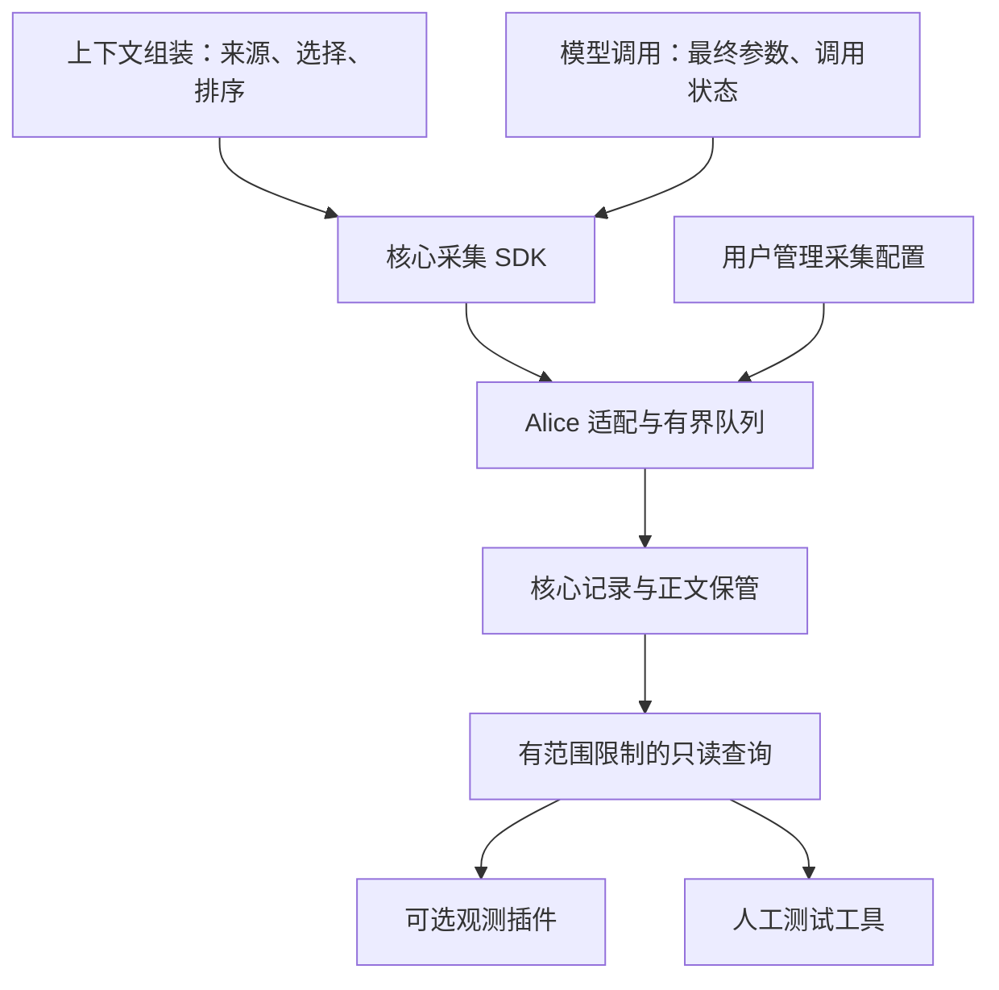

# 上下文观测插件：架构与施工设计 v1

日期：2026-11-07。状态：**P0–P2 已实装（同日，架构侧施工）**——P0：正文读取补核心归属校验（`context_body` 必须携带 request_id，hash 须在该请求事件中登记过；裸 hash 返回 binding_required，未知请求/外来 hash 分立拒绝）+ `plugin_status` 功能发现（协议/采集/额度）；P1：`addons/context_inspector/`（manifest+README+web 四文件）、`[plugins] context_inspector_enabled`（默认关）、固定静态托管（清单白名单+解析路径+类型/大小限制，禁用/缺文件给明确状态聊天照常）、`/api/plugins/context-inspector/{status,requests,request,body}`（同源 observer 意图校验+启用检查，委托同一核心投影）；P2：inspector 三栏页（请求列表→调用过程→最终输入，条件正文展开）+ 聊天回复旁「查看本轮上下文」入口（携带 request_id，缺 ID 不伪造入口）。旧观察面板「调用轨迹」视图保留为过渡入口并改为携带 request_id 读正文。展示形态按用户参考 dsh-context 复刻为原生实现：分类颜色编码（稳定/索引/背景/历史/工具/模型/用户）、组成堆叠条与图例、逐调用趋势带与差异徽标（vs 上次：±N 条消息 ±Nk 字）、DNA 模型读取顺序逐项列表（位置色块+正文按钮）、树状上下文浏览器（类别折叠+选择决策）；字符估算占比与供应商 usage 分列不混用。P3（相邻差异/人工备注/导出）与 P4（旧面板迁移完成/辅助调用细绑定）待续。离线自检 12 项过（/tmp/alice_ctxobs_check/check_plugin.py）；真人验收按 §12 清单。以下为原始设计文本。

## 1. 决策与目标

采用 **核心轻量采集＋核心保管记录＋可选观测插件**。SDK 是采集接口的实现方式，插件是用户查看和使用这些证据的独立功能。

用户从一条回复进入插件，能够查清这轮人格、记忆、前情、历史、工具结果如何进入模型请求，以及哪些材料没有进入、调用后回复有没有被替换。插件只提供实际记录，不自动评判人格或猜测模型内部原因。

首版采用 Alice 同源独立页面，原生 HTML/JS/CSS，随仓库提供，通过固定入口启用。不另起 Web 服务、不安装第三方依赖、不建设通用插件市场或任意代码加载器。通用采集 SDK 继续留在核心；不要求为了插件形态重写已进行的 SDK 施工。

## 2. 当前代码基线

本次只读查看工作区，已见以下新增接线；它们仍包含未提交改动，不能凭文件存在认定已经完工、运行或通过真人验收：

- `alice/context_observer/`：通用采集、快照、事件与 sink 接口。
- `alice/context_observation.py`：Alice 适配、收据队列及本机正文快照保管。
- `ChatService.observer_context_requests()`、`observer_context_body()` 及 `/api/observer/requests`、`/api/observer/body`：新的公共观察投影。
- `[context].observer_enabled`、`observer_body_capture`：采集与正文配置。
- `web/observer.js`、`web/index.html`：已出现 SDK 观察界面接线。

施工先核对这些代码的实际状态。既有观察面板可作为过渡入口，后续与插件共用同一公共投影；不建立第二份上下文快照、调用ID或材料选择逻辑。

## 3. 架构与职责



| 部分 | 职责 | 边界 |
| --- | --- | --- |
| 核心组装器 | 记录实际选择、排除、排序、来源与版本 | 不让插件决定放什么进模型 |
| 核心采集 SDK | 冻结最终参数，关联请求/调用/尝试与事件 | 不请求模型、不自动重试、不依赖插件 |
| 核心适配/保管 | 接现有队列、落盘、范围校验、期限和容量 | 不将观察资料回灌聊天或记忆 |
| 公共查询 | 有界、只读地返回元数据与当前可见正文 | 读取不flush、不维护、不扩大许可 |
| 观测插件 | 时间线、上下文展开、差异、人工备注及导出 | 不直接读SQL或user目录，不执行捕获的文本 |
| 人工测试工具 | 关联真实对话、请求ID与人工结果 | 使用同一公开投影，不自建活库读取路径 |

采集需要同时接在组装入口和实际模型调用入口。仅包装模型客户端不能解释某条材料为何被排除；插件不能从最终消息反推未记录的决策。

## 4. 工作区与固定托管

拟新增目录如下，名称和文件均为设计约定：

```text
addons/context_inspector/
  manifest.json
  README.md
  web/
    index.html
    inspector.js
    inspector.css
    observer-client.js
```

核心提供固定、只读的静态托管映射，将 `/addons/context-inspector/` 映射到上述固定资源。服务器只允许清单内的文件，检查解析后的路径和文件类型，不接收客户端给定的任意路径、脚本命令或插件根目录。缺文件、禁用或版本不兼容时返回明确状态，Alice 聊天照常运行。

这是新增的静态资源公共面，需要在工作区约定中登记。核心读取固定 manifest/静态文件，不 import addon Python，不执行插件安装脚本；addon 浏览器代码只调用公开 HTTP。部署者可以更新插件文件，但页面不能自行下载或替换代码。

manifest 首版只描述固定ID、界面版本、观察协议兼容版本和资源清单。它不自行授予正文权限，也不要求宿主实现通用插件注册、依赖安装和后台生命周期。

## 5. 启停与配置

分开控制三个状态：

| 控制 | 含义 | 首版建议 |
| --- | --- | --- |
| 插件启用 | 固定页面是否可访问、入口是否可见 | 新配置 `[plugins.context_inspector].enabled=false`；显式启用后提供入口 |
| 元数据采集 | 核心是否记录详细上下文事件 | 沿用现有 `context.observer_enabled`，不因插件开关擅自改值 |
| 正文采集 | 后续请求是否保留有界正文 | 沿用 `observer_body_capture`；开启时执行轮数、期限和容量上限 |

新增插件配置首版可随服务启动加载；不为开关插件创建一套热更新框架。采集配置若已有可靠的管理入口就复用，否则通过现有配置方式操作并提示何时生效。插件查询不写配置，打开页面不等于开始正文采集。

关闭插件只停止页面使用，已有记录依核心策略保留；关闭元数据或正文采集只影响之后的记录，不谎报已经删除旧记录。页面关闭不取消聊天或后台调用。禁用后当前页面的插件专用查询返回禁用状态并清理显示，不以继续轮询维持使用。

正文建议沿用前设计的10个用户请求、7天、50MiB上限；用户请求开始时固定是否采集该请求，避免同一轮工具往返混用不同采集政策。达到上限不截断后冒充完整，记录相应缺失状态。开关变化、会话重置或权限撤回对读取的限制优先于已经开始的页面请求。

## 6. 公共接口与权限

首版页面由真实浏览器从 Alice 同源打开，沿用 GUI 观察来源与意图校验。人工工具使用获准的 ChatService/CLI；不能伪造浏览器来源来调用 GUI 专用 HTTP。

复用既有上下文、调用回执和新 SDK 请求投影。插件使用一个薄的 `observer-client.js` 适配响应，不自己读取内部文件、聚合内部事件表或推断当前模型状态。

建议增加插件专用查询命名空间，固定委托到同一核心观察服务，并检查插件是否启用。以下为**拟议接口**，不能当作已存在路由：

| 接口 | 用途 |
| --- | --- |
| `GET /api/plugins/context-inspector/status` | 插件/采集状态、支持的协议与功能、正文额度状态 |
| `GET /api/plugins/context-inspector/requests` | 有界请求列表，返回cursor与记录覆盖范围 |
| `GET /api/plugins/context-inspector/request` | 指定请求的调用、尝试、块、选择原因及版本 |
| `GET /api/plugins/context-inspector/body` | 读取该请求/调用中获准的消息或块正文 |

详情必须携带服务观察scope及完整资源定位；每个响应返回当前scope和记录状态。正文读取需验证会话代际、渠道、请求、调用和块的实际归属及当前可见性，不能仅凭内容hash就开放全部快照。可返回绑定这些条件的 `body_ref`，hash仅用于内容比较。现有按hash读取接口若尚无此绑定，先补核心校验；未完成前插件只提供元数据能力。

观察scope是并发与代际一致性依据，不是身份凭据。捕获时可见也不代表以后永远可读；过期、来源失效或许可撤回后返回明确不可读状态。插件发现scope变化，取消旧查询、清掉已展示正文和旧body_ref，不自动把新会话套在旧请求上。

首版插件是随项目提供的**受信同源界面代码**。只读约束由其接口与实现限定，不声称普通同源JS被隔离成只能读观察接口的浏览器沙箱。任意第三方脚本不纳入同源加载；将来需要第三方插件时再设计独立来源/进程及受限凭据。

服务只返回实际支持的字段和功能版本。不支持的正文、块绑定、差异或历史范围明确显示未支持/未采集，插件不能用今天的文件重建“当时请求”。

## 7. 页面与日常定位流程

独立页分为请求列表、调用过程和上下文详情。Alice 回复旁提供“查看本轮上下文”入口，携带 request_id；缺少ID时只能进入列表，不按时间猜一条请求归给该回复。

```text
请求列表                 调用过程                 当前调用的最终输入
15:45 你最近怎么样       主对话·工具轮次0          0 system
  ↳ 回复#20               尝试1：响应完成            宪法 / 表达使用说明 / 人格
                         ↳ 工具调用              1 user：材料索引
                         主对话·工具轮次1        2… 历史原文
                           尝试1：响应完成        …   前情、工具结果、可选提醒

人格版本 / usage版本     主调用与辅助调用分列      工具定义单列
采集状态 / 正文额度      失败与证据缺口可展开      每块来源、长度、位置可展开
```

定位顺序：从回复找到请求；从请求找到主调用及可能的后处理；查看最终消息序列；展开具体表达条目或记忆；核对未进入材料的原因；必要时与同请求前一次模型调用比较。

支持展示：

- 宪法、人格表达投影、生长材料、历史、前情、候选索引、已读正文、工作集、工具结果和近位提醒的不同资格。
- 人格fingerprint、表达投影条目ID，以及 `usage_policy_version`、使用说明hash、近位提醒策略/状态。使用说明和人格源材料分别统计。
- 原模型输出、审查/回退/失效替换与最终保存回复的关联；实际未记录原输出时标明缺失。
- 每次尝试的状态和模型回执；主调用usage与辅助调用累计分别显示。估算token与供应商usage不混用。

正文按需展开、分页，以纯文本渲染；不执行其中的HTML或指令。轮询仅在页面可见时进行，建议至少2秒间隔；busy退避、关闭停止、相同scope请求去重。打开观察不会触发记忆读取、记忆使用水位、模型调用或维护。

## 8. 差异、备注和导出

默认比较同一用户请求内相邻两次模型输入，标记新增、移除、修改和移位；跨轮比较由用户显式选两个调用，并展示模型、渠道、人格/说明版本是否变化。来源版本或正文缺失时，只做有证据支持的元数据比较，不凭标题臆造内容差异。

首版优先基于稳定消息/块ID与hash比较；同文多次出现仍保留各自序号。没有可信块绑定时仅显示整消息差异。分页覆盖、扫描限制、事件丢失和 pending 状态与比较结果一同显示，避免“未读到事件”被画成“材料被移除”。

人工备注只保存在当前页面内存，关闭前可导出，不写 Alice 记忆或人格。首版提供元数据JSON及Markdown报告，带协议、版本、采集状态与缺口。正文导出需用户显式选择并经当前可见性复核；正文接口未完成归属校验时不开放。下载后的离线副本不能由宿主远程回收，页面不承诺撤回已下载内容。

不自动调用模型解释“为什么人格没生效”，不生成无证据的注意力评分。用户可以把导出的获准材料交给其他AI分析，这属于用户后续操作。

## 9. 记录与故障语义

记录仍由核心保管。插件不复制正文到localStorage/IndexedDB或独立日志，不另设后台数据库，不持有模型密钥。正文调试副本与元数据的保存状态分开。

必须区分：已装配未调用、进入客户端调用、收到响应、流完整结束、流中断、失败/取消，以及观测未接线、未保存、队列丢失、超过范围或正文过期。应用提交给客户端的参数不是供应商内部上下文，也不能证明模型理解或遵循了材料。

插件文件损坏、协议不兼容、页面崩溃、查询busy或导出失败只影响观察。核心采集队列满或快照写入失败沿现有SDK记录缺口，不重试模型、不改变聊天结果。插件不提供隐式重放按钮，不通过“重放这次请求”制造副作用。

采集点关闭时走现有空实现；界面插件关闭时，核心仍可按当前政策为人工SDK留证。不能承诺关闭页面后整个采集成本归零。

## 10. 对已有施工的衔接

保留 ZCode 当前 `context_observer/`、Alice sink、调用接线和记录存储，先把公共投影质量补足。将 `web/observer.js` 的上下文功能逐步迁到 addon 页面，原开发面板保留跳转；同一能力只有一套读取协议。迁移期间旧面板可继续工作，不删除其他人格/记忆观察功能。

已施工的人格使用层只需沿现有 metadata 暴露457字符使用说明、usage版本与hash，以及可选近位提醒状态。其代码位于 `persona_context.py`，没有新增观测SDK的反向依赖。不要因插件化改写人格导入、表达包或会话数据。

核心新增的是固定静态托管和开发观察能力，不是 Alice 主模型可调用的工具。不向模型开放导出、插件安装、采集开关或读取全部观察快照的权限。若修改相关能力说明，保持存在事实与实际公开能力一致，不写“我能查看完整内部上下文”之类超出实现的自述。

## 11. 施工顺序与交付边界

| 阶段 | 交付 | 完成依据 |
| --- | --- | --- |
| P0 | 核对在建SDK、明确事件与查询覆盖，补scope/资源归属和功能发现 | 实际接口范围可列出，不以文件存在自证完成 |
| P1 | 固定插件包、启用配置、静态托管、同源入口、协议状态 | 浏览器可打开/关闭插件，缺文件或不兼容不影响聊天 |
| P2 | 按回复定位、请求/调用/尝试时间线、有序消息、条件正文展开 | 真人一次普通对话及一次工具往返可逐项核对 |
| P3 | 相邻调用差异、缺口状态、人工备注与导出 | 报告能追溯具体请求与版本，不扩大正文可见范围 |
| P4 | 辅助调用与更细块绑定逐步接入，旧面板完成迁移 | 未覆盖路径明确标注，不宣称全链路 |

最小可用交付为P0–P2。P3/P4可后续推进，不用等待通用插件框架或SDK独立发布。静态资源托管、公共接口与配置变更须同步工作区文档和用户说明。

## 12. 真人验收清单

遵守项目只做真实环境人工测试的约定，不新增机器自测或模型自动评分。隔离环境也必须通过真实服务公共面操作，不能直接写活库或伪造GUI来源。

1. 启用插件，打开与关闭页面；确认聊天照常使用，关闭页面停止轮询。
2. 发送普通问候，从回复进入对应请求；核对人格版本、使用说明和实际输入位置，确认没有按时间误配。
3. 让 Alice 通过现有工具读取本机一条材料；分别核对工具前后模型请求，正文何时进入输入。
4. 保持正文关闭完成一轮，再开启有限正文采集完成新一轮；前者保持“未留存”，后者可核对原文，不补画旧请求。
5. 比较同请求相邻调用，核对新增工具结果及其他真实变化；正文缺失或分页不完整时差异图如实降级。
6. 在真实可操作条件下关闭采集、改变会话scope或撤回来源资格，核对旧页面和旧资源引用停止展示；无法触发的分支记待验。
7. 禁用插件或移走其固定资源后启动服务，确认聊天可用，入口和错误状态准确；不删除或改写用户人格与历史。
8. 导出元数据与人工备注，核对请求ID、版本、调用状态、证据缺口及可见范围。真实出现中断/失败时核对相应状态，不伪造失败演练成功记录。

验收记录须区分代码已写、服务已加载、接口可读、正文可核对和表达效果；本插件提供定位证据，不替代人格长期稳定性验收。

## 13. 本轮交付状态

本轮只交付插件架构与施工设计，未修改运行代码、既有SDK施工、配置、user/或服务，未运行测试。前述新SDK接线仅为源码观察，尚未通过本轮确认部署或效果。下一棒据本设计和实际在建代码细化实施，不把设计中的路由、配置或插件目录当成现成能力。
