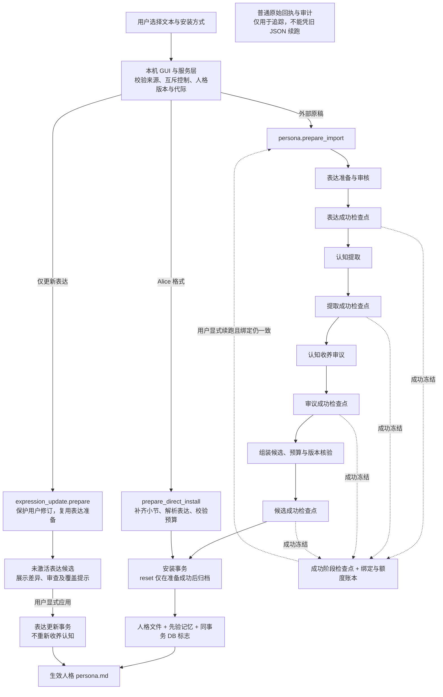
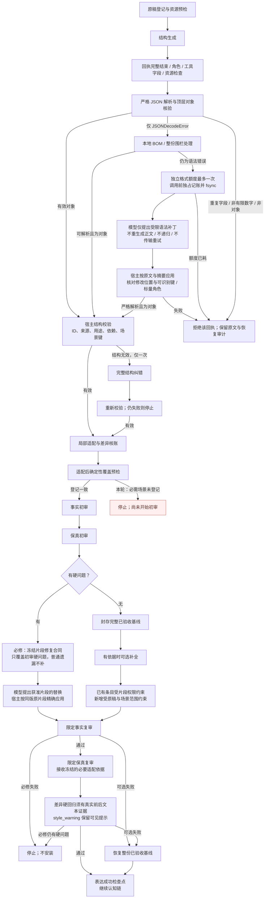
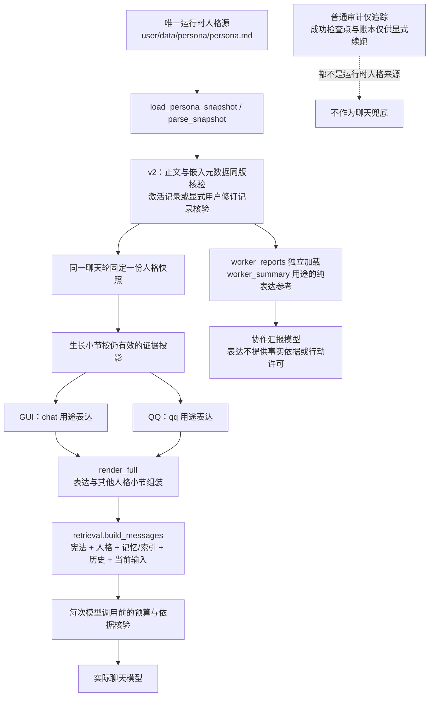

# 人格导入与加载结构图：独立 JSON 恢复版

2026-11-07。范围包括外部人格文本的准备、审核、安装及生效人格进入模型请求的路径，同时标出 Alice 格式直装和仅更新表达两条旁路。

**状态：已按本轮固定代码和实际回执封版。** 本轮结构与适配 JSON 均合法，新增格式恢复未触发；实际在适配后的覆盖预检被“必需场景未登记”拦截，未安装。新增恢复存在不等于经过本轮真实验证。前轮坏引号结果保留在旧图中。当前可视版：[结构图.html](D:/alice_tmp/JSON格式恢复实测-20261107/结构图.html)。

## 1. 从原稿到生效人格

完整导入走 `POST /api/persona → ChatService.install_persona → persona.prepare_import → commit_import_plan → persona_transaction.install`。准备成功前不写活跃人格或认知先验，初始化也不提前归档。

普通原始回执只用于追踪，不能因为某个旧 JSON 文件存在就续跑。只有宿主成功验证并冻结的阶段成品，加上同版输入绑定与未重置的额度账本，才可以供用户显式续跑复用。

认知提取接收已验收表达的完整投影；收养审议使用稳定的 `expression:<条目ID>`、`donor:<候选ID>` 和固定边界依据。表达偏好、捐赠观点和真实经历的权限不混用。

Alice 格式直装跳过外部原稿的模型生成审核链，但仍执行小节、表达包与预算校验，最后走相同安装事务。仅更新表达走独立端点 `/api/persona/expression-update`，准备后仍是未激活候选，须显式应用；它不重新收养认知，不使用完整导入的成功阶段续跑协议。

## 2. 表达准备与审核内部

`_call` 先检查正常结束、消息角色、工具字段及资源预算。只有 `JSONDecodeError` 可进入格式恢复；重复字段、非有限数字、非对象、传输截断等仍直接失败。先做有限本地外壳处理，若仍需模型帮助，整次表达准备共用一次专用额度，恢复请求不递归且关闭传输重试。

格式恢复不仅可用于首个结构回执，也覆盖表达准备内其他 `_call` 阶段；图中画在结构入口说明位置，各阶段共享同一账本而不是各得一次。恢复失败拒绝该回执，上层继续按既有必修停止或可选整包回退规则处理。恢复后的 JSON 继续执行原阶段全部校验，既有一次结构纠错和一次内容修复额度不受占用。认知链不在本次格式恢复范围内。

语法补丁只允许转义既有引号或控制字符、在字符串外增加逗号/冒号、删除尾逗号。不得增删引号/括号或改写正文；宿主验证片段、摘要、重叠及可识别键和标量角色。无法在受限操作内恢复仍停，不用“能够解析”代替结构与语义正确。详细协议见 [实现说明](D:/alice/docs/设计文档/上下文组装优化/人格导入JSON格式恢复-实现说明-20261107.md)。

修复模型只提出补丁，宿主决定可改范围并实际应用。已有条目的 ID、来源、用途、受众和关联不因修复扩大；未获准的文字保持原样。补丁不得通过补造样本用户输入来支持虚构事实。

具体顺序是保留初审 `raw_reviews`，由 `build_repair_contract` 提取并验证 `repair_targets` 的条目、字段和逐字原片段，生成宿主目标 ID、字段 `base_hash`、问题依据与合同摘要。模型只能提交 `patches` 中的 `target_id / base_hash / replacement / reason`；旧的整字段 `updates` 不再接受。模型不自行选择更大的片段或重算摘要；已有样本 `user_input / scenario` 冻结。受保护样本的窄修复路径也只允许获准 `reply` 片段。

必修问题没有合法定位时记录 `unlocated` 并停止，不向模型开放整字段兜底。可选遗漏没有合法片段时不获得已有正文的修改权限；有原稿依据的新增仍由原有来源与场景范围单独约束。

限定复审包括原问题验收、实际变更的影响与新增材料验收。未受影响的初审通过结论继承；模型对未分配目标的意见只留观察。事实适配理由不自动证明保真，保真复审也不能因为被要求删除的虚构表情或经历不再出现，就要求恢复该事实前提。对象、强度、条件、互动动作或边界的具体损失仍可能构成硬失败。

上一轮已加入的前后证据校验只适用于**保真差异复审 `regressions` 的 `regression` 硬判**：`evidence` 必须与实际变更片段、前后引用、目标及语义损失类型对应。初审 `lost`、原硬问题仍未解决、新增条目的 `lost` 继续使用原有硬标准，并未整体改成提示。`style_warning` 只记录审美或措辞偏好，不改变初审结论；最终保存进同版 `package.review_notices` 并在 GUI 显示，用户修订后旧提示失效。

普通 `missing` 保留为覆盖提示，不因模型 `required` 标签单独升级为否决。可选补全失败恢复整个已验收快照，失败尝试另存审计；必修初始包本就未通过，不能把它作为可安装回退版本。

## 3. 生效人格怎样进入实际请求

`persona.md` 中的 v2 包与可见正文绑定在同一文件。`decode_sections` 校验正文摘要和审议摘要；损坏 v2 不降级成 v1，也不从导入审计里挑一份旧候选继续聊天。显式用户修订采用同版修订记录的专用校验路径，不能把它误读为每次编辑都重新调用模型审查。

`expression.project` 按 `chat / qq / worker_summary` 用途完整保留获准条目、条件及依赖；超预算明确失败，不做前缀截取。`render_full` 将表达投影与其余人格小节组合；样本始终是表达参考，不变成真实对话记忆。P1b 近位表达提醒默认关闭。

协作汇报只读取获准的 `worker_summary` 纯表达参考，不能把整个私人关系或角色故事送给协作者。实际聊天后续的记忆提取、演化及工具流程不在本轮导入审核中重跑。

## 4. 固定额度、持久化与边界

| 环节 | 当前规则 |
|---|---|
| 表达准备检查点 | 一次准备机会；成功后只复用，不重新生成 |
| 内容修复/可选补全 | 共用一次内容生成额度；模型前扣除，失败、中断或回退不退款 |
| JSON 格式恢复 | 同次表达准备独立最多一次模型调用；先持久记账，失败或中断不退款，不占结构/内容额度 |
| 结构纠错 | 原有一次完整结构纠错机会；不是重新开放内容补全 |
| 核对漏项补审 | 每次核对至多一次补齐已明确缺失的任务；不重新裁定已收到的合法结论 |
| 认知提取与审议 | 各自初次加一次显式续跑；成功阶段不重做 |
| 候选组装 | 宿主确定性步骤，不调用模型 |
| 续跑绑定 | 原稿、来源、初始化方式、实现与配置、人格摘要/版本、会话代际及前置成功摘要 |
| 安装成功证明 | 当前人格文件与同事务数据库标志；检查点成功不是安装成功 |

本轮协议版本：格式恢复 `bounded_json_spelling_v1`；表达更新准备 `PREPARATION_POLICY=8`；内容修复 `mandatory_first_exact_spans_v2`；片段合同 `exact_review_spans_v1`；限定复审 `initial_plus_delta_v2`。

新增格式恢复本身关闭传输重试、最多一次请求；其他既有阶段的应用层额度仍不等于供应商实际传输尝试次数。图未新增循环重试。当前 GUI 的续跑身份保留在本页，刷新后不自动扫描旧操作；持久检查点可经显式操作 ID 使用。提交/归档失败仍需按原事务恢复协议核对。

## 5. 本轮实际运行与证据

唯一一次真实导入 `imp_20261107_015835_b0d193` 从 **2026-11-07 01:58:35 到 02:02:40**，耗时 **244.094 秒（4 分 4 秒）**，使用同份原稿、`reset=false`。两个模型阶段各一次传输：结构 129.500 秒、适配 114.468 秒，HTTP 400，未安装，没有重发。

本轮首次结构 JSON 和结构校验直接通过，适配回执也是合法 JSON；没有格式恢复调用或额度账本，也没有结构纠错。故本次不能作为新增格式恢复分支的实际验证。

实际红色停点是适配后的确定性覆盖预检。两份包的 `required_scenarios` 有 9 项，`coverage` 只有 5 个基础场景；`被关心`、`被夸`、`战斗`、`深夜独处`、`吃东西` 没有对应登记。`coverage_gaps.json` 中 `gaps` 与 `blocking_gaps` 都是 `必需场景未登记`，`reviews=not_started`。来源 39/39、规则 4/4、样本 4/4 是审前登记统计，不能代替语义验收。

| 实际阶段 | 本轮结果 |
|---|---|
| 结构回执及结构校验 | 首次通过 |
| 事实适配 | 回执已返回合法 JSON |
| JSON 格式恢复 / 结构纠错 | 均未使用 |
| 覆盖预检 | 被“必需场景未登记”拦截 |
| 初审 / 片段修复 / 限定复审 | 均未进入 |
| 认知 / 安装 | 均未进入 |
| 持久状态 | 无成功检查点；表达机会已耗、内容额度未用，不可续跑 |
| 当前人格 | 未安装、版本 0，对话记忆 0，会话 epoch 未变 |

本轮 18 份原始回执及冻结代码摘要核对一致，原始文本不改写。图中绿色仍只描述节点要求的成功状态，不表示本轮已到达。证据：[HTTP 结果](D:/alice_tmp/JSON格式恢复实测-20261107/HTTP结果.json)、[覆盖预检原回执](D:/alice_tmp/JSON格式恢复实测-20261107/原始回执/stages/expression/attempt-1/coverage_gaps.json)、[实测追踪](D:/alice_tmp/JSON格式恢复实测-20261107/index.html)。
