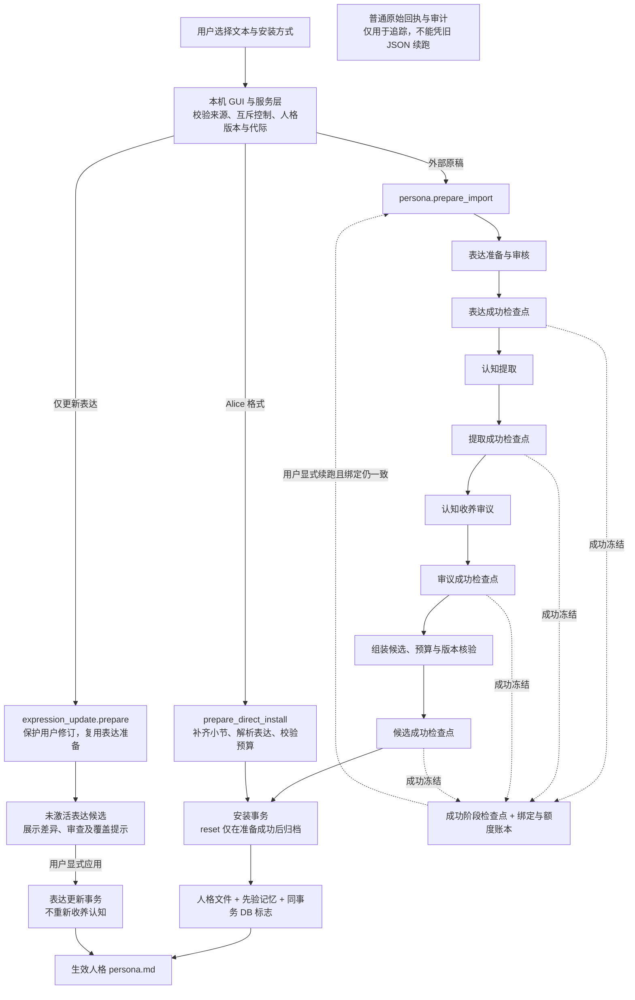
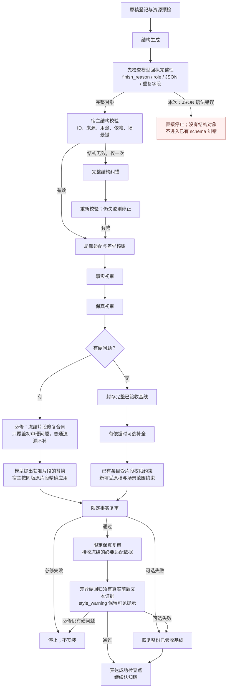
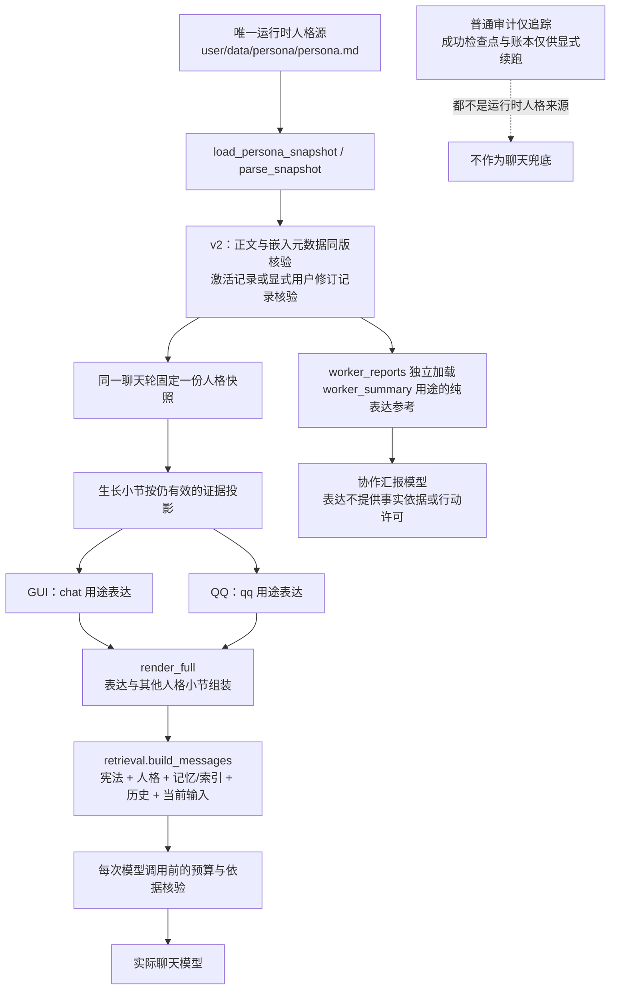

# 人格导入与加载结构图

2026-11-07。范围包括外部人格文本的准备、审核、安装及生效人格进入模型请求的路径，同时标出 Alice 格式直装和仅更新表达两条旁路。

**状态：最终版，已按本轮固定代码及真实回执核对。** 本轮导入在结构回执的 JSON 解析处停止，未安装；新增的片段修复与保真合同复审尚未进入。图中的路径存在，不表示每条分支都已通过本轮真实运行。当前本地可视版：[结构图.html](D:/alice_tmp/片段修复与保真合同实测-20261107/结构图.html)。

## 1. 从原稿到生效人格



完整导入走 `POST /api/persona → ChatService.install_persona → persona.prepare_import → commit_import_plan → persona_transaction.install`。准备成功前不写活跃人格或认知先验，初始化也不提前归档。

普通原始回执只用于追踪，不能因为某个旧 JSON 文件存在就续跑。只有宿主成功验证并冻结的阶段成品，加上同版输入绑定与未重置的额度账本，才可以供用户显式续跑复用。

认知提取接收已验收表达的完整投影；收养审议使用稳定的 `expression:<条目ID>`、`donor:<候选ID>` 和固定边界依据。表达偏好、捐赠观点和真实经历的权限不混用。

Alice 格式直装跳过外部原稿的模型生成审核链，但仍执行小节、表达包与预算校验，最后走相同安装事务。仅更新表达走独立端点 `/api/persona/expression-update`，准备后仍是未激活候选，须显式应用；它不重新收养认知，不使用完整导入的成功阶段续跑协议。

## 2. 表达准备与审核内部



`_call` 先检查模型回执是否正常结束、消息类型与工具字段、文本上限，以及严格 JSON 语法、重复字段和顶层对象。只有拿到完整对象才进入 `normalize_structure`；原有一次 `structure_correction` 针对完整 JSON 的结构校验错误，**不覆盖 JSON 本身不可解析的情况**。本次停在 `_call` 的严格 JSON 解析处，因此没有触发后面的 schema 纠错。

修复模型只提出补丁，宿主决定可改范围并实际应用。已有条目的 ID、来源、用途、受众和关联不因修复扩大；未获准的文字保持原样。补丁不得通过补造样本用户输入来支持虚构事实。

具体顺序是保留初审 `raw_reviews`，由 `build_repair_contract` 提取并验证 `repair_targets` 的条目、字段和逐字原片段，生成宿主目标 ID、字段 `base_hash`、问题依据与合同摘要。模型只能提交 `patches` 中的 `target_id / base_hash / replacement / reason`；旧的整字段 `updates` 不再接受。模型不自行选择更大的片段或重算摘要；已有样本 `user_input / scenario` 冻结。受保护样本的窄修复路径也只允许获准 `reply` 片段。

必修问题没有合法定位时记录 `unlocated` 并停止，不向模型开放整字段兜底。可选遗漏没有合法片段时不获得已有正文的修改权限；有原稿依据的新增仍由原有来源与场景范围单独约束。

限定复审包括原问题验收、实际变更的影响与新增材料验收。未受影响的初审通过结论继承；模型对未分配目标的意见只留观察。事实适配理由不自动证明保真，保真复审也不能因为被要求删除的虚构表情或经历不再出现，就要求恢复该事实前提。对象、强度、条件、互动动作或边界的具体损失仍可能构成硬失败。

本轮新增的前后证据校验只适用于**保真差异复审 `regressions` 的 `regression` 硬判**：`evidence` 必须与实际变更片段、前后引用、目标及语义损失类型对应。初审 `lost`、原硬问题仍未解决、新增条目的 `lost` 继续使用原有硬标准，并未整体改成提示。`style_warning` 只记录审美或措辞偏好，不改变初审结论；最终保存进同版 `package.review_notices` 并在 GUI 显示，用户修订后旧提示失效。

普通 `missing` 保留为覆盖提示，不因模型 `required` 标签单独升级为否决。可选补全失败恢复整个已验收快照，失败尝试另存审计；必修初始包本就未通过，不能把它作为可安装回退版本。

## 3. 生效人格怎样进入实际请求



`persona.md` 中的 v2 包与可见正文绑定在同一文件。`decode_sections` 校验正文摘要和审议摘要；损坏 v2 不降级成 v1，也不从导入审计里挑一份旧候选继续聊天。显式用户修订采用同版修订记录的专用校验路径，不能把它误读为每次编辑都重新调用模型审查。

`expression.project` 按 `chat / qq / worker_summary` 用途完整保留获准条目、条件及依赖；超预算明确失败，不做前缀截取。`render_full` 将表达投影与其余人格小节组合；样本始终是表达参考，不变成真实对话记忆。P1b 近位表达提醒默认关闭。

协作汇报只读取获准的 `worker_summary` 纯表达参考，不能把整个私人关系或角色故事送给协作者。实际聊天后续的记忆提取、演化及工具流程不在本轮导入审核中重跑。

## 4. 固定额度、持久化与边界

| 环节 | 当前规则 |
|---|---|
| 表达准备检查点 | 一次准备机会；成功后只复用，不重新生成 |
| 内容修复/可选补全 | 共用一次内容生成额度；模型前扣除，失败、中断或回退不退款 |
| 结构纠错 | 原有一次完整结构纠错机会；不是重新开放内容补全 |
| 核对漏项补审 | 每次核对至多一次补齐已明确缺失的任务；不重新裁定已收到的合法结论 |
| 认知提取与审议 | 各自初次加一次显式续跑；成功阶段不重做 |
| 候选组装 | 宿主确定性步骤，不调用模型 |
| 续跑绑定 | 原稿、来源、初始化方式、实现与配置、人格摘要/版本、会话代际及前置成功摘要 |
| 安装成功证明 | 当前人格文件与同事务数据库标志；检查点成功不是安装成功 |

本轮协议版本：表达更新准备 `PREPARATION_POLICY=7`；内容修复 `mandatory_first_exact_spans_v2`；片段合同 `exact_review_spans_v1`；限定复审 `initial_plus_delta_v2`。

这些是应用层阶段约束，不等于供应商实际传输尝试次数。图未新增循环重试。当前 GUI 的续跑身份保留在本页，刷新后不自动扫描旧操作；持久检查点可经显式操作 ID 使用。提交/归档失败仍需按原事务恢复协议核对。

## 5. 源码定位与本轮实测

| 模块 | 负责内容 |
|---|---|
| `server.py` / `service.py` | GUI 入口、互斥与安装方式分流、完成重放幂等 |
| `persona.py` / `persona_checkpoint.py` | 表达—认知—组装编排，成功阶段和固定额度 |
| `expression_prepare.py` | 构建、适配、初审、必修/可选分流、最终验收 |
| `expression_repair.py` | 宿主修复范围、精确补丁应用及结构守卫 |
| `expression_rereview.py` | 原问题、变更影响、证据与同版回执合并 |
| `persona_transaction.py` | 人格文件、先验记忆、数据库标志和事务恢复 |
| `expression_update.py` | 仅表达准备、预览、显式应用与回退 |
| `persona_context.py` / `expression.py` | 权威人格解析、版本校验、用途投影 |
| `loop.py` / `retrieval.py` | 每轮固定快照、记忆/历史装配及模型请求 |
| `worker_reports.py` | 独立的纯表达协作汇报投影 |

本轮真实导入 `imp_20261107_013223_26ef59` 从 **2026-11-07 01:32:23 到 01:36:15**，耗时 **231.531 秒，约 3 分 52 秒**。只有 1 个模型阶段、1 次传输：`expression_structure` 传输成功，耗时 231.405 秒；应用层 **HTTP 400，未安装**。

阻塞来自 `ex_low.reply` 正文的未转义双引号。原回执局部为：

```text
"reply":"……知道啦。"（停了一下）"可你也别一个人扛。这么沉的东西，两个人分。"
```

严格 JSON 解析报告 `Expecting ',' delimiter`，第 1 行、第 10828 列（字符偏移 10827）。本轮没有可接受的结构对象，没有进入结构 schema 校验及其一次纠错，也没有进入适配、初审、精确片段修复、保真合同复审、认知或安装。它不能作为本轮第 1、3 项语义修复策略失败或通过的证据。

| 本轮实际状态 | 结果 |
|---|---|
| 结构模型传输 | 已返回；1 次，无重发 |
| 结构回执 JSON | 未通过解析 |
| 初审、精确片段修复与合同复审 | 未进入，真实效果未验证 |
| 表达检查点 | 无成功阶段；表达准备机会已消耗 |
| 内容修复额度 | 尚未使用，但不能据此重开整个表达生成链 |
| 认知与安装 | 未进入 |
| 当前人格 | 未安装、version 0；会话代际未变 |

本轮留存 5 份原始回执，原文不作修补或改写。复核材料：[HTTP 结果](D:/alice_tmp/片段修复与保真合同实测-20261107/HTTP结果.json)、[结构回执解析定位](D:/alice_tmp/片段修复与保真合同实测-20261107/结构回执解析定位.json)、[实测审阅页](D:/alice_tmp/片段修复与保真合同实测-20261107/index.html)。前一轮 `imp_20261107_004151_bec369` 的失败仍是历史证据，不能当成本轮新协议已运行的结果。
