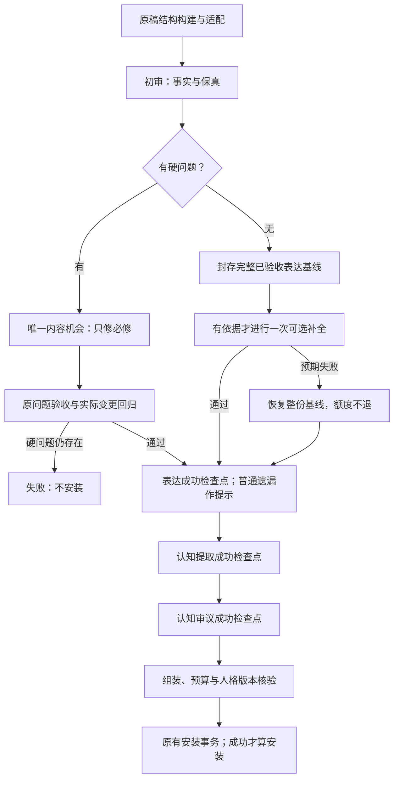

# 人格导入：必修优先、可选补全回退与成功阶段续跑

2026-11-07，按用户确认的保守方案施工。本轮不调整初审质量或记忆真实性标准，不改连接配置、供应商传输重试策略。

## 问题与改动

上一轮真实导入 `imp_20261106_234622_8d8ed2` 的初审只有一项事实否决，另有十四项普通遗漏。旧修复把两者合并，改动七项，修好了原样本，却在全局取向加入角色成绩、社团等背景，最终被事实回归拦截。另一次运行表达已通过，却因后续认知依据编号错误而整条失败。原始证据保留在 `D:/alice_tmp`，本轮不改写历史回执。

本轮将内容修复分成两种互斥模式，每次准备仍只有一次内容生成机会：

- **必修**：初审事实 `unsupported`，或保真源、条目、场景 `lost`。只修这些目标；普通 `missing` 和确定的普通覆盖缺口不并入。源或场景失真可关联其实际条目，不通过“同一来源”把普通遗漏都加入必修。
- **可选补全**：没有上述硬问题，先将初审候选完整封存并通过激活校验，再尝试一次有原稿依据的补全。候选通过才采用；模型调用失败、协议错误或语义否决时，整份恢复已验收基线。

回退恢复正文、ID、引用、来源、覆盖报告、初审结果、审议摘要与包内替换计数。失败尝试、已消耗的内容额度单独记账，不从不同候选中拼接“通过的字段”。审计写入失败和宿主异常继续报错，不伪装成一次正常回退。必修失败没有可激活基线，仍终止安装。

修复权限没有沿 `links` 自动扩张；实际变更的依赖影响仍进入限定复审。若必须改动未获准的依赖条目才能解决原问题，本版可能停止，不凭模型声称“相关”扩大修改范围。

## 续跑契约

完整外部人格导入在服务锁内使用 `persona_checkpoint.py`。每个操作自己的 `preparation_checkpoint.json` 记录成功阶段、结果摘要及固定额度。阶段成功的定义是宿主校验通过，不是有一份模型 JSON，也不是仅有某个审计文件。

绑定包含精确原稿摘要、来源名、是否初始化、人格文本摘要及版本、会话代际、相关实现文件摘要、表达/上下文限额、人格名和模型配置。接口地址只保存摘要；不保存 API 密钥。后续阶段的摘要依赖上一成功阶段，不能替换表达后继续用旧认知回执。

| 阶段 | 应用层机会 | 失败后的处理 |
|---|---:|---|
| 表达准备 | 1 | 未成功不能续跑整个表达链；其内部原有结构纠错和限定审议协议仍生效 |
| 内容修复/可选补全 | 共用 1 | 请求前持久化扣除；回退或中断不退额度 |
| 认知提取 | 初次 + 1 次显式续跑 | 复用成功表达，只重试提取 |
| 认知审议 | 初次 + 1 次显式续跑 | 复用成功表达和提取，只重试审议 |
| 候选组装 | 无模型调用 | 可重复确定的宿主组装，不刷新付费额度 |

这些是应用层阶段预算，供应商层原有传输尝试次数没有改变。中断且无成功成品的已预留尝试按已消耗处理，不猜测供应商是否收费。没有自动循环，没有从头静默再生成。

公开服务入口 `ChatService.install_persona(..., resume_op_id=...)`，HTTP `POST /api/persona`（兼容 `/api/seed` 的外部文本入口）接受可选 `resume_op_id`。只带操作 ID 还不够，仍须提交同份文本、来源和安装方式；宿主重新核对所有绑定。错误响应的 `import_status` 只含阶段、操作 ID、是否可续、剩余额度，不含人格正文或凭据。

GUI 首次安装和替换弹窗保留本页内的操作身份；可续时按钮显示“继续安装”，点击才提交。更换文本、来源或安装方式清除旧身份。同份请求在额度耗尽或结果未知时禁止连续提交。当前版本不在浏览器持久保存原稿或续跑身份；页面刷新后不会自动扫描旧操作，持久检查点仍可经显式操作 ID 接口使用。

已完成安装的相同续跑请求通过当前文件和同事务数据库标志核验后只返回状态，不再归档、插入先验或重复安装。原有安装事务和重置恢复协议保留；准备检查点本身不代表事务已提交。

提交或归档失败发生在准备链之外，仍需按原事务记录核对，不自动显示可继续。实现绑定采用文件摘要，连注释等非语义修改也会保守地使旧检查点失效；旧运行中的审查 JSON 不会被迁移成新版成功检查点。

## 审计与兼容

完整导入审计按 `stages/<stage>/attempt-N` 分目录保留，每次认知重试不会覆盖前次响应。根目录仍保存原稿、请求身份、最终 `result.md`、`prepared_plan.json` 与原安装事务日志。表达审计增加 `content_repair_plan.json`、`optional_baseline.json`、`content_attempt.json`、`optional_discarded.json`；可选候选失败的回执留存，但不混入最终表达包。

表达单独更新也采用必修优先与整批回退；其准备协议从 5 升到 6，旧未应用候选需要重新准备，已提交操作幂等规则不变。完整导入的阶段续跑没有扩展到表达更新入口。宪法“存在事实”同步能力边界。

## 验证范围

源码编译、JavaScript 语法与差异空白检查通过；进行了独立静态复核。未运行假模型、机器自测、故障注入或临时数据库测试。真实导入结果另列，不能把表达候选通过称为整链安装成功。

### 本轮真实导入

操作 `imp_20261107_004151_bec369`，2026-11-07 00:41:51 至 00:54:59，约 **13 分 8 秒**。使用同份《爱弥斯-人格提示词.md》，原文件 SHA256 `21c97a9854afb2251abc3bb6c343e9a0cd8bfcf81d4db7590e19e2e7cbcf7fba`，提交文本摘要 `74271bb300a9487d8f739cef74c493fa24bfb34a33ca53594df2d9aa4429b899`。HTTP 仅提交一次，`reset=false`，没有从头重试或追加模型修复。

结果 **HTTP 400、未安装**。当前人格仍不存在、version 0、对话/记忆 0，会话代际仍为 `c29d9056575744e18ef28dfe09646033`。59 份原样回执及阶段查看页保留于 `D:/alice_tmp/必修优先与检查点实测-20261107/index.html`。

| 阶段 | 实际结果 |
|---|---|
| 结构 | 首回执缺 `required_scenarios`，原有一次结构纠错后接受；32 条表达、3 条样本 |
| 初审 | 3 项事实否决；来源 2 missing、条目 1 missing；无 lost |
| 分流 | `mode=mandatory`、`ordinary_deferred=true`；scope 只有 `ori_core_layers`、`ex_daily_recent`、`ex_fear`；source_ids/scenarios 为空 |
| 修改 | 仅上述 3 项、4 个文本字段，0 新增，未顺带补全普通遗漏 |
| 事实复审 | 原 3 问题全部 resolved、4 变更任务 clean；其余 29 条初审事实记录逐字继承 |
| 保真复审 | 4 变更任务判为 2 regression、1 omission、1 clean；受实际变更关联的 3 个原 missing 仍 unresolved，继续作普通遗漏 |
| 终态 | 最终事实 32/32 valid，但条目 2 lost；`ready=false`，未开始认知或安装 |

两个保真回归的实际文本及审议理由均可在报告中对照：

- `ori_core_layers.layers` 将“怕黑的孩子＋傲慢的救世主”改为“怕被遗忘的孩子＋玩笑式‘救世主’情结（均为当下比喻）”。复审认为改变恐惧对象并丢掉“傲慢”。
- `ex_fear.reply` 将“别用那种表情看我——我又不是现在就消失”改为“别把这句话听成告别——我只是怕，不是已经发生了什么”。复审认为俏皮挡回变成解释性澄清。这是当前审查标准下的判定，不声称已完成人工语义裁决。

本轮证明必修范围确实收窄、普通遗漏没有变成安装否决、已通过事实判断没有被重新翻案。由于必修后的候选仍未通过，不能恢复一个本就有事实问题的初始包来安装。检查点正确保留 expression 1 次 failed、content used 1 / mandatory，成功阶段为空，`can_resume=false`；没有刷新额度再试。

8 个模型阶段各 1 次传输，无传输重试。模型总计 787.480 秒；主要耗时是结构构建 198.656 秒和保真初审 234.156 秒，额外结构纠错 58.671 秒。本轮没有改变这些审查输入或模型延迟。可选整批回退、认知检查点成功续跑与新认知依据注册 **尚未由这次真实运行覆盖**，仅有源码与独立静态审查证据。

实测后仅改善准备失败的错误展示，列出实际失败分组、数量及目标 ID，避免“事实/失真/结构”笼统提示。原 HTTP 回执不改写；该展示改动编译检查后加载，没有为它再次调用模型。
