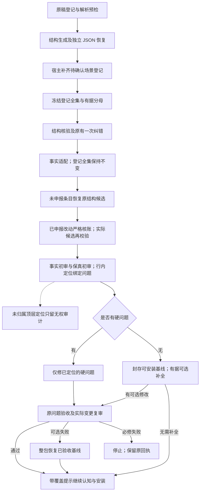

# 人格导入覆盖率改造：遗留检查与修复

2026-11-07。用户要求修复上一轮暴露的场景登记阻塞，检查覆盖率改造的其他遗留项，发现后接续修复，再进行一次真实导入。检查覆盖生成、适配、初审、片段修复、限定复审、激活、表达更新、运行时投影、用户修订、安装重放与 GUI 展示。

本轮按工作区约定使用源码静态核对、独立交叉审查和真实环境导入；没有机器自测、假模型、临时数据库或故障注入。旧失败回执保留，未将改后的规则回填为旧调用已通过。

## 已发现并修复

| 项目 | 原问题 | 修改 |
|---|---|---|
| 场景漏登记 | 模型声明了自定义场景，但覆盖表缺行，适配后被旧必需场景门槛阻断 | 结构期登记基础场景、声明场景、已有样本的精确场景名；缺行补 `unresolved`，只保留实际样本关联，不补造规则或通过结论 |
| 场景集合漂移 | 原合同只冻结有据和未知场景，未固定所有登记项 | 新合同增加可选的 `registered_scenarios`；适配漏行恢复待核对占位，越界新增或改名拒绝。旧合同仍可读取，运行时不偷偷补字段 |
| 表达类型强制齐备 | 非空的纯反应或纯样本原稿仍须生成取向/语感；样本又被强制关联独立规则 | 部分覆盖包允许只保留原稿提供的类型；没有独立规则的样本可以无 `links`，已有引用、来源和用途仍严格校验 |
| 原登记来源丢失 | 可选补全重算场景来源时会删除已有但尚未挂到条目的来源 | 保留原登记来源，再合入实际新增关联的来源 |
| 用标签解决失真 | 原复审可能允许仅改必要性或覆盖标签，就申请解决源/场景的 `lost` | 部分覆盖中的此类失真必须有相关实际正文改动或新增；元数据变化仍审查，普通 `missing` 不混作失真 |
| 未知登记被强推为否定 | 通用核对提示要求无法确认时给否定，与未知支持范围只留提示冲突 | 通用提示服从阶段标准；未知登记本身不构成 `lost`。保真 `passed` 不把未知变已覆盖；事实无法确认仍 `unsupported` |
| 已审核内容仍计零 | 有效规则/样本即使逐项通过，仍可能因 `missing/unresolved` 标签计零并触发重复补全 | 完整审核后按实际关联及条目/事实结论计数，保留未知和普通遗漏提示；未完整审核仍保守计数，分母不扩大 |
| 确定错误发现过晚 | 返回式硬缺口未接到结构纠错，原稿解析歧义也可能等到付费适配后才暴露 | 原稿解析硬问题前移到首次模型前；结构期消费剩余硬缺口，使用原有一次结构纠错 |
| 安装重放丢提示 | 已完成操作的只读重放没有返回普通覆盖提示 | 正常完成与重放共用同锁的安装状态和覆盖投影；显示读取失败不把已提交安装变成失败 |

## 保留的边界

场景名称不是原稿支持证据。无来源的待确认场景不纳入有据分母，不授权生成新行为；有精确关联的规则、样本仍分别计数，计数不表示全部行为语义已保留。未知登记和普通遗漏可以带提示保留，事实不成立、实际换义、关键停止条件丢失和用户明确约束冲突仍阻止安装。

空包、坏字段、重复 ID、错误引用、用途越界、虚称已覆盖却没有实际关联及预算超限仍拒绝。原稿解析未明确属于输入结构问题，不降级为普通覆盖缺口。生成和适配不会扩张已冻结分母；显式用户新增样本继续走用户修订路径，不自动扩大捐赠原稿分母。

没有增加模型阶段或生成次数。保留一次独立 JSON 格式恢复、一次结构纠错、一次必修/可选共用内容额度；可选补全失败恢复整份已验收基线。覆盖率修复阶段的表达更新准备协议为 9，适配收敛修复后为 10，初审定位层级收敛后为 11；原有已安装包兼容，旧未应用准备计划须重新准备。

## 后续修复：只采纳有申报的适配改动

第一次真实复验又暴露适配模型的未申报正文改写。这是独立的差异账目问题，不是覆盖率旧门槛再次拒绝，也不能将漏账直接视为措辞等价。

新增 `_select_declared_adaptation`，策略为 `declared_adaptation_only_v1`。原始回执先经过完整结构、条目 ID、来源及冻结覆盖合同校验；只有 `changes` 中精确、唯一、已知的条目 ID 才启用选择。未申报的条目改动恢复为原结构候选的完整条目，不猜测同义，不补造适配理由。重复、未知或损坏的申报仍走既有严格核账路径，不借选择机制隐藏错误。

已申报改动仍必须通过原有逐字差异核对。恢复后的实际候选重新执行完整结构与用途校验，再接受完整初审；恢复原条目不代表事实已成立。原始模型回执保留，`adapt_selection.json` 独立记录保留、丢弃及核账状态，后续审查只以实际候选为准。没有新增模型阶段、生成额度或安装豁免，也没有把第一轮失败回执补写为完整账目。

## 后续修复：初审定位的层级与权限

第二次复验暴露行内定位提示的层级不够明确。初审协议现明确顶层只能包含核对清单中的分组，`repair_targets` 必须嵌入所属的单条 `sources/items/scenarios` 审查意见，与该行 `id/verdict/reason` 同级，不得把多个问题合成顶层总表。事实 `unsupported` 与保真 `lost` 必须定位具体问题；普通 `missing` 可以无定位，继续作为覆盖提示处理。

宿主仅对初审中已知的顶层 `repair_targets` 列表作受限收敛：列表及字段有上限，每项恰含非空字符串 `item_id/field/quote` 时，将其保存在独立的 `*_unassigned_locations.json`，标记为 `observations_only_no_repair_authority`。不猜归属、不将它合并到任何审核行、不改变任何原始结论，也不赋予片段修改权。原始回执继续保留；损坏的定位清单及其他未知分组仍严格拒绝。

实际修复权限仍只来自合法行内定位；事实或实质失真硬问题缺少有效定位，仍不能靠顶层观察信息获得安装放行。现有逐项 ID 完整核对、缺行续查与限定复审范围保持不变，没有新增模型阶段或调用额度。

## 当前流程

独立下游检查未发现另一处强制覆盖率 100% 或只接受 `fidelity=passed` 的门槛：完整导入、认知链、表达更新和运行时继续共用统一校验；GUI 区分 `partial/missing`、规则/样本、零分母和未审查统计。可选补全的模型、格式、复审预检及审核失败仍在整包回退范围内，没有为处理普通遗漏而扩大异常吞并。

## 验证与本轮实测

首次复验前源码已冻结，相关八份源码编译、差异空白和独立静态审查通过。使用同份原稿，文件和提交正文摘要与前轮一致，没有改变接口配置。

### 第一次复验

导入 `imp_20261107_025027_a81df6` 从 **2026-11-07 02:50:27 到 02:55:23**，耗时 **295.422 秒，约 4 分 55 秒**，HTTP 400，未安装。结构生成 189.421 秒、事实适配 105.796 秒，各一次模型传输；JSON 格式恢复和结构纠错均未触发。

实际停止在适配差异核账：有两条正文发生变化，`ex_daily.reply` 有申报，而 `orient_default.text` 将“递纸巾/零食”改为“递纸巾或零食”却没有申报。宿主报 `局部适配差异账目不完整`。这不是覆盖率门槛再次否决，也不是初审模型判定失真；此时尚未到覆盖预检、初审、片段修复、限定复审、认知或安装。

新的 `registered_scenarios` 合同已实际写入，登记基础五类；结构合同记录来源 30 项、支持场景 4 项，仅为登记基线。该次没有产生上轮的五个悬空自定义声明，宿主自动补行分支未实际触发，因此不能宣称该分支或全部语义链已通过真实验证。失败后人格仍未安装、版本 0，会话代际和对话记忆未变。

此结果作为第一次复验保留。后续针对未申报改写的保守收敛方案及独立复验另行记录，不改写这份原始回执或将后续规则回填为本次已通过。

### 第二次复验

后续三份修改源码的编译、差异空白与独立静态审查通过，服务已重启加载固定代码。第二次独立导入 `imp_20261107_030456_480ba6` 从 **2026-11-07 03:04:56 到 03:15:08**，耗时 **612.531 秒，约 10 分 13 秒**，HTTP 400，未安装。原稿摘要与前轮一致，`reset=false`。结构 178.843 秒、适配 125.656 秒、事实初审 140.563 秒、保真初审 167.171 秒，各一次模型传输；未触发 JSON 格式恢复或结构纠错。

此次已实际越过非满覆盖预检：来源 30/30，规则 5/6（83.33%），样本 3/6（50%）。能力澄清缺规则及样本，拒绝和玩笑有规则但无样本，没有因此硬拦；这些是初审前统计，不能作为语义通过结论。适配中的三项正文改动均已申报，严格核账通过；未申报条目恢复分支未触发。六个场景均为模型原有登记，宿主自动补行也未触发。

本次阻塞转移到保真初审回执的结构：模型在 `sources/items/scenarios` 之外，另给出六条顶层 `repair_targets`，宿主以“表达独立核对包含未知分组，不能丢弃分组内容”拒绝。定位未明确绑定具体源/条目审核项，不能猜测归属并用作修复权限。事实初审回执有效，意见为 18 项 `valid`、3 项 `unsupported`；保真原始回执虽已返回，但未被采纳，不等于保真审查通过。

尚未进入内容修复、限定复审、认知或安装，内容修复额度未消耗。人格仍未安装、版本 0，会话代际和对话记忆未变。独立目录 `D:/alice_tmp/覆盖率遗留修复复验-20261107` 保存实际运行的 17 份源码快照与 30 份原样回执，后续修复不会重写本轮结果。可视版见 [第二次复验结构图及实际停点](D:/alice_tmp/覆盖率遗留修复复验-20261107/结构图.html)。

### 第三次复验

初审定位层级修复已完成并通过独立静态复核，最终 17 份源码已归档和绑定，服务重启后固定运行此版本。第三次独立导入 `imp_20261107_032135_4cd1da` 从 **2026-11-07 03:21:35 到 03:30:54**，耗时 **558.531 秒，约 9 分 19 秒**，HTTP 400，未安装。七个模型阶段各一次传输，没有自动重发。

这次首次实际触发独立 JSON 格式恢复，并成功修复两处引号转义（`escape_quote`），没有改写正文。结构候选随后接受，未使用结构纠错，格式恢复也没有占用内容修复额度。适配的三项改动全部有申报，严格核账通过；初审前来源 30/30、规则 5/5、样本 2/5，非满覆盖预检通过。事实和保真两份初审回执均完整通过格式核验，未产生顶层未归属定位清单。

事实初审为 10 项 `valid`、1 项 `unsupported`；保真初审发现具体 `lost`，因而进入一次必修片段修复。初审后的来源 16/30、规则 3/5、样本 1/5 只是覆盖提示，普通缺口进入 `ordinary_deferred`，没有触发拒绝。必修阶段修复三个条目的四个授权片段，实际修改三个字段，没有新增条目。限定事实复审确认原示范回复的虚构往历及用户外貌问题已解决，但将变更 `c0002` 判为 `regression`；其余两项变更为 `clean`，原事实问题为 `resolved`。

实际停点是 `t_happy_sharp.boundary` 的语义分歧：保真初审认为“不以隐瞒为爱”把原稿倾向反转成禁令，要求恢复；片段修复改为“她爱人的方式就是隐瞒：把好的一面递过去，重量留给自己”；事实复审又认为新句与保留的不说谎、不编造约束冲突。宿主绑定检查确认这次复审只针对该条目及实际变更片段，未扩大到未改条目，也不是覆盖率旧门槛或全量重新翻案。

这个模型否决不等于已证明客观事实矛盾：修后同条目的 `turn` 仍要求“不说谎”、可以少说或明确不想展开，全局也保留“不改事实、不说假话”。情绪不披露不逻辑等同于说谎，当前仍需统一源保真、片段修复与事实回归对情绪保留、拒绝展开和事实误导的区分及优先级。本轮没有擅自把模型结论改为通过，也没有追加随机付费重试。

必修内容额度已消耗，事实复审阻断后未调用保真复审，未进入认知提取、收养或安装。人格仍未安装、版本 0，前后用户状态及会话代际相等。追踪目录 `D:/alice_tmp/覆盖率遗留修复终验-20261107` 保存 57 份原样回执、17 份实测源码和检查点绑定，导出哈希核对全部匹配。可视版见 [第三次复验结构图及实际停点](D:/alice_tmp/覆盖率遗留修复终验-20261107/结构图.html)，具体原稿、修复片段及复审意见对照见 [阻塞对照](D:/alice_tmp/覆盖率遗留修复终验-20261107/阻塞对照.json)。

三轮真实记录仍未覆盖宿主自动补场景行、恢复未申报适配条目、顶层无权定位兼容、可选补全失败回退、保真复审、认知链、安装提交与安装重放。独立 JSON 格式恢复已在第三轮实际成功，不再列为未验证分支。当前结论是覆盖率旧阻断与已暴露的账目/定位层级问题已修，完整导入仍被上述语义口径分歧阻止，不能宣称安装成功。

第一次复验回执存放于 `D:/alice_tmp/覆盖率遗留修复实测-20261107`。可视版见 [导入与审核结构图及第一次停点](D:/alice_tmp/覆盖率遗留修复实测-20261107/结构图.html)，原样回执见 [第一次追踪页](D:/alice_tmp/覆盖率遗留修复实测-20261107/index.html)。
