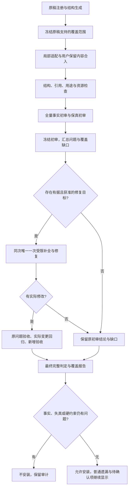

# 人格导入：部分覆盖与一次补全

2026-11-06。按用户确认的讨论实施，接续[限定复审](人格导入限定复审-实现说明-20261106.md)。目标是让普通内容遗漏可以修复或带提示保留，不再把模型自行标记的每个必需场景都当作安装条件。初审质量与记忆真实性标准仍是后续议题。

## 新流程

结构无效、来源解析有歧义、引用越界、投影失败和资源超限仍会停止。结构阶段既有的一次格式纠错及合法漏项的补审规则保留，不算作第二次内容补全。一次内容补全复用原有修复额度，没有新增一轮生成或初审。

## 覆盖如何计算

新增宿主策略 `source_coverage_v1`。初次结构通过后生成 `coverage_contract`，绑定原稿摘要，冻结来源与场景分母；适配、修复和用户编辑不能删减分母来提高百分比。

| 指标 | 分母 | 已覆盖依据 |
|---|---|---|
| 源单元覆盖 | 初次结构识别为保留、适配、合并或必要的非标题源单元 | 有实际成品条目引用，且相关来源、条目核对未否定其有效覆盖 |
| 规则场景覆盖 | 初次登记了原稿来源支持的场景 | 明确的 `rule_ids`，独立于样本关联 |
| 样本场景覆盖 | 同一组原稿支持场景 | 明确的 `example_ids`，样本场景须匹配 |

这里只统计**源单元**，不是把每段原稿拆成原子行为后计算的完整行为保留率。一段中多个动作可能共享一个来源 ID；百分比不能代替逐项保真核对。规则与样本也分别计数：有规则但没有样本，不强制补造样本；仅有样本，不伪称已有独立规则。分母为零时显示无比例，不显示 100%。

初次模型未能确定的来源、场景单列“待确认”。标题、表头不进入源单元分母。五类基础场景仍须有登记，允许注明原稿未提供，不要求五类都有规则或示例。已确认具有原稿支持的合同场景不能在适配时改成“不适用”。

合同是计数基线，不证明初次模型识别了全部原意。初审仍覆盖完整原稿与候选；合同外的普通遗漏和失真也保留逐项提示，不能因未计入分母而消失。补全只能在获准来源、已登记且有原稿依据的场景及获准条目内进行。

## 普通遗漏与硬失败分开

| 判定 | 含义 | 安装处理 |
|---|---|---|
| `passed` | 本目标核对满足 | 保留 |
| `missing` | 有原稿依据的普通内容遗漏 | 尝试一次有据补全；未补完可带提示安装 |
| `lost` | 换义、冲突、关键限制丢失，或违背用户明确要求、宿主固定边界 | 修复后仍存在则阻止安装 |
| 事实 `unsupported` | 成品事实前提、权限或用途隔离不成立 | 仍阻止安装 |

单凭 `required=true`、源文档中的角色口令或模型自己的“必需”判断，不能把普通遗漏升级为硬失败。遗漏若导致已生成动作失去停止条件、范围或原意，则仍是失真。事实初审指令与记忆真实性边界没有放宽。

最终保真汇总允许 `partial`：既包括模型明确报告的普通遗漏，也包括宿主发现的覆盖缺口、规则/样本不齐及待确认提示。没有新增一个任意百分比阈值，也不要求全覆盖才安装。空包、无任何有效表达类型或无效结构仍不能安装。

## 一次补全与限定复审

初审问题与宿主覆盖缺口合并到同一个修复清单，复用现有一次额度。新候选可局部改写获准条目、补入遗漏源的表达，或给已有且有据的缺失场景增加规则、样本；场景关联必须显式声明，不能凭“同源”推测。新增条目默认私有 chat 用途，不能自动扩到 QQ 或 worker。

没有足够原稿依据时允许保留缺口并说明。普通遗漏没有实际修改时，继承初审，不为同一内容付费复审；硬否决没有关联修改则仍停止。用户保留内容继续使用更窄的样本回应修复路径，普通遗漏不授权覆盖用户已选择的正文。

限定复审继续只验收原问题、实际变化的影响及新增内容。未受影响的通过结论继承；未改的普通遗漏也继承为遗漏。新增内容须完成事实与保真验收。复审不得把原 `lost` 降为普通遗漏，普通遗漏回归也须引用本次真实修改和允许目标。初审潜在旧问题仍只记观察。

最终四组回执必须覆盖当前候选完整目标。结构、来源、用途、投影、资源预算及版本摘要继续全量核验；UI 提示不参与豁免。

## 展示、兼容与审计

- `alice/expression_coverage.py` 负责冻结合同、结构校验和覆盖汇总；无模型调用或文件 I/O。
- `expression_prepare.py` 汇总普通缺口与硬失败，`expression_repair.py` 执行有界补全，`expression_rereview.py` 合并限定复审。原始初审不改写。
- 新包保存 `coverage_report` 与 `warnings`。准备结果、候选页面、当前人格与安装完成提示均携带覆盖信息；观察记录仅增加计数，不复制原稿或提示正文。
- 用户显式编辑后清除失效规则/样本关联，并按同一合同重算未审查报告；不伪造已审查标记。
- `expression_update.py` 准备策略升至 **5**，未应用旧候选须重新准备，已完成操作的幂等查询保留。没有新合同的旧表达包沿用原校验规则。
- 宪法“表达原稿更新”能力说明已同步。连接与协作者功能不在本次范围。

新增私有审计文件包括：

- `coverage_contract.json`：冻结范围；
- `coverage_before_review.json`、`coverage_initial_review.json`、`coverage_final.json`：结构、初审后、最终覆盖；
- `repair_scope.json`：合并后的实际修复授权；
- `repair_skipped.json`、`repair_no_change.json`：无有据可改目标或普通缺口未修改时的继承说明；
- `source_repair_changes.json`：真实修复变化，复审记录继续沿用限定复审文件。

这些文件在下一次真实准备时产生。本轮没有伪造新的模型回执，也未重放用户原稿。

## 验证与待确认

本轮完成相关 Python 编译、前端 JavaScript 语法、差异空白检查及独立静态复核。按工作区约定，未运行机器自测、冒烟、业务测试或假模型；未调用真实模型、启停应用、读写活动 `user/`，未提交推送。

现有常驻服务没有在本轮重启，不能据磁盘源码推断其内存已加载更新。**下一次人工导入前需重启服务并刷新页面。** 尚待真实确认的项目包括生成/审查模型能否稳定使用新判定、一次补全的实际效果与耗时、普通缺口提示是否清楚。静态检查不等于完整导入已经成功。

## 后续场景分类协议修复

用户随后重启并人工导入，操作 `imp_20261106_225841_4cc740` 在结构纠错后停止。首轮 3 处、纠错后 2 处样本 `scenario` 与引用它的 `coverage.scenario` 不相等；纠错模型把分类名加作前缀，例如“日常接话：被问最近怎么样”，仍不满足逐字一致。两次模型传输均正常，合计 343999 毫秒，未进入适配、初审或安装。证据见 `D:/alice_tmp/人工导入追踪-20261106-225841/index.html`。

按用户“继续修复，并自行导入一次校验”的明确授权，补充以下修复：

- 生成、适配和内容补全的提示统一说明 `scenario` 是精确分类键，具体情境完整保留在 `scope`、用户原话保留在 `user_input`；一个样本不能跨两个不同分类键引用。已有规则支持的场景无需为了修关联而新增样本。
- `CoverageScenarioError` 在基础类型和引用检查后汇总全部场景不等值，提供分类名、样本 ID、实际值和期望值。核心校验与新覆盖模块共用诊断，旧包仍只检查原先要求的 covered 行；没有模糊匹配或自动改名。
- 唯一一次结构纠错收到完整 `host_issues`，明确保留无关正文、来源与支持范围，不用新造能力来凑场景。纠错最终失败写 `structure_correction_rejected.json`；非校验异常仅记录类型与固定安全文案，不落供应商异常正文、不增加重试次数。

这次修复通过定向编译、差异空白与独立静态复核。随后使用正常关闭接口加载更新后的服务，通过 `/api/persona`、`reset:false` 提交一次原附件真实导入；本次不使用假模型或合成输入。请求、原始回执、前后状态及核验结果保存在 `D:/alice_tmp/场景协议修复实测-20261106-231800/`，真实执行结论以该目录最终核验记录为准。

### 第一轮真实实测及后续修复

操作 `imp_20261106_231931_16658f` 用时约 15 分 32 秒，共 10 次模型传输。三个样本的分类键在生成、纠错及适配后均无冲突；另一个“来源标记保留但条目未引用”的问题经结构纠错补齐。结构接受了两个仅有规则、没有样本的场景。表达初审的 1 项事实问题和 9 项普通遗漏进入一次受限修复；修复改 8 个条目、没有新增，事实问题和原遗漏通过限定复审。复审引入的 2 项普通遗漏保留提示，最终表达 `ready=true`、事实通过、保真 `partial`，未阻断。

最终安装仍返回 HTTP 400，原因是认知收养的依据编号契约错位：完整表达投影被放在唯一的 `style:1` 中，模型却按投影内部序号引用 `style:12` 等。8 个收养决定都有理由，但都含不存在的依据编号；此时还没有安装事务，当前人格仍为空。原始回执、失败核验及定位结论完整保留，不回填成成功。

继续修复包括：

- 收养审查接收已通过激活与摘要检查的最终表达包，宿主按真实条目生成 `expression:<原ID>` 依据；渲染正文与允许引用的 ID 使用同一登记。具体范围、字段、关联均保留，不从投影字符串推测分段，也不把错误编号自动改成有效编号。
- 旧入口仍使用原 style/reaction 清单；收养决定、真实性与理由条件未改变。新增 `review_input.json`、`review_manifest.json` 和 `review_validation.json`，记录最终表达摘要及所有未知依据引用，保留模型原始回执。
- 覆盖统计去除场景级遗漏对规则与样本的连带扣除。两项分别根据“已声明 covered 的行、明确关联、对应条目与事实核对结果”计数；场景级遗漏仍逐项提示，`lost` 和事实否决仍阻断。不解析模型理由猜测哪类材料应被扣除。
- 生成提示明确“理由称保留”不能替代实际来源引用；缺少保留目标的错误包含准确来源 ID。

补充修复后再次加载服务，使用原附件进行第二次完整真实导入，仍为 `reset:false`。证据目录 `D:/alice_tmp/认知依据修复实测-20261106-234500/`；以其中 `安装验证.json` 对 HTTP、事务完成、数据库标记、会话及人格摘要的联合核验作为最终安装结论，而非仅依据表达准备通过。

### 第二轮真实终态（2026-11-07）

`imp_20261106_234622_8d8ed2` 从 11 月 6 日 23:46:22 到 11 月 7 日 00:04:29，约 18 分 7 秒，最终 HTTP 400，未安装。7 个模型阶段产生 8 次传输尝试；首个结构请求超时约 300.6 秒后，由既有策略重试成功，超时用量为未知。没有改变连接配置或重试策略。

场景关联校验通过；结构少填 `required_scenarios` 经已有一次纠错补齐。初审有 1 项事实问题、14 项普通遗漏，无保真失真项。一次修复实际改动 7 个已有条目、保留 16 条、没有新增条目或场景。事实限定复审确认原 `ex_daily` 问题已解决，但 `o_light_care` 的新片段直接写入“成绩一般、人缘极好、社团有事就挨个帮忙”等角色背景，没有比方或假想限定，因此按实际修改 `c0006_e003` 判定新增事实回归。其余 21 条事实结论及理由原样继承。

这次在事实回归阶段停止，未运行保真复审、认知收养或安装。新的认知依据登记经过静态复核，但尚未得到真实收养回执验证。两次实测的当前人格均未安装、会话 epoch 保持不变，不能宣称整链成功；两套原始回执分别保留 60 和 46 份，副本摘要核对一致。

剩余架构问题是可选补全可能把普通遗漏变成新的硬错误，导致整单停止。后续需要单独设计依赖明确的补全回退机制；本轮没有放松事实标准、强行安装或改写模型判定，也没有把回退设想当成已实现功能。
