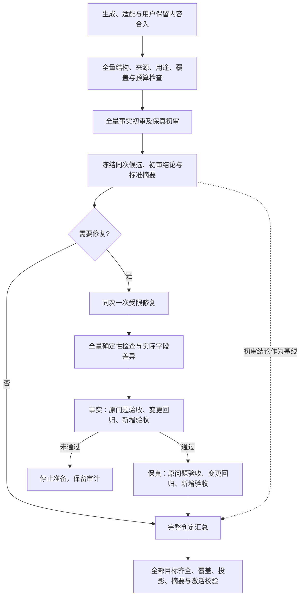

# 人格导入限定复审：实现说明

2026-11-06。按用户确认的结构实施；初审质量、记忆真实性判据另议。本轮不修改这两部分，也不处理连接、协作者或 UI。

后续已实施[部分覆盖与一次补全](人格导入部分覆盖与一次补全-实现说明-20261106.md)：新合同包的普通遗漏可带提示安装，准备策略升至 5；下文保留本阶段的历史说明。限定复审范围不变，普通遗漏的继承和补全规则以新说明为准。

原流程对修复后的整份候选重新做事实与保真审查，未改且初审通过的条目也可能因第二次解释不同被否决。新流程把复审改为原问题验收与实际变更回归；初审记录保持不变，最终结果由宿主合并。

## 决策范围

| 任务 | 允许形成的结论 | 宿主约束 |
|---|---|---|
| 原问题验收 `issues` | 初审指定的问题已解决或仍未解决 | 固定原判定与理由；解决必须引用此目标关联的实际修改，不能用第二次不同意见清除原否决 |
| 变更回归 `regressions` | 本次修改是否引入新问题 | 按真实字段差异分配任务；新否决须引用本次修改片段 ID 和允许的受影响目标 |
| 新增验收 `additions` | 新条目的事实与保真是否通过 | 新条目没有初审基线，两个阶段均须完整验收 |
| 既有问题观察 `preexisting` | 记录另一种理解或初审潜在遗漏 | 只记审计，不改写本次判定 |
| 未分配的额外意见 | 记录越界输出 | 原始回执及额外意见单独存档，不进入判定汇总 |

局部修改沿明确的反向依赖传播，再到相关来源与场景；来源、场景是终点，不通过共同来源扩张到所有兄弟条目。取向或约束的全局正文变化分配全局差异任务，可以查看同用途上下文，但仍只审查指定修改产生的影响。

用户保留内容的样本修复路径也复用未显式引用标题的影响规则，避免已有可修样本被旧前置检查拦住；仅来源否决仍不会自行扩大样本修复目标，用户内容的可改字段不变。

未变且未受影响的通过结论直接继承。原否决如果没有相关实际修改，在模型复审前停止。单改来源标签、反向索引或说明理由不能充当源正文修复证据；必要性声明本身可能是原问题，因此实际 `required` 变化仍进入对应验收范围。

`clean` 和 `preexisting` 不会清除原否决。回归否决在原问题、新增验收合并后写入，不能被另一项通过结论覆盖。事实阶段仍未通过时停止保真复审。最终四组判定必须覆盖当前候选完整 ID 集，结构、来源、用途、覆盖和资源检查仍全量执行。

## 实现与审计

- `alice/expression_rereview.py`：生成绑定前后候选、初审和标准摘要的计划；生成真实修改及片段编号；验证任务回执并合并判定。仅使用标准库，无模型调用或文件写入。
- `alice/expression_prepare.py`：初审之后写检查点；两种修复路径都调用限定复审。初审仍允许原有附加说明字段，检查点仅规范保留已验证的 `id/verdict/reason`，原始回执不丢弃。任务全部附加字段在漏项补审前验证，仅合法子集可进行一次补审。两个复审阶段的精确首请求共用实际发送的组装逻辑，在首次复审付费前一并检查预算，避免事实已付费才发现保真输入过长。
- `alice/expression_update.py`：准备策略升至 4，待应用旧候选必须重新准备；已完成安装的幂等查询保留。计划记录 `initial_plus_delta_v1`，运行时 expression-v2 格式不变。
- `alice/expression_repair.py`：本轮仅同步复审契约说明；既有一次修复额度、可编辑范围、用户内容保护不变。

新增私有审计包括 `review_initial_checkpoint.json`、`rereview_plan.json`、`rereview_preflight.json`、各阶段原始请求/回执、`rereview_fact_merge.json`、`rereview_fidelity_merge.json`、最终 `review_merged.json`。若模型给出范围外意见，另写 `*_out_of_scope.json`；阶段失败保留已经形成的审计，不生成通过记录。GUI 未增加专门的复审审计展示。

本轮没有增减用户能力，无需改宪法存在事实清单。没有新增整轮审查调用：修复后每阶段一次任务审查，合法漏项最多各补一次；无任务阶段直接继承初审，不发模型请求。

## 既有真实材料的任务清单

使用 `imp_20261106_205426_deb7f0` 的适配候选、真实初审及真实修复结果，仅生成新结构的任务清单；未调用模型、未重放旧复审、未制造新判定。输出在：

`D:/alice_tmp/限定复审任务清单-20261106-215647/说明.md`

| 阶段 | 原问题验收 | 字段变更回归 | 新增验收 |
|---|---:|---:|---:|
| 事实 | 2 | 6 | 0 |
| 保真 | 3 | 6 | 0 |

宿主识别出的 6 处变化与原追踪一致：`ori_layers` 的三个字段、`r_low_mood.first`、`ex_daily.reply`、`ex_low.reply`。上次初审通过、复审翻转的 `r_night_food` 不再独立重新全审；它只能作为三处全局取向变化的影响上下文。再次把原有的小屋、炉火、汤香认作记忆，本身不能成为新否决，必须说明本次修改如何造成新问题。

需保留的限制：代码能核验修改、证据片段、版本和允许目标，不能用结构校验证明模型声称的语义因果一定正确。全局差异的归因质量仍须真实人工导入确认，不宣称本次已稳定通过导入。

本轮验证包括定向语法编译、差异空白检查、独立静态复核及上述真实材料的任务清单生成；两份完整初审指令与旧真实请求逐字核对一致。不运行机器自测、冒烟、假模型或业务测试。未新增真实模型调用、未启停服务、未读写活动 `user/` 数据、未提交推送。实际运行进程仍须加载更新后的源码，完整人工导入验收待进行。
