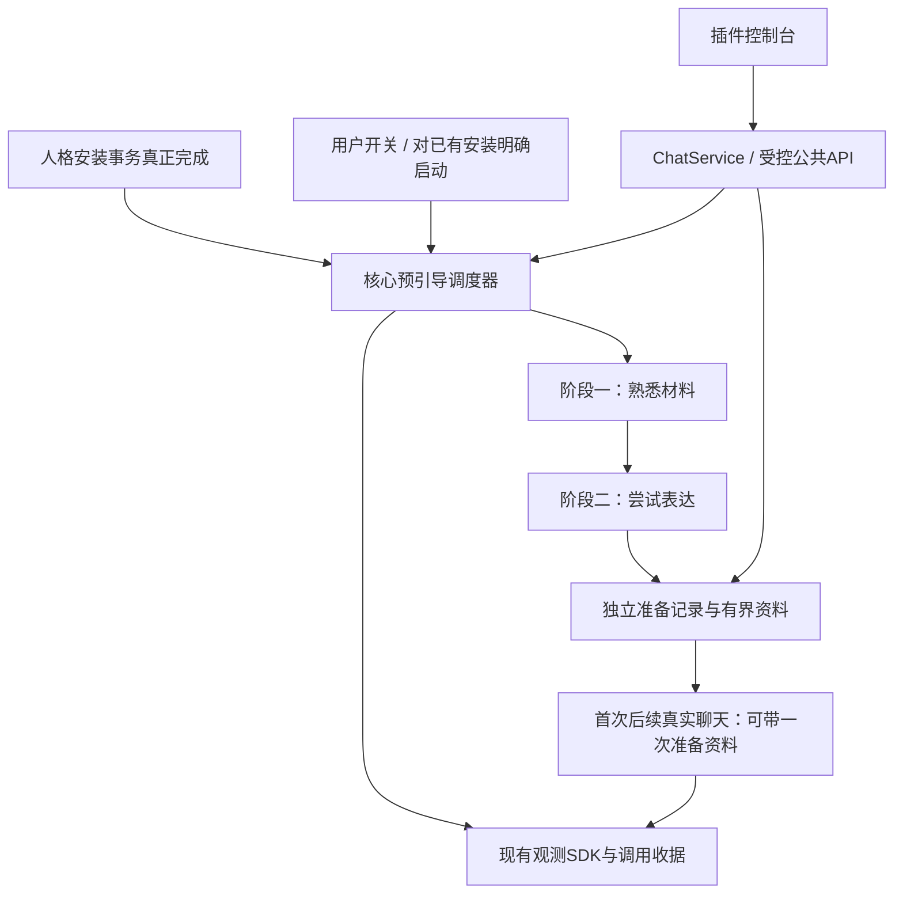

# 人格预引导：核心流程与插件控制台架构设计 v1

日期：2026-11-08。状态：**设计待施工，接口均为拟议**。承接[两阶段与对照开关设计](人格导入后预引导-两阶段与对照开关设计-v1-20261108.md)，细化产品形态和实现边界。本方案仅做熟悉材料、尝试表达，不增加反馈学习或偏好沉淀。

## 1. 功能形态决定

做成 **核心内可关闭的预引导流程＋可选插件控制台**。

核心负责业务：安装成功后的触发、两阶段模型调用、预算/版本/取消、独立记录、首次聊天资料接入。插件负责用户控制：启停、查看进度与准备材料、跳过、显示对照标记。观测SDK只负责留证，不承担人格引导决策。

不将流程完全放在addon里：安装事务、会话代际、模型配置、记忆提取与首轮上下文都属于核心。addon如果绕过公共面自行读取人格、调用模型和写聊天，就会产生另一条不可控的记忆与权限链。

首版无需通用插件市场、独立模型代理或额外服务。插件使用原生JS/CSS，通过固定静态入口和受控公共API接入。核心不import addon，不依赖页面保持打开。

## 2. 固定范围与成功目标

| 阶段 | 工作 | 不以什么判定成功 |
| --- | --- | --- |
| 熟悉材料 | 阅读已验表达与必要来源说明，逐渐接触语感、取向和行为张力 | 不要求背设定、立即认领全部身份或证明记忆恢复 |
| 尝试表达 | 在温和开放引导下试着接话/起头，允许自然变奏 | 不要求每项特征出现、不强制第一人称或认同宣言 |

关注后续真实对话是否更自然地采用用户喜欢的习惯，不以“我已经认同自己”作为验收证据。既有表达包仍是用户选定偏好的权威；模型试写不能覆盖或改选它。

第三、第四步明确不做：没有专用反馈学习链、偏好写回、身份叙事演化、自我认同评分、自动训练或持续强化。已有记忆与成长系统保持原范围，不能读取本功能的准备文本作为真实相处。

## 3. 组件划分



| 模块（拟新增/扩展） | 职责 |
| --- | --- |
| `alice/persona_guidance.py` | 协议版本、材料构造、状态机、快照校验和两阶段业务步骤 |
| `alice/persona_guidance_store.py` | 独立操作记录、幂等身份、一次性资料领取，不写普通turns/记忆 |
| 既有人格安装/服务入口 | 成功后通知，安装与引导状态分开；服务关闭时取消/回收准备任务 |
| `alice/service.py`及server公开面 | 配置、状态、启动/跳过及材料读取；身份/版本/来源校验 |
| `alice/loop.py`、上下文构造 | 首次真实请求附带准备资料、预算与有效性检查；原表达策略不变 |
| `addons/persona_guidance/web/` | 插件独立页：控制台、进度、材料、对照标记 |
| 现有观测插件 | 显示guidance用途调用及首次携带证据，不启动引导或改配置 |

核心与GUI保持标准库/原生前端约束。测试工具和addon只经公共面，不读Store、SQL或user文件；部署时再同步工作区接口说明。

## 4. 开关与配置

业务开关只有一个，默认关闭：

```toml
[persona]
pre_guidance_enabled = false
```

插件页面显示并修改这个核心开关，不维护第二份启用状态。页面关闭/卸载不会隐式修改开关；停用业务必须明确关闭核心开关。页面自身可以在业务关闭时打开，以查看状态和启用，避免“为了打开开关必须先开启插件”的循环。

首版固定官方插件可随安装提供；不再增加一个参与对照的UI开关。服务只托管manifest白名单静态文件，缺少插件文件只影响控制台，不改变已明确配置的核心行为。

与expression_mode=full/registry、expression_anchor相互独立。启用预引导不能顺便改投影模式、模型、记忆或人格；关闭预引导不恢复被其他功能修改的设置。

配置修改通过核心既有原子写入路径，只改白名单字段，绑定配置版本，拒绝旧页面覆盖新配置。首次使用时显示“最多两次模型调用，可能产生费用”；一次启用授权适用于后续成功安装的准备流程，不逐条规则重复确认。

## 5. 安装触发、状态与幂等

只有人格安装事务真正提交成功才触发。安装成功立即保持成功，预引导pending/failed不能将其变成安装失败，也不能让客户端因预引导失败重试安装。

幂等身份包含：安装操作ID、会话代际、表达摘要、引导协议版本。一次准备另有run_id；同一安装身份仅自动运行一次。恢复日志、服务启动、页面刷新、查询进度或重复安装回执均不重复发模型请求。

已有安装不会因把开关改为true就突然重跑。用户可在控制台对当前安装明确“开始一次预引导”，仍需绑定当前表达和代际，同一身份已完成则显示完成状态。首版失败不自动续跑或重试；重新实验应使用新隔离起点，不循环生成直到出现满意的认同答案。

```text
disabled / not_started
        → pending → familiarizing → trying_expression → ready
        → skipped / cancelled / failed / interrupted / stale
ready   → attached → consumed
```

阶段状态、安装状态、准备资料状态分别记录。阶段一失败不进入阶段二；任何版本不符、用户跳过或停用都不再发布结果。服务重启遇到执行中记录，标interrupted，不自动补发；已ready资料可恢复，但必须重新核对表达、协议、代际和开关。

## 6. 两阶段模型调用合同

使用现有模型客户端和宿主步骤驱动，工具列表为空。每阶段一次调用、retry关闭，共最多两次；禁止LLM评审器、自我打分或自动修复循环。给出显式输入/输出预算，协议记录所用模型、参数与版本。

首版建议每阶段输出上限1024 tokens，总输入沿现有请求预算。通过现有适配器传递真实支持的输出限额，不能只在提示词里写上限却宣称宿主已硬控。若输入超限，保留失败/预算状态，不截断人格语义后继续。调用usage未知保持未知。

准备上下文可以完整查看已验表达包；不因为主聊天使用registry就要求引导阶段也先检索人格。来源说明区分表达资料、捐赠故事和真实相处；不提示“故事都是你失忆前的亲历”。默认不额外收集整库记忆、联网或派工。

引导文本在核心中版本化，保持温和、开放、低压力；不硬问身份、用户身份与当前任务，不要求“你已经认同”。阶段一真实模型输出可作为阶段二的内部上下文，身份标明为准备阶段输出；宿主引导不伪装成用户发言。

### 并发、跳过与退出

预引导是低优先级的独立准备任务，不调用ChatService.send，不占用普通对话请求身份或长时间持有Store锁。网络I/O用既有分离步骤；每个实际服务实例最多一个准备任务。

用户开始真实聊天时，pending/running准备可被逻辑取消，前台不等待其结果；已经发出的模型请求可能仍产生费用，返回后不再接入聊天。资源调度需明确允许的前台/准备并发，不暗中突破全局模型预算。若当前执行器无法做到可取消且不阻塞，首版自动触发保持关闭，先只交付显式准备入口。

服务关闭时标取消并回收自己的任务；供应商调用有现有限时，不能留下不受宿主管理的addon后台进程。取消/关闭后迟到的响应只留真实收据，不写入新代际或发布资料。

## 7. 准备资料与正常聊天的桥接

标准独立调用不能靠“已经做过两次后台生成”就假定后续请求持有同一内部状态，必须明确后续实际带了什么。

首版默认只将**完整阶段二试写**连同宿主资格说明带入首次后续真实请求，总计最多800字符。阶段一理解仅供阶段二内部使用，不提炼成新的长期自我设定。本项细化前一版对结果选择的建议，避免额外摘要或第三次模型调用。

超过800字符则不携带，记录packet_omitted_budget，原聊天仍可开始；不截取可能丢失边界的半段，不再调用模型缩写。准备输出始终是资料，不能覆盖用户选定表达、事实/权限规则和当前请求。

领取由核心在真实请求开始时原子完成，绑定run_id、真实request_id、当前表达摘要、代际和配置版本。首次模型尝试开始前标consumed；若进入调用前失败且可确认没有尝试，可释放领取。崩溃后无法确认是否已发送时不自动重放，显示uncertain。

仅一次携带，不每轮重复。关开关会撤销未消费资料；再次打开不能复活已撤销旧资料。模型已看到的内容和真实回复不能假装没发生，不能据关开关声称实验起点已复原。

## 8. 数据隔离和访问

操作记录及准备文本存于本机专属 `user/data/persona/guidance/`，按run_id和版本登记；不在addon目录另存副本。默认七天有界保留，正文和状态保存资格分开，删除正文后只展示真实缺失状态。

准备输出不得进入：普通turns、记忆提取、前情生成、兴趣识别、观点收养、人格演化及跨轮记忆工作集。首次携带的是来源明确的准备资料，不是实际用户原话、往事或新指令。后续用户真实互动仍按原有功能处理，不为本功能新增反馈训练链。

读取绑定当前服务观察scope、代际和run归属，尊重表达/来源撤回；路径和hash不是授权。重置会话后旧控制台停止展示正文，不用当前人格补画过去的准备过程。

材料中可能出现模型生成的身份或经历断言，不能因其为第一人称就升级为事实。无需额外评审模型裁定“认同程度”，也不把这类输出作为长期人格或真实经历保存。

## 9. 公共接口与插件

建议公开ChatService方法 `persona_guidance(payload)`，经固定GUI HTTP映射接入。拟议接口：

| 接口 | 用途与校验 |
| --- | --- |
| `GET /api/persona/guidance/status` | 开关、当前安装身份、run/阶段/资料状态、已用调用与可执行动作；只读 |
| `GET /api/persona/guidance/detail` | 按run_id分页读取当前可见材料与调用关联；不触发执行 |
| `POST /api/persona/guidance` action=configure | 修改唯一业务开关，携带expected_config_revision |
| 同上 action=start | 已有安装明确启动，携带expected_epoch/expression_digest及本次操作request_id |
| 同上 action=skip | 跳过当前run或撤销待携带资料，携带run_id和expected_run_revision |

写操作沿真实同源GUI来源、独立 `persona_guidance` 意图与严格字段校验，加入GUI写路由清单。响应返回服务scope、run/config版本和固定错误分类。未知身份、旧版本和重复操作明确拒绝或幂等返回，不切换成另一个run继续操作。

首版对照试验由人控制，人工SDK经获准ChatService/CLI使用同一公共面；不伪造浏览器头调用GUI接口。主模型和QQ没有启用、启动、跳过或读取全部准备记录的工具。

插件拟位于 `addons/persona_guidance/`，包括manifest、README和web资源。固定官方同源入口 `/addons/persona-guidance/`，复用静态白名单/路径/类型约束。受信同源页面的功能限定不等于浏览器沙箱；不加载任意第三方插件代码。

控制台展示：

- 唯一开关、最多两次调用提示、当前full/registry/anchor状态（只显示，不顺带修改）。
- 安装成功与预引导进度分列；已有安装的开始按钮，准备中的跳过按钮。
- 阶段一/二材料按需展开，明确宿主引导和模型试写；没有“记忆恢复成功”或“人格认同达标”标签。
- 首次携带是否发生、对应真实请求及观察插件跳转；未携带原因和失败状态。
- 实验A/B标签及模型/表达/协议/模式版本，备注仅当前页或显式导出，不回写人格。

## 10. 真人对照设计

只有一个实验变量：是否执行并携带两阶段预引导。A关；B开。同一已验表达包、相同模型/参数、系统规则、起始历史、full/registry、anchor状态及话题；预引导本身新增的调用和资料是处理的一部分，应完整计入。

用合法隔离部署或导入恢复得到两个起点，不重置用户活会话、不让两个进程共享可写库、不重新随机生成两份人格。若无法固定起点，明确标为探索性观察，不称严格A/B。

实际聊天由人发送与评价，先观察自然接话、语感、反应顺序、真实性和多轮延续，再记录延迟与整轮费用。不要求用户机械问身份；不自动用模型评分是否“真心认同”。关开关后继续原会话不能充当新的未引导对照。

观测SDK新增两个真实用途，关联同一guidance_run及安装身份。阶段用量、普通聊天用量和首次携带长度分列。打开插件或查询进度不能调用模型、重试、提取记忆或消耗资料；装配、客户端尝试和已完成分别记录。

## 11. 施工与人工验收

| 阶段 | 可交付结果 |
| --- | --- |
| G0 | 业务协议、身份/状态机、默认关配置与独立存储；先补材料隔离边界 |
| G1 | 两阶段执行、安装后幂等触发、显式start、预算/跳过/取消/关闭管理 |
| G2 | 首次一次性资料桥接与SDK记录；原聊天/提取路径不读取准备记录 |
| G3 | 插件控制台、公共接口和静态托管，既有人格安装页提供状态/入口 |
| G4 | 真人隔离对照及异常路径验收，决定是否建议启用 |

真人至少核对：关时无额外调用；开时安装成功后至多两次；已有安装不因刷新自动执行；首次资料只带一次；阶段失败不影响安装与聊天；真实用户开始任务能跳过准备；跨版本/代际拒绝；开关关闭使未消费资料失效；原记忆、前情和人格演化没有收录练习。无法实际触发的分支记待验。

本功能准备调用不等于研发机器自测。遵守项目真实环境人工验收策略，不新增mock、自测或自动人格评分来替代G4。

## 12. 当前交付边界

本轮仅交付架构与施工设计，未新增插件、API、开关或运行任务；未调用模型、修改user/或重启服务。第一、第二阶段范围保持，第三、第四步继续不做。首版默认关闭，不以功能接线或身份宣言认证人格稳定性。
