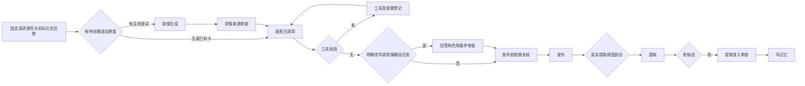

# 审查开销与前情退休：具体契约草案

2026-11-04；依据[任务书 W6／前情退休](../整体设计迭代概览/Alice架构完善-开发任务书-20261104.md)、[上下文设计](模型参与上下文组装-架构优化设计-v1.md)及[原验收 §14—19](人格与上下文优化-实施与人工验收-20261103.md)。状态：设计交付、待裁决，未实现本文新增配置、API或退休状态。W4 已有修复的实际落点以本轮实施记录为准。没有读取本机配置或调用供应商；下面不推定任何接口支持专有参数、并发或批处理。

## 1. W6 调用依赖及优化边界

真实依赖按逻辑用途表示；工具或空结果使部分节点不出现，不能按图补算未发生费用。

人格导入单独为：提取 → 提取结构／表达审查 → 表达适配 → 成品前提审查 → 认知收养 → 提交。具体调用是否合并应以 W4 purpose 记录为准；表达和认知的分工不能为了节省一次调用消失。普通演化另有依据投影与提交，禁止套用审查模型配置。上图是依赖图，不承诺当前各节点锁内／锁外或串行时间完全相同。

首版优化不增加并发。生成输出是审查输入；来源资格与完整条件是提交输入。任何一个依赖尚未完成都不能先发草稿再补审。保留现有空候选免审、已生成前情复用、明确任务才审回答、批内一次审查和失败保原句。结构错误直接拒绝只记 `skipped_invalid_structure`，不能记语义审查通过。

### 1.1 可归因观测

W4 最小记录应能映射到以下分析字段。字段缺失时写未知，分析不从整轮累计反推分调用。

| 字段 | 语义 |
|---|---|
| epoch、request_id、call_id、attempt_id、parent_call_id | 请求、逻辑调用、实际发送尝试、依赖关系；相同重试属于同一 call，不抹掉失败 attempt |
| purpose、stage、actual_model_fingerprint、profile_revision | 记录实际发送的模型及配置作用域，不能由 cheap/chat 配置猜测 |
| started_at、duration_ms、first_event_ms | 墙钟用于定位、单调钟用于耗时；缺首事件记录为 null |
| outcome、error_class、fallback_from、dispatch_state | 固定类别；未发送、已发送未知、成功、失败、取消分别可辨 |
| usage_status、input/output/reasoning_tokens | 回执值或 null；推理 token 只有接口明确返回才填，completion 不能自动等同推理 |
| price_revision、currency、reported/estimated_cost | 有明确价格版本才估算；供应商账单未取得不称最终结算 |
| cache_state、skip_reason、input/output_size | 只记有界元数据；不记录 prompt、查询正文、密钥或供应商错误原文 |

实际发送次数为 `dispatch_state=sent/unknown` 的尝试数，unknown 单列；总等待拆为装配／工具／模型／审查／发布等待，不能把网络往返耗时称供应商推理时间。每请求同时报告完整次数、已知 usage 求和及未知次数。只有整组全已知才显示完整总量。

### 1.2 独立配置草案

建议新增 `[review]`（默认 `profile="inherit"`，保持现行行为），作用域只覆盖 `extraction_review,recap_review,rewrite_review,recap_answer_review,import_expression_review,import_finished_review,import_adoption`；导入生成、主聊天、思辨和普通演化不受影响。各用途可引用配置档，档结构：`id, revision, model_alias, max_output_tokens, provider_capability_id, timeout_seconds`。`model_alias` 必须指向用户已有显式配置；无档时继承当前调用目标，不偷偷换模型。

供应商专有设置放在经过验证的能力映射中，允许键由接口适配固定，不提供任意请求体透传。能力记录为 `provider_type, api_family, model_alias, documented_at, source_url, verified_by_human_at, supported_fields, output_semantics, stream_usage_support, retry_policy`，不存端点密钥。文档支持与本机真实回执支持分列，未核实为 `unknown`。即使支持批处理，也须比较异步批次时延是否适合实时请求。

更换审查模型、输出上限或供应商参数需用户选择具体档。接口拒绝参数默认失败并按现行保护返回，不自动再发一次收费调用；若今后允许一次降级重试，应另授权 `retry_budget=1`、适用固定错误类和完整尝试记账。配置回退只撤销新档，不清审计、不退款、不重新运行旧请求。

### 1.3 可实施的缩减与缓存

先让候选表达只包含其实际依据、必要上下文和完整限制，输出用稳定 ID、固定决定类别与有界理由；超限整候选暂缓，禁止字符截断条件。输入减少须人工确认角色／否定／时间条件仍完整。首版不引入语义近似缓存；若需要精确缓存，键必须覆盖 `epoch/channel/purpose/rule_revision/model_profile/input_digest/source_versions/permission_revision`，命中前复核全部来源，任一撤回即失效。缓存只保存审查裁决和版本化引用，不能借缓存留全文；expires_at 不超过最短来源期限且不得因命中续期。是否保存跨请求裁决、期限多长属于新增保留政策，当前不启用。

### 1.4 最小分解、人工比较与回退

1. W4 完成后，人工自然使用收集同类任务的逐调用记录；不自动刷请求。记录同模型/人格/渠道/开关，以及不能控制的历史差异。
2. 只缩减审查输入输出的重复包装，完整条件保持；一项变化一组对照。至少分别覆盖正常、拒绝、接口失败和来源失效；没真实发生就待验。
3. 用户提供脱敏接口类型、模型别名及官方能力链接后核实；无需密钥或完整配置。再提出具体配置差异和影响。
4. 分别比较每请求总尝试、已知用量/未知次数、首字/总等待、漏掉条件、错误放行及用户返工。样本少只列个案，不宣称统计收益。

出现错误放行、无审草稿、重复请求或来源越界即撤回新档／优化；保留审计与旧保护。费用未完整时不宣布降本百分比。数据迁移仅加档及可选观测字段，旧记录标 `legacy_unknown`，不补造时间或模型。代码回退到无新档版本前先将档改为 inherit；版本化记录保留且不得被旧版误解为成功。

## 2. 前情纠正、替代与退休

目标：来源仍有效但语义已被用户纠正的旧卡不继续作为现行要求；失败跨度不自动反复付费。该能力与 W3 实际历史边界修复独立，不能用本草案声称已经解决语义退休。

### 2.1 最小数据

新增关系表而非重写原卡正文：`recap_dispositions(id, epoch, channel, card_id, card_version, action, expected_revision, correction_request_id, correction_turn_id, correction_version, replacement_card_id, actor, reason_code, created_at, operation_id)`。action 仅 `retire/supersede/end_topic`；actor 为 `user` 或 `model_proposal`，只有用户确认的操作生效。reason 不存另一份私人原文，纠正通过仍有效的同渠道原文引用解释。

卡生命周期 `active → retired/superseded/expired/invalid_source`。退休是单向的；撤销错误操作必须新建显式恢复决定并重核所有来源，不直接删除审计。supersede 只有新卡成功生成且独立审查通过才连接新卡；生成失败时先停用被明确纠正的旧卡，回复“旧摘要已停用，新摘要尚未形成”，不能因没有新版继续用错版。话题结束仅退出自动注入，不删原话、不取消旧授权记录、不让模型仍把它当当前待办。

另设 `recap_retry_requests(operation_id, epoch, channel, span_digest, source_versions, previous_attempt_id, state, authorized_by, max_attempts=1, created_at, expires_at)`。一个明确用户动作只授权一次新的生成链及必要一次审查；网络库内实际重试仍须有 W4 attempts，不得在此做无限重试。相同 operation_id 回放状态，不重发。

### 2.2 API 与界面草案

GUI 同源、意图 `context`：

- `GET /api/context/recaps?scope=…`：有界只读元数据，卡 ID/版本/状态、来源身份、失败跨度及可执行动作；来源失效不返回正文。
- `POST /api/context/recaps/disposition`：`operation_id, epoch, card_id, card_version, expected_revision, action, correction_ref?`。停用可以无 correction_ref；宣称被纠正必须有同 epoch/渠道、实际用户角色的引用。
- `POST /api/context/recaps/retry`：以上跨度身份及当前请求授权，返回排队身份与费用提示；忙时拒绝或排队但不自行追加新次数。
- 模型只可返回有界 `recap_change_proposal`，不能直接调用管理 API；模型提议既不生效也不构成新的用户授权。QQ 不获管理入口。

接口名称为拟议，当前不存在。GUI可显示旧卡、关联的当前用户纠正及“停用/替代建议”；查不到可回放原文时显示不可用，不能靠留私人副本维持审计。

### 2.3 并发、恢复和删除

生成开始固定全部卡/来源版本，先登记依赖再入模；发布前重验。用户在生成期间停用则禁止旧卡派生答复发布；不能仅下轮生效。退休元信息与派生失效标志同一事务；观察器不能替它提交事务。过期请求、epoch变化、版本冲突返回固定冲突码且不调用模型。

失败跨度默认维持 attempted，不清标记。真人显式重试创建新 attempt、保留旧失败，额度不足则不发送。重启后 `dispatched` 无结果为 unknown，不自动重试；未 dispatch 的明确授权也不跨进程自动发，显示“需重新确认”。来源撤回/删除删除可回放内容，保留不含正文的 disposition 身份及原因仅在既有审计许可内；彻底删除时引用随生命周期清除，不能以审计名义永久复制。

TTL 建议作为退出辅助，不替代用户纠正关联。建议初版沿现有卡注入数量及来源寿命，不额外设自动语义TTL，先观察；以后若设 TTL，固定创建时点且读取不续期。旧卡迁移为 `legacy_active` 且现行来源校验继续执行，不自动推测历史纠正。用户可逐卡停用；不重跑历史模型、不全库扫描私人对话生成关系。

回退先关闭新管理与模型提议，禁止旧版本再次注入已退休卡（需兼容过滤或保留功能关闭）；不能简单删新表使错版复活。只读 API/schema、用户停用及 CAS、生成/发布复核、显式单次重试、模型提议可见性按五步分别交付。

## 3. 需要裁决的最小问题

| 决定 | 推荐与替代 | 阻塞范围 |
|---|---|---|
| 谁能让前情退休生效 | 推荐用户点选；模型仅提议。替代是模型自动关联并停用，误关联会丢有效背景 | 新退休操作，不阻塞 W3 |
| 是否提供显式付费失败跨度重试入口 | 推荐每次确认仅一条生成链；替代只允许停用，保持无重试 | 失败恢复新入口 |
| 独立审查配置目标 | 先 inherit、缩重复输入，取得脱敏接口证据后再选档；当前不请求密钥 | 换模型／参数与并发优化，不阻塞 W4 |

所有选择目前均为建议；新增入口及保留规则需确认后实施。人工验收见[W5剧本](../整体设计迭代概览/Alice架构完善-人工验收剧本-20261104.md)，本文新行为另列未来场景，不混入本轮代码通过结论。
