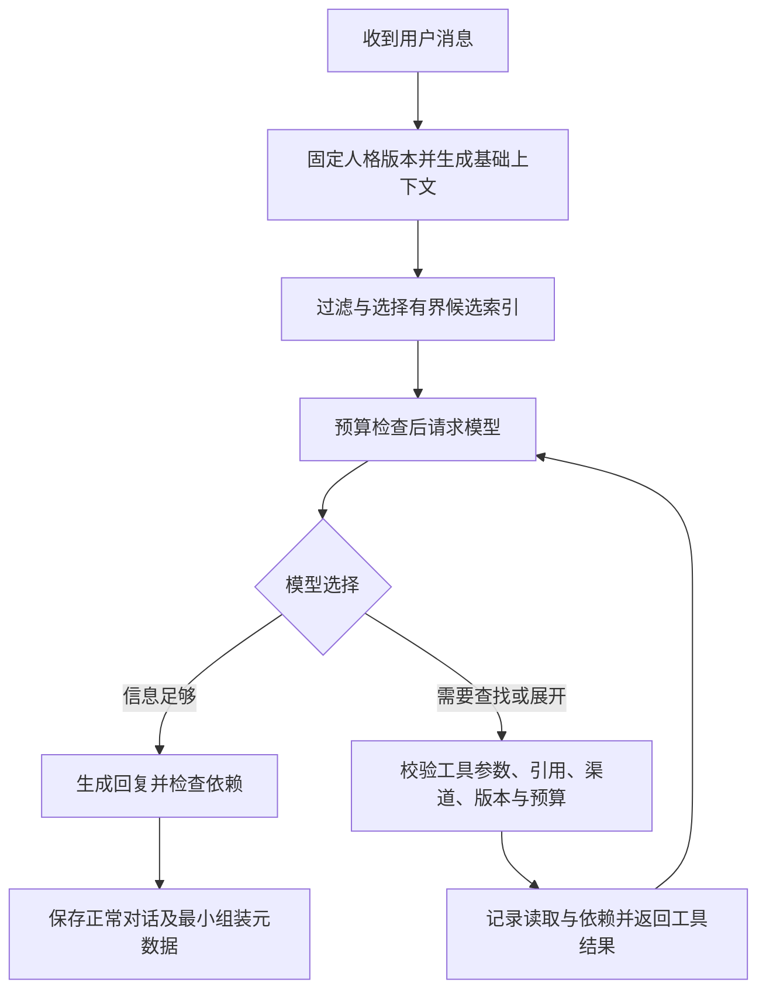

# 模型参与上下文组装：架构优化设计 v1

日期：2026-11-03。状态（2026-11-04 实装对齐更新，详见 §13）：C0/C1/C2/C3首批（history+recap）、Step1 观测与人格 P0/P1a/P1b 已实装并在活库开启（indexed+working_set+history+recap，recent_turns=16），主线经真人使用验证；遗留待验边界与未做项（审查开销优化、气质候选审议、N09、worker P2 来源契约）见 §13 及[实施和人工验收记录](人格与上下文优化-实施与人工验收-20261103.md)。

用户已确认方向：让 Alice 通过带语义的 ID 索引，按需要展开记忆与语境，参与决定有限上下文里应当保留什么。首版从本机记忆的索引与读取开始。

## 1. 目标与首版结论

**宿主提供必要背景与可发现的候选，Alice 判断需要哪些细节；宿主校验权限、版本和预算后，将正文送入下一次模型请求。**

这使组装从“宿主固定挑选并灌入全文”，逐步变成双方共同完成的过程。ID 是访问入口；模型必须看到足以判断相关性的语义提示，不能只收到一串编号。

首版交付边界：

- 少量必要内容常驻；其他本机普通记忆提供有界候选索引。
- 新增只读的 `memory_search` 与 `memory_load`，在现有工具循环中搜索候选、按引用批量展开正文。
- 不强制每轮先规划，不增加独立的逐轮选择模型；现有信息够用就直接回答。
- 不开放任意文件/SQL 读取，不改变记忆保存、遗忘、来源撤回和协作资料隔离规则。
- 不在首版开放模型对工作上下文的保留/移出，也不开放历史全库、网页或协作正文的通用按 ID 读取。

期待收益是减少无关正文、提高需要时找到细节的机会；额外调用可能增加延迟和总费用，须人工比较，不能仅凭初始 prompt 变短宣布成功。

## 2. 依据与现状

### 2.1 研究参考及使用边界

- [Toolformer](https://arxiv.org/abs/2302.04761)：通过训练学习 API 的调用时机、参数和结果使用。Alice 本方案是宿主与提示/工具协议改造，不包含该论文的训练过程。
- [ReAct](https://arxiv.org/abs/2210.03629)：交替进行判断、行动与观察。本方案借鉴其交互组织，不要求对用户公开内部推理，也不把模型自报的理由当作验收结论。
- [MemGPT](https://arxiv.org/html/2310.08560v2)：模型通过函数在外部存储和有限工作上下文之间移动资料。它是更直接的架构参考，但本方案保留 Alice 的真实遗忘、渠道许可和宿主管控，不照搬无限期保存历史或自由编辑核心人格的做法。

上述论文支持设计方向的可行性参考，不证明本方案在 Alice 上已有效。

### 2.2 当前实现的起点

| 当前行为 | 位置 | 改造动机 |
| --- | --- | --- |
| 长期记忆按历史权重取 top-k，近期记忆按新旧取全文 | `alice/retrieval.py` | 当前话题相关性参与不足，正文可能占据不必要空间 |
| 仓库注入标题索引，`recall(query)` 返回相关全文 | `alice/retrieval.py`、`alice/loop.py` | 已有模型主动检索雏形；缺少统一引用、版本与批量按 ID 展开 |
| 默认历史取最近 16 条消息 | `alice/config.py`、`alice/worker_context.py` | 条数不能代表长度，也可能切断完整交流与前情 |
| 宪法将未列出的内容视为“不记得” | `alice/retrieval.py` | 混淆未载入、检索未命中与真实遗忘 |
| 工具结果逐次追加，缺少统一的总上下文预算 | `alice/loop.py` | 多轮读工具会继续增长；索引化不能独自解决溢出 |
| 来源及协作依赖已有专门的授权/撤回处理 | 来源、协作相关模块 | 新读取不能绕过它们；首版缩小到本机普通记忆 |

这里只是静态依据，不宣称当前所有漏忆或人格漂移都由这些路径造成。

## 3. 与既有方案的分工

### 3.1 人格方案

[人格连续性与表达稳定设计](人格连续性与表达稳定-架构优化设计-v1.md)定义表达偏好的继承、保护和成长。

本方案负责材料的选择、展开和装配。身份、真实性、用户选定的核心说话习惯常驻，不能只留 ID 后等 Alice 自己想起来。模型不通过本方案修改或移出这些内容。

人格底色仍由原文档定义的解析器生成；本方案消费其结果，不另建一份人格或风格数据库。当前观点从记忆库按有效性选择，避免同一观点在人格和记忆区重复全文注入；选择时保留相关的分歧与不确定性。

两项改造可分阶段落地。人格新解析器尚未实施时，继续读取现有有效人格并保护其表达部分；不把新索引模式作为自动重装人格的理由。外部来源观点仍由现有来源通道按权限提供，首版普通记忆目录不接管它们。

### 3.2 网络 N09

[网络待办 N09](网络接入架构优化-待办.md)处理“低价值网络正文降级为名称/URL，再按需要定向重读”。两者可共用后续的索引展示约定，但不同步上线。

本方案中的 `memory_load` 只读已经存在且仍有效的本机普通记忆，不联网、不从 URL 恢复正文。仅保留名称/URL 的网络线索，需要未来通过 N09 的权限、定位和预算链路重读；不能因有一个本地 ID 就声称已经重新读过网页。

首版落点补充：普通目录先限定为有效、无来源 URL、无父链/证据链接的独立 conversation 记忆，避免缺少依赖传播时暴露标题或正文。有来源的见闻继续用 `recall_sources`（原来源回忆链）；普通但带父链的条目暂不进入 indexed 目录，其完整适配待后续，不宣称已覆盖全部记忆。

## 4. 一次请求装配哪些内容

```text
宿主稳定指令
  身份、真实性、权限、索引/读取协议
  用户选定的核心表达习惯、少量必要表达样本

当前有效背景（资料块）
  必要关系背景、明确纠正与少量重要约定
  当前话题的简短前情（有依据时才提供）
  少量相关观点/记忆正文（不能省略的条件一并保留）

候选索引（资料块）
  有语义提示的引用、类型、时间、展开大小

最近完整对话 + 最新用户消息及时间

本轮宿主能力说明 + 实际可用工具定义

按需追加：模型调用 → 读取结果 → 下一次模型请求
```

来源资料、记忆正文、索引标题属于资料，不因它们处于 system 消息附近就成为新的宿主指令。第一版可沿用供应商已支持的消息角色，用明确分隔的资料块表示；不能虚构一条用户说过的指令来承载索引。

最新用户要求与现行授权控制当前行为。旧记忆中的“以后可以做 X”、网页提示及历史任务说明，都不能单独证明本轮具备该操作的授权。

### 4.1 常驻与按需展开

| 材料 | 默认形态 | 原因 |
| --- | --- | --- |
| 身份、真实性、权限与协议 | 简明常驻 | 模型不能先自行决定要不要遵守 |
| 用户选定的核心说话习惯 | 常驻 | 无需用户反复提醒，普通演化不能覆盖 |
| 最新输入、最近完整往返 | 原文 | 保留正在说什么及指代关系 |
| 当前明确纠正、必要约束与前情 | 有来源的简短正文 | 防止尚未读取就不知道需要读取的循环 |
| 其他本机记忆、较长观点依据 | 候选索引，按需全文 | 减少无关材料，允许进一步发现 |
| 旧对话全文、长报告、网页正文 | 不接入首版通用读取 | 分阶段接入各自的来源、版本和权限契约 |

“常驻”不是无上限。放不下时必须报告预算冲突，保留最新请求和必要约束，不能静默丢弃条件后照常回答。

### 4.2 先修正记忆状态语义

- 当前已载入有效正文：可以依据实际内容回应，引用范围不超过正文。
- 看见候选索引：知道存在一条可能相关的材料，未取得未展示的细节。
- 未载入：不等于遗忘，需要时可以查。
- 搜索未命中：只能说明此次查询没找到；不能推出从未发生。
- 引用不可用：不能据此重建旧正文，也不向模型透露不应可见的撤回细节。
- 普通知识：仍可以使用，但不能冒充本机共同经历。

若短标题或索引提示已经明确包含某事实，模型确实能看见它；不能靠一句“不是证据”使其消失。因此索引提示优先写“涉及什么问题”，避免将精确结论、私密正文或重要限制条件藏在不完整摘要里。需要复述具体往事时读取正文。

### 4.3 功能说明逐步从常驻宪法中分离

核心能力概况与不可绕过的边界保留；具体版本的 GUI 操作入口、归档恢复步骤等详细说明，后续可以按当前功能提供，而不在普通闲聊中全部展开。

能力概况与详细说明必须来自同一份宿主能力定义，不能维护两份互相矛盾的清单。代码中的权限检查始终生效；未加载详细说明不代表开放操作。具体的按需说明入口单列后续实施，不以此为 C1 上线前置条件，也不提前删除现有能力边界。

## 5. 候选索引与引用

### 5.1 索引结构

以下为虚构结构示例，不对应活库记录：

```json
{
  "ref": "memory:184@8a71c2",
  "kind": "event",
  "title": "上次讨论说话方式的结论",
  "hint": "涉及长期表达偏好与人格成长的区别",
  "occurred_at": null,
  "recorded_at": "2026-11-03T10:00:00+08:00",
  "estimated_chars": 620,
  "detail_state": "not_loaded"
}
```

- `ref` 指向具体正文版本。真正解析由宿主完成，不把它拼成路径或 SQL。
- 时间区分记录时间和事件时间；不知道发生时间就为空，不把记录日期当作发生日期。跨年使用完整日期，不能只给月日。
- `hint` 第一版从现有标题、关键词及类型按确定性模板构造，不每轮调用模型生成摘要。生成提示的质量不足时保留标题，明确它只是发现线索。
- 原始内容有指令文字时按资料转义展示；不将其直接拼入宿主协议。
- 索引和正文适用相同的渠道、来源、用途及撤回检查。元数据也可能泄露内容，不能先暴露标题再等读取阶段检查权限。

### 5.2 标识与版本

内部身份包含会话库代际、记录 ID、正文版本。模型只收到当前请求可用的引用，宿主保存引用到实际记录的映射，并绑定请求与当前渠道。

版本可在首版用规范化正文、标题及相关语义字段的摘要生成；使用次数、排序分数等计数变化不能使引用无故失效。库重置后即使数字 ID 重用，也不能指向另一条记忆。

读取时重新检查当前版本。发生变化返回 `stale_ref` 和仍获准的新候选，不以旧引用悄悄返回新正文。请求内同一版本只装配一次；不能因为两个标题相近就合并不同证据或相反观点。

跨请求的引用必须重新取得资格。旧对话里出现的 ID 不视为永久访问票据；若仍需同一材料，可重新搜索获得当前引用。

### 5.3 候选发现策略

宿主先过滤合法材料，再用当前输入和必要近期话题生成候选：

1. 结合标题、关键词、现有文本匹配选择与当前问题相关的材料。
2. 为明确约定、未解决事项及相关观点的分歧留少量位置，避免只剩常用旧话题。
3. 去重后按固定规则排序；历史权重可参与，但不独占相关性判断。
4. 候选目录受总量与字符预算限制，返回是否仍有其他候选；Alice 可通过搜索改变查询或翻页。

第一版复用标准库与现有检索能力，不新增向量数据库、embedding 服务或模型路由器。相关性策略属于待真人验收的工程选择，不把简单词面匹配包装成理解了当前话题。

## 6. 首版只读工具契约

### 6.1 `memory_search`

输入示意：`{"query": "说话方式 人格成长", "limit": 8, "cursor": null}`。

返回有界候选、下一页游标及匹配范围，不返回记忆全文。搜索覆盖当前渠道、用途允许的普通对话来源记忆，包括 active、warehouse、longterm；不能因为候选处于近期层就无法按 ID 读取。

游标由宿主生成并绑定请求、查询与过滤条件；版本或候选集合变化时允许要求重新搜索，不承诺未经实现的稳定快照。所有查询参数做类型、长度及上限检查。

### 6.2 `memory_load`

输入示意：`{"refs": ["memory:184@8a71c2", "memory:207@fb0214"]}`。

返回逐项结果，包含引用、类型、时间、完整正文及是否已在上下文内。批次内可部分成功，逐条说明，不能把一个失败伪装成整批已读。

| 结果 | 含义 |
| --- | --- |
| `loaded` | 本次取得并装配了获准的完整正文 |
| `already_loaded` | 同一版本正文仍在本次请求的输入中，不重复装配 |
| `stale_ref` | 正文版本变化，需要当前引用 |
| `unavailable` | 不存在、已失效或当前不可读取；不暴露不应可见的细节 |
| `budget_exceeded` | 尚未取得正文，不能声称已读 |
| `too_large` | 单条无法在本次正文预算内完整展开 |

`already_loaded` 由实际上下文清单判断，不能只因某次历史调用读过就返回它。只有内容确实会随下一次请求发送，才能标记为已载入。

首版不截取一段正文后标为完整加载。超大条目明确拒绝本次展开；后续若增加分段读取，必须标明范围、缺失内容与必要限定，另行设计。读取不生成新摘要、不联网补齐。

### 6.3 与既有 `recall` 的关系

保留现有公开工具/CLI 兼容入口，但需要把过滤、预算、来源依赖和读取事件统一到公共内部服务。`recall` 可继续提供检索后直接返回正文的便利，不能成为绕过预算的另一条路；新目录/批量读取用于将“发现”与“展开”分开。

一次请求不并列摆放多个职责相同的搜索工具。新功能试用模式给模型提供 `memory_search`、`memory_load`；旧 `recall` 由宿主兼容层处理既有调用，不额外注入重复 schema。未启用时维持旧工具集合。

如果旧 `recall` 需要处理网络来源，则仍走原有来源授权和依赖链，不能让首版普通记忆读取接管这部分职责；实施前列出两条路径的覆盖差异。

首版实际工具集合：普通记忆为 `memory_search/memory_load`；`recall_sources` 只负责原有来源见闻，复用原授权与依赖链并加入本轮预算。两者不重复搜索普通记忆。旧 `recall` 不另挂 schema，兼容调用在 indexed 模式走同一普通记忆过滤与预算；legacy 模式维持原入口。

### 6.4 读取与记忆维护计数

候选入选、目录展示、搜索未命中都不计为正文使用，不延长期限、不增加兴趣或可信度。

成功展开沿用现有 `recall` 的检索使用语义，同一请求、同一版本最多计一次，额外记录它是“读取交付”事件。该事件只证明宿主已将正文交给模型，不证明模型认真理解或在回答中实际采用；不能据此标记观点已验证。若要调整维护权重，须另列变更，不夹带在本次只读工具实现里。

## 7. 请求流程与总预算



读取只能通过新的工具回合影响下一次请求，不会在单次推理中凭 ID 得到窗口外信息。当前工具调用与返回必须成对保留，不在中间丢掉一半。

### 7.1 预算包含哪些内容

总预算覆盖稳定提示、资料、历史、工具 schema、已展开正文及回复预留。工具结果入场前先检查，每次模型调用前再检查。

第一版使用显式配置和保守长度估算，实际 API usage 只用于事后校准；字符数不是精确 token 数，不宣称长度检查已严格证明供应商窗口不会溢出。支持的模型窗口与输出参数需要按真实接口核实，不能猜一个通用上限。

初始试用上限建议如下，均为工程起点而非效果结论：

| 项目 | 建议初值 |
| --- | --- |
| 初始候选目录 | 最多 12 条、合计最多 1,800 字符；本轮目录累计默认 3,600，搜索也计入 |
| 单次搜索候选 | 最多 12 条，并纳入目录总预算 |
| 单次批量展开 | 最多 4 条 |
| 本轮新增展开正文 | 合计最多 8,000 中文字符，受剩余总预算进一步限制 |
| 本轮记忆工具调用 | 最多 2 次，且受现有总工具轮数及剩余预算限制 |

初始候选可直接供 `memory_load` 使用，因此不强制先搜索。无命中时可以先搜索再批量读。不能为这些工具另开不受现有工具总上限控制的无限循环；用户设总上限为 0 或 1 时按实际剩余额度收尾。

目录超过预算时不不断累加所有搜索页；宿主为后续请求只保留有界候选展示，同时保持当前工具消息结构合法。首版实现若不能安全缩减已产生的工具结果，就在返回前限制结果并拒绝继续搜索，不承诺动态移出能力已经存在。

### 7.2 空间不足与失败处理

首次组装可减少不相关候选、重复材料及较早的完整对话往返。保留最新输入、必要纠正和当前工具协议。若仍不足，明确报告需要缩小问题或材料范围，不能静默截掉最新用户消息。

单条读取超过剩余预算时返回未加载状态；已加载内容继续可用。额度用尽时停止读取并如实回答可知范围，不用猜测补全未展开内容。

收到上下文过长错误时不能重跑已经发生的联网、派工、写记忆等操作。读操作的重试保持请求 ID 和幂等记录；内容装配失败不代表工具副作用已撤销。首版不靠清空全部工具历史后从头执行来恢复。

## 8. 历史、前情与后续工作上下文

### 8.1 首版历史选择

历史按完整往返组织，在总预算内选择连续后缀。保留当前用户消息，不因固定条数切出无对应问题的孤立答复。宿主展示通知继续遵循现有排除规则；被撤回资料的派生历史仍按原有 shadow/依赖机制处理。

不凭空把“最近 16 条消息”理解为 16 轮，也不把保留更长历史当作唯一优化路径。

### 8.2 前情材料的阶段边界

首版复用仍有效的既有记忆、当前原文和明确纠正，生成最小背景；没有可靠摘要就不提供摘要，不每轮额外调用模型补一张讨论卡。

后续可以在旧原文即将移出时生成有来源的前情：当前目标、已定结论、未决问题、被放弃的方案和依据 ID。必须基于原文重建，保留限制条件；不能只对上一版摘要无限递归压缩。

前情仅帮助延续讨论，不自动保存为永久记忆，也不成为授权。用户改口、来源失效和话题结束时，要有修订/退出规则。这项能力单列后续阶段，不把“首版没有新摘要”宣传成已经解决长期语境连续性。

### 8.3 后续保留与移出

未来可增加 `context_keep` / `context_release` 一类操作，让 Alice 提议哪些展开材料跨轮保留、哪些可以移出。宿主决定最终容量、有效期与被保护内容。

移出只影响之后构造的请求，不删除原始记忆、不清空用户可见历史、不撤销来源依赖、不恢复已经过期的材料。已经随某次 API 请求发出的正文无法追回；模型也不能以“移出”免除本轮派生内容的来源约束。

模型对当前上下文的任何编辑只在宿主重建的下一次请求生效，不能声称改变了模型已经读过的输入。不得移出最新问题、必要纠正、权限边界或核心表达偏好来便利某个答案。

## 9. 来源与权限边界

首版读取范围为普通对话来源且仍有效的本机记忆。必须使用显式的当前渠道与用途过滤；不能复用隐含 GUI 默认值的读取路径给 QQ 使用。

- 网页来源、其派生观点与协作任务正文不混入首版候选；保留现有专用工具与授权链。
- 选择目录、展开正文、继续请求模型及发布回复前，分别检查适用的来源依赖；不能只在初始索引时检查一次。
- 对所有已暴露材料保守继承依赖。模型声称“这条我没用”或后续请求不再展示，不解除本轮已有依赖。
- 依赖登记应在正文暴露前完成，数据库登记失败则拒绝暴露。并发撤回后不能继续发布基于失效资料的派生正文。
- 错误不泄露未获准的标题、路径或正文。索引之外的随机 ID、旧库 ID 和跨渠道引用都不能直接读。

首版不改变普通记忆写入、来源硬期限、七天维护、观点修订或 QQ 连接权限。未来覆盖新材料类型时逐类定义适配器，不能用一个“通用 context ID”绕过现有专用契约。

## 10. 实现划分与兼容

建议新增标准库模块 `alice/context.py`，表示只读的 `ContextItem`、候选目录、当前请求清单与预算；记忆读取可放在 `alice/context_memory.py`，调用 store 的显式过滤公共内部方法。

| 现有路径 | 拟议职责 |
| --- | --- |
| `alice/retrieval.py` | 从固定全文组装迁至分块投影；旧 `recall` 接口保留并共享内部读取规则 |
| `alice/loop.py` | 注册工具、执行按需回合、维护请求清单及总预算，保留现有依赖保护 |
| `alice/store.py` 及相关 mixin | 有渠道/用途过滤的候选、按 ID 校验与读取，不向工具暴露裸 SQL |
| `alice/config.py`、`config.example.toml` | 开关及候选/正文/回合预算；错误配置不能扩大权限 |
| `alice/service.py`、观察接口 | 请求锁、最小组装记录与只读观察；不让观察查询触发检索计数或模型调用 |
| `alice/persona_context.py`（人格方案拟新增） | 提供受保护的稳定表达部分，避免重复解析与双份人格 |

新模式拟议开关为 `[context] assembly_mode = "indexed"`，未启用时为 `"legacy"`；名称在实施时统一核对。初期不自动迁移活库、不重建人格、不另存一套正文。记忆版本优先从现有内容确定性派生，必要的新持久字段另列迁移。

最小组装记录包括：请求 ID、模式、人格版本、候选/载入引用及版本、选择/拒绝原因代码、长度估算、工具回合、实际 usage 和请求耗时。默认不持久化整段 prompt 或额外私密正文。它能解释宿主发送了什么，不能证明模型关注了什么。

核心保持标准库；GUI 保持原生 JS。人工 SDK 及 addons 只使用公开 service/HTTP/CLI，不 import 核心内部模块。

## 11. 分阶段实施与真人验收

### 阶段 C0：基础语义和装配清单

修正“未载入就是遗忘”；建立块级清单、完整历史选择、去重与总预算。清单区分 stable、background、index、history、tool_result；不更改人格内容或记忆维护策略。

### 阶段 C1：本机普通记忆索引与展开（首版）

新增两个只读工具与候选目录，所有读取共用过滤、预算和版本检查。试用前必须完成 C0 的必要基础；不要求先把宪法所有功能说明的按需加载一并重构。

### 阶段 C2：模型提议保留与移出

C1 证明能正确找到材料后，再做跨轮工作集、退出规则及供应商工具消息兼容。不能提前将 keep/release 放进首版工具集合。

2026-11-03施工：用户优先施工，C2先写代码但保持独立开关working_set_enabled=false；仅indexed与此开关同时开启时提供工具，C1默认集合不变。工作集为服务内存中的渠道分区，重启清空、库代际变化全部清空。仅本轮memory_load新返回且已随模型请求发送的引用可新增保留（不把宿主交付等同模型理解），已经保留的重复keep不续期。默认4条/4,000字符/当前渠道12次装配/每轮4次工具提议，仍受C1正文预算和总模型/工具回合预算控制。

每次注入重新签发本轮引用，正文通过C1记忆资料块注入并去重；计入已加载和暴露清单，生成及发布继续沿用C1有效性复查和流式缓冲。release只接受本轮获准的精确引用，不解析数字子串、不接受裸ID或跨请求引用；重复调用返回not_kept。所有状态回执只带有界元数据，不改历史消息或删除provider工具调用/回执。TTL按本渠道开始装配的请求消耗，失败请求也不续期；因正文预算未注入的项仍老化。小于单条的容量也允许将最后一项移出，事件列表有界。当前没有自动话题分类/结束检测，退出依靠release、TTL、版本失效、容量及重启；不宣称已完成语义话题退出。

### 阶段 C3：长语境与其他材料适配

分别设计有来源前情、旧对话原文读取、网络 N09 定向重读和协作正文适配。每一类沿用自己的权限、期限、版本与派生约束，独立验收。

#### C3首批：普通旧原文只读契约

独立配置history_enabled=false，需同时indexed才提供history_search/history_load。它读取仍保存在当前对话库中的原始发言，不重建提炼记忆，也不等于Alice本来记得。记忆遗忘与原始聊天记录仍保留是不同存储行为；开关开启后的查阅须如实表述为查到原文，不把遗忘的条目默默写回。关闭开关不删除用户可见记录。

首批只读当前session_epoch、同一channel_id的已完成完整往返：request账本同时指向user与assistant，角色匹配、顺序正确且位于近期原文窗口之前。历史上未绑定渠道的旧/CLI记录、归档库、缺一边/未完成请求均不在范围内，不通过裸turn_id补猜归属。任何一侧被source_turns、worker_turns或worker_reports绑定时整对排除，过期/撤回后也不回到普通原文入口。资格在排序与LIMIT前检查，元数据同样受限。

history_search(query,cursor?)：固定窗口最多扫描200个合格往返，词面排序后每页8项，给用户原文前120字符片段且标明preview_is_excerpt、记录时间和估计正文长度，不把片段叫完整正文。请求内游标绑定query、扫描窗口及窗口版本，窗口变化返回stale_cursor；分页遍历本窗口匹配后再向更早窗口移动。默认两次工具调用无法穷尽历史，查无结果只代表已扫描范围未命中。

history_load(refs)：最多2个本轮history引用；宿主持有完整版本映射，引用绑定库代际、渠道、当前请求随机nonce，不接受路径、SQL、裸ID或跨请求引用。逐项loaded/already_loaded/stale_ref/unavailable/budget_exceeded/too_large。成功时给出用户和AI双方完整原文、角色、turn_id和记录时间；旧AI回应可能出错、用户旧要求不等于当前授权，不凭旧发言执行动作。

默认history_max_chars=8000（目录、完整正文与回执累计），history_calls=2，并受模型总工具回合和剩余token预算约束。超大原文整对拒读，不截掉条件后称完整。无模型额外摘要调用、不计记忆使用、不写库、不持久化正文副本。旧原文不进入C2普通记忆工作集。

目录和正文的每个已暴露版本都保留在本请求依赖清单，接入C1的库代际/资格复查和流式缓冲；模型调用前后、工具之间及发布前重验，失效时停止使用。provider工具调用与回执保持原状，不以清空历史重试模型来伪造成功。context_basis只记调用、字符量、引用、组装/发送状态与有界事件，不记录原文或查询副本。此契约不扩展到来源见闻、协作、跨渠道或自动前情摘要。

### 11.1 人工场景

遵循当前项目测试策略：只做真实环境人工测试与记录回收，不新增机器自测、冒烟测试或自动模型评分。实施后的编译/格式检查不算功能验收。

| 场景 | 人工验收重点 |
| --- | --- |
| 当前资料已经足够 | 直接回答，不为显得主动而每轮搜索 |
| 用户问某次已保存往事，正文未在首屏 | 能从索引展开、基于真实正文回答 |
| 相关条目未出现在初始候选 | 会继续搜索；查不到时不编造，不断言从未发生 |
| 索引提示相近、正文结论不同 | 不只凭标题猜答案，能查看必要分歧 |
| 一批引用含有效、过时、不可用条目 | 逐项如实处理，不把整批标已读 |
| 单条过长、批量超过预算、工具额度 0/1 | 清楚收尾，不静默截断条件、不循环读、不扩额度 |
| 同一条反复读取 | 不重复正文，不重复累计检索使用 |
| 用户要求这轮正式，之后回闲聊 | 核心说话习惯仍在，讨论记忆时也无须重新扮演 |
| 用户纠正前情，之后旧原文移出 | 不把过时前情当现行要求；无摘要时明确能力边界 |
| GUI、QQ、撤回、过期及重启后旧引用 | 不跨渠道泄露，不恢复撤回正文，不误读重用 ID |
| 标题/正文含“忽略规则”等文字 | 作为资料处理，不改变权限和宿主指令 |
| 原有搜索、写入、协作任务共存 | 保留原有依赖链及副作用记录，不因重组重复执行 |

人工比较 legacy 与 indexed 时记录相近任务、相同模型/设置及已知历史差异；优先在不影响活库的独立人工环境准备受控材料，部署前另按授权范围操作，不为方便复制并混用真实私密库。

### 11.2 放行与回退依据

同时观察最终回答正确性、遗漏必要条件的情况、是否取得关键材料、错误声称记得/忘记的次数、额外回合、总输入输出 usage、首字/总等待时间，以及用户需要提醒的次数。

不能只比较第一次请求的 token；必须统计整次用户请求的所有调用。工具返回成功只证明读取链路成功，用户回答是否被改善仍由人工判定。

出现资料泄露、过期内容复活、版本错配或重复副作用，阻断放行。若额外回合明显增加而回答没有改善，先保留 legacy，并依据漏检/误选/预算记录调整，不继续堆更多工具。

回退关闭 indexed 模式，恢复旧装配入口，保留已发生的真实对话和读取记录，不清空库、不退款、不重派。C1 本身不写新记忆正文，因此没有“为回退删除整段经历”的步骤。

## 12. 文档与部署约束

本设计稿的阶段语义（§4~§11）保持原样作为设计依据；**实际落地的模块、配置与差异以 §13 实装对齐记录为准**，实施细节与真人验收以单独记录为准。

未来实际新增工具或能力时，同步宪法“存在事实”和相关人工验收记录；保持 `ytq` 工作分支；提交仅暂存自身路径，推送须用户明确要求，main 不直接推送。

先让 Alice 能可靠地发现和展开本机记忆，再逐步赋予工作上下文的管理能力。保留宿主提供必要背景和执行边界的职责，才能把模型的主动选择变成可核对、可回退的机制。

## 13. 实装对齐记录（as-built · 2026-11-04）

本节记录设计稿到代码的最终落点，供后续维护者对照；设计语义冲突时以本节描述的实际实现为准。

### 13.1 模块映射

| 设计概念 | 实际落点 | 要点 |
| --- | --- | --- |
| C0 装配 | `alice/context.py` + `alice/retrieval.py` | `ContextManifest` 块级清单（stable/background/index/history/tool_result）；保守 token 估算（CJK≈1、ASCII≈4:1）；`complete_round_suffix` 完整往返后缀（孤行丢弃/整对回收/一问多答不拆散）；总预算 `total_budget_tokens=100k`+`reply_reserve_tokens=4k`；每次模型调用前预算终检（超额明确报告，不静默截断）；宪法四态措辞（未载入≠遗忘/未命中≠未发生/普通知识≠共同经历） |
| C1 记忆索引 | `alice/context_memory.py` | `MemoryContext`：nonce 引用 `memory:ID@digest:nonce`（能力式引用，不收裸 ID）；候选目录分页游标；`memory_search`/`memory_load` 回执六态 loaded/already_loaded/stale_ref/unavailable/budget_exceeded/too_large；版本与库代际（session_epoch）双重失效 |
| C2 工作集 | `alice/context_workspace.py` | `WorkingSet` 服务内存持有，渠道分区（gui/qq-owner），重启清空；`context_keep`/`context_release`；仅本轮实读且已随请求发送的引用可 keep（重复 keep 不续期）；TTL/容量/版本/epoch 四重裁决；回执只带有界元数据 |
| C3 旧原文 | `alice/context_history.py` | `history_search`/`history_load` 按 §C3首批 契约实现（200 往返窗口、8/页、整对读取） |
| C3 前情 | `alice/context_recap.py` | `RecapContext`：floor 边界制（越过取数窗才触发）；区间 UNIQUE 幂等；cheap 模型从原文摘 1~6 条逐字引文，宿主加发言者标签（用户曾说/AI曾说）；`generation_key` 绑定模型+prompt+审查政策+输出上限；旧格式卡永不住入；冷启动限深 |
| P1a/P1b 表达 | `alice/persona_context.py` | 快照/指纹/`render_expression_reference`（purpose 分权：chat 全量、worker_summary 不读样本正文）；`render_anchor` 近位提醒 ≤560 字符，`expression_anchor` 默认关（效果未验） |
| P0 导入 | `alice/persona.py` | 五路提取→样本适配（风险改写+适配标记）→收养审查（adopt/adapt/reject/undecided+理由）→来历中性化→两阶段提交（快照+op_id 幂等+原子替换+中断恢复）；外部角色卡必走管线 |
| Step1 观测 | `alice/metrics.py` | ~~`record_llm_call` 直写 `turn_metrics`~~ **（2026-11-07 合并后为收据队列制）**：`record_llm_call(purpose, started, *, request_id, call_id, attempt, status, usage_state, context, …)` 入队收据，owner 在安全边界统一落账；正文/端点/供应商异常文本不入库；context 入队即冻结，后续轮次不可改写早前 attempt。loop/extraction 接线保留；persona 导入侧三处接线随对方重构移除（见 §13.5） |
| 装配循环 | `alice/loop.py` | manifest/recap 块/锚的注入与终检点替换；recap 生成-审查-落卡步；流式缓冲与生成/发布前后重验 |

### 13.2 与设计稿的差异（有意取舍）

- RecapContext 由设计期函数式草稿改为会话类（epoch/generation_key/floor/refs 随请求持有）。
- 工作集渠道限定 gui/qq-owner；其余渠道不提供 keep/release。
- 前情注入上限按卡截取（`recap_inject_count`/`recap_inject_chars`），超预算卡跳过不截尾。
- 观测对错误/回退显式记录而不是吞掉；流式分支以 resp=None 记主调用耗时。
- 引文完整性（不摘半句）由 RECAP_PROMPT 硬规则 + grounding 审查层把关；parse 层只机械保证逐字连续+发言者归属+去重+字符预算。

### 13.3 本轮复查记录（2026-11-04，提交前 bug 排查）

- 实锤并修复：`persona.py` 三处 `record_llm_call(store, …)` 的 `store` 不在作用域（P0 导入管线跑到 LLM 提取即 NameError）——`store` 参数穿透 `_extract_import`/`_adapt_expression`/`_review_adoption`/`prepare_import` 及三个调用方。
- 补齐三处 claude 任务终态事件文案（原会落 DSH 默认措辞“DSH 会话已空闲…”）。
- 交叉核对通过：claude 双轨派工链（排队→单槽启动→监视→落账→取消收敛）、质询身份字段全链（gate→pending.json→list→GUI echo→answer 四元校验）、`normalize_result` 契约（usage 恒 dict/cost None 安全）、`ledger.task` 异常面、loop 观测作用域。
- 离线自检 34 项全过（合成数据，不触 user/）：normalize_result、质询文件袋协议（含身份不符/过期/冲突答复/幂等）、RecapContext（floor/claim 幂等/parse 逐字与归因/版本失效/不越窗注入）、WorkingSet（keep/release/未发送拒收/TTL 老化）、render_anchor、record_llm_call；compileall 干净。

### 13.4 待验与未做（不因本文档更新改判通过）

P0 成品前提的真实样本审查、P2 表达保存/演化恢复、C1 自主选择与边界、C2 TTL/容量/跨渠道、claude GUI 质询人工闭环、审查开销优化（Step2）、气质候选审议、N09 定向重读、worker P2 最小来源链——逐项见[实施和人工验收记录](人格与上下文优化-实施与人工验收-20261103.md)与[Alice剩余工作-详细评估与推进报告-20261103.md](Alice剩余工作-详细评估与推进报告-20261103.md)。

### 13.5 2026-11-07 合并对齐（origin/main PR#24/25 并入 ytq，按对方为正典）

- **质询宿主侧协议迁移**：`addons/claude_agent/permission_gate.py` 职责由新模块 `alice/worker_permissions.py`（`WorkerPermissionsMixin`）承接。嵌套 gate-dir（`<workspace>/gate/<task_id>/<attempt_id>/`）与身份绑定保留，绑定元组扩为 id/task_id/attempt_id/epoch/worker_id/policy_revision/expires_at/**action_digest/resource_digest**（动作与资源摘要入绑定，防答复错配），新增 `PermissionAnswerConflict`（first-wins 冲突显式化）；HTTP 面（`/api/worker-permissions/{list,answer}`）不变。
- **RecapContext 边界外置**：构造改为 `RecapContext(store, cfg, scope, *, boundary)`，`boundary` 来自 C0 装配清单的 `manifests[0].history`（`first_retained_id` 即取数窗下界）——前情与历史选择共用同一不可变边界，生成不触发重选。
- **render_anchor 被对方加固**：默认 boundary 语补「不授予权限」，预算判定改为标题+边界行先行。
- **record_llm_call 收据队列化**：见 §13.1 Step1 行。
- **遗留**：persona.py 三处导入观测接线（import_extract/import_review/expression_adapt）随对方导入重构移除，待在新结构上重接；已记[未完成工作总览](../整体设计迭代概览/Alice未完成工作总览-20261104.md)。
- 合并共存检查：compileall / node --check / import 冒烟 / 离线自检 26 项全过（自检脚本 `/tmp/alice_bugcheck_20261104/check.py`，质询段已改新模块探针）。
