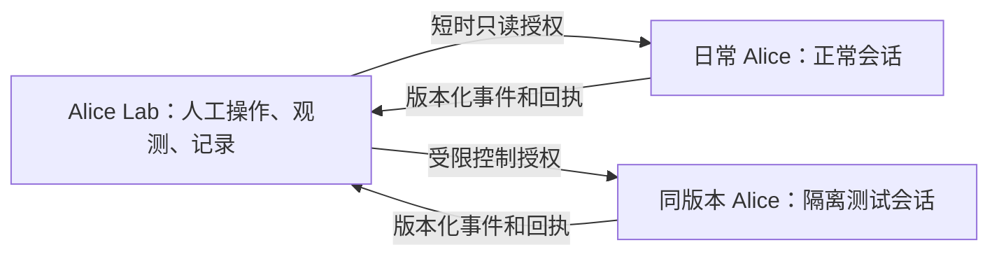

# Alice 独立测试与观测平台

目标：日常 Alice App 保留聊天、人格、发现、思想与探索的用户功能。测试面板、观测器、测试豁免、剧本与报告由独立安装的 **Alice Lab** 提供。Alice 提供版本化接口和运行事实；Lab 不读活库、不模拟 GUI 请求、不导入 Alice 内部模块。

## 1. 应该分走什么

| 项目 | Alice App 保留 | Alice Lab 接管 |
|---|---|---|
| 后台探索 | 清醒/睡眠、发呆时长、结束发呆、工具权限、用户能理解的成果状态 | 调度权重、抽签候选与概率、阻塞细节、逐轮回执、手动推进、测试策略 |
| 上下文与记忆 | 正常的记忆和上下文机制；可获授权输出诊断事件 | 上下文观测器、正文采集开关、装配详情、记忆观察、模型调用/导入记录及回复注释缓存诊断 |
| 实验与验收 | 普通聊天接口及必要事件 | P1 实验、样本目录、单轮绑定、额外费用额度、人工判级与导出；真人逐步操作及验收辅助 |
| 测试配置 | 正常保护和权限；识别并落实会话的有效规则 | 测试配置、时段与额度豁免、测试记录、复现实验参数；非默认、不会写回日常配置 |

用户可正常查看自己的对话、记忆、疑问和成果；这些不是开发者诊断入口。模型配置里的连通性检查也保留。

## 2. 两种连接

**观察正在使用的 Alice。** 日常 App 默认不开外部接口。由用户在 Alice 原生界面批准一次短时连接，可分别授权元数据或上下文正文；默认只读元数据。也可以用「撤销连接」立即停止访问。观察不会调用模型、提升搜索权限或消耗配额。正文采集只对选择授权后的新轮次生效；界面显示实际留存状态，不补造历史。

**控制隔离的 Alice。** Lab 由用户选择要验收的 Alice 版本，启动同版本的实例，使用独立测试档案、会话、权限和记录。提供投递一条测试消息、指定疑问、单步调度、开始/结束发呆、读结果和暂停等明确动作。测试策略和模型额度只对该实例有效。日常档案不会因为连接 Lab 进入测试模式。首版用独立本地 Web 应用即可；如需独立图标和窗口，再给 Lab 打桌面包。

## 3. 公共接口

- 使用独立的本机通道。macOS 首选已有私有控制管道的同类协议，日常 App 可通过本机原生授权入口把短期观察连接交给 Lab；若采用回环 HTTP，只绑定回环、令牌由平台服务端持有、单独验证目标实例、权限及失效时间。浏览器不能绕过授权去访问后台接口。桌面退出或档案切换使连接失效。
- 建议的 v1 方法：`hello`、`observe.schedule`、`observe.runs`、`observe.context`、`observe.memory`、`test.chat`、`test.run_question`、`test.advance_once`、`test.end_rest`、`test.pause`。按操作名逐项授权，修改操作附请求 ID 与会话版本。未知结果可查询原请求；不自动重发。Lab 不拿命令行、任意路径、API Key 或任意设置写入权限。
- 启动测试时显示所选实例、隔离档案和是否计费。网络工具、主动联系仍按测试实例的授权执行。当前硬编码的 `TEST_CONTROLS_ONLY` 要改为由宿主显式装入的测试会话策略；日常 App 固定正常策略。
- 抽签输出保存实际四项权重、抽签池、最终结果，以及发呆分数的两项来源（无实质进展窗口、受阻计数）和重复降权系数。既区分「按当前状态估算下一次抽签」，也区分「某次真实抽签」。模型主动休息、人为休息、没有候选及优先任务均不是抽签；不生成虚假概率。旧发呆记录若未保存权重，明确显示未知。

## 4. 实施顺序和验收

1. **先补运行事实。** 与历史上有活动的轮次一致，把真正抽到休息时的权重和候选一并写入选择回执。此步不改公式、不改现有抽签概率，也不需要新模型调用。
2. **建立 Lab 与隔离控制。** 优先接通调度权重、活动回执和单步控制，再接上下文、记忆和人工验收。再接入日常实例的短期只读连接；现有同源诊断页面仅作为过渡，不当作新接口。
3. **移动实验执行和设置。** P1 脱离产品聊天的直接耦合；测试额度、采集、单步和报告迁走。拆除核心默认配置中的测试豁免。原有开发资料可留档，不自动搬走私人记录。
4. **最后裁掉桌面包里的旧入口。** 包清单显式排除观测插件资源、测试 UI/脚本、P1 工具与测试策略实现；生产后端只保留事件、协议和执行真实业务操作所必需的宿主代码。正式切换前，由真人在新包确认这些页面和旧调试接口不可访问、聊天功能仍正常，另在 Lab 验证只读授权、撤销、隔离控制和真实权重。裁掉前不能称作已分离。

工作区：Alice 实现公共协议与运行回执；Lab 客户端/真人验收工具归 `tests/`，独立安装与外壳归 `addons/`。现有 `addons/context_inspector` 可迁作 Lab 模块，`tests/pressure` 改接正式协议，不示范匿名 HTTP 或 SQLite 直连。

## 5. 当前施工范围

- 抽签池作为实际调度回执保存，包括抽中发呆时的记录；旧版发呆只保存选择原因，没有足够资料精确恢复原抽签概率。新增独立的只读调度投影，与正常聊天界面解耦。
- 首批终端 Lab 通过私有继承管道启动隔离实例，能查看实时权重和实际回执、切换清醒/睡眠、请求探索、暂停、结束发呆。使用 `python3 tests/lab/console.py`。同一构建维护两种入口：常规启动不开放 Lab 命令，Lab 启动只能创建新临时档案，拒绝指定已有用户目录或模型配置。
- 第二批（0.1.35）：独立本地 Lab 图形界面位于 `addons/alice_lab`，支持日常实例授权码、源代码或打包后端的隔离实例。日常授权存在 Alice 进程内存中，15 分钟失效；观察请求经独立 Lab 回环服务转发，令牌不写入文件。Lab 浏览器页另有一次启动凭据，普通网页不能调用 Lab。正文授权负责既有留存的读取及新窗口的有限采集，撤销后拒绝后续读取。
- Lab 提供调度权重、上下文、记忆、疑问、模型调用、人格导入和已授权正文/回复缓存的读取。隔离实例增加发对话、指定疑问、采集和复读实验设置。P1 由 Lab 的源码隔离实例执行；选正式打包后端时不出现 P1。请求探索复用现有调度，没有另造强制单步策略。
- 日常 App 已移出旧观测器、P1 页面和调度权重，移除相关旧 HTTP 路由，常规实例恢复时段、额度、间隔及搜索限额。在 GUI 查看近期探索结果、疑问和邀请不受影响。包排除了旧观测器资源、P1 源文件及冻结模块；仅保留读投影、授权和真实操作接口。原有数据未迁移、未删除。
- 0.1.35 安装包 `20261119T111047Z-e91fb8a2-dirty` 已完成静态、签名、映像和 142 项资源核验，并核对冻结归档没有 P1 执行模块。未安装或启动；授权撤销、配置及真实人工测试仍待验收。独立桌面壳、批量剧本和确定性单步不属于这次本地 Web 交付。
- 0.1.37：Lab 的上下文入口沿用原组成卡、Total/Delta 趋势、读取顺序、上下文浏览器和完整输入窗口。Lab 自有页面经既有只读连接请求真实调用快照；元数据连接不读取正文，旧记录或旧后端明确标注缺项。关闭窗口移除内容，连接变更或授权过期清理观测界面；旧 App 观测页面仍不随 Alice 分发。人工验收见 Lab README。
