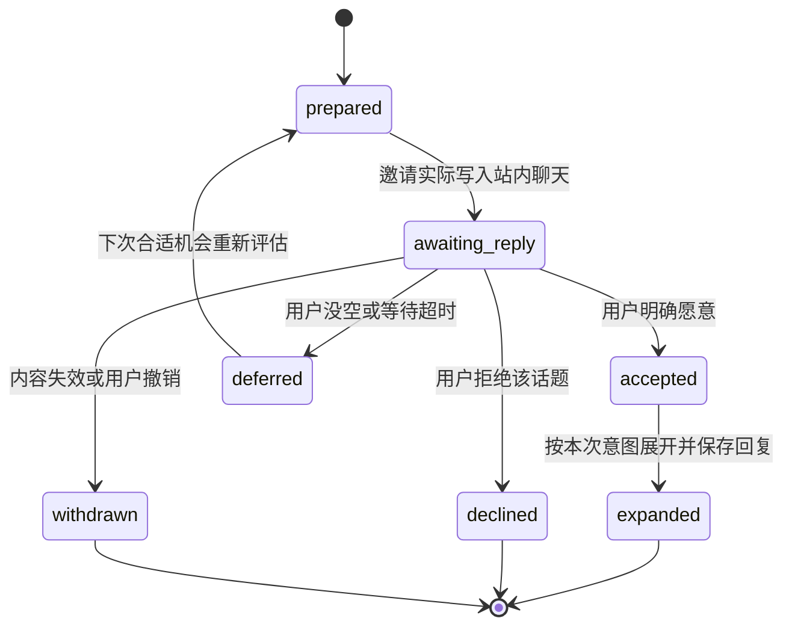

# 自主活动质量与邀请式交流：优化设计 v2

2026-11-17。状态：**主要业务及接班收尾已施工，0.1.11 本机测试包已构建；未安装、启用或迁移实际资料，真实环境人工验收待进行（§12、§14）。** 本文承接用户对首夜评估的讨论与确认。类、字段、方法与接班事项见[骨架交接](./自主活动质量与邀请式交流-骨架交接-20261117.md)。

依据：[清醒睡眠与三模式设计 v1](./清醒睡眠与自主活动调度-设计-v1-20261117.md)、[首夜真实运行评估](./清醒调度-首夜真实运行评估-20261117.md)。冲突之处以本文的新设计为准；旧报告保留作为历史证据。

## 1. 已确认的方向与待校准参数

用户确认以下方向：

- 清醒期间增加“发呆”，允许无事可做；仍保留兴趣探索、问题思考、自我迭代。
- 不提供用户可设置的基础偏好；活动倾向由具体内容、可推进条件与执行历史形成。
- 一起优化等待条件、进展判定、观点修订与后台成果进入聊天的方式。
- Alice 想主动开启话题时，先询问是否方便；用户愿意再展开。未回复或表示没空，本次不展开，留待下一次合适机会重新发起。

本文提出的发呆初始时长、相同依据上的推演窗口数、邀请等待时长与再次邀请间隔，都是**实现初值建议**，没有冒充用户给定的数值，需在真实使用中校准。用户仍可设置时长、工具许可与额度，不设置模式基础权重。

## 2. 问题与优化目标

首夜新启动 20 次自主运行、96 次主循环调用，另有旧任务继续 4 次，当日账本达到 100。三模式轮换真实发生，但多个模式仍围绕相同对话反复分析；新增 12 条长期观点，同一问题产生多版当前观点，修订记录为 0。

当前实现存在三个相互强化的环节：

1. 成功写入 thought_record/update/resolve 就记为进展。
2. 自己的疑问版本与观点写入改变输入戳，容易解除无进展冷却。
3. 部分成果只要还有 remaining，就重新写成 open，不区分剩余部分是否只能等待外部条件。

本次目标是让 Alice 可以继续有价值的推演、采用表达策略，也能停止重复解释；允许休息、等待和保留未知。成果数量、回复字数和额度使用率不作为主要成功指标。

## 3. 清醒、睡眠与发呆

| 层次 | 状态或模式 | 行为 |
| --- | --- | --- |
| 生命周期 | sleeping | 不自主开展活动或发出邀请；正常响应用户消息与显式任务 |
| 生命周期 | awake | 允许在实际权限、时段和额度内选择活动，也允许等待 |
| 清醒活动 | interest / problem / iteration | 兴趣探索、推进疑问、自我迭代 |
| 清醒活动 | idle（发呆） | 不调用模型、工具或记忆整理，不主动发消息；宿主等待即可 |
| 执行条件 | waiting_budget / waiting_permission 等 | 硬条件未满足，直接等待，不花模型调用决定要不要等待 |

发呆是主动活动的一种选择；预算等待是条件约束。界面可以都表现为安静待机，但必须说明实际原因，不把额度用尽包装成 Alice 自主选择休息。

### 3.1 发呆的进入与结束

可以通过两条路径进入：

- 调度时发呆参与选择；如果所有工作模式都没有可推进事项，直接等待，不调用模型“找点事做”。
- 某轮活动中，Alice 判断暂时不值得继续，通过一次结束回执选择发呆。

进入时保存 `idle_started_at / idle_until / reason / related_run_id`。等待由宿主定时器处理，不生成空白用户轮次，也不每隔几分钟请求模型判断是否无聊。发呆期间暂停已准备但尚未发送的自主邀请；用户回应已经收到的邀请，仍属于用户发起的交流。

用户消息或显式任务立即获得前台响应。用户发言本身不改变清醒/睡眠配置；若处于发呆，任务结束后重新核对原发呆期限和实际新材料，不自动连开多个探索窗口。

到期、相关新证据或真正可推进的紧急事项可以触发调度重判。仅发生自写笔记、普通状态刷新、界面重开，不提前解除发呆。到期仅意味着允许重新调度；没有任务时可以继续安静等待。

建议初值：发呆单段 5 分钟，可在高级设置修改；设为 0 仅停用主动抽选发呆，硬条件不足时仍然等待。此值不是每五分钟调用一次模型的周期。

### 3.2 发呆权重与轮换

工作模式继续按内容价值、紧迫性、期限、实际执行历史计算权重。**先判断可推进，再计算权重**：等待条件未满足的事项为 0，不能靠等待时间累积成高权重后强行执行。

发呆以与其他模式相同的中性起点参与；连续活动缺少实质进展、缺口全部依赖外部、刚完成一段工作时，提高发呆倾向。明确有可执行下一步的紧急任务可优先于主动发呆。

可供实现的首版计算：`idle_score = 1 + 2*min(连续无实质进展窗口数, 3) + 2*不可推进的工作模式数`，再使用现有最近选择衰减。分数不是可编辑的用户偏好。无可推进工作时直接等待，不依赖抽样碰巧选中 idle。

发呆不记模型调用或工具步骤，也不记知识成果。它保留独立选择回执，适度降低下一次主动发呆倾向；对其他模式的补偿仅作用于已经具备执行条件的事项。

## 4. 进展：记录变化与认识变化分开

| 变化 | 示例 | 对再次执行的影响 |
| --- | --- | --- |
| 新证据 | 用户实际回应了某个问题，读到相关新来源 | 可解除对应事项的等待，并重新评估 |
| 实际行动 | 完成一次获准检索、验证或实践，得到明确结果 | 据结果确定下一步；失败也可消除一个具体可能性 |
| 有意义的新推导 | 找到反例、排除一种解释、提出可验证预测 | 可以支持有限的后续推演，不自动成为外部验证 |
| 表述修订 | 给旧解释换名字、压缩或润色旧结论 | 可保存版本，不自动获取新的探索窗口 |
| 状态登记 | 更新引用、保存检查点、标记等待 | 维护记录，不等于问题推进 |

不要求每次推理都必须联网或等待用户。关键是指出**哪个不确定点发生了变化**，而不是把新的文字当成新的事实。

### 4.1 轻量结束回执

建议增加一个后台专用的 `activity_finish` 能力，替代依靠“某工具写入成功”判断认识进展。业务字段仅包括：

- `decision`：continue / wait / rest / done。
- `progress_kind`：evidence / action / inference / rewrite / none。
- `summary`：简短结果或变化点。
- 按需提供真实 `evidence_refs / action_refs`、`next_step` 或 `wait_condition`；选择 rest 可提供期望等待时长，受用户上限约束。

每个窗口收尾一次即可，不为每条回复新增一轮模型审查。窗口在回执前遇到额度、前台让位或连接中断时，宿主保存实际行动，默认“尚未确认实质进展”；不补发付费调用追问收尾，也不丢失已完成的工具结果。

模型负责解释意义，宿主核对引用、动作是否真实发生、版本与受众，不试图从自然语言裁定心理解释真假。有效工具执行仍计入实际活动历史，但与“已取得实质进展”使用不同字段。

### 4.2 依据版本与推演额度

把 v1 的单一 input_stamp 拆成：

- `external_material_version`：相关用户证据、实际来源内容版本、获准行动回执；区别发生事实与旧 AI 发言。
- `working_revision`：问题描述、推导草稿与当前观点版本。

自己的 working_revision 改变不自动刷新 external_material_version。来源换 ID 但实际相同、重新读同一对话、同一观点的另一版，不当作独立新依据。新建子问题也保留父问题的证据归属。

同一问题族在同一依据版本上可以进行有限推演，建议初值为 2 个工作窗口；窗口内仍受原模型、工具、时间额度约束。得到进一步可核对的新证据或完成有意义的方法步骤才重新评估，不凭“又想深一层”无限续开。初值可在高级设置校准，不写成宪法禁令。

问题族采用明确的父子/关联引用；可由 Alice 提议关联，宿主不靠关键词把不同问题强行合并。一次准备好多个子问题，不意味着每个都获得全新的同证据推演额度。全局预算仍是最后上限。

## 5. 部分解决与真实等待条件

保留“阶段成果”和“剩余事项状态”两个维度。扩展 thought_resolve，使其能同时提交成果、remaining 以及 `next_status / wait_condition`；不能再用 remaining 非空直接推出 open。

| 剩余情况 | 状态与解除条件 |
| --- | --- |
| 还有具体可执行方法 | open，附下一步与所需工具 |
| 等一次相关用户回应或自然交流情境 | waiting_user，关联问题、触发情境与已观察到的最后证据 |
| 等相关资料或外部验证 | waiting_source，关联资料缺口；自己的新观点不满足条件 |
| 等工具、来源保存资格或额度 | waiting_permission / waiting_budget，关联具体条件；恢复资格不代表结论已获验证 |
| 已无值得继续方向 | paused 或 closed，说明是否保留当前观点 |
| 缺口全部处理完 | resolved；不等于每项事实都经过独立验证 |

用户后来发任意一句消息，不能直接将所有 waiting_user 事项重新入队。前台主模型结合当前话题和少量相关等待索引，判断这次是否触及条件；只有相关反馈才更新该问题。普通问候照常回应，不强制检查全部疑问或增加独立分类调用。

宿主只向现有主循环提供相关待判断事项，重判不等于自动展开研究。背景模式不持续调用模型检查“用户是否已经回了”。来源资格固定拒绝时，保存真实拒绝和等待条件；不自动放宽权限，不通过换成果类型规避相同限制。

## 6. 观点：当前版本、候选解释与历史

为同一问题/观点建立稳定身份，区分当前版、候选解释和旧版历史。一个问题可以有多种尚未分开的解释，但放在同一份当前材料中，不伪装成多条独立支持。

更新流程：读取当前版 → 说明改变了什么、为什么 → 选择修订或另立确有独立价值的观点 → 保存版本关系 → 更新当前指针。已有 outcome 的问题默认提示修订，不再默认为新增另一条长期 stance。

“只会付出”“怕结账”“怕等待”可以暂时并列为三个解释；除非新依据或推导排除了其中一个，否则不把最后写下的版本自然升级为更可靠。当前采用的表达策略仍可直接保留，例如“先应声，减少追加问题”，不必为它虚构一段心理生平。

前台索引默认只投影当前版及必要未知；旧版按需查阅。修订历史、旧记忆 ID 与原出处保留，不批量删除用户资料。记忆与传统全文装配路径都遵守当前版投影，不能仅修复新的按需索引而让传统路径继续注入所有旧版。

有外部依据的当前版和历史版均沿用来源受众、有效期与保存资格，失效后停止投影。版本升级不会把不可保存的外部材料变成可永久保存的本机观点。

## 7. 邀请式主动交流

### 7.1 内容意图与邀请尝试分开

保留一个稳定的 `contact_intent`：关联问题/成果版本、主题摘要、为何值得聊、可展开正文引用。每次实际邀请建立独立 attempt，记录邀请文字、发送回执、等待期限及用户回应。

邀请只提供识别话题所需的一句话，例如：

> 之前那个短回复的问题，我有了点新想法。现在方便聊两句吗？

不会把正文先发完再补一句“你方便吗”。措辞由人格材料与当前语境决定，不把样例变成固定台词。

### 7.2 状态流转

用户表示愿意后，展开是这次用户回应所触发的正常前台交流；睡眠时也能处理，不自动把全局状态设为清醒。一次接受只绑定当前主题与内容范围，不成为以后自动展开所有成果的许可。

表示没空时简短收住，不继续解释成果，也不立即换一个主题再邀请。未回复时静默结束该尝试，不再发送“你还在吗”。超时与“已读但不想聊”不同，不据此保存对用户感情或偏好的判断。

用户直接问“昨晚想了什么”，已给出本次交流意图，可以直接回答。已有对话中 Alice 要主动换入自己的后台话题，同样先邀请；不能利用“下次聊天提起”入口绕过本流程。当前问题的相关回答无需反复征求是否方便。

### 7.3 邀请回应的识别

邀请带 attempt_id、邀请消息 ID、主题版本、会话与渠道身份。按钮回应可直接绑定；自然语言回应由现有主对话模型结合最近邀请判断，不另起一个固定模型审查轮。

若增加 `contact_reply` 能力，接受/延期/拒绝必须关联当前实际用户消息。宿主核对该消息是用户发言、时序与渠道相符、邀请仍有效；不允许后台模型自己接受自己的邀请。明显转入其他话题时先接住当前话题，不把普通“在？”或无关“嗯”当作接受。

邀请超时后，用户若明确说“刚才那个问题，现在可以说了”，按新的明确请求处理，不机械要求再次邀请。长期对话中“好”指代不清时保持当前话题，必要时只澄清一句。

### 7.4 下次再发起的含义

超时/没空后保留内容意图，本次 attempt 终止。之后出现下一次允许的联系机会，Alice 重新检查内容是否仍有价值、时机是否合适，再决定是否邀请；不因计时器到点就必发。

建议初值：邀请等待 10 分钟；同一主题再次自主邀请至少间隔 24 小时，用户明确说“晚点/明天”时结合其指定时间。数值可配置，继续遵守现有全局联系时段、冷却与每日额度。用户主动明确要求该主题时不受自主邀请重试间隔阻碍。

明确拒绝该话题则结束意图，不能当成“现在没空”自动排到下次。后续由用户重开，或在有明确新进展时重新判断新意图。没有回复不生成催办任务，也不制造新的高紧迫疑问来反复联系。

### 7.5 计数、投递和重启

邀请本身算一次主动联系，计入每日次数与冷却；用户接受后在正常回复里展开，不额外计一次自主联系。同一会话同一时间仅保留一个待回应邀请，其他意图排队，不让多个邀请同时等待用户决策。

awaiting_reply 从实际投递回执开始计时，不从生成邀请文字开始。排队未投递不冒充用户未回复。首版仍仅站内 GUI，不新增 QQ 或系统通知投递。

写入邀请、占用次数和登记身份原子完成。重启不重复写入邀请；过期检查用持久化时间，静默转 deferred，不请求模型补发超时提示。到期后没有新的联系机会就继续等待。用户接受后连接中断，沿用实际请求身份与回复回执，不后台重放未知结果。

睡眠或发呆暂停尚未投递的自主邀请；用户主动回应已经收到的邀请不被阻断。切换睡眠不会替用户接受或拒绝一条邀请。

## 8. 后台成果进入前台的方式

前台只获取当前主题相关的观点、必要等待索引以及最多一个待回应邀请。未被接受的联系意图不注入完整展开正文，避免材料已经在上下文中时被顺手讲出。

问候优先回应问候，不自动附带后台反省。“我正在做什么”的具体活动自述使用实际运行、工具结果与时间状态；可以表达当下想聊什么、对什么好奇，不把适合人格的活动写成已经发生的操作。

用户接受邀请后，再按实际主题载入所需成果正文，保留当前版与未知。接受不自动恢复失效来源；必要资料不可用了，就说明现有范围，不拿过期缓存补足。

## 9. 实现边界、接口与迁移

继续使用现有共享后台运行位与 ChatService，不增加四个独立 Agent。宿主负责许可、预算、等待、版本、引用和投递回执；Alice 决定选题、意义、当前策略和是否值得交流。

| 现有位置 | 优化职责 |
| --- | --- |
| alice/activity.py | idle 选择、工作可推进性、外部依据版本、问题族推演额度 |
| alice/autonomy.py | 无调用发呆计时、结束回执、邀请队列的实际投递与超时 |
| alice/thought_workspace.py | 部分成果的后续状态、等待条件、当前观点与修订关系、邀请回应 |
| alice/context_memory.py、thought.py、retrieval.py | 按当前观点投影，控制传统全文路径的旧版重复进入 |
| alice/loop.py | 邀请索引、用户回应绑定、接受后按需装配正文 |
| alice/discovery* | 无关结果筛选、来源读取/保存条件与真实阻塞状态 |
| web/thoughts.js/css | 当前活动/等待原因、邀请历史、配置与展开详情 |
| commands.json / constitution.json | 新业务参数与必要自我事实；不扩写整套禁令 |

公共配置仍走 thoughts 的会话/修订号校验。增加 idle 时长、有限推演窗口初值、邀请等待/重试时长；权重仍为只读。模型能力建议增加 activity_finish、contact_reply，扩展 thought_resolve 的后续状态与修订语义；是否复用 contact_update 的业务命令在施工时保持一条明确路径，不同时留两套可绕行的展开机制。

新增等待/进展、观点当前指针、邀请尝试用扩展表保存，原始轮次、运行和记忆不覆盖删除。观测应记录为何进入发呆、为何结束等待、哪项变化消除了缺口、选择了哪个观点版本、邀请实际走到哪一步。事件引用对象 ID，避免重新复制全文造成上下文和来源容量膨胀。

### 9.1 旧资料与旧版共存

- 保留原始 memory ID、问题 ID、运行记录及来源依赖。可通过 outcome_committed 事件与现有 outcome_id 找到同题成果；不能只解析标题“Q5”来认定关系。
- 已存在多个版本时，先建立可审计的当前候选指针，旧版可回看；最后写入不意味着验证通过。语义合并属于单独、可审阅的整理动作，不在启动时自动付费重写所有观点。
- 旧的待发全文联系条目先转为待重新准备邀请，不在升级后直接发送全文；旧已送达记录保留。新未接受内容存展开引用，旧兼容字段不再承载可被直接投递的完整正文。
- 现有活动权限、费用开关和睡眠状态保持。新加数值使用明确默认值，不开启联网、自动联系或扩大每日额度。
- 数据优先采用加性 schema；发布前核对现有格式 v1、备份恢复与更新协议能否表达真实兼容性。旧核心不理解当前版指针与邀请合同，不能仅因旧字段可读就声称降级行为安全；若必须改变旧字段含义，需先补明确格式迁移及客户端升级路径。

本设计不触发运行中资料迁移或生成新安装包。

## 10. 界面呈现

主页只呈现清醒/睡眠、当前活动或等待原因、状态切换以及一个当前待回应邀请。发呆显示“发呆中”；条件等待显示“等资料”“今日额度已用完”等准确状态。

时长、权限、邀请等待参数放到配置窗口；权重、依据版本、推演窗口余量与旧观点放到详情。邀请在聊天中可附轻量“现在聊 / 稍后 / 不聊这个”操作，始终支持自然语言，不要求用户必须按按钮。

超时不在聊天中新增一条系统催办；重新查看详情时能看到本次已结束、内容仍保留。用户不必同时决定多个主题。视觉细节沿用项目现有主题与信息分层原则，不在本设计指定新的框架或页面风格。

## 11. 建议施工顺序

1. **等待与进展合同**：拆开实际执行/语义进展，修复 partial→open，区分外部证据与自写版本；先切断循环。
2. **发呆与调度**：加入无调用计时和权重，接入问题族有限推演与硬条件等待。
3. **观点修订与投影**：稳定身份、当前指针、旧版历史；同时覆盖按需与传统装配路径。
4. **邀请式交流**：稳定意图/独立 attempt、先邀请、绑定接受后展开、超时和延期、预算与回执；替换原全文主动投递/下次聊天直接展开路径。
5. **观测与界面、迁移和打包**：完整接上状态和人工验收入口，再构建测试包。

各阶段使用统一合同，避免只在宪法中追加“不准反复解释”“不准打扰”而保留原触发逻辑。

## 12. 真实环境人工验收

按项目约定，只记录真实环境人工体验与实际回执；语法、JSON 与构建检查不能替代行为通过。

| 场景 | 应观察到的结果 |
| --- | --- |
| 清醒但无可推进事项 | 进入发呆/条件等待，无持续模型调用；不强制产出观点 |
| 发呆持续、到期、用户来消息 | 发呆期间无自主调用；用户即时获得前台响应，到期只重判，不强迫开工 |
| 权限或额度用尽 | 准确显示原因；不调用模型解释等待，不换权限绕过 |
| 同一对话反复推演 | 表述修订不重置依据版本；有限窗口后等待，子问题不能无限续开 |
| 新方法或相关新证据 | 能说明具体变化，恢复对应问题；不强迫所有推演都依赖联网 |
| 无关新消息/自写新观点 | 不唤醒全部等待事项，不拿自己的假设验证自己 |
| 阶段成果剩下用户反馈 | 保存成果且保持 waiting_user；不自动恢复为 open |
| 同题观点修订 | 当前版明确，旧版可追溯；普通上下文不重复注入所有版本 |
| 邀请准备与投递 | 只发简短邀请；实际投递后计次数和等待时间，未接受不暴露正文 |
| 接受/没空/无回复/拒绝话题 | 接受才展开；没空收住；无回复静默结束；明确拒绝不自动重邀 |
| 下次再聊/过期后明确请求 | 合适机会重新邀请；明确新请求可直接响应，不重复强迫邀请 |
| 普通招呼或模糊“嗯” | 按语境回应，不自动接受旧邀请 |
| 睡眠、发呆、重启、连接中断 | 不新增自主投递；已发邀请身份可追溯，超时不补发，未知结果不重放 |
| 普通问候与活动自述 | 先回应当前话题，后台反省不自动占据；具体活动有实际记录 |
| 原有功能共存 | 前台任务、四模式权限、每日额度、保存资格、传统记忆装配与桌面入口均保持正确 |

首夜观察中暴露的时间预算与系统休眠/在途等待差异，另外保留诊断项，不能在未核对原因前把加 idle 宣称为已经修复计时。

完成标准是：在允许自主探索的情况下，能推进、能等待、能休息；当前观点可修订，交流由邀请获得回应后再展开。上述真实行为尚未验收。

## 13. 施工记录（2026-11-17，ZCode 接班施工）

按 §11 顺序完成阶段 1–4 与阶段 5 的界面/观测接线；阶段 5 的迁移重打包与真人验收未做。所有改动未提交。

### 13.1 新增与改动的文件

| 文件 | 内容 |
| --- | --- |
| `alice/autonomy_v2/`（新包） | `schema.py`（v2_ 前缀加性表：等待、回执、族窗口、发呆、观点指针/历史、意图/邀请）；`adapters.py`（SQLite 仓库、证据/宿主/时钟/迁移适配，共用 Store 事务）；`services.py`（进展/等待/调度/观点/邀请/前台装配/AutonomyV2 门面全量实现）；`tuning.py`（设置→Tuning，无可写权重）；`__init__.py:build()` 工厂 |
| `alice/activity.py` | idle 第四模式（无调用、独立选择回执计入 ledger）；就绪优先再算权重；`input_stamp` 只含外部材料（剔除 stance 与 agenda，切断自写解锁）；问题族同依据窗口（入队时按 run_id 幂等消耗，实质推演回执补 1 窗）；等待事项不再因任意新消息/新记忆自动回队（仅 waiting_source 遇新来源包机械唤醒） |
| `alice/thought_workspace.py` | `thought_resolve` 走 `ViewService.commit_outcome`+`WaitingService.apply_outcome_wait`：拆开 partial→open，`next_status`/`wait_condition` 独立；已有当前观点默认要求修订（`create_independent_view` 显式另立）；`thought_update` 扩 waiting_permission/budget 与等待条件、显式族关联；`contact_propose` 重写为「意图+一句简短邀请」（240 字符上限，正文只在 content_refs）；新增 `contact_reply`（前台绑定真实用户消息；接受即返回按需展开材料）与 `activity_finish`（仅后台窗口）；`initial()` 投影单个待回应邀请索引；`contact_capacity` 把已投递邀请计入次数与冷却 |
| `alice/autonomy.py` | 周期先清到期发呆→发呆中不投递不调度；`_deliver_invitations_locked` 每轮至多投递一条已准备邀请（写入=计次=期限原子，重试按稳定 ID 返回原回执）；入队消耗族窗口；窗口结束无回执时宿主补记默认回执（不确认实质进展、不补付费调用）；charge 只记实际执行，语义进展仅由回执驱动；快照含 idle/邀请/意图/迁移计划；新增面板动作 contact_reply（仅稍后/拒绝）、intent_cancel、idle_rest/idle_wake、migration_prepare/apply |
| `alice/thought.py`、`alice/retrieval.py`、`alice/loop.py` | `current_stance_rows` 当前指针过滤贯穿传统装配：观点仅在其问题的当前头时投影（链式替代或同题更晚 outcome 不再重复进入）；loop 前台构造宿主 ExecutionContext、保存回复后为接受的邀请幂等绑定 `commit_expansion`（接受不另计一次主动联系） |
| `alice/store.py` | 安装 v2 加性 schema（旧库启动即建空表，无数据迁移） |
| `alice/capabilities/commands.json` | 注册 `activity_finish`、`contact_reply`；`contact_update` 移除；`thought_resolve` 扩展 next_status/wait_condition/create_independent_view；`thought_update` 扩等待条件与族关联；版本 3→4 |
| `alice/constitution.json` | §1.3 补自我事实：可休息/等待、窗口结束回执、先邀请后展开 |
| `web/thoughts.js`、`web/thoughts.css` | 发呆状态与「让她休息一会儿」；邀请与联系意图区（稍后/不聊按钮、结束意图）；新设置（发呆时长/同依据窗口/邀请等待/同主题再邀间隔）；旧联系迁移准备/执行；旧版联系记录归档展示 |

### 13.2 开发中验证（非验收）

按仓库测试政策未新增机器自测；施工过程中在临时目录 Store 上做过一轮开发验证（非 GUI、无真实模型调用，仅为发现接线错误）：编译/导入/JSON/node 检查全过；14 项合同检查通过，覆盖——部分成果保持 waiting_user（不自动 open）、同题二次 stance 被拒、邀请准备→投递（600s 窗口）→前台接受（绑定真实轮次、展开材料仅含引用内容）→展开回执绑定 assistant 轮、面板稍后（24h 再邀）、静默过期、后台 activity_finish（推演回执补窗）、前后台工具互斥、观点修订（head 移动、历史留档、旧版退出投影）、旧全文联系迁移为待重新准备邀请、waiting_user 不因新用户消息自动回队（模型显式重开）。

### 13.3 边界与未完项

- 未生成新安装包/未做 schema 数据迁移执行（迁移入口在思想面板，需人工核对后执行；旧待发全文在此期间不会被投递——旧投递路径已删除，安全默认）。
- §12 真人验收全部未做；服务未重启，运行中的进程仍是旧代码。
- 聊天内邀请轻量按钮未做：接受路径只走自然语言（前台模型经 contact_reply 绑定），面板按钮仅承载稍后/拒绝（无展开故无需轮次绑定），与 §7.3「按钮可直接绑定」相比是更保守的首版。
- `ForegroundAssembler.project` 已实现；`ThoughtSession.initial` 的索引装配直接经仓库取邀请索引（含相关疑问/当前观点排名），未整体改走 project——两处语义一致，统一收口留待验收反馈。
- 首夜观察的时间预算/系统休眠诊断项未处理（§12 尾注保留）。

## 14. Codex 接班收尾（2026-11-17）

修正上一棒接线、回执、等待、邀请/迁移及自由窗口限额问题，补齐 0.1.11 测试交付。最终实现、数据格式与人工验收边界以[接班收尾报告](./自主活动质量与邀请式交流-接班收尾与人工验收-20261117.md)为准；§13 是上一棒施工时点记录，不能据其临时 Store 开发验证视为真人通过。
